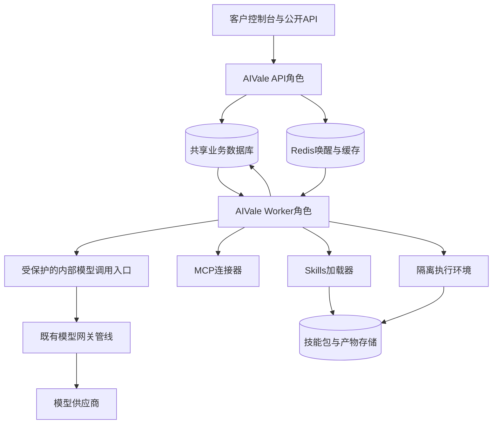
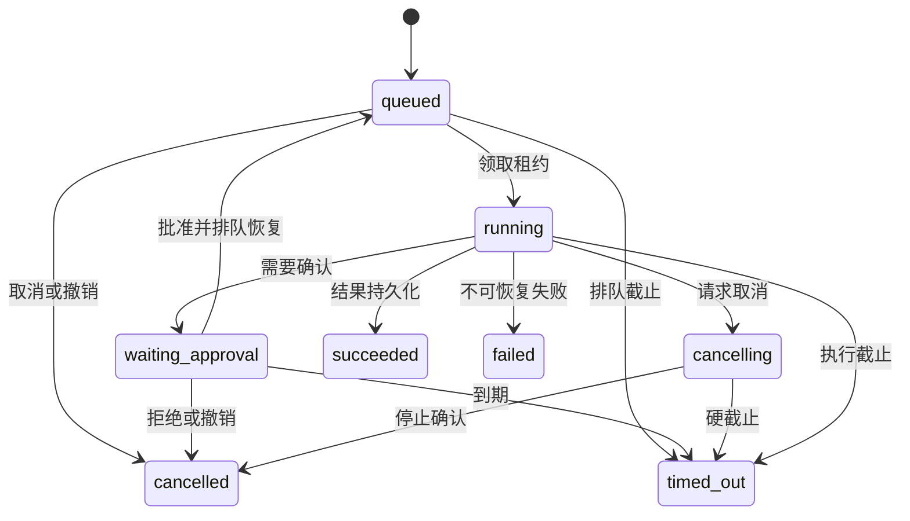
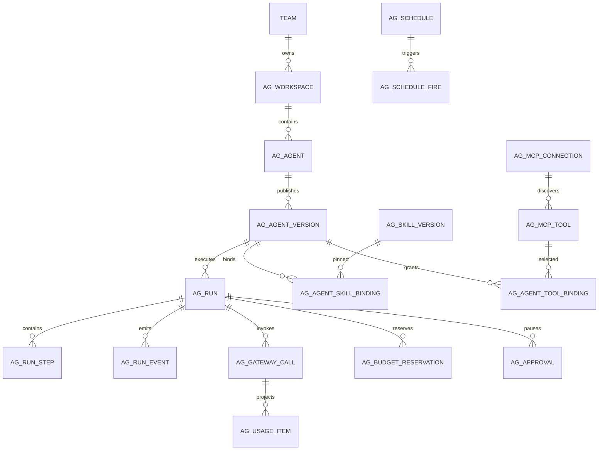

# AIVale 一体化智能体平台详细设计与分批开发计划

版本：1.20 独立工作台编辑与归档工作区

日期：2026 年 11 月 5 日

适用项目：`E:/Project/AIVale/new-api`

交付范围：设计、实施计划与已实现边界；仅任务复选框和对应代码、验证证据共同确认的内容视为已完成。各阶段尚未完成的页面、接口和运行能力仍是规划。

**文档规模**：原规划含29张数据表、129项主接口及3项补充子路由、3项扩展预留接口、23个业务页面、12个开发阶段、108个主任务及若干子任务、36个建议批次；P01-T08 另增加个人工作区表及读写接口。

**目录与执行入口**

- [第1章 使用方法与产品边界](#chapter-1)
- [第2章 当前项目基线与可复用范围](#chapter-2)
- [第3章 整体架构与进程边界](#chapter-3)
- [第4章 领域规则与执行语义](#chapter-4)
- [第5章 数据库详细设计](#chapter-5)
- [第6章 接口详细设计](#chapter-6)
- [第7章 页面和交互详细设计](#chapter-7)
- [第8章 代码模块与实施落点](#chapter-8)
- [第9章 权限 安全 计费与运行治理](#chapter-9)
- [第10章 测试门禁与发布条件](#chapter-10)
- [第11章 分阶段开发任务](#chapter-11)
- [第12章 批次执行与交付管理](#chapter-12)
- [第13章 决策记录 风险与参考资料](#chapter-13)

建议开发时同时打开第5章数据字典、第6章接口契约和第11章当前任务；第12章提供36个建议批次及交付模板。

<a id="chapter-1"></a>

## 1 使用方法与产品边界

### 1.1 目标与设计结论

在现有 AIVale 代码仓库内增加智能体开发、Skills 仓库、MCP 工具接入、运行调度和治理。客户从站点顶部导航进入与“模型广场”并列的独立“智能体工作台”，复用现有身份、Team、API Key 与账务体系。采用同仓库模块化单体：现有 Gin 服务承载控制面与模型网关，同仓库 worker 承载执行编排，客户脚本进入隔离执行环境。初期共用业务数据库与 Redis，不要求引入一组独立微服务。

本方案以 Go + Eino 作为原生运行路线，不把 Dify 或 Coze 的控制台整体合并进仓库。现有 Dify/Coze 调用适配继续保留；以后若新增外部引擎适配，必须遵守相同 Run、事件、权限和计量契约，不影响本方案首期闭环。

### 1.2 怎样按本文分批开发

1. 开发前先读第 2 至第 4 章，理解现有能力、模块边界和状态语义。
2. 涉及数据库读第 5 章；涉及接口读第 6 章；涉及页面读第 7 章。
3. 第 8 至第 10 章定义代码位置、安全计费规则和验收门禁。它们适用于所有阶段。
4. 第 11 章的 `Pxx-Txx` 是可派发的小任务。按依赖完成任务，每次推荐只选 1 至 3 项，不直接要求“完成整个阶段”。
5. 每个任务完成后记录实际改动、验证证据、已知限制和回退方式，更新复选框。任何依赖未完成的任务不得标为完成。
6. 第 12 章提供批次示例和发布验收，第 13 章记录可调整默认值与来源。需求变化时先改共同契约，再安排实现任务。

任务中的“小”指边界清楚、结果可验证、可以独立评审及回退；有数据库、鉴权或计费影响时，所需验证属于该任务的一部分，不能为了缩短任务而省略。

### 1.3 交付层次

| 交付层次 | 能力范围 | 允许的用户与操作 |
| --- | --- | --- |
| L0 内部工程验证 | P00 至 P03，工作区、Agent 版本、单模型运行、事件与基础预算 | 开发和指定内部测试账户；不开放客户任意工具和脚本 |
| L1 受控客户试用 | P04 至 P06完成，远程只读 MCP、指令类 Skills、可靠运行和核账 | 受邀客户、审核后的服务和技能；通过租户与计费门禁后才可试用 |
| L2 任务与文件自动化 | P07 至 P08完成，触发器、审批、隔离脚本和产物 | 已配置风险策略、配额和隔离执行的客户 |
| L3 完整开发工作台 | P09 至 P10完成，流程画布、有限多 Agent、检索与评测 | 经治理的开发团队；不承诺任意代码或无限递归 |
| L4 正式商业发布 | P11完成，备份、演练、容量、审计、运营流程 | 按套餐和租户策略放量 |

L1 可以先形成可收费的受控产品，但必须具备合同与授权、计费对账和事故处理能力。L3 功能全部完成不是 L1 的前提；P11 中与实际开放能力相关的上线检查也不能因阶段编号靠后而延期。

### 1.4 首期明确采用的产品默认值

| 决策 | 首期约定 | 后续扩展条件 |
| --- | --- | --- |
| 租户 | `Team` 是租户及账务主体；工作区属于一个 Team | 客户确有跨组织协作需求时设计多团队成员迁移 |
| 成员 | 保留现有一个用户最多属于一个 Team；工作区成员是团队成员子集 | 不在本次首批改账户和邀请全流程 |
| 产品入口 | “智能体工作台”紧随“模型广场”，拥有独立页面和工作区导航；控制台仍负责原网关与账户管理 | 后续功能只扩展工作台内部导航，不继续增加站点顶层入口 |
| 个人用户 | 可以继续使用原模型平台；无需加入 Team 即可主动创建个人工作区并维护名称、描述 | 个人工作区仅当前账号可见，不授予团队资源访问或运行权限，不能静默改为扣个人钱包 |
| 运行引擎 | Eino；平台状态与执行契约由 AIVale 控制 | Python 特有需求出现后再评估其他引擎 |
| 编辑方式 | 先配置表单，后流程画布 | 画布只能编辑已有后端支持的节点语义 |
| 技能 | 标准目录包；先只读指令及参考文件，再开放脚本 | 可执行文件必须通过 P08 隔离能力及策略检查 |
| MCP | 先受控远程 HTTP 工具；只读工具也要限制数据范围和出站目标 | 受限客户自助HTTP接入在本计划内；OAuth、stdio及对外MCP发布列为后续独立增量 |
| 文件 | 本地文件存储适配器用于单机开发；生产使用支持共享访问的对象存储 | 多 worker 不依赖某个节点的本地绝对路径 |
| 费用 | 模型费用由现有网关结算；Agent 层做预算与关联展示 | 工具和沙箱额外收费需独立费项契约和幂等结算 |
| 长任务 | 数据库为运行事实，Redis用于唤醒与缓存；至少一次投递 | 跨天复杂补偿足够多时再评估 Temporal，首期不依赖它 |
| 发布 | 每次发布新建不可变版本；旧版本可追踪 | 回滚是切换发布指针，不覆盖已发生任务的版本 |

### 1.5 首期不纳入默认承诺的能力

公共技能市场交易分成、任意客户镜像执行、任意内网 MCP 地址、自主无限递归、多组织成员体系、完整自建向量数据库平台、GPU 调度、所有模型协议的 Agent 能力完全等价、通过 Chat Completions 完整表达审批和长任务，都不作为 L1 完成条件。它们有独立边界和成本，应在对应能力稳定后增加任务。

### 1.6 P00-T03 数据库验证范围调整

2026年11月2日，按用户“当前项目使用MySQL，仅使用它就可以了”的明确要求，P00-T03只建立并运行真实MySQL验证环境。本文原有“三库”“SQLite/MySQL/PostgreSQL”门禁描述，在本次P00-T03任务中按此范围执行；不因未建立SQLite或PostgreSQL环境而阻塞本任务，也不据此宣称三库兼容已验证。后续生产模型、迁移、驱动或事务变更仍须逐项确认适用的仓库要求及用户范围，不能沿用本次结果代替新的验证。

本次采用本机MySQL Server 26.7.0程序启动独立实例，使用专用数据目录、随机本机端口、测试账户及四个隔离库，分别覆盖fresh主库/日志库和upgrade主库/日志库。不读取业务连接配置，不连接已有业务数据库，不调整已有MySQL服务，不把该实际版本的结果外推到MySQL 5.7.8、8.2或其他版本。

升级样例使用当前分支已知发布标签祖先`v1.0.0-rc.42`（`6370b29424168039e94d40d610191e7d2e65dbf4`）的脱敏最小schema投影，显式满足现有BIGINT额度字段前提。它只用于验证选定用户、个人Token、渠道及日志数据的保留和当前结构补齐，不是完整旧版数据库dump，也不代表全部历史生产升级路径。该旧版尚无Team表和Token.TeamId；Team、成员和团队Token在当前迁移后创建并参与重启保留验证，不伪造为旧版存量数据。具体来源、覆盖字段及未覆盖路径须随实际结果记录。

<a id="chapter-2"></a>

## 2 当前项目基线与可复用范围

### 2.1 代码基线

| 领域 | 已有事实及位置 | 复用方式 | 必须补齐 |
| --- | --- | --- | --- |
| 后端框架 | [go.mod](E:/Project/AIVale/new-api/go.mod:4)，Go 1.26、Gin、GORM | 保留现有管理 API、启动与配置习惯 | worker启动角色和Agent模块 |
| 前端框架 | [package.json](E:/Project/AIVale/new-api/web/package.json:66)，React、TanStack、Rsbuild；已有React Flow依赖 | 同站点新增独立工作台布局，复用公共导航、会话与组件 | Agent、Skills、MCP及Run页面 |
| 网关 | [relay-router.go](E:/Project/AIVale/new-api/router/relay-router.go:74) | 完整复用Token鉴权、路由、限流与结算管线 | 可信Run上下文、调用账本与用量关联 |
| 团队 | [team.go](E:/Project/AIVale/new-api/model/team.go:19) | Team账务、成员关系与现有钱包 | Workspace角色与资源边界 |
| 模型Token | [token.go](E:/Project/AIVale/new-api/model/token.go:17) | 额度、模型范围、到期与TeamId | Agent显式授权，默认旧Key无Agent权限 |
| 权限框架 | [enforcer.go](E:/Project/AIVale/new-api/service/authz/enforcer.go:19) | 复用资源动作注册、审计基础 | 工作区归属校验；现有Casbin不是现成租户域授权 |
| 站点导航 | 现有模型广场、公共站点头部和控制台顶部导航 | 共用受能力探测控制的工作台入口，放在模型广场之后 | 工作台独立的工作区切换、内部导航及缓存隔离 |
| 系统任务 | [system_task.go](E:/Project/AIVale/new-api/service/system_task.go:26) | 参考租约、抢占与运行历史经验 | 客户Run必须有独立队列和状态，不复用维护任务类型锁 |
| 产物存储 | [task_artifact_store.go](E:/Project/AIVale/new-api/service/task_artifact_store.go:60)目前返回禁用实现 | 可参考接口边界 | 实际存储、授权下载、清理与配额 |
| 计费 | [billing_session.go](E:/Project/AIVale/new-api/service/billing_session.go:23) | 保留既有资金与Token结算 | 跨进程调用事实、未知结果对账；现有进程内幂等不等于持久化幂等 |
| Dify/Coze | [Dify适配](E:/Project/AIVale/new-api/relay/channel/dify/adaptor.go:48)等 | 原有已发布应用调用 | 不把这些适配器视为Agent设计和发布系统 |

源码存在表示可复用的实现基础，不代表已经通过本设计的多租户和生产验收。

### 2.2 仓库开发约束

- 原业务 JSON 编解码继续使用 `common` 包装函数；独立 `relaykit`、`tokenkit` 保持模块独立性。
- 不更换现有数据库、身份系统、计费单位、组件库或路由框架来实现本需求。
- 新核心表遵循仓库SQLite、MySQL和PostgreSQL兼容编码约束；涉及数据库的每个变更按G-DB确认适用验证范围。P00-T03按第1.6节明确只验证MySQL，不以其结果代表其他方言或最低版本通过。
- 前端使用现有共享表格、表单、对话框、错误处理、国际化和格式化工具；新增画布前复用已安装能力。
- 费用和额度处理遵守 [.agents/rules/billing.md](E:/Project/AIVale/new-api/.agents/rules/billing.md)。改动动态价格表达式时另读其专用说明。
- 供应商JavaScript任务插件不是客户Skills运行环境。若改插件契约，额外遵守现有插件API说明；本方案首期不依赖修改该契约。
- 项目现有标识、版权及许可证保持其规定。对外运营修改版本须落实AGPL对应义务或取得覆盖所需用途的商业授权。

### 2.3 不应在起步阶段做的重构

不整体改写relay、不把所有旧表统一更名、不迁移全部登录逻辑、不将已有模型Token自动赋予Agent管理权、不将现有系统任务改成通用客户作业队列、不升级所有前端依赖、不以新Agent需求为由先拆分全部微服务。必要的公共接口抽取只在出现具体调用点和回归保护后进行。

<a id="chapter-3"></a>

## 3 整体架构与进程边界

### 3.1 部署拓扑



### 3.2 运行角色

| 角色 | 必需职责 | 不承担的职责 | 权限边界 |
| --- | --- | --- | --- |
| API | 浏览器会话、控制面CRUD、发布、公开Run入口、网关、事件读取 | 不在请求处理器内等待完整Agent任务结束 | 可解析模型父Token、执行服务端授权和资金结算 |
| Worker | 领取Run、执行Eino、加载Skills、MCP调用、写步骤事件与检查点 | 不加载客户代码到Go宿主；不向模型暴露管理凭据 | 以服务身份访问运行元数据，按Run取最少凭据 |
| Sandbox | 执行获准脚本、处理临时文件、返回受限产物 | 不访问主数据库、宿主Docker socket或平台配置 | 按任务分配CPU/内存/磁盘/网络/时间上限 |
| 调度扫描器 | 计算到期触发并原子创建fire+run+outbox | 不直接执行Agent，也不按每次扫描重复生成任务 | 通过数据库唯一约束和租约协调多副本 |

API和Worker复用同一代码版本及镜像，提出新增运行角色参数（名称在P00冻结）。不要把现有master/slave节点选项当成Agent角色。默认生产由API负责兼容性检查、单独的受控迁移入口负责迁移，worker启动只验证schema版本，不竞争AutoMigrate。所有角色支持优雅退出：停止接新任务，结束可安全完成的步骤，保留检查点与租约状态。

开发环境可以用一个Compose启动API、Worker、数据库、Redis；对不执行客户脚本的本地调试可提供组合角色，但生产放量必须分离worker资源并满足Sandbox策略。角色分离不改变客户看到的一体化控制台。

### 3.3 模块依赖方向

`router → controller → service/<domain> → model`。执行模块依赖稳定的模型、技能、MCP、产物接口；provider adaptor继续位于现有relay层。业务模块不得互相导入形成循环；跨域操作由application service编排，事务在明确的业务入口开启。

Eino被封装在Agent执行适配层。平台自己的Run状态、事件类型、ID和JSON契约不直接暴露Eino内部类型；引擎升级需经过序列化、检查点和事件回归。先冻结一个经过验证的版本，不在运行时拉取latest依赖。

### 3.4 模型调用入口

1. 浏览器运行必须明确选择用户有权使用且属于当前Team的`funding_token_id`；公开API的来访模型Token是父Token，不能通过请求体切换为更高权限Token。
2. API保存Token ID引用，不把完整Token写进Run配置、事件、Prompt或任务消息。
3. Worker每个模型调用先申请短期Run能力凭据。凭据绑定Run、step、逻辑call、当前租约代次、父Token、模型范围和到期时间，并带audience及重放控制。
4. 受保护的内部入口验证worker身份和能力凭据，重新查验Run状态、Team、Workspace、父Token状态及模型权限；客户端传入的Team、费用或内部请求头全部不作为授权依据。
5. 内部入口按已验证的Token ID解析父Key，进入既有网关完整管线。首期可通过内部HTTP封装保留已有行为；是否抽成共享服务函数由后续性能证据决定。
6. 服务端生成`gateway_request_id`，与`logical_call_id`及具体`attempt`关联。不得假定外部传入的request_id会被现有网关接受。
7. 模型消耗由网关结算；Worker只接收脱敏结果、用量事实和调用关联，不接收上游模型Key。

内部入口必须独立于公网路由暴露，或有明确的服务身份认证和网络访问控制。仅检查某个自定义HTTP头不构成服务身份认证。

### 3.5 存储分工

业务数据库保存资源定义、版本、运行状态、租约、审批、计费关联和审计索引；对象存储保存技能文件、输入输出产物与大体积记录；Redis仅用于唤醒、限流和短期缓存。Redis丢失后能通过数据库扫描恢复待执行任务，不能因此丢失Run。

已有独立日志库可能使用ClickHouse，它不能承担Run事务、作业抢占或财务唯一约束。事件和账本的业务事实先写主数据库，再按需异步投影到分析日志系统。

<a id="chapter-4"></a>

## 4 领域规则与执行语义

### 4.1 资源关系

Team拥有多个Workspace。Workspace拥有Agent、Skill、MCP连接、凭据、运行、会话及流程。Agent发布版本引用固定Skill版本与工具配置快照。Run只能引用同Workspace已发布版本，内部调试则生成不可变调试快照并标记`mode=debug`，不能让运行中的草稿随编辑变化。

平台共享模板采用显式复制或经过授权的只读引用；首期不允许通过猜测跨Workspace ID复用资源。复制Skill或Agent不复制源工作区凭据。公开市场以后增加可见性和订阅策略，不把共享状态硬塞成绕过租户的特例。

### 4.2 Agent生命周期

| 操作 | 规则 | 可观察结果 |
| --- | --- | --- |
| 创建 | 新建草稿，填写名称、模型策略、指令与默认预算 | 草稿可编辑但公开API不可运行 |
| 保存 | 带修订号做乐观并发控制 | 过期revision返回冲突，保留本地未保存内容 |
| 调试 | 冻结当前草稿、绑定有权使用的资金Token | 产生独立debug Run，显示实际费用 |
| 发布 | 验证模型、Skill版本、MCP schema、权限、输入输出及预算 | 创建新版本与内容摘要，原子切换发布指针 |
| 回滚 | 选择仍有效的旧版本，重新进行当前策略校验 | 新请求使用旧版本；已运行任务保留原版本 |
| 停用 | 禁止新Run，按策略取消活动Run | 所有入口一致，不仅隐藏页面按钮 |
| 删除 | 先归档；有Run或版本引用不能直接级联物理删除 | 历史可追踪，后续按保留政策清理 |

发布版本包含执行所需的完整可复现配置，但不冻结密钥明文和永久权限。当前凭据撤销、工具禁用、用户移出团队、技能安全封禁始终优先于历史版本快照。

### 4.3 Run状态机



| 状态 | 含义 | 允许动作 |
| --- | --- | --- |
| queued | 已持久化，等待worker | 查询、取消；只能被有效租约领取 |
| running | 正在执行或恢复 | 查询、订阅事件、请求取消；适用实时撤销 |
| waiting_approval | 检查点已保存，等待指定审批 | 批准、拒绝、取消；不占worker执行槽 |
| cancelling | 已阻止新步骤，正在终止当前执行 | 查询；不得再启动模型或写工具 |
| succeeded | 最终结果已持久化 | 读取结果、查看费用；终态不再恢复 |
| failed | 已失败，保留原因与可用产物 | 查询；重试需显式创建新Run，未知结果先核查 |
| cancelled | 已停止，不代表之前外部操作被撤回 | 查询，按已发生消耗计费 |
| timed_out | 已超过排队/审批/执行截止 | 查询，不自动退款已发生调用 |

数据库CAS控制每个状态变更。完成与取消竞争时以提交的合法状态转换为准：如果取消先赢得CAS，不再发布成功终态；如果成功已提交，取消接口返回当前终态且不重写。租约失效并不意味着立即可重跑：先检查当前步骤是否有外部副作用或未知结果，再决定重新入队或失败待处理。

Run状态与费用状态分开。Run可成功但计费处于`reconciliation_required`，页面必须明确标识“费用待核对”；不能把待核对当作零费用。步骤结果未知使用步骤状态/错误码表达，不随意扩展上述公开Run枚举。

### 4.4 一次执行的标准步骤

1. 鉴权并确定Workspace及资金Token；冻结执行版本，校验输入schema和资源授权。
2. 在事务中写幂等键、Run、初始事件及outbox，提交后才返回Run ID。相同幂等键和相同请求返回同一Run；不同请求体返回409。
3. outbox派发唤醒；worker以条件更新领取Run并递增fencing代次。租约持有人只能使用当前代次写状态。
4. 加载固定版本及检查点；检查当前授权、总截止时间、并发与预算，不符合则记录明确终态。
5. 为下一次模型/工具调用生成稳定逻辑step与call ID；若需人工确认，先保存参数摘要和检查点，进入waiting_approval并释放执行槽，尚不调用远端。
6. 无需审批或获得有效批准后，重新校验权限、版本与参数digest，写执行意图并原子预留预算，然后调用模型或工具。
7. 结果先持久化，再写可向用户展示的完成事件，再推进下个步骤；批准不能跨参数、版本或审批有效期复用。
8. 成功后原子保存结果摘要、产物引用、终态及结束事件。费用投影可以异步补齐，但必须可追踪并最终核对。

### 4.5 步骤与恢复语义

| 步骤类型 | 自动重试条件 | 未知结果处理 |
| --- | --- | --- |
| 纯本地转换 | 输入和版本固定、无外部副作用 | 从已保存输入重算 |
| 只读工具 | 工具被平台确认可重试，结果新鲜度可接受 | 标记重试次数和时间；不能声称结果必然相同 |
| 模型调用 | 确认尚未发送，或供应商提供可验证幂等/查询能力 | 已发送但结果未知时不自动重发，保留费用预留并核查 |
| 外部写工具 | 明确幂等键受支持或能查询已发生结果 | `outcome_unknown`，停止流程并等待人工处置 |
| 沙箱脚本 | 纯文件转换且输出未发布，或脚本自身有明确幂等语义 | 有外部写权限时按写工具处理 |
| 人工批准 | 针对固定approval ID及参数digest | 重复审批幂等，过期/参数变化拒绝旧批准 |

租约fencing能防止旧worker覆写数据库，不能自动撤销它已发出的网络请求。若旧worker可能仍执行外部写动作，禁止新的worker同时补跑该动作。以连接取消、执行隔离终止和外部幂等回执共同控制该窗口，不宣称exactly-once。

### 4.6 事件与可观测内容

Run事件至少包括创建、排队、开始、模型输出片段、步骤开始/结束、工具调用摘要、审批请求/决定、产物生成、预算变化、错误及终态。每个Run有单调递增seq；落库后再发送，SSE可通过seq重放。

终态和审计事件不能丢；高频文本片段允许按短间隔聚合，避免逐token写库。重连时以持久化事件和最终输出快照修复显示。只记录用户可见输出、调用参数的授权视图和执行摘要；不记录或展示模型隐藏推理链，不把工具返回当成更高优先级指令。

### 4.7 Skills加载与包生命周期

导入来源为ZIP或Git的固定commit。拉取在受控下载服务中进行，不接受客户任意shell命令。校验名称、根目录、`SKILL.md`前置字段、路径、文件数量、大小、压缩展开比例、符号链接、二进制及执行依赖；无效包保留可读错误但不能发布。

生成按规范化路径排序的文件manifest和内容digest；发布后文件不可变。Agent绑定具体SkillVersion。先给模型名称和描述，激活时加载正文，参考文件按需读取且总量受限。指令不能授予工具权限；`allowed-tools`只是作者声明，平台权限取交集。

技能禁用分为“禁止新绑定”和“安全封禁”。安全封禁影响现有发布版本的新调用和正在执行的下一个检查点，并产生审计记录；已经完成的外部动作不可能通过禁用自动撤销。

### 4.8 MCP能力边界

连接器分别处理连接测试、认证、协议协商、工具发现、schema校验和调用。发现工具元数据不等于授权可执行。工具目录按Workspace、连接、认证主体缓存，禁止跨客户共用带权限的发现结果。

模型看到的是当前Agent获准工具子集。每次调用在服务端再校验工具授权、输入schema、风险策略、输出大小、并发、截止和出站目标。工具schema改变后形成新快照；旧Agent版本继续绑定旧摘要，但服务端不兼容时显式要求重新验证，不静默按新schema运行。

首期远程HTTP使用官方Go SDK适配并做版本兼容测试；stdio MCP后续接入时只能作为受控进程在隔离环境中启动；其具体实现不计入本次108任务。将AIVale自身发布为MCP Server与消费第三方MCP是两项功能，前者后期单独增加导出资源授权和API，不在初期混为一项开关。

### 4.9 会话与记忆

conversation归属Workspace与Agent。Run记录输入消息和所用上下文快照；同一会话首期只允许一个活动Run，第二个返回明确冲突，避免两条消息并发覆盖历史。多个独立会话可并发。

会话历史为短期上下文，长期记忆为另一个需要授权和保留策略的能力。首期不自动把所有工具结果写入长期记忆，不跨用户共享会话。输入文件与检索片段必须在每次读取时验证归属；只传授权内容给模型。

### 4.10 定时与Webhook

Schedule固定AgentVersion、输入模板、时区和资金Token引用。保存时校验cron及下一次触发时间；发生夏令时变化时使用明确策略：不存在的本地时间跳过，重复时间按UTC计划实例去重。默认时区可用Asia/Shanghai，但存储采用IANA时区而非固定UTC偏移。

每个计划时刻使用唯一fire键，事务中写fire、Run和outbox，重复扫描只创建一次。首期并发策略默认为skip_if_running，前一次未结束则记录skipped；补跑默认跳过历史，只允许有界一次补跑策略，避免服务恢复后洪峰。

Webhook采用独立hook secret、原始body签名、时间戳和事件ID防重放；不接受请求体指定任意租户或资金Token。入站只创建持久化Run并快速应答，不等待执行。签名轮换设短暂双Key窗口，记录使用的Key版本。

### 4.11 工作流与多Agent

第一版工作流只支持有向无环图。P09节点类型为start、end、model、tool、condition、transform、approval；agent节点到P10才启用，脚本节点依赖P08。输入输出用JSON schema，显式声明边的数据映射；发布前检查缺失引用、循环、不可达节点、类型不匹配和未授权工具。

graph_json带schema_version，执行计划按版本编译，节点执行映射为RunStep。并行采用有界fan-out；join需声明等待全部还是接受部分失败。节点默认不因前端画布保存而执行。流程执行先支持配置导入和后端验证，再增加React Flow画布。

多Agent采用固定父子关系和显式职责，最大深度、子任务数、总模型次数、总预算均受父Run约束。子Agent不能扩大父级工具或凭据权限，不允许模型自由创建无限子Agent。P10引入独立子Run，以parent_run_id和root_run_id记录关系；所有分支向根Run预算原子预留，子Run记录实际调用明细，父级仅聚合展示，不产生第二份客户模型账单。


### 4.12 工作流图契约与节点执行规则

P09冻结graph_json.schema_version=1。节点ID为图内唯一ASCII标识，发布版本中稳定；显示名和坐标可编辑，但坐标不参与执行语义digest。边必须指向存在的端口，不允许由运行时模型任意创建新节点或修改图。

| 节点类型 | 必需配置 | 输入与输出 | 执行及失败规则 | 阶段 |
| --- | --- | --- | --- | --- |
| start | input_schema | Run输入→output | 每图恰好一个start；类型不符拒绝创建Run | P09 |
| model | model_policy、instructions、输入映射、output_schema | 授权上下文→text/structured output | 复用模型调用账本和预算；结构化结果无效时按节点策略失败，不无限重问 | P09 |
| tool | 固定tool binding、参数映射 | 已验证参数→结构化结果/产物引用 | 调用前实时鉴权；需要审批时暂停；未知结果不能自动重试 | P09 |
| condition | 比较表达式、true/false两端口 | 已完成前驱的字段→选定出口 | 支持eq/ne/gt/gte/lt/lte/exists/in及有界and/or；不执行任意表达式代码 | P09 |
| transform | 字段赋值与允许的确定性转换 | JSON→JSON | 仅白名单映射、合并、取字段、字符串格式化；无网络、文件和任意脚本 | P09 |
| approval | 说明、参数摘要、审批策略、有效期 | 当前业务数据→批准后原数据 | 一次审批只允许继续固定动作；拒绝取消当前Run，不绕过工具级审批 | P09 |
| end | output_schema、字段映射 | 活跃路径结果→Run结果 | 每图恰好一个逻辑end；所需输入缺失时报错，不用空值掩盖失败 | P09 |
| agent | agent_version_id、输入映射、子限额 | 显式子输入→子Run结果 | 同Workspace、固定版本、根预算、深度和数量限制 | P10 |
| script | runtime_profile、已发布Skill脚本引用、文件映射 | 授权文件/参数→产物和结构化结果 | 只有P08隔离执行验收且节点适配完成后启用；不能输入任意宿主命令 | P09且依赖P08 |

数据引用采用显式结构 `{from_node, pointer}`，pointer按JSON Pointer路径解释；Run输入用from_node=`$input`。不执行`${...}`中的任意JavaScript、Go模板或shell。发布时验证引用节点是合法前驱、字段类型相容；运行时仍验证实际类型。

每个普通节点可声明`join_policy=all_selected`：等待本次执行中实际被选中路径的全部前驱成功。条件节点未选择的出口沿该支路标记skipped；skipped不是失败，不能使汇合节点永远等待。某节点同时收到活跃和跳过支路时只等待活跃支路，输入映射不可要求读取被跳过节点的必需字段。发布检查应发现这种不确定输入并要求默认值或分支后的统一转换节点。

P09允许固定DAG的并行分支，默认最大同时执行节点数为4且不超过Run/Team并发限制；不支持运行时无限fan-out。节点失败策略首期为fail_run，终止新节点、取消仍在执行的兄弟分支并保留实际费用；ignore_failure、竞速取首结果、补偿事务和循环都不默认开放。审批节点等待时释放worker槽，但不能把已在执行的其他外部写操作当作已停止。

节点状态映射到Step，node_id、执行attempt与Run ID共同定位执行。恢复时从持久化状态找ready节点；已成功节点读取既有结果，已跳过节点不重新执行，有未知副作用的节点使Run进入核查失败。记录真实节点时长而非前端动画进度。

最小图样例用于P09-T01至T04的合同测试，model配置引用的是同一发布版本中冻结的节点配置，不能在执行时取最新Agent草稿：

```json
{
  "schema_version": 1,
  "max_parallel_nodes": 1,
  "nodes": [
    {"id": "start", "type": "start", "config": {"input_schema": {"type": "object", "properties": {"question": {"type": "string"}}, "required": ["question"], "additionalProperties": false}}},
    {"id": "answer", "type": "model", "join_policy": "all_selected", "config": {"model_policy": {"model": "platform-model-name", "max_output_tokens": 1024}, "instructions": "根据输入回答问题。", "input_mapping": {"question": {"from_node": "$input", "pointer": "/question"}}, "output_schema": {"type": "object", "properties": {"text": {"type": "string"}}, "required": ["text"]}}},
    {"id": "end", "type": "end", "join_policy": "all_selected", "config": {"output_mapping": {"answer": {"from_node": "answer", "pointer": "/text"}}, "output_schema": {"type": "object", "properties": {"answer": {"type": "string"}}, "required": ["answer"]}}}
  ],
  "edges": [
    {"source": "start", "source_port": "output", "target": "answer", "target_port": "input"},
    {"source": "answer", "source_port": "output", "target": "end", "target_port": "input"}
  ]
}
```

对该样例至少测试缺失question、重复node ID、不存在的source_port、引用未来节点、环、非法model、max_output_tokens超限、模型返回不符合schema、保存草稿后发布引用漂移和运行中取消。前端画布仅编辑这个契约的可视化形式，不能绕过后端验证。


### 4.13 父Run协调等待与单槽并发

P10的父Agent及评测根Run采用持久化协调等待，不在占用唯一执行槽时同步等待子Run。事务保存待等待的子Run ID、协调Step和检查点，把父Run.execution_phase置waiting_children，结转active_elapsed_ms并清空active_started_at，释放Workspace执行槽及worker租约；公开status仍为running，UI显示“等待子任务”。

子Run终态通过outbox发出可去重的parent_wakeup。协调器检查所有选定子任务是否满足完成/失败策略，再以CAS把父Run置queued、phase=ready，设置不超过总deadline的有界排队窗口并投递唤醒。重复唤醒不得重复创建子任务或重复推进节点。租约过期扫描器跳过无活动lease的waiting_children父Run，总deadline、取消、授权撤销检查继续生效。

等待子任务期间父Run不累计实际执行时长，子Run各自计时且所有外部调用共享根费用与次数上限；总墙钟deadline不能延长。子任务尚未达到唤醒条件时不抢占执行槽，也不重复重新入队轮询。父取消传递到后代并阻止新后代创建，协调器负责收敛终态。

必须用Workspace并发=1验证父Agent→子Agent→返回，以及eval根Run→多个顺序样本→报告；两种流程均可完成，不因父占槽而永久排队。多层委派同样使用此规则，不能只解决第一层。

<a id="chapter-5"></a>

## 5 数据库详细设计

### 5.1 数据边界与不可变规则

本章定义 30 张新增业务表及其数据契约，不要求一次创建全部表。每张表的引入阶段与第 11 章任务对应；迁移通常按 2 至 4 张强相关表拆批，独立实体可以单表成批。核心身份、模型 Token、团队余额、订阅、渠道和模型价格仍使用现有表。Agent 子系统不建立第二套用户、钱包或模型价格表。

1. `team_id` 是租户与账务归属；`workspace_id` 是该租户下的资源和权限范围。创建团队工作区必须属于 Team。个人模型 Token 不因新增 Agent 模块而自动转为团队 Token。
2. 团队工作区的资源查询同时带经过鉴权确定的 `team_id`、`workspace_id`。不得先按任意资源 ID 查询后仅凭前端隐藏按钮隔离客户。个人工作区的元数据仅按实时管理会话解析出的账号查询，不接受调用方指定所有者。创建子资源时校验父子归属一致，任务执行时再次校验。
3. Team 的已有成员关系保持“一名用户至多一个团队”；除 Team owner 隐式 admin 外，用户必须有显式有效 Workspace 成员记录。团队成员退出、账号禁用、Token 撤销、工具连接禁用，均优先于发布时的权限快照。
4. Agent 发布版本、已发布 Skill 的内容和 Workflow 图定义不可原地覆盖。回滚是修改当前发布指针或发布一个新版本；历史运行仍指向原版本。版本可被标记撤销，撤销不改写其历史内容。
5. Run 保存输入快照、执行身份、发布版本、预算和运行状态。队列中仅传递 Run ID 与消息类型，完整状态以主数据库为准。
6. 模型网关是模型实际扣费的唯一事实来源。Agent 用量表是运行维度的关联与展示投影；Run 预算预留不是 Team 钱包预扣，不可重复扣减现有余额。
7. 数据库只保存文件元数据与不可猜测的存储键。技能包、附件、检查点大对象和产物字节放受控文件存储；不得把数据库主键拼成可公开下载的目录。

### 5.2 类型与公共字段约定

#### 5.2.1 类型和默认值

| 写法 | 存储与实现约定 |
| --- | --- |
| `ID` | 有符号 64 位整数，由 GORM 的主键机制生成；外部 API 使用十进制字符串。引用旧 `users/teams/tokens` 时按旧表实际类型适配并检测转换边界。 |
| `I64` | 有符号 64 位整数；额度、计数、时间计算需边界检查，禁止由不受限浮点数直接转换。 |
| `I32` | 非负计数或枚举辅助值，应用校验范围。 |
| `V(n)` | 最多 n 字符的字符串。代码、slug、摘要使用 ASCII；用户可见名称允许 UTF-8。 |
| `H64` | `V(64)`，小写 SHA-256 十六进制摘要。 |
| `TXT` | 跨数据库 TEXT；不依赖 JSON/JSONB 类型、JSON 路径索引或数据库内 JSON 修改。 |
| `MS` | I64，UTC Unix 毫秒。旧表的 Unix 秒字段不改语义，适配层显式转换；禁止混用。 |
| `QUOTA` | I64，沿用现有平台额度单位；API 用十进制字符串。涉及币种展示时复用现有换算与格式化。 |
| `N / Y` | 不可空 / 可空。未知时间、未关联 ID 使用 NULL，不用 0 伪装有效对象。 |
| `服务赋值` | 应用创建记录前必须赋值，不设置数据库默认。特别是 TEXT 不依赖 MySQL 5.7 不支持的默认值。 |

JSON 统一经过 `common.Marshal/Unmarshal`，校验固定 `schema_version`，拒绝未知的安全敏感字段和超出深度、数组长度限制的内容。单个 `TXT` 默认最多 60 KiB UTF-8；事件载荷最多 16 KiB，单段指令最多 32 KiB，凭据密文最多 16 KiB。更大内容转为 `Artifact` 并保存摘要，避免 MySQL TEXT 的容量边界及数据库热点。具体阈值由配置控制，但不得超过对应列的安全上限。

P00-T02冻结新增API的序列化边界：ID必须为`[1-9][0-9]*`的规范十进制字符串，且不大于`9223372036854775807`；拒绝0、前导零、符号、空白、指数、浮点、数字JSON及溢出。旧表中的0哨兵保持原语义，新接口对未知引用使用null而非ID字符串0。quota使用无前导零的非负十进制字符串且不超过int64正上界，零是合法计量值，不等于允许零预算执行收费模型。UTC毫秒、事件seq、游标及revision的JSON数字必须在JavaScript安全整数范围内；seq与revision至少1、after_seq至少0，超界拒绝，不舍入。数据库I64存储能力不等于JSON数字可无损表达其全部范围。

唯一键中的名称先规范化，避免 SQLite、MySQL、PostgreSQL 的排序规则差异。Workspace/Agent/Skill slug 采用小写 ASCII，最长 64；MCP 工具名可能较长，另存 `tool_name_hash` 作唯一索引。索引名最长 55 字符，组合索引避免大段 UTF-8 名称。类型与唯一性仍须在三种真实数据库上验证。

#### 5.2.2 公共字段组合

后续每张表标注使用的字段组，字段组就是该表实际字段的一部分；“不使用”表示不能自动添加。这样避免表定义中重复抄写公共字段而产生差异。

| 字段组 | 字段 | 类型 | 空 | 默认 | 用途 |
| --- | --- | --- | --- | --- | --- |
| B | `id` | ID | N | GORM 生成 | 主键 |
| B | `created_at` | MS | N | 服务赋值 | 创建时间 |
| U | `updated_at` | MS | N | 服务赋值 | 可变记录最后更新时间 |
| U | `revision` | I64 | N | 1 | 乐观锁版本，更新成功加 1 |
| T | `team_id` | ID | N | 服务赋值 | 租户归属，来自认证上下文 |
| W | `workspace_id` | ID | N | 服务赋值 | 工作区归属 |
| A | `created_by` | ID | N | 服务赋值 | 创建者，引用现有用户 |
| A | `updated_by` | ID | Y | NULL | 最后编辑者；系统更新可保持 NULL |
| X | `archived_at` | MS | Y | NULL | 业务归档，不等同物理删除 |

新增表不依赖 GORM 隐式软删除过滤。业务实体采用显式状态及 `archived_at`，查询必须明确是否包含归档记录。归档后的 slug 保留，不自动回收；因此不需要在三库中模拟“只对未删除行唯一”的部分索引。

#### 5.2.3 引用完整性

首期以服务层事务校验与数据库唯一索引维护引用完整性，不引入跨旧表或跨日志数据库的级联外键。每条应用外键都必须有父子租户一致性检查、删除前引用检查和离线孤儿检查。新增相邻表若后续增加物理外键，应单独通过三库迁移门禁，不改变本文的禁止级联删除语义。

发布、建 Run、审批恢复、租约接管、预算预留均使用短事务。标准行锁通过项目 `model/` 中的 `lockForUpdate(tx)`；SQLite 依靠事务与条件更新处理竞争，不能以“SQLite 不执行 FOR UPDATE”推断没有竞争风险。网络调用、对象存储上传和模型请求不放入数据库事务。

### 5.3 表目录与关系

| 表 | 引入阶段 | 所属责任 | 主要关系 |
| --- | --- | --- | --- |
| `ag_workspaces` | P01 | 工作区 | Team → Workspace |
| `ag_workspace_members` | P01 | 权限 | Workspace + User |
| `ag_token_grants` | P01 | API 授权 | 现有 Token → Workspace 内指定资源 |
| `ag_personal_workspaces` | P01-T08 | 账号私有元数据 | `owner_user_id` 为非自增主键；保存名称、描述、版本及 UTC 毫秒更新时间，无 Team 或运行资源引用 |
| `ag_agents` | P02 | Agent 定义 | Workspace → Agent |
| `ag_agent_versions` | P02 | Agent 发布 | Agent → Version |
| `ag_runs` | P02 建表 / P03 执行 | 运行 | AgentVersion → Run |
| `ag_run_steps` | P03 | 步骤 | Run → Step |
| `ag_run_events` | P03 | 事件流 | Run → 顺序事件 |
| `ag_idempotency_keys` | P01 | 请求去重 | 请求主体 + 操作 + Key |
| `ag_outbox` | P01-T04审计 / P03运行 | 可靠通知 | 主事务 → 日志投影及后续异步处理 |
| `ag_gateway_calls` | P03 | 网关调用账本 | Run/Step → 实际模型调用 |
| `ag_usage_items` | P03 | 用量投影 | 网关/工具/执行环境 → Run |
| `ag_budget_reservations` | P03 | Run 预算 | Run → 单次调用预留 |
| `ag_conversations` | P06 | 会话 | Workspace + Agent + 调用者 |
| `ag_messages` | P06 | 消息 | Conversation → Message |
| `ag_credentials` | P04 | 凭据 | Workspace → 受控密文 |
| `ag_mcp_connections` | P04 | MCP 连接 | Workspace → MCP Server |
| `ag_mcp_tools` | P04 | 工具目录 | Connection → Tool |
| `ag_agent_tool_bindings` | P04 | 工具授权快照 | AgentVersion → Tool |
| `ag_skills` | P05 | 技能元数据 | Workspace → Skill |
| `ag_skill_versions` | P05 | 技能包版本 | Skill → 版本化文件包 |
| `ag_agent_skill_bindings` | P05 | 技能引用 | AgentVersion → SkillVersion |
| `ag_artifacts` | P05 / P08 扩展 | 文件元数据 | 输入、技能包、检查点、产物 |
| `ag_checkpoints` | P06 | 恢复状态 | Run → Checkpoint |
| `ag_approvals` | P06 | 人工确认 | Run/Step → Approval |
| `ag_schedules` | P07 | 定时和 Webhook | 发布版本 → 触发器 |
| `ag_schedule_fires` | P07 | 触发去重 | Schedule → 一次触发 → Run |
| `ag_workflows` | P09 | 工作流定义 | Workspace → Workflow |
| `ag_workflow_versions` | P09 | 工作流发布 | Workflow → 不可变图定义 |



图中使用逻辑实体名，具体物理表名以本节目录为准。所有多对多绑定都继承租户边界；不允许把另一客户的技能 ID 或凭据 ID 作为“公共资源”直接关联。

### 5.4 工作区与调用权限

#### 5.4.1 ag_workspaces

字段组：B、U、T、A、X。阶段 P01。

| 字段 | 类型 | 空 | 默认 | 说明 |
| --- | --- | --- | --- | --- |
| `slug` | V(64) | N | 服务赋值 | 团队内唯一稳定标识 |
| `name` | V(128) | N | 服务赋值 | 显示名称 |
| `description` | TXT | N | 服务赋值为空文本 | 描述，最多 4 KiB |
| `status` | V(16) | N | active | active、suspended、archived |
| `default_member_role` | V(16) | N | viewer | 添加成员表单的默认选项；不自动授予无成员记录者访问权 |
| `max_active_runs` | I32 | N | 服务赋值 | 工作区运行并发上限，0 禁止运行，不表示无限 |
| `active_run_count` | I32 | N | 0 | 运行槽位计数，事务维护并定期与租约核对 |
| `default_run_budget_quota` | QUOTA | N | 服务赋值 | 新 Run 的默认预算上限 |
| `max_run_budget_quota` | QUOTA | N | 服务赋值 | 用户可设置的预算最大值 |
| `max_run_seconds` | I32 | N | 服务赋值 | 执行时间上限 |
| `policy_json` | TXT | N | 服务赋值 | 版本化模型、出站网络、工具和文件策略 |

唯一索引 `(team_id, slug)`；查询索引 `(team_id, status, id)`。创建时校验 Team 活跃和成员关系。并发计数不是计费账本，必须可重建；暂停工作区应阻止新 Run 和下一次受控调用，是否取消已运行任务按暂停操作参数明确执行。归档前停止触发器并处理活跃 Run，保留版本、费用和审计，不级联删除。

#### 5.4.2 ag_workspace_members

字段组：B、U、T、W、A。阶段 P01。

| 字段 | 类型 | 空 | 默认 | 说明 |
| --- | --- | --- | --- | --- |
| `user_id` | ID | N | 服务赋值 | 必须仍是同 Team 成员 |
| `role` | V(16) | N | viewer | admin、developer、operator、viewer |
| `status` | V(16) | N | active | active 或 blocked；blocked 显式禁用该成员 |
| `granted_by` | ID | N | 服务赋值 | 授权人 |

唯一 `(workspace_id, user_id)`；查询 `(team_id, user_id, status)`。Team owner 隐式拥有 Workspace admin，无需每个工作区插入一条；不可通过此表锁掉最后一个团队 owner。其他用户无显式有效行时拒绝访问，不能继承 default_member_role。删除成员授权立即撤销工作区访问；退出 Team 后即使该行仍存在也失效，清理可以异步，但服务端检查不能等待清理。

P01-T05 复用已有表与索引。首次授权 revision 为 1；移除将原行原地置 `blocked` 并递增 revision，保留创建时间和原角色供审计与明确重授权，不回收唯一键。重授权需当前 tombstone revision；旧创建或编辑请求不得复活已移除授权。空操作不改 revision。团队退组或停用由当前资格校验即时挡住，独立的 Team/User 生命周期不自动重写历史授权行；本批不改变重新入队政策，也不拦截由旧 Team/User 操作造成的后续无人可管理状态。

#### 5.4.3 ag_token_grants

字段组：B、U、T、W、A。阶段 P01。

| 字段 | 类型 | 空 | 默认 | 说明 |
| --- | --- | --- | --- | --- |
| `token_id` | ID | N | 服务赋值 | 现有模型 Token；必须是同 Team Token |
| `scope` | V(32) | N | 服务赋值 | agent:run、run:read、run:cancel、artifact:read；其他能力逐项扩展 |
| `resource_type` | V(24) | N | 服务赋值 | agent 或 workspace；首期不授予凭据明文访问 |
| `resource_id` | ID | N | 服务赋值 | 目标对象；workspace 范围必须显式选择 |
| `status` | V(16) | N | active | active、revoked |
| `expires_at` | MS | Y | NULL | grant 自身到期；仍服从 Token 本体到期 |
| `revoked_at` | MS | Y | NULL | 实际撤销时间；未撤销为 NULL，不等于未过期 |

唯一 `(token_id, workspace_id, scope, resource_type, resource_id)`；查询 `(workspace_id, token_id, status)`。现有 Token 未配置 grant 时不获得新增 Agent 权限，旧模型调用行为保持原样。删除 Agent 采用归档，grant 仍可审计；撤销 Token 时立即失效，不必依赖逐条更新此表。运行 API 的最终权限取 Token、本用户、Workspace、Agent 与资源 grant 的交集。

P01-T06 仅主库加表，无旧 Key 回填或默认授权；`resource_type=workspace` 且 `resource_id=workspace_id`。创建为 active/revision 1；撤销保留原行、写入撤销毫秒和操作者并递增 revision。过期仍保留 active 状态，但不再有权限。P01-T07 以 `revision` 作为授权代次，不新增表或列：只有已撤销或已到期的同一元组可显式续发，ID、Key、scope、归属和创建时间保持原样；原位写新期限、状态及更高 revision。旧收据、旧代次或普通创建接口均不能恢复权限。现有 Key 状态和范围独立生效，不回写费用、余额或旧鉴权逻辑。

### 5.5 Agent 定义与发布

#### 5.5.1 ag_agents

字段组：B、U、T、W、A、X。阶段 P02。

| 字段 | 类型 | 空 | 默认 | 说明 |
| --- | --- | --- | --- | --- |
| `slug` | V(64) | N | 服务赋值 | 工作区内唯一 |
| `name` | V(128) | N | 服务赋值 | 显示名称 |
| `description` | TXT | N | 服务赋值 | 最多 4 KiB |
| `tags_json` | TXT | N | 服务赋值 | 有界标签数组，用于列表筛选 |
| `kind` | V(16) | N | single | single；P09 增加 workflow |
| `status` | V(16) | N | active | active、disabled、archived |
| `draft_json` | TXT | N | 服务赋值 | 版本化配置，含指令、模型策略、工具和技能引用、预算默认值 |
| `draft_revision` | I64 | N | 1 | 独立编辑版本，条件更新防止覆盖他人修改 |
| `draft_hash` | H64 | N | 服务赋值 | 规范化配置摘要 |
| `next_version` | I64 | N | 1 | 发布序号分配器 |
| `current_version_id` | ID | Y | NULL | 当前对外发布版本；草稿 Agent 可为空 |

唯一 `(workspace_id, slug)`；索引 `(workspace_id, status, updated_at, id)`。列表默认返回摘要，不携带全部 draft。编辑提交 `expected_revision`，冲突返回 409 并提供最新 revision。删除已发布且被运行引用的 Agent 改为归档；禁用不销毁历史版本。

#### 5.5.2 ag_agent_versions

字段组：B、T、W、A；内容不使用 U。阶段 P02。

| 字段 | 类型 | 空 | 默认 | 说明 |
| --- | --- | --- | --- | --- |
| `agent_id` | ID | N | 服务赋值 | 所属 Agent |
| `version_no` | I64 | N | 服务赋值 | 从 1 增长，允许因失败重试产生空洞 |
| `version_kind` | V(16) | N | release | release、debug；公开运行接口只接受release |
| `source_draft_revision` | I64 | N | 服务赋值 | 冻结时的草稿版本 |
| `schema_version` | I32 | N | 1 | 配置结构版本 |
| `config_json` | TXT | N | 服务赋值 | 发布时冻结的完整配置；超限拒绝或拆文件，不静默截断 |
| `config_hash` | H64 | N | 服务赋值 | 规范化配置与绑定摘要共同计算 |
| `input_schema_json` | TXT | N | 服务赋值 | 调用输入契约 |
| `output_schema_json` | TXT | N | 服务赋值 | 输出契约；无结构要求时显式为空对象 schema |
| `release_note` | TXT | N | 服务赋值 | 最多 4 KiB |
| `published_at` | MS | Y | NULL | release时必填；debug快照不作为对外发布 |
| `revoked_at` | MS | Y | NULL | 撤销标记，唯一可变生命周期元数据之一 |
| `revoked_by` | ID | Y | NULL | 撤销操作人 |
| `revocation_reason` | V(256) | Y | NULL | 脱敏理由 |
| `workflow_version_id` | ID | Y | NULL | P09 才添加；kind=workflow 时必填 |

唯一 `(agent_id, version_no)`；索引 `(workspace_id, agent_id, version_kind, id)`。发布事务锁定 Agent，验证 draft_revision、模型权限及当前阶段已启用的依赖，插入版本与绑定，更新发布指针及 next_version。同一发布请求由P01已建立的幂等键约束。P02只允许其已开放配置，工具与技能绑定必须为空；相应模块开放后再增加技能版本、工具schema及凭据授权验证。P02发布不依赖outbox，主库本地事务完成后使用现有同步审计入口；独立审计存储若失败应按现有告警机制处理，不能把已成功发布的版本伪装成事务回滚。P03以后有需要的发布通知才增加同事务outbox记录，审计日志与主库是否同事务仍按实际存储边界判断。

调试也冻结不可变version与当前阶段可用绑定，但version_kind=debug，不更新current_version_id；对外版本列表默认过滤debug，调试消耗的序号允许造成发布序号空洞。debug版本只向其创建者和明确管理权限者可见，依赖仍须通过执行检查。撤销后禁止新 Run；尚未执行的受控调用实时检查撤销策略。已发生费用不随版本撤销自动退款。

P09 的 Workflow 通过 `Agent.kind=workflow` 暴露给统一运行接口；所有 Run 始终绑定一个 `agent_version_id`。工作流图发布与 Agent 发布分别操作，避免图编辑自动影响已上线 Agent。

### 5.6 运行状态与事件

#### 5.6.1 ag_runs

字段组：B、U、T、W。阶段 P02 创建持久化调试快照与Run元数据；P03接入执行，恢复和会话字段在 P06 迁移添加。

| 字段 | 类型 | 空 | 默认 | 说明 |
| --- | --- | --- | --- | --- |
| `agent_id`、`agent_version_id` | ID | N | 服务赋值 | 资源及固定发布版本；两者必须对应 |
| `created_by` | ID | N | 服务赋值 | 发起用户；定时任务沿用触发器服务身份所属用户 |
| `trigger_type` | V(16) | N | manual | manual、api、schedule、webhook、subagent；P10增加evaluation |
| `mode` | V(16) | N | production | production、debug，P10增加eval；debug仅可引用debug快照，eval由评测服务创建，公开API禁止设置 |
| `retry_of_run_id` | ID | Y | NULL | 显式重试所创建新Run的原Run引用；不继承原审批 |
| `parent_run_id` | ID | Y | NULL | P10 子 Agent 关联；首期拒绝外部设置 |
| `root_run_id` | ID | Y | NULL | P10预算根Run；迁移回填旧Run为自身ID，新根Run在创建事务提交前写自身ID，子Run写根ID |
| `conversation_id` | ID | Y | NULL | P06添加；可选会话，必须属于本主体与 Agent |
| `caller_token_id` | ID | Y | NULL | API 发起方 Token；浏览器 Session 请求可为空 |
| `funding_token_id` | ID | N | 服务赋值 | 实际模型费用所用的同 Team Token ID，不保存其 Key |
| `status` | V(24) | N | queued | queued、running、waiting_approval、cancelling、succeeded、failed、cancelled、timed_out |
| `execution_phase` | V(24) | N | ready | P10添加；ready、executing、waiting_children、idle，用于区分不占执行槽的父协调任务 |
| `input_json` | TXT | N | 服务赋值 | 校验后的输入；文件仅保存 Artifact 引用 |
| `metadata_json` | TXT | N | 服务赋值 | 客户业务关联字段，最多4KiB；不接受权限、Token或预算覆盖项 |
| `result_json` | TXT | Y | NULL | 小型结构化结果；大文件引用 Artifact |
| `input_hash` | H64 | N | 服务赋值 | 输入、版本及调用者上下文的规范化摘要 |
| `error_code` | V(64) | Y | NULL | 稳定机器码，如 CALL_OUTCOME_UNKNOWN |
| `error_message` | V(512) | Y | NULL | 用户可见脱敏消息 |
| `trace_id` | V(64) | N | 服务赋值 | 关联日志及链路，服务端生成 |
| `priority` | I32 | N | 服务赋值 | 经过授权的有限优先级，禁止用户任意提权 |
| `available_at` | MS | N | 服务赋值 | 允许领取时间 |
| `started_at`、`finished_at` | MS | Y | NULL | 实际启动和终态时间 |
| `deadline_at` | MS | N | 服务赋值 | 默认创建+25小时，包含排队、执行和审批；重试/恢复不得延长 |
| `queue_deadline_at` | MS | N | 服务赋值 | 首次默认创建+600秒；合法审批恢复可取min(恢复时刻+600秒,总deadline) |
| `execution_budget_ms` | I64 | N | 服务赋值 | 默认300000毫秒累计实际运行预算；与总墙钟上限分开 |
| `active_elapsed_ms` | I64 | N | 0 | 已完成运行片段的累计耗时，不在等待审批时增长 |
| `active_started_at` | MS | Y | NULL | 当前执行片段开始时间；进入审批/终态时结转并清空 |
| `cancel_requested_at` | MS | Y | NULL | 已请求取消，不代表上游已停止 |
| `lease_owner` | V(96) | Y | NULL | 领取该 Run 的 worker 实例 |
| `lease_epoch` | I64 | N | 0 | 每次接管加 1，用作 fencing token |
| `lease_expires_at`、`heartbeat_at` | MS | Y | NULL | 租约与心跳时间 |
| `attempt` | I32 | N | 0 | Run 调度尝试次数，不等于外部调用次数 |
| `last_event_seq` | I64 | N | 0 | 已提交事件最大序号 |
| `budget_limit_quota` | QUOTA | N | 服务赋值 | 本次任务预算上限 |
| `budget_reserved_quota` | QUOTA | N | 0 | 未结算的 Run 预算预留总额 |
| `budget_consumed_quota` | QUOTA | N | 0 | 已确认消耗的汇总投影 |
| `budget_policy` | V(16) | N | strict | strict 或受控 best_effort，默认严格模式 |
| `max_model_calls`、`max_tool_calls` | I32 | N | 服务赋值 | 次数上限 |
| `model_call_count`、`tool_call_count` | I32 | N | 0 | 已接受的调用数量 |
| `max_steps`、`step_count` | I32 | N | 服务赋值、0 | 所有运行步骤的总上限与已分配数，包含非模型步骤以限制循环 |
| `usage_state` | V(32) | N | pending | pending、partial、final、reconciliation_required |
| `requires_reconcile` | I32 | N | 0 | 0/1；有外部结果或扣费不确定时置 1 |
| `resume_checkpoint_id` | ID | Y | NULL | P06 恢复入口 |
| `auth_snapshot_json` | TXT | N | 服务赋值 | 允许能力摘要，仅用于审计和上界；不替代实时撤销检查 |

索引 `(workspace_id, created_at, id)`、`(workspace_id, agent_id, created_at, id)`、`(status, available_at, id)`、`(status, lease_expires_at, id)`、`(workspace_id, conversation_id, id)`。不对长输入建立索引。Run 接管必须条件更新状态和租约，所有 worker 写入携带 epoch；旧 worker 即使恢复网络也不能提交结果。未确认外部效果的 Step 不因接管自动重发。

运行时间预算与排队/审批墙钟分开：运行中比较 `active_elapsed_ms + 当前片段耗时` 与 execution_budget_ms；所有状态都受deadline_at约束，审批expires_at默认取min(审批创建时刻+24小时,总deadline)。排队时执行时长不增长，但queue_deadline_at继续检查。只有一次合法审批决策之后的重新排队可按本表规则重新给予有界排队窗口；消息重复、worker重启、租约重试不重置已有排队截止时间。重启恢复不能把累计执行值归零；丢失心跳片段采用保守计时或明确终止，不能让反复重启获得无限运行时间。上述初值由部署政策统一配置，写入Run后保留effective值。

终态 Run 默认保留 90 天元数据；费用关联与审计按财务留存策略单独保留。清理事件和消息前检查审批、核账、法律保留及活跃下载，不能以 Run 终态为由释放未知扣费预留。外部结果未知时，Step 置 outcome_unknown，Run 置 failed、error_code=CALL_OUTCOME_UNKNOWN、usage_state=reconciliation_required、requires_reconcile=1；此路径不进入 waiting_approval，也不允许恢复该终态 Run。管理员核对事实后可解除待核账标记；需要重试业务时创建新 Run，并显式确认新的调用及费用。

#### 5.6.2 ag_run_steps

字段组：B、U、T、W。阶段 P03。

| 字段 | 类型 | 空 | 默认 | 说明 |
| --- | --- | --- | --- | --- |
| `run_id` | ID | N | 服务赋值 | 所属 Run |
| `step_key` | V(96) | N | 服务赋值 | 稳定逻辑步骤标识，图节点含循环轮次和分支路径 |
| `parent_step_id` | ID | Y | NULL | 子步骤关系 |
| `attempt` | I32 | N | 1 | 本步骤尝试序号 |
| `kind` | V(24) | N | 服务赋值 | model、tool、skill_load、sandbox、approval、workflow_node |
| `status` | V(24) | N | pending | pending、running、waiting_approval、succeeded、failed、cancelled、outcome_unknown、skipped；P10协调步骤增加waiting_children |
| `lease_epoch` | I64 | N | 服务赋值 | 创建/提交对应 Run 的租约代数 |
| `logical_call_id` | V(64) | Y | NULL | 外部调用逻辑 ID，由服务端生成，重查保持不变 |
| `input_json`、`output_json` | TXT | Y | NULL | 已脱敏的小型结构数据 |
| `input_hash` | H64 | Y | NULL | 审批绑定与幂等校验 |
| `target_ref_json` | TXT | N | 服务赋值 | 工具、模型或技能的固定标识与版本 |
| `external_request_id` | V(128) | Y | NULL | 对方受理后返回的 ID，不作为授权凭据 |
| `side_effect_policy` | V(24) | N | unknown | read_only、idempotent、non_idempotent、unknown |
| `retry_policy_json` | TXT | N | 服务赋值 | 有界重试条件；不能覆盖未知结果保护 |
| `started_at`、`finished_at` | MS | Y | NULL | 执行时间 |
| `error_code`、`error_message` | V(64)、V(512) | Y | NULL | 脱敏错误 |

唯一 `(run_id, step_key, attempt)`；索引 `(run_id, status, id)`、`(workspace_id, logical_call_id)`。同一个逻辑步骤重试创建新 attempt 行，历史行不覆盖。`outcome_unknown` 表示请求可能已被外部执行，需查收据、对方状态或人工判断，不能归为普通网络失败后盲目重试。

#### 5.6.3 ag_run_events

字段组：B、T、W，无 U。阶段 P03。

| 字段 | 类型 | 空 | 默认 | 说明 |
| --- | --- | --- | --- | --- |
| `run_id` | ID | N | 服务赋值 | 所属 Run |
| `seq` | I64 | N | 服务赋值 | Run 内从 1 开始的单调序号 |
| `event_key` | H64 | N | 服务赋值 | 生产者逻辑事件去重键 |
| `step_id` | ID | Y | NULL | 相关步骤 |
| `event_type` | V(48) | N | 服务赋值 | 如 run.started、message.delta、tool.completed、approval.required |
| `payload_json` | TXT | N | 服务赋值 | 版本化、脱敏载荷，最大 16 KiB |
| `payload_schema_version` | I32 | N | 1 | 前后端事件兼容 |
| `visibility` | V(16) | N | user | user、admin；不记录模型隐藏推理内容 |

唯一 `(run_id, seq)`、`(run_id, event_key)`；索引 `(workspace_id, run_id, seq)`。追加事件在同一短事务内锁定 Run，检查 epoch、分配 seq、插入事件并更新 last_event_seq。提交成功后才向 SSE 广播；Redis 只做唤醒。重连从数据库读取 `seq > cursor`，按 seq 去重。旧事件已清理时返回明确的游标过期错误和快照入口，不能假装无事件。

### 5.7 请求去重与可靠投递

#### 5.7.1 ag_idempotency_keys

字段组：B、U、T、W。P01-T04先为工作区创建/归档建立，P01-T06复用于Token授权，P02用于发布去重，P03扩展用于运行受理。创建工作区的scope包含当前Team与主体；只在新Workspace真实ID生成后同事务保存completed收据，不用0表示未创建对象。

| 字段 | 类型 | 空 | 默认 | 说明 |
| --- | --- | --- | --- | --- |
| `scope_hash` | H64 | N | 服务赋值 | workspace、主体类别/ID、操作名的摘要 |
| `key_hash` | H64 | N | 服务赋值 | 客户 Idempotency-Key 摘要，原文不进入日志 |
| `request_hash` | H64 | N | 服务赋值 | 规范化请求与固定版本摘要 |
| `operation` | V(48) | N | 服务赋值 | run.create、agent.publish、schedule.fire 等 |
| `state` | V(16) | N | processing | processing、completed、failed |
| `resource_type` | V(24) | Y | NULL | 生成的资源类型 |
| `resource_id` | ID | Y | NULL | 如 Run ID |
| `response_status` | I32 | Y | NULL | 原成功/确定失败响应码 |
| `response_json` | TXT | Y | NULL | 不含密钥的可重放响应 |
| `expires_at` | MS | N | 服务赋值 | 客户请求默认至少 24 小时，按产品 SLA 配置 |

唯一 `(scope_hash, key_hash)`；索引 `(expires_at, id)`。同 Key 同 Hash 返回同资源，同 Key 不同 Hash 返回 409。P01创建Token grant与幂等结果同事务保存；P02发布版本与幂等结果同事务保存。P03创建 Run 与幂等成功状态也放在同一事务，不允许先返回 202 再异步写 Run。该表解决平台受理去重，不能替代模型或外部工具执行幂等。活动资源对应 Key 不提前清理，过期后再次使用的语义在 API 中明确。

P01-T06 复用 completed 收据：操作 `token_grant.create`，资源引用为 grant ID，收据仅含安全 DTO。作用域绑定 Team/主体/工作区/方法和路由，摘要含 token_id、scope、资源目标及期限。至少保留 24 小时；本阶段到期后不再重放，也不清理或复用旧 key。

#### 5.7.2 ag_outbox

字段组：B、U、T、W。P01-T04先用于工作区变更审计事实，P03复用并实现运行可靠投递；提前建表不等于后台worker或运行outbox已完成。

| 字段 | 类型 | 空 | 默认 | 说明 |
| --- | --- | --- | --- | --- |
| `event_key` | H64 | N | 服务赋值 | 全局唯一业务事件键 |
| `kind` | V(32) | N | 服务赋值 | run_ready、run_cancel、usage_project、skill_scan 等 |
| `aggregate_type` | V(24) | N | 服务赋值 | run、skill_version、gateway_call 等 |
| `aggregate_id` | ID | N | 服务赋值 | 对象 ID |
| `payload_json` | TXT | N | 服务赋值 | 最小引用数据，不含凭据或文件原文 |
| `status` | V(16) | N | pending | pending、delivering、delivered、dead |
| `attempts` | I32 | N | 0 | 投递次数 |
| `available_at` | MS | N | 服务赋值 | 重试时间 |
| `lease_owner` | V(96) | Y | NULL | 投递者 |
| `lease_expires_at` | MS | Y | NULL | 可接管时间 |
| `last_error_code` | V(64) | Y | NULL | 脱敏失败码 |
| `delivered_at` | MS | Y | NULL | 交付时间 |

唯一 `(event_key)`；索引 `(status, available_at, id)`。Outbox 与业务变更同事务写入，投递采用至少一次语义；消费者再以业务唯一键去重。超过阈值进入 dead 并告警，可以重投同一事件，不能重新生成 Run。已投递记录按短期留存清理，dead 记录处理前保留。

P01-T04仅写`workspace_audit`事件，与工作区、初始管理员和适用幂等收据原子提交；payload只含可信主体/Team/Workspace、动作、revision前后、request_id、时间及固定changed_fields，不包含名称、描述、原始原因或凭据。提交后向现有关系型日志库投影，固定EventID唯一约束防重；失败保留pending，显式有界恢复入口仅处理该kind，不创建后台worker。ClickHouse当前日志表没有同等唯一保证，此阶段保留pending，不声称已投影。未投递事实不清理，P03实现通用租约/退避/dead与后台恢复时继续验收。

P01-T05 增加独立 `workspace_member_audit` kind（原工作区 v1 事件保持兼容）；v2 增加目标用户 ID 和固定前后角色，revision 指成员行版本。新增/重授权、改角色和移除分别记录 `workspace.member.add/update/remove`。与实际授权变更原子写入，复用有界关系库投影、固定 EventID 和失败 pending；旧版本不领取新 kind。幂等空操作不生成变更事件。没有新增表、索引或 worker。

P01-T06 的独立 `token_grant_audit` v3 事件包含 Token/授权 ID、scope、revision、请求 ID 与固定变更类别，撤销理由只保存摘要。实际授权变更、创建收据与成功审计同主库事务；空操作不增加变更事件。沿用有界关系日志投影及失败恢复，旧节点不消费此 kind。

P01-T07 续发另写 `token_grant_renewal_audit` v4，记录原状态、原期限/撤销时间（如存在）、新期限、前后 revision 和最小引用。它与续发 CAS 及专用 completed 收据同事务保存；原创建/撤销审计不改写。独立 kind 使旧节点仍能处理其支持的历史事件。只在关系日志库投影，不开启通用 worker。

三个写入口的失败另使用现有审计实体记录security拒绝事件，避免普通UserAuth没有管理审计兜底造成漏记。仅记录可信/未知主体、静态动作、HTTP状态、服务端request_id及规范化的尝试对象ID，不复制原始URL、body、query、Key、SID、IP或User-Agent；独立短Context，日志故障按既有best-effort诊断处理，不生成成功事件或额外业务副作用。平台gate在其前，GET和成功写入不重复记录拒绝事件。

### 5.8 模型调用账本与预算

#### 5.8.1 ag_gateway_calls

字段组：B、U、T、W。阶段 P03 建立，P06 完善核账。此表是新增的网关持久化调用账本，必须由受信任的 broker/网关写入；客户端和普通 worker 不能直接把调用标记成已扣费。

| 字段 | 类型 | 空 | 默认 | 说明 |
| --- | --- | --- | --- | --- |
| `run_id`、`step_id` | ID | N | 服务赋值 | 运行及模型步骤 |
| `logical_call_id` | V(64) | N | 服务赋值 | 一个逻辑模型调用的稳定标识 |
| `attempt` | I32 | N | 1 | 仅在确定允许重发时增加 |
| `gateway_request_id` | V(64) | N | 服务赋值 | 关联现有网关 RequestId |
| `funding_token_id` | ID | N | 服务赋值 | 父 Token ID |
| `lease_epoch` | I64 | N | 服务赋值 | broker 接受时验证的 Run epoch |
| `request_hash` | H64 | N | 服务赋值 | 模型参数、消息与工具定义的摘要 |
| `model_name` | V(128) | N | 服务赋值 | 客户选择的模型名 |
| `channel_id` | ID | Y | NULL | 实际路由后填写，不作为运行者可控字段 |
| `state` | V(24) | N | prepared | prepared、dispatched、responded、settled、rejected、outcome_unknown |
| `upstream_request_id` | V(128) | Y | NULL | 上游收据引用 |
| `preconsume_quota` | QUOTA | Y | NULL | 网关实际预扣值，仅关联记录，不再次扣款 |
| `actual_quota` | QUOTA | Y | NULL | 网关确认的最终收费；未知必须 NULL，不能写 0 |
| `funding_state` | V(16) | N | pending | pending、applied、refunded、unknown |
| `token_state` | V(16) | N | pending | 同上，区分资金来源与 Token 使用统计提交 |
| `funding_source` | V(24) | Y | NULL | 实际钱包/订阅等来源 |
| `usage_json` | TXT | Y | NULL | 网关解析并校验的输入、输出、缓存等用量 |
| `pricing_snapshot_json` | TXT | Y | NULL | 收费规则引用/摘要，避免事后用当前价反推 |
| `result_artifact_id` | ID | Y | NULL | P05 添加；经策略允许保存的结果，便于重查；没有保存时仍不能自动重发 |
| `dispatched_at`、`responded_at`、`settled_at` | MS | Y | NULL | 外部与结算进度 |
| `reconcile_status` | V(24) | N | pending | pending、confirmed、manual_required |
| `reconciled_by` | ID | Y | NULL | 人工确认身份 |
| `reconcile_note` | TXT | Y | NULL | 证据引用及处置摘要，不包含密钥 |

唯一 `(logical_call_id, attempt)`、`(gateway_request_id)`；索引 `(run_id, id)`、`(reconcile_status, updated_at, id)`、`(workspace_id, funding_token_id, created_at, id)`。broker 接受受限运行凭据后，先登记账本再调用完整 relay 链路；相同 logical_call_id/attempt/hash 重试只返回原调用状态，不再次调用模型。相同 ID 不同 Hash 返回冲突。

现有 BillingSession 的资金更新与 Token 更新不是凭此表就自动成为一个原子事务。若在扣费后、账本更新前崩溃，必须标记 unknown 并核查，不能再次调用整段 `Settle` 试图补齐。现有消费日志的 RequestId 是普通索引，日志还可能位于 ClickHouse，因此日志无记录不等于没有扣费，日志重复也不能直接推导重复扣费。生产自动核账需要在 G-BILL 门禁证明资金来源、Token 统计及调用账本的确定状态；不能证明的窗口保留人工处置。

#### 5.8.2 ag_usage_items

字段组：B、T、W；修正用新行，不改已有事实行。阶段 P03。

| 字段 | 类型 | 空 | 默认 | 说明 |
| --- | --- | --- | --- | --- |
| `run_id`、`step_id` | ID | N | 服务赋值 | 成本归属 |
| `root_run_id` | ID | Y | NULL | P10加入并回填；父任务汇总用此列，不重复插入父费用项目 |
| `gateway_call_id` | ID | Y | NULL | 模型项目必填，工具/沙箱可空 |
| `logical_call_id` | V(64) | N | 服务赋值 | 与实际调用对应 |
| `source_kind` | V(16) | N | 服务赋值 | model、tool、sandbox |
| `source_event_key` | H64 | N | 服务赋值 | 可信生产者+调用+结算事件的摘要 |
| `item_kind` | V(16) | N | charge | charge、refund；修正以关联原项目的新charge或refund记录表达，额度保持非负 |
| `related_item_id` | ID | Y | NULL | 退款/修正指向原项目 |
| `quota` | QUOTA | N | 服务赋值 | 已确认非负额度，不接受 worker 自报扣费 |
| `quantity_json` | TXT | N | 服务赋值 | 模型 Token、工具次数、沙箱时长等数量 |
| `price_snapshot_json` | TXT | N | 服务赋值 | 原规则与单位引用 |
| `source_ref_json` | TXT | N | 服务赋值 | 网关请求/外部计量收据等引用 |
| `occurred_at` | MS | N | 服务赋值 | 实际发生时间 |

唯一 `(source_event_key)`；索引 `(run_id, id)`、`(workspace_id, occurred_at, id)`。只有确认的结算事件生成事实行；pending/unknown 保存在 gateway_calls/reservations 并在账单界面显示“待核账”，不生成 0 费用成功项。投影消费者插入时遇唯一冲突视为同事件已处理，随后校验内容一致。退款和修正重算净额时防溢出，禁止最终净额为负；既有钱包如何退款仍走既有计费服务。

#### 5.8.3 ag_budget_reservations

字段组：B、U、T、W。阶段 P03，必须在 Run 表之后创建。

| 字段 | 类型 | 空 | 默认 | 说明 |
| --- | --- | --- | --- | --- |
| `run_id`、`step_id` | ID | N | 服务赋值 | 归属运行与步骤 |
| `root_run_id` | ID | Y | NULL | P10加入并回填；原子预算校验和累加锁定该根Run |
| `logical_call_id` | V(64) | N | 服务赋值 | 同一次调用沿用 |
| `attempt` | I32 | N | 1 | 与调用账本一致 |
| `cost_kind` | V(16) | N | 服务赋值 | model、tool、sandbox |
| `estimated_quota` | QUOTA | N | 服务赋值 | 本次保守上界预留 |
| `settled_quota` | QUOTA | Y | NULL | 确定结算值；未知不填 |
| `status` | V(24) | N | reserved | reserved、settled、released、outcome_unknown |
| `estimate_snapshot_json` | TXT | N | 服务赋值 | 用于估计的规则、数量上界与模型参数 |
| `expires_at` | MS | N | 服务赋值 | 仅用于检查，不意味着可无条件释放 |
| `settled_at`、`released_at` | MS | Y | NULL | 最终处理时间 |

唯一 `(run_id, logical_call_id, attempt, cost_kind)`；索引 `(run_id, status, id)`、`(status, expires_at, id)`。预留时短事务锁 Run，检查 `consumed + reserved + estimate <= limit`、调用次数和状态，再插入 reservation、增加 Run 的 reserved/count 并创建调用步骤。该事务不减 Team 钱包。结算事务按唯一调用键只执行一次，从 reserved 移到 consumed。

严格预算必须有可验证的费用上界，例如限定模型最大输出、最大工具调用和固定执行环境时长。价格或数量无法给上界的调用，strict 模式拒绝；best_effort 必须显示可能超预算的语义。未知外部执行保留预留并阻止自动重发；不能仅因租约过期或 Run 已失败而释放。若实际收费高于预留，记录真实费用、停止后续调用并标记预算超限，不能伪造较低费用。

### 5.9 会话与消息

#### 5.9.1 ag_conversations

字段组：B、U、T、W、A、X。阶段 P06。

| 字段 | 类型 | 空 | 默认 | 说明 |
| --- | --- | --- | --- | --- |
| `agent_id` | ID | N | 服务赋值 | 会话归属 Agent |
| `owner_user_id` | ID | N | 服务赋值 | 会话所有者 |
| `caller_token_id` | ID | Y | NULL | API 会话进一步绑定调用 Token |
| `external_user_hash` | H64 | Y | NULL | 客户应用中的终端用户标识摘要，仅在API契约启用后使用 |
| `title` | V(128) | N | 服务赋值 | 用户可编辑标题 |
| `status` | V(16) | N | active | active、archived |
| `last_message_seq` | I64 | N | 0 | 单调消息序号 |
| `last_run_id` | ID | Y | NULL | 最近运行 |
| `last_activity_at` | MS | N | 服务赋值 | 列表排序 |

索引 `(workspace_id, owner_user_id, last_activity_at, id)`、`(workspace_id, caller_token_id, id)`。同 Workspace 不表示可读取他人的会话。会话的授权范围比 Agent 资源授权更窄；读取消息需验证 owner、调用主体或明确管理审计权限。首期同一会话只允许一个非终态 Run，创建事务锁会话并校验，避免消息上下文并发交叉。

#### 5.9.2 ag_messages

字段组：B、T、W。阶段 P06。

| 字段 | 类型 | 空 | 默认 | 说明 |
| --- | --- | --- | --- | --- |
| `conversation_id` | ID | N | 服务赋值 | 所属会话 |
| `seq` | I64 | N | 服务赋值 | 会话内序号 |
| `run_id` | ID | Y | NULL | 用户输入在创建 Run 后关联；输出必有关联 |
| `role` | V(16) | N | 服务赋值 | user、assistant、tool；system 指令存发布版本而非作为可编辑用户消息 |
| `content_json` | TXT | N | 服务赋值 | 结构化内容及文件引用 |
| `status` | V(16) | N | complete | pending、complete、interrupted、redacted |
| `source_event_key` | H64 | N | 服务赋值 | 防止输出消息重复追加 |
| `token_estimate` | I64 | Y | NULL | 上下文预算估算，不作为收费事实 |

唯一 `(conversation_id, seq)`、`(source_event_key)`；索引 `(conversation_id, id)`。流式 token delta 放短期事件流，完成后生成消息快照；避免每个 token 更新整个 messages 行。删除会话时先做内容清除或归档，Run 和账单保留必要身份摘要；不得记录模型隐藏推理链作为普通消息。

### 5.10 MCP 与凭据

#### 5.10.1 ag_credentials

字段组：B、U、T、W、A、X。阶段 P04。

| 字段 | 类型 | 空 | 默认 | 说明 |
| --- | --- | --- | --- | --- |
| `name` | V(128) | N | 服务赋值 | 可见名称 |
| `kind` | V(24) | N | 服务赋值 | api_key、bearer、oauth、webhook_hmac |
| `status` | V(16) | N | active | active、revoked、expired |
| `encrypted_payload` | TXT | N | 服务赋值 | AEAD 密文及 nonce；API 永不返回 |
| `encryption_key_id` | V(64) | N | 服务赋值 | 密钥管理系统中的版本引用，不含加密主密钥 |
| `secret_version` | I64 | N | 1 | 轮换序号 |
| `display_hint` | V(64) | N | 服务赋值 | 掩码提示，不能恢复密钥 |
| `metadata_json` | TXT | N | 服务赋值 | issuer/scopes 等非秘密信息 |
| `allowed_hosts_json` | TXT | N | 服务赋值 | 经管理员验证的凭据发送目标白名单，不为空表示明确限制；首期拒绝任意通配全部主机 |
| `expires_at` | MS | Y | NULL | 凭据实际到期 |
| `last_used_at` | MS | Y | NULL | 使用记录汇总 |

索引 `(workspace_id, status, id)`。API 只允许写秘密与读元数据；数据库备份不包含解密主密钥。更新使用 revision 和 secret_version 防止 OAuth 刷新竞争覆盖；轮换、撤销记录审计。凭据引用被删除前列出连接/触发器引用，不静默级联删除；租户之间不能复用同一 credential_id。

#### 5.10.2 ag_mcp_connections

字段组：B、U、T、W、A、X。阶段 P04。

| 字段 | 类型 | 空 | 默认 | 说明 |
| --- | --- | --- | --- | --- |
| `name` | V(128) | N | 服务赋值 | 连接名 |
| `transport` | V(24) | N | http | 首期远程HTTP；实际协议版本/协商由连接器处理；P08受控增加stdio |
| `endpoint_url` | V(2048) | Y | NULL | HTTP 地址；不带明文秘密，不对其建立索引 |
| `runtime_config_json` | TXT | N | 服务赋值 | 非秘密传输参数、允许 headers 名称、受控镜像引用 |
| `credential_id` | ID | Y | NULL | 服务端凭据引用 |
| `status` | V(16) | N | disabled | disabled、active、error、archived；验证前默认禁用 |
| `auth_mode` | V(16) | N | none | none、api_key、bearer、oauth |
| `protocol_version` | V(32) | Y | NULL | 最近协商成功的版本 |
| `discovery_revision` | I64 | N | 0 | 工具目录快照版本 |
| `policy_epoch` | I64 | N | 1 | 禁用/权限变化后递增用于缓存失效 |
| `last_checked_at` | MS | Y | NULL | 最近探测 |
| `last_error_code` | V(64) | Y | NULL | 不暴露上游秘密的错误码 |
| `tool_policy_json` | TXT | N | 服务赋值 | 默认审批、超时、出站限制 |

索引 `(workspace_id, status, id)`、`(credential_id)`。服务端对 URL、DNS 重绑定、重定向、内网地址及响应大小作策略检查；这不是仅数据库字段校验。endpoint/credential/transport 改变后必须重新发现并比较工具 schema。禁用立即阻止新的调用，旧发现缓存不得绕过状态校验。

#### 5.10.3 ag_mcp_tools

字段组：B、U、T、W。阶段 P04。

| 字段 | 类型 | 空 | 默认 | 说明 |
| --- | --- | --- | --- | --- |
| `connection_id` | ID | N | 服务赋值 | MCP 服务 |
| `tool_name` | V(256) | N | 服务赋值 | 完整工具名 |
| `tool_name_hash` | H64 | N | 服务赋值 | 精确 UTF-8 名称摘要，避免长索引 |
| `title` | V(256) | Y | NULL | 展示标题 |
| `description` | TXT | N | 服务赋值 | 不受信任工具描述；限制长度 |
| `input_schema_json`、`output_schema_json` | TXT | N | 服务赋值 | 服务声明的结构，需本地验证支持范围 |
| `schema_hash` | H64 | N | 服务赋值 | 规范化工具契约摘要 |
| `annotations_json` | TXT | N | 服务赋值 | 对方的只读/幂等提示，不自动授予权限 |
| `risk_level` | V(16) | N | unknown | 由平台/客户管理员确认的风险等级 |
| `approval_policy` | V(24) | N | always | always、never、policy；与Agent绑定、连接政策取更严格结果 |
| `enabled` | I32 | N | 0 | 明确启用后可绑定 |
| `present` | I32 | N | 1 | 最近发现仍存在 |
| `discovery_revision` | I64 | N | 服务赋值 | 对应连接发现批次 |

唯一 `(connection_id, tool_name_hash)`；索引 `(connection_id, present, enabled, id)`。发现目录使用“成功获取完整列表 → 事务更新工具与 revision”的方式，分页/网络失败不能把未读到的工具误判删除。不存在的工具保留记录并置 present=0。schema 变化后已有发布绑定进入不匹配状态，禁止直接静默调用新契约。

#### 5.10.4 ag_agent_tool_bindings

字段组：B、T、W，无 U。阶段 P04。

| 字段 | 类型 | 空 | 默认 | 说明 |
| --- | --- | --- | --- | --- |
| `agent_version_id` | ID | N | 服务赋值 | 已发布 AgentVersion |
| `mcp_tool_id` | ID | N | 服务赋值 | 工具目录记录 |
| `schema_hash` | H64 | N | 服务赋值 | 发布时确认的契约 |
| `tool_snapshot_json` | TXT | N | 服务赋值 | 模型可见工具 schema 和说明快照 |
| `approval_policy` | V(24) | N | always | never、always、policy；never 仅在授权允许时选择 |
| `argument_policy_json` | TXT | N | 服务赋值 | 参数约束、固定过滤范围等 |
| `max_calls` | I32 | N | 服务赋值 | 每 Run 上限 |
| `timeout_seconds` | I32 | N | 服务赋值 | 单次超时上限 |

唯一 `(agent_version_id, mcp_tool_id)`。发布绑定保留，但每次调用仍检查连接、凭据和工具实时状态、schema_hash 及调用者权限。批准的是具体工具与参数摘要，不能以“Agent 已发布”替代用户的受控写操作确认。

### 5.11 Skills 与文件

#### 5.11.1 ag_skills

字段组：B、U、T、W、A、X。阶段 P05。

| 字段 | 类型 | 空 | 默认 | 说明 |
| --- | --- | --- | --- | --- |
| `slug` | V(64) | N | 服务赋值 | 标准 Skill name，工作区内唯一 |
| `display_name` | V(128) | N | 服务赋值 | 展示名称 |
| `description` | TXT | N | 服务赋值 | 技能用途摘要，遵循标准长度限制 |
| `visibility` | V(16) | N | private | private、workspace；P10 共享必须复制/安装为独立资源 |
| `status` | V(16) | N | active | active、disabled、archived |
| `current_version_id` | ID | Y | NULL | 最近发布版本 |
| `draft_version_id` | ID | Y | NULL | 当前编辑草稿 |
| `next_version` | I64 | N | 1 | 版本序号分配 |
| `tags_json` | TXT | N | 服务赋值 | 标签数组，首期不建全文搜索 |

唯一 `(workspace_id, slug)`；索引 `(workspace_id, status, updated_at, id)`。同名不同来源导入不覆盖已存在资源，用户选择新名称或显式创建其新草稿。删除被发布 Agent 引用的 Skill 使用归档/禁用语义。

#### 5.11.2 ag_skill_versions

字段组：B、U、T、W、A；发布后 U 仅用于生命周期与审计元数据。阶段 P05。

| 字段 | 类型 | 空 | 默认 | 说明 |
| --- | --- | --- | --- | --- |
| `skill_id` | ID | N | 服务赋值 | 所属 Skill |
| `version_no` | I64 | N | 服务赋值 | 分配时唯一，允许有未发布版本 |
| `status` | V(16) | N | draft | draft、scanning、published、rejected、revoked |
| `source_type` | V(16) | N | upload | upload、git；后期可增加 mcp |
| `source_url` | V(2048) | Y | NULL | 已清理凭据的来源地址 |
| `source_commit` | V(64) | Y | NULL | Git 固定 commit；不以分支 HEAD 作为发布版本 |
| `package_artifact_id` | ID | N | 服务赋值 | 不可变技能包对象 |
| `content_digest` | H64 | N | 服务赋值 | 规范化文件清单/内容摘要 |
| `skill_md` | TXT | N | 服务赋值 | 经解析的核心正文，最大 32 KiB |
| `frontmatter_json` | TXT | N | 服务赋值 | 原标准字段，平台扩展不污染标准语义 |
| `manifest_json` | TXT | N | 服务赋值 | 相对路径、大小、类型、摘要；超限转 artifact 引用 |
| `compatibility_json` | TXT | N | 服务赋值 | 解释器、依赖、所需工具能力 |
| `execution_mode` | V(16) | N | instruction | instruction、script；script 需 P08 支持 |
| `scan_result_json` | TXT | Y | NULL | 路径、压缩包、依赖、脚本检查结果 |
| `reviewed_by` | ID | Y | NULL | 发布检查责任人 |
| `release_note` | TXT | N | 服务赋值 | 发布说明，最多4KiB |
| `published_at`、`revoked_at` | MS | Y | NULL | 生命周期时间 |

唯一 `(skill_id, version_no)`；索引 `(workspace_id, status, id)`、`(package_artifact_id)`。上传完成后在短事务创建草稿/扫描状态与 `skill_scan` outbox；扫描结果必须绑定 skill_version_id、revision 和 content_digest，不能将旧扫描结果写到用户已更新的草稿。发布检查 Artifact 可用、扫描通过、环境兼容、引用权限，并冻结内容。P05 不执行脚本，仅显示脚本能力未启用。

#### 5.11.3 ag_agent_skill_bindings

字段组：B、T、W。阶段 P05。

| 字段 | 类型 | 空 | 默认 | 说明 |
| --- | --- | --- | --- | --- |
| `agent_version_id` | ID | N | 服务赋值 | 发布 AgentVersion |
| `skill_version_id` | ID | N | 服务赋值 | 明确的已发布 SkillVersion |
| `content_digest` | H64 | N | 服务赋值 | 防止存储对象被替换 |
| `activation_mode` | V(16) | N | auto | auto、explicit；不是把正文全量拼入系统提示 |
| `config_json` | TXT | N | 服务赋值 | 已验证的非秘密技能参数 |

唯一 `(agent_version_id, skill_version_id)`。发布时禁止同一技能多个版本同时绑定，按 skill_id 校验。实际工具权限不由 Skill 的 `allowed-tools` 字段直接授予；技能能申请的工具仍受 Agent 绑定、用户授权及 Workspace 策略交集限制。

#### 5.11.4 ag_artifacts

字段组：B、U、T、W、A。P05 用于技能包，P08 扩展为通用执行产物。

| 字段 | 类型 | 空 | 默认 | 说明 |
| --- | --- | --- | --- | --- |
| `kind` | V(24) | N | 服务赋值 | skill_package、input_file、output_file、checkpoint、model_result；P10增加eval_dataset、eval_report |
| `run_id`、`step_id` | ID | Y | NULL | 运行产物关联；技能包可空 |
| `owner_user_id` | ID | N | 服务赋值 | 访问所有者 |
| `original_name` | V(255) | N | 服务赋值 | 清理路径字符后的显示名，不能当存储路径 |
| `mime_type` | V(128) | N | 服务赋值 | 服务端检测/限制后的类型 |
| `storage_backend` | V(16) | N | 服务赋值 | local、s3compatible |
| `storage_key` | V(512) | N | 服务赋值 | 随机分配的内部对象键，不返回真实宿主路径 |
| `storage_key_hash` | H64 | N | 服务赋值 | 唯一定位摘要 |
| `size_bytes` | I64 | N | 0 | 实际大小，非客户端自报 |
| `content_digest` | H64 | Y | NULL | 上传完成后计算 |
| `status` | V(24) | N | pending_upload | pending_upload、uploaded、scanning、available、quarantined、failed、deleting、deleted |
| `scan_result_json` | TXT | Y | NULL | 文件检查结果 |
| `expires_at` | MS | Y | NULL | 内容保留截止时间 |
| `retention_hold` | I32 | N | 0 | 0/1；审批、核账或保留策略阻止清理 |
| `deleted_at` | MS | Y | NULL | 实际内容删除完成时间 |

唯一 `(storage_key_hash)`；索引 `(workspace_id, owner_user_id, created_at, id)`、`(run_id, id)`、`(status, expires_at, id)`。上传协议为“登记 → 上传到临时对象 → 服务端校验 → 原子发布元数据”；数据库成功而对象失败时标失败并清理孤儿，不能返回 available。下载每次鉴权，短期签名票据绑定主体、文件、用途和到期；票据无须新增表，但撤销敏感文件时必须采用可立即阻断的代理下载或足够短 TTL。

技能包解析拒绝路径穿越、符号链接逃逸、压缩炸弹、重复规范化路径和超量文件；这些是发布前置条件。对象存储垃圾回收采用 mark-and-sweep：确认无发布版本、Run、检查点引用后再清理，不能只凭 Artifact.created_at。

### 5.12 检查点与人工审批

#### 5.12.1 ag_checkpoints

字段组：B、T、W，无 U。阶段 P06。

| 字段 | 类型 | 空 | 默认 | 说明 |
| --- | --- | --- | --- | --- |
| `run_id` | ID | N | 服务赋值 | 所属 Run |
| `checkpoint_seq` | I64 | N | 服务赋值 | Run 内递增 |
| `lease_epoch` | I64 | N | 服务赋值 | 生成者 epoch |
| `engine_name` | V(32) | N | eino | 执行引擎 |
| `engine_version` | V(64) | N | 服务赋值 | 创建时运行版本 |
| `state_schema_version` | I32 | N | 服务赋值 | 平台序列化格式 |
| `state_json` | TXT | Y | NULL | 小型恢复状态 |
| `artifact_id` | ID | Y | NULL | 大状态对象；与 state_json 二选一 |
| `content_digest` | H64 | N | 服务赋值 | 完整性校验 |
| `last_completed_step_id` | ID | Y | NULL | 安全恢复边界 |
| `resume_reason` | V(32) | N | 服务赋值 | approval、retry、handoff 等 |
| `expires_at` | MS | Y | NULL | 受审批/运行留存约束 |

唯一 `(run_id, checkpoint_seq)`；索引 `(run_id, id)`。检查点保存模型可见上下文、图状态及已完成动作收据引用，不保存明文凭据或进程对象。恢复必须校验内容摘要、引擎版本兼容、Agent 发布版本与实时授权；不兼容时进入明确失败/人工处置，不能强行反序列化执行。

#### 5.12.2 ag_approvals

字段组：B、U、T、W。阶段 P06。

| 字段 | 类型 | 空 | 默认 | 说明 |
| --- | --- | --- | --- | --- |
| `run_id`、`step_id`、`checkpoint_id` | ID | N | 服务赋值 | 审批暂停位置 |
| `request_key` | H64 | N | 服务赋值 | 同一审批意图去重 |
| `action_type` | V(32) | N | 服务赋值 | tool_call、sandbox_exec 等 |
| `action_hash` | H64 | N | 服务赋值 | 工具版本、参数、文件范围、影响对象的摘要 |
| `summary_json` | TXT | N | 服务赋值 | 用户能理解的操作说明与脱敏参数 |
| `required_role` | V(16) | N | operator | 最低审批角色；高风险可配置admin |
| `status` | V(16) | N | pending | pending、approved、rejected、expired、cancelled |
| `expires_at` | MS | N | 服务赋值 | 截止时间 |
| `decided_by` | ID | Y | NULL | 审批用户 |
| `decided_at` | MS | Y | NULL | 决策时间 |
| `decision_note` | V(512) | Y | NULL | 决策备注 |

唯一 `(run_id, request_key)`；索引 `(workspace_id, status, expires_at, id)`。批准使用状态和 revision 条件更新，并与 Run 恢复状态、outbox 同事务提交。重复批准返回原结果；批准和拒绝并发时只有一次成功。参数、目标、工具 schema 变化使旧批准无效，需要新 approval。Run 已取消、凭据被撤销或审批过期时不能恢复；“已批准”不表示已执行成功。

### 5.13 调度与 Webhook

#### 5.13.1 ag_schedules

字段组：B、U、T、W、A、X。阶段 P07。

| 字段 | 类型 | 空 | 默认 | 说明 |
| --- | --- | --- | --- | --- |
| `name` | V(128) | N | 服务赋值 | 触发器名称 |
| `kind` | V(16) | N | cron | cron 或 webhook |
| `agent_id`、`agent_version_id` | ID | N | 服务赋值 | 固定发布版本，更新须显式保存 |
| `funding_token_id` | ID | N | 服务赋值 | 运行账务 Token，触发时重新校验 |
| `execution_user_id` | ID | N | 服务赋值 | 创建者/服务身份，退出团队后停止触发 |
| `status` | V(16) | N | disabled | disabled、active、error、archived |
| `input_json` | TXT | N | 服务赋值 | 固定输入模板，不含密钥 |
| `input_schema_json` | TXT | N | 服务赋值 | Webhook 负载映射后的校验契约 |
| `cron_expression` | V(128) | Y | NULL | cron 型必填，统一语法版本 |
| `timezone` | V(64) | N | Asia/Shanghai | IANA 时区，用户可选 |
| `next_fire_at`、`last_fire_at` | MS | Y | NULL | 统一存 UTC 毫秒 |
| `misfire_policy` | V(16) | N | skip | skip、run_once；首期不无限追赶错过任务 |
| `concurrency_policy` | V(24) | N | skip_if_running | skip_if_running、allow；replace 后期再引入 |
| `max_concurrent_runs` | I32 | N | 1 | 触发器自身上限 |
| `webhook_route_id` | V(64) | Y | NULL | 随机公开路由标识，不当作唯一认证因素 |
| `route_hash` | H64 | N | 服务赋值 | webhook路由摘要；cron型生成独立随机摘要以保持非空唯一 |
| `webhook_credential_id` | ID | Y | NULL | HMAC/认证凭据，webhook型必填 |
| `webhook_config_json` | TXT | N | 服务赋值 | 签名算法、时钟容差、事件ID映射、允许字段 |
| `failure_count` | I32 | N | 0 | 连续受理失败计数 |
| `last_error_code` | V(64) | Y | NULL | 失败提示 |

唯一 `(route_hash)`；查询索引 `(status, kind, next_fire_at, id)`、`(workspace_id, status, id)`。公开URL中的 `:hook_id` 对应随机 webhook_route_id，不是顺序schedule_id。用非空route_hash维护公开路由唯一性，非webhook行也生成独立随机摘要；不依赖可空唯一索引的隐式差异语义。收到路由后计算摘要定位记录，再验证HMAC、时间窗口及payload，公开路由本身不构成授权。

cron 计算在应用层完成，持久化 next_fire_at。夏令时重复/不存在时刻按冻结的调度策略生成唯一 UTC 触发点；preview API 与后台 scheduler 使用同一计算器。授权失效应将触发器标 error 或 disabled 并通知，不能悄悄改用平台管理员账户执行。

#### 5.13.2 ag_schedule_fires

字段组：B、U、T、W。阶段 P07。

| 字段 | 类型 | 空 | 默认 | 说明 |
| --- | --- | --- | --- | --- |
| `schedule_id` | ID | N | 服务赋值 | 触发器 |
| `fire_key` | H64 | N | 服务赋值 | cron用schedule+计划UTC时间；webhook用已验证外部事件ID摘要 |
| `scheduled_at` | MS | N | 服务赋值 | 应触发时间 |
| `received_at` | MS | N | 服务赋值 | 实际处理/收到Webhook时间 |
| `payload_hash` | H64 | N | 服务赋值 | 负载摘要 |
| `status` | V(16) | N | accepted | accepted、skipped、rejected、run_created |
| `run_id` | ID | Y | NULL | 创建成功后关联 |
| `reason_code` | V(64) | Y | NULL | 并发限制、过期、授权失败等 |

唯一 `(schedule_id, fire_key)`；索引 `(schedule_id, scheduled_at, id)`、`(run_id)`。更新 next_fire_at、插入 fire、创建 Run、预算初始化及 outbox 必须遵守同一受理事务边界；网络调用不在该事务执行。相同外部事件 ID 不同 payload_hash 返回冲突并审计。没有稳定事件 ID 的 Webhook 必须定义签名时间窗口及可用的幂等键，不能默认按所有相同正文永久去重。

### 5.14 工作流版本

#### 5.14.1 ag_workflows

字段组：B、U、T、W、A、X。阶段 P09。

| 字段 | 类型 | 空 | 默认 | 说明 |
| --- | --- | --- | --- | --- |
| `slug` | V(64) | N | 服务赋值 | 工作区内唯一 |
| `name` | V(128) | N | 服务赋值 | 展示名称 |
| `description` | TXT | N | 服务赋值 | 简介 |
| `status` | V(16) | N | active | active、disabled、archived |
| `draft_graph_json` | TXT | N | 服务赋值 | 有界图定义，独立于画布视觉坐标 |
| `draft_layout_json` | TXT | N | 服务赋值 | 节点坐标、折叠状态等编辑器信息 |
| `draft_revision` | I64 | N | 1 | 编辑乐观锁 |
| `current_version_id` | ID | Y | NULL | 当前发布图 |
| `next_version` | I64 | N | 1 | 版本分配 |

唯一 `(workspace_id, slug)`；索引 `(workspace_id, status, updated_at, id)`。首期不建节点/边表：一个图作为一个可校验、版本化定义，执行实例节点放 run_steps。若单图超过容量或需要协作编辑，单独设计图存储迁移，不能悄悄把 TEXT 改为仅 MySQL 可用的类型。

#### 5.14.2 ag_workflow_versions

字段组：B、T、W、A，无 U。阶段 P09。

| 字段 | 类型 | 空 | 默认 | 说明 |
| --- | --- | --- | --- | --- |
| `workflow_id` | ID | N | 服务赋值 | 所属图 |
| `version_no` | I64 | N | 服务赋值 | 版本序号 |
| `graph_schema_version` | I32 | N | 服务赋值 | 图格式 |
| `graph_json` | TXT | N | 服务赋值 | 执行语义、固定节点配置与依赖版本 |
| `graph_hash` | H64 | N | 服务赋值 | 图内容摘要，不含视觉坐标 |
| `input_schema_json`、`output_schema_json` | TXT | N | 服务赋值 | 结构契约 |
| `validation_report_json` | TXT | N | 服务赋值 | 类型检查、环路/预算、引用校验结果 |
| `release_note` | TXT | N | 服务赋值 | 发布说明，最多4KiB |
| `published_at` | MS | N | 服务赋值 | 发布时刻 |
| `revoked_at` | MS | Y | NULL | 生命周期撤销 |

唯一 `(workflow_id, version_no)`；索引 `(workspace_id, workflow_id, id)`。P09只接受基本有向无环图，发布需要拒绝循环、校验图闭合、输入输出连线类型、不可达节点、每节点超时、受限并行分支数与join汇合语义，以及工具和技能固定版本。P09依赖P06可靠运行和P05技能文件能力，不要求P08沙箱；仅当启用script节点时才必须满足P08。P09禁用agent委派节点，P10完成子Run、根预算和权限继承后才开放，并增加子Agent版本引用与循环依赖检测。禁止在图JSON中存储任意可执行Go代码；运行期另设最大深度、总步骤和总预算。

### 5.15 必须保证的事务与竞争行为

| 操作 | 同一事务中完成 | 事务外完成 | 失败和重试语义 |
| --- | --- | --- | --- |
| 发布 Agent | 乐观锁校验、版本、当前阶段绑定、发布指针、幂等结果；P03以后按需加通知outbox | 现有同步审计入口；可选外部连接预检，发布时检查有效期 | 相同幂等键返回同版本；依赖变化冲突，不半发布；P02不依赖outbox |
| 创建 Run | 幂等记录、版本归属、Run、必要会话消息、run_ready outbox | worker实际执行 | 事务回滚则无Run；队列发送失败由outbox补发 |
| 领取 Run | workspace并发槽、Run状态、lease_epoch、lease与事件 | 模型和工具调用 | 条件更新只允许一个获胜；旧epoch写入被拒绝 |
| 预留调用预算 | 锁Run、校验额度和次数、reservation、step、计数 | broker实际出站调用 | 同调用键不重复预留；unknown不可释放 |
| 登记模型调用 | 校验受限身份、call唯一键、prepared状态 | relay预扣、请求和结算 | 旧call只返回已记录状态，不自动重复发起 |
| 投影结算 | 唯一usage事件、reservation转结算、Run汇总、事件 | 仪表盘异步聚合 | 重复事件无重复计费；来源未确认不生成事实 |
| 审批决策 | approval CAS、Run可恢复性、outbox、审计 | 恢复后重新校验并执行 | 同意/拒绝竞争只有一个获胜；过期拒绝 |
| 定时触发 | fire唯一键、next_fire_at、Run与outbox | Run执行 | 多scheduler不重复受理同fire |
| 文件删除 | 标记deleting及删除任务 | 对象删除 | 确认删除后标deleted；中断可重试 |

领取与续租 SQL 不能依赖 MySQL 8 的 `SKIP LOCKED`，因为项目最低 MySQL 版本为 5.7.8。采用有界候选列表加条件更新，并根据受影响行数判断竞争结果；SQLite 同时写竞争需要有界重试。不可持有 Workspace 行锁等待模型结果。运行槽位在等待审批或P10的waiting_children协调等待时释放，恢复时重新申请；是否释放由一个明确的状态迁移函数负责，避免成功/取消路径各减一次。

检查点只承诺在已提交的安全边界恢复。若最后一个外部操作已发出但没有确定结果，恢复为 `outcome_unknown` 处置，不能假装检查点可以撤销外部写操作。租约 fencing 保护数据库提交，不能阻止已经发出的网络请求在外部继续执行。

P10增加独立子Run时，`parent_run_id`构成同Workspace有界树，`root_run_id`标识唯一预算所有者。创建根Run先插入生成ID，再在同一事务内写root_run_id=id后提交；子Run继承父根ID且不得自行改写。预留、结算、释放统一先锁根Run，再按固定顺序锁实际子Run，避免并行子Agent分别拿到完整父预算。reservation.run_id和usage_items.run_id保留实际执行者，root_run_id用于总额汇总；一个外部调用只生成一条成本事实，不再给父Run复制一条费用。父界面按root_run_id聚合，子界面按run_id查看自己的消耗。子Run预算上限只能收紧，实际准入同时受根剩余额度、子上限、总调用次数、最大深度及子任务数量限制。取消父Run向后代传播，未知子调用仍保留根预算预留。迁移需为既有Run、usage、reservation回填根ID并验证无跨租户根引用，之后所有新增行提交前必须有根ID。

### 5.16 索引与查询验收

1. 列表排序固定 `created_at DESC, id DESC` 或 `updated_at DESC, id DESC`；API 页面分页初期可以 page/page_size，长事件流必须按 seq 游标。所有列表限定最大 page_size，禁止以“导出”绕过客户范围。
2. Run 列表、待审批、调度领取、outbox、预算清理分别使用对应组合索引。每批在三库中检查执行计划与真实查询结果，不要求三库输出相同计划文字。
3. 禁止给全部 JSON/TEXT 建索引；高频筛选状态、Agent ID、时间、费用状态使用独立列。JSON 配置中不藏决定租户授权的唯一信息。
4. MCP 工具/Skill 元数据检索首期采用有界名称与标签检索，不承诺大规模全文搜索。需要搜索服务时把索引当可重建投影，查询仍带租户过滤。
5. 事件产生速度高于页面消费速度时聚合 message.delta，保留完整最终消息；事件落库批处理必须保持每个 Run 的 seq 顺序和去重。
6. 同一 ID 通过列表、详情、更新、删除、导出、下载、SSE、审批、恢复、后台任务入口均要验证隔离。只覆盖详情接口不足以证明安全。

以下DTO转换必须集中定义并有契约用例，不能由各页面自行推断：草稿接口的 `revision` 对应 Agent.draft_revision，资源基础信息的 revision 对应其U字段组；请求 `limits.max_cost_quota` 对应 Run.budget_limit_quota，`limits.timeout_seconds` 先转为有界毫秒预算；`version_id` 在运行创建时解析为 `agent_version_id`；`endpoint_url` 直接对应连接列，MCP `timeout_seconds` 持久化在 runtime_config_json，`policy` 对应 tool_policy_json；Credential API若使用type，映射到kind，allowed_hosts映射到allowed_hosts_json；`expected_digest` 用于比较服务端算出的content_digest，所有digest字段均为64位小写十六进制字符串，不带sha256前缀；文件上传purpose映射到Artifact.kind且使用显式允许列表。API output_schema=null表示无结构化输出要求，存储时规范化为空对象schema，并在返回DTO时保持约定。文本和JSON从请求到持久化前再次校验总UTF-8字节数，不能只校验单个字段长度。

### 5.17 留存与删除策略

以下为初始产品默认值，部署可调整；资金与合同要求优先于普通内容清理。配置变更只改变未来清理计划，不立即批量删除历史数据。

| 数据 | 默认建议 | 删除动作与保护 |
| --- | --- | --- |
| Agent/Skill/Workflow 发布版本 | 被Run或当前发布引用期间保留 | 停用优先；无引用且超保留期才可物理删除 |
| Run与Step元数据 | 90天 | 保留核账、审计所需关联；unknown未处理不得清理 |
| Run事件与会话内容 | 30天，可按客户调整 | 内容删除后保留终态摘要；事件游标过期返回明确错误 |
| 调试输入输出 | 默认7天 | 不改变费用记录；用户可提前清除内容 |
| 产物与输入附件 | 默认30天 | 发布版本/审批/checkpoint引用和retention_hold阻止删除 |
| 幂等键 | 至少24小时且覆盖客户重试窗口 | 活跃Run/未完成发布对应记录不提前删 |
| 已投递outbox | 7天 | dead事件处理前保留 |
| Gateway调用账本与usage关联 | 按财务审计策略，初始365天 | 不随Run内容清理级联删除；实际法规/客户合同另配置 |
| 凭据 | 有效引用期间 | 撤销立即生效；密文按策略清除，审计仅留元数据 |

用户删除 Workspace 时，执行“停止触发 → 禁止新任务 → 处理活跃任务 → 撤销凭据 → 导出/确认保留策略 → 归档 → 异步清内容”。财务事实和必要审计采用最小化保留，不保留原始文档来满足账单审计。敏感数据导出、批量删除与后台清理均要写审计。

### 5.18 迁移与回滚步骤

每一批数据库变更都必须独立完成以下闭环，再进入下一批。新表不自动扩大现有 Token 权限，也不修改旧模型网关行为。

建议冻结以下迁移批次，编号是迁移设计编号，不代表已存在的迁移文件。某一批的数据库门禁通过不意味着整个阶段可以开放；例如正式创建并执行Run入口必须等P01幂等表与P03 outbox和预算表全部就绪，P02仅建立持久化快照和Run元数据。

| 迁移批次 | 新表或字段 | 前置 | 本批最小验证 |
| --- | --- | --- | --- |
| DB-P01-01 | workspaces、workspace_members；T04增加idempotency_keys与审计outbox；T06增加token_grants | 旧Team/Token可用 | 按实际任务分别验证工作区、事务幂等/审计及Token授权，不把提前建表等同运行投递完成 |
| DB-P02-01 | agents、agent_versions | DB-P01-01 | 草稿revision竞争、发布序号唯一、引用归属 |
| DB-P02-02 | runs | DB-P02-01 | 调试快照固定、Run元数据、使用已有幂等表验证同Key同资源与异Hash冲突；尚不执行 |
| DB-P03-01 | run_steps、run_events；扩展复用outbox | DB-P02-02 | Run状态CAS、事件seq、旧epoch拒绝、通用投递/恢复及提交后失败补发 |
| DB-P03-02 | gateway_calls、usage_items、budget_reservations | DB-P03-01 | 调用唯一、预留竞争、重复usage不重复汇总 |
| DB-P04-01 | credentials、mcp_connections | P03基础闭环 | 凭据write-only、连接归属与轮换revision |
| DB-P04-02 | mcp_tools、agent_tool_bindings | DB-P04-01 | 完整发现提交、schema变化、绑定快照 |
| DB-P05-01 | artifacts、skills | P04基础可用 | 对象元数据状态、同名资源不覆盖 |
| DB-P05-02 | skill_versions、agent_skill_bindings；gateway_calls.result_artifact_id | DB-P05-01 | 固定内容摘要、发布不可变、旧扫描结果拒绝 |
| DB-P06-00 | conversations、messages；Run会话字段 | P03基础闭环 | 同会话单活跃Run、消息序号与读取主体隔离 |
| DB-P06-01 | checkpoints、approvals；Run恢复字段 | P03与P05 | 一次审批、过期/取消竞争、恢复格式版本 |
| DB-P07-01 | schedules、schedule_fires | P06 | 多scheduler去重、同事件ID不同负载拒绝 |
| DB-P08-01 | Artifact运行产物字段或受控扩展 | P05与P06 | 上传完成边界、删除中断恢复、引用保护 |
| DB-P09-01 | workflows、workflow_versions；AgentVersion图引用 | P06及P05；script节点另需P08 | 基本DAG发布唯一、受限并行join、无效图拒绝、旧AgentVersion读取兼容；agent节点P10启用 |
| DB-P10-01 | Run、usage、reservation的root_run_id及索引；Run.execution_phase | P09 | 旧数据回填、根预算原子争用、子Run只记一次事实 |

表名在本表省略统一的 `ag_` 前缀；执行迁移必须使用完整物理表名。可空前向引用字段在父表尚未创建时保持NULL并禁止写入；对应阶段加入服务端引用检查后才允许使用。

1. 固定本批字段、索引、应用默认值和输入上限，更新数据字典与迁移编号。一次通常处理强相关的 2 至 4 张表，独立实体允许单表成批，避免不可审查的大迁移。
2. 编写 GORM 模型和迁移注册；新增表先不接外部入口。显式控制新表名为 `ag_*`，避免默认复数规则产生不一致名称。
3. 在空 SQLite、MySQL、PostgreSQL 实例各运行一次迁移，核对字段实际类型、唯一索引、默认值和空值语义。
4. 再启动迁移至少一次，确认幂等，不反复 ALTER 默认值或丢失索引。
5. 从当前项目代表性旧版本数据库备份升级；包含用户、团队、模型 Token、渠道、价格和日志配置样本。升级后验证旧API和余额不变。
6. 写入最小成功样本，验证唯一冲突、无权限父引用、跨租户关联、空值、最大长度、64位边界及并发更新失败路径。
7. 若涉及租约或预算，分别在三库执行两个并发事务争抢，断言只有一个领取/预留成功、失败者可确定重试，不能用单线程单测替代。
8. 如果受影响链路写独立日志库，再对实际日志库组合验证；不得把主数据库三库测试当成 ClickHouse 日志关联已经通过。
9. 灰度代码先支持读取旧/新数据，功能开关默认关闭；迁移先行，API/worker代码后行，最后按工作区开启功能。
10. 回滚优先关闭新入口、暂停新调度、停止worker并保留表。已经有客户数据的新表不通过删除表回滚；修复后继续前滚。
11. 需改字段时采用 expand-contract：加新列 → 双读/必要双写 → 有界回填 → 校验 → 切换 → 单独版本移除旧列。SQLite不能直接支持的变更采用可验证的重建迁移，不能照抄其他数据库DDL。
12. 保存数据库精确版本、命令、迁移前后摘要、测试结果、回滚操作和剩余问题。未完成三库实测的批次只能标“代码完成，数据库门禁未通过”，不能标交付完成。

### 5.19 数据库验收清单

- [ ] 数据表与接口字段名称一致，阶段未启用的表不提前创建无用数据。
- [ ] 旧用户、Token、团队和模型调用兼容，新增权限默认不授予。
- [ ] 每个应用外键有同Team/Workspace校验、引用删除保护和孤儿检测。
- [ ] 版本发布、幂等受理、outbox、Run/Step状态和事件seq在故障窗口中保持一致。
- [ ] 旧lease_epoch无法提交结果，unknown外部操作不会被worker接管自动重复执行。
- [ ] 额度字段不使用float，预算预留不重复扣钱包，真实结算不依赖客户端上报。
- [ ] 网关两步结算出现不确定窗口时进入核账，日志缺失不触发自动补扣或退款。
- [ ] Artifact只有在字节校验完成后available，清理不会删除仍被发布版本引用的对象。
- [ ] SQLite、MySQL、PostgreSQL的fresh/upgrade/restart、并发和边界验证均有证据。
- [ ] 所有迁移能通过关闭功能、保留数据的方式停止使用，客户数据不因应用回滚被删。

<a id="chapter-6"></a>

## 6 接口详细设计

### 6.1 接口边界和通用契约

本章所有新增接口均为拟实现契约。现有模型协议入口保持兼容，新增资源管理和 Agent 运行接口采用独立命名空间。数据库主键在 Go 中使用整数，在 JSON、URL、前端状态和事件中统一使用十进制字符串；不把数据库的自增值当成安全边界。

| 接口类别 | 命名空间 | 身份来源 | 设计用途 |
| --- | --- | --- | --- |
| 浏览器工作区管理 | `/api/agent-platform/workspaces` | 现有浏览器会话，经 UserAuth 识别后执行工作区鉴权 | 工作区列表、建立资源空间 |
| 工作区资源 | `/api/agent-platform/workspaces/:workspace_id` | 同上；每个资源查询都必须验证归属 | Agent、Skills、MCP、凭据、任务、文件和调度 |
| 客户运行 | `/v1/agents/:agent_id/runs`、`/v1/agent-runs/:run_id` | 现有模型 Token，经 TokenAuth 和新增 ag_token_grants 检查 | 客户业务系统创建和读取获授权运行 |
| 触发入口 | `/api/agent-platform/hooks/:hook_id` | 独立 Webhook 签名、时间窗和事件去重 | 外部系统触发预先配置的发布版本 |
| 后期 MCP 输出 | `/mcp` | 单独设计 MCP 授权、服务能力和资源映射 | 把平台批准的能力发布给外部 MCP 客户端 |
| 内部执行 | 内部网络上的受限网关调用 | 短期运行凭据、服务身份和 run_id | Worker 调用模型；不开放创建任意租户上下文的外部接口 |

管理前缀下的工作区路径在下文缩写为 **W**，即 `/api/agent-platform/workspaces/:workspace_id`；所有接口表中的 `W/...` 都须展开为此绝对 URL 路径。每个接口编号保持稳定，后续新增接口只追加编号，不重新编号已有项。

管理 API 第一阶段只承诺浏览器会话入口。现有 UserAuth 能识别的 PAT 不自动获得新路由权限；遵守现有 PAT 路由白名单，未登记的新权限默认拒绝。客户运行 API 使用模型 Token，不能把 PAT 与模型 Token 混用。第一期不新增登录、会话刷新或密码流程。

**统一响应。** JSON 响应保留当前项目的 `success/message/data` 结构，同时在新接口补充稳定的 `code/request_id`。旧接口不随此次改造统一重写。新接口使用准确 HTTP 状态：200 查询/修改、201 创建、202 异步受理、400 校验失败、401 身份失效、403 工作区内明确无操作权限、404 不存在或跨租户不可见、409 并发或状态冲突、410 已过期内容、413 大小超限、422 配置不可执行、429 限流、503 依赖不可用。

```json
{
  "success": true,
  "code": "OK",
  "message": "",
  "request_id": "req_01...",
  "data": {
    "id": "101",
    "created_at": 1793577600000
  }
}
```

```json
{
  "success": false,
  "code": "AG_DRAFT_REVISION_CONFLICT",
  "message": "草稿已被其他操作修改，请刷新后合并。",
  "request_id": "req_01...",
  "data": {
    "field_errors": [],
    "retryable": false
  }
}
```

**分页和排序。** 新管理列表统一接收 `page=1&page_size=20`，页码最小 1、每页 1–100；返回 `data={items,total,page,page_size}`，空列表为 `items:[]`。旧 `common.GetPageQuery` 使用 `p` 查询参数，不直接套用后声称已经支持 `page`；给新命名空间定义明确解析器或局部兼容适配，保持旧路由行为。排序字段必须从白名单选择，默认 `created_at desc,id desc`；筛选 `q/status/created_by/from/to` 均有长度和时间范围上限。高频事件和消息使用 `after_seq/limit` 游标；不使用深页 offset 追尾。

P00-T06将公共core契约显式演进为1.1.0：在原错误目录外增加`500 AG_INTERNAL_ERROR`用于未知内部故障，原错误码和wire形状不变。统一适配器对200/201使用`OK`，202使用`ACCEPTED`，不合法状态/code组合不被静默改成成功。request_id从可信服务端上下文取得，缺失或非法时生成，长度1–64并同步`X-Oneapi-Request-Id`，不读取客户端同名header。错误data严格只有field_errors/retryable，不能附加任意内部details；上面的冲突样例不再携带current_revision，客户端通过有授权的资源GET刷新revision。

分页URL只接受`page/page_size/sort`；未提供才默认1/20，page为规范正十进制且不超过`9007199254740991`，page_size为1–100。显式空值、重复参数、旧p、未知键、前导零、符号或指数形式拒绝。sort以`field:direction`及逗号分隔，field仅created_at/id，direction仅asc/desc；只接受单个id、单个created_at或created_at后跟id的组合，ID必须末项，省略时补id:desc。默认输入为`created_at:desc,id:desc`，不把原始字符串拼接到SQL。业务筛选由后续具体控制器按契约先解析并移出，再使用共享分页工具。

`PageQuery`保存验证后的私有字段，排序防御复制；offset用checked int64内部计算，不作为JSON字段公开。分页响应的total非负且不超过JSON安全整数，nil items输出[]，不静默截断；坏仓储数据或无效服务端查询归为内部500，不归咎于客户400。P00-T06没有增加分页业务路由，解析和分页输出通过本地HTTP harness验证，不以固定空数据冒充业务接口。

未知内部异常返回固定安全消息，受控错误只暴露目录分类及服务端静态校验文案；SQL、secret、绝对路径和上游原文不进入公开message/field_errors。普通Context取消不推断步骤超时或账务结果。新Agent保留命名空间采用局部兜底：响应尚未提交时转安全500，已提交时仅中止且不追加错误JSON；保留命名空间外的旧全站Recovery不在本任务重写范围。安全设计参考OWASP ASVS 5.0.0的输入校验与安全错误处理要求，不构成整站合规声明。

**修改冲突。** 可编辑草稿、连接配置、工作区政策和计划配置返回整数 `revision`。修改必须携带 `expected_revision`，服务端条件更新失败返回 409；服务端不能用“最后一次写入覆盖”消除冲突。公开运行和终态记录不提供任意 PATCH。

**幂等。** 创建运行、发布版本、导入包、审批决定、重试新运行、触发计划、创建授权等可能产生重复副作用的 POST 要求 `Idempotency-Key`；长度 16–128，作用域为认证主体、工作区、方法和路由模板。请求hash包含实际目标路径及资源ID、规范化查询、body和有效授权主体；不能只用路由模板和相同body把不同Agent的操作判成同一请求。规范化后计算 hash；相同 key、相同请求返回相同业务结果，相同 key、不同请求返回 409。处理中返回已创建资源或 `AG_REQUEST_IN_PROGRESS`，禁止再次排队。保留至少 24 小时，具体期限由部署政策规定并返回过期时间；超过期限的重放不承诺去重。DELETE、完整状态 PUT 和取消命令按其最终业务效果幂等，但仍需授权并保留审计。

**时间与金额。** 所有 API 时间为 UTC Unix 毫秒；计划另携带 IANA 时区。额度、费用、累计 token 等可能超过 JavaScript 安全整数范围的计量字段使用十进制字符串；`page/limit/max_steps` 等有明确小上限的字段使用数字。费用单位使用现有 quota 单位，并显式返回 `quota_unit` 或定价快照标识，不能让前端凭固定汇率推算账单。模型计费仍由网关执行，运行预算预留不再预扣客户钱包。

**请求边界。** 所有落单个TEXT列的序列化内容合计不得超过60 KiB；草稿总配置超限时拒绝或转为经授权Artifact引用，不能仅逐字段限长。默认普通 JSON 请求上限 1 MiB，Agent 指令建议初始上限 32 KiB，内联文本任务输入初始上限 32 KiB；部署配置只能在平台安全上限内调整。Schema 使用平台批准的 JSON Schema 子集，禁用远程 `$ref`，限制深度、节点数和正则复杂度。P05文件能力完成前，超过内联上限的输入或结果返回明确超限错误，并保留已经发生的计量事实；P05后可将获准大内容转Artifact。任何截断必须明确标记，不能静默丢失。

### 6.2 权限和资源归属矩阵

工作区角色采用 `admin/developer/operator/viewer`。Team owner 在自己团队工作区中继承 admin，普通团队成员必须获得工作区角色；工作区成员记录不能把团队外用户引入。全局平台管理员的运维权限不默认转化为读取客户提示词、输入文件或凭据的权限，必要的支持访问另走审计后的受控流程。

下表是首期默认角色集，后续可增加自定义角色，但不能用 UI 是否显示按钮替代服务端授权。

| 权限 | admin | developer | operator | viewer | 补充约束 |
| --- | --- | --- | --- | --- | --- |
| workspace:read | 是 | 是 | 是 | 是 | 必须为当前有效成员 |
| workspace:manage / member:manage | 是 | 否 | 否 | 否 | 不能移除团队 owner 的管理能力 |
| agent:read / skill:read / mcp:read | 是 | 是 | 是 | 是 | viewer 仅元数据；私密正文另检查内容权限 |
| agent:write / agent:publish | 是 | 是 | 否 | 否 | 发布检查所有依赖与权限 |
| skill:write / skill:publish | 是 | 是 | 否 | 否 | 脚本发布还受平台沙箱政策约束 |
| mcp:manage / credential:manage | 是 | 否 | 否 | 否 | 后续可以显式授权，首期避免角色过宽 |
| credential:use | 是 | 受绑定限制 | 受绑定限制 | 否 | 不允许读取 secret；授权的是服务端使用 |
| run:create | 是 | 是 | 是 | 否 | 同时检查可用模型、工具与计费凭据 |
| run:read | 工作区范围 | 工作区范围 | 工作区范围 | 脱敏摘要 | 内容需 run:content |
| run:content | 是 | 自己创建或明确分享的运行 | 明确授权的运行 | 否 | 不因看见任务标题而获得全部材料 |
| run:cancel | 工作区范围 | 自己创建的运行 | 工作区范围 | 否 | 取消只影响后续执行，不保证撤销外部已发生操作 |
| run:approve | 有资格时 | 否 | 有资格时 | 否 | 高风险默认禁止发起者自批；需策略指定审批者 |
| schedule:read | 是 | 是 | 是 | 元数据 | 不自动获得触发输入与Webhook秘密 |
| schedule:manage | 是 | 是 | 否 | 否 | 创建者离队或父凭据撤销后自动停止触发 |
| token-grant:manage | 是 | 自己拥有的合格 Token | 否 | 否 | 只能在自身权限以内授予，不可扩大 Token 模型范围 |
| usage:read | 团队授权范围 | 自己运行 | 授权运行 | 汇总或隐藏 | 上游内部成本仅向有账务权限者显示 |
| artifact:read / artifact:write | 随所属资源授权 | 随所属资源授权 | 随所属资源授权 | 不默认授予 | 不能凭 Artifact ID 绕过父资源权限 |

每次操作取“平台政策 ∩ 团队成员资格 ∩ 工作区权限 ∩ 资源授权 ∩ Token scope ∩ 运行快照允许范围”的交集。角色变更、凭据禁用、工具撤销在后续有副作用的执行步骤前重新检查；发布快照不能永久保留已撤销权限。

公开 Token 首期增加的 scope 为 `agent:run`、`run:read`、`run:cancel`、`artifact:read`。授权以 `ag_token_grants` 绑定工作区和 Agent 等具体资源；旧 Token 没有新授权时继续调用模型，但不能自动调用 Agent。`run:read` 默认只允许该 Token 创建的运行，额外跨运行读取需要显式共享授权；不能只凭相同 Team 扩大访问。审批接口首期只开放管理会话入口，公开自动审批需要后续单独审批授权设计。

浏览器调试创建 Run 时必须显式选择可用的团队 `funding_token_id`，服务端验证其所属团队、使用者权限、有效期、模型范围与余额。只提交 Token ID，不把完整 Token 放入表单状态。公开运行使用请求携带的模型 Token 作为父计费凭据，不允许请求体覆盖。Worker 使用服务端签发或查验的短期运行凭据，绑定 `run_id/parent_token_id/workspace_id/model_allowlist/expires_at`；公网请求提供的同名 header 不可信。

### 6.3 工作区和授权接口

下列输入列省略通用 `expected_revision` 和 `Idempotency-Key` 时，仅表示该列聚焦业务字段，不取消 6.1 中适用规则。“输出”均指成功响应的 data。

| 编号 / 阶段 | 方法和路径 | 权限 | 输入与输出 | 副作用、失败和验收 |
| --- | --- | --- | --- | --- |
| API-001 / P01 | GET `/api/agent-platform/workspaces` | 有效管理会话，实时团队/成员范围 | 输入 page/page_size/sort/q；输出可见 workspace 列表、当前角色 | 不返回其他团队工作区；无团队返回可解释的空态 |
| API-002 / P01 | POST `/api/agent-platform/workspaces` | Team owner | name、description、可选slug；输出新 workspace | 服务端确定team_id；slug缺省生成稳定随机值，允许名称重名，slug冲突409 |
| API-002A / P01-T08c | GET `/api/agent-platform/workspaces/create-eligibility` | 有效管理会话 | 不接收查询参数；仅返回 `can_create`、`team_id` | 实时同时核对 Team owner 引用和当前成员 owner 角色；只有可创建时返回自己的规范 Team ID |
| API-003 / P01 | GET `W` | workspace:read | 输出基础信息、状态、revision、effective_permissions | 权限来自实时后端计算；跨租户返回404 |
| API-004 / P01 | PATCH `W` | workspace:manage | name、description、expected_revision | 禁止客户端修改 team_id；冲突409 |
| API-005 / P01 | POST `W/archive` | workspace:manage | reason、expected_revision、Idempotency-Key；返回归档收据 | 有活跃 Run 返回 409，未接入的运行资源保护返回 503；保留数据与审计。计划停止流程随运行域交付 |
| API-006 / P01 | GET `W/members` | member:manage | page/page_size；输出当前同 Team 启用用户的显式授权页（含 blocked） | 授权范围先于 COUNT 和分页，不回显邮箱、Token 或内部主体 |
| API-007 / P01 | PUT `W/members/:user_id` | member:manage | role、expected_revision；200 输出当前 active 授权 | 仅同 Team 启用用户；0 只新建，已有行用精确 revision |
| API-008 / P01 | DELETE `W/members/:user_id` | member:manage | 无 body/query；200 输出 user_id/revoked | 原地停用，重复幂等；不能修改 owner 或撤掉最后有效管理员 |
| API-009 / P01 | GET `W/policy` | workspace:read | 输出本人可见政策与可选上限 | 凭据密文与平台内部规则不返回 |
| API-010 / P06 | PUT `W/policy` | workspace:manage | 并发/预算/工具/保留政策、revision | 不得突破平台上限；变更影响新Run及实时撤销规则 |
| API-011 / P03 | GET `W/funding-tokens` | run:create | 输出当前可使用Token ID、名称、有效状态与模型范围摘要 | 不返回任何完整Key；必须过滤其他成员私有Token |
| API-012 / P01 | GET `W/token-grants` | token-grant:manage + Key 控制权 | 必填 token_id，可选 page/page_size | 分页前限定 Team/Workspace/Key；可查看已撤销或已过期记录 |
| API-013 / P01 | POST `W/token-grants` | token-grant:manage + Key 控制权 + scope 交集 | token_id、scope、resource_type、resource_id、可选 expires_at、必填 Idempotency-Key | 新建 201，同有效元组及期限 200，生成审计；禁止通过重复请求恢复撤销 |
| API-014 / P01 | DELETE `W/token-grants/:grant_id` | token-grant:manage + Key 控制权 | 必填 JSON reason；返回撤销收据 | 重复撤销不二次写入；下一次授权判定即时拒绝，已发出的调用不回收 |
| API-012A / P01 | GET `W/token-grants/permissions` | token-grant:manage + Key 控制权 | 单值 `token_id`；返回 `token_id/scopes` | 只返回当前工作区 scope 候选，固定按 scope 排序 |
| API-013A / P01 | POST `W/token-grants/:grant_id/renew` | token-grant:manage + Key 控制权 + scope 交集 | `expected_revision`、有限 `expires_at`、`Idempotency-Key` | 仅到期或已撤销时生成新代次；200 返回当前安全收据 |

P01-T03只注册API-001与API-003，受默认关闭的总开关控制，且只接受既有管理会话。列表data固定为`items/total/page/page_size/empty_reason`；无空态时empty_reason为null，否则为`no_team/no_results/page_out_of_range`。summary仅有字符串id、slug、name、status、current_role、created_at、updated_at、revision及effective_permissions，详情另含description。内部team/actorID、policy和预算字段不返回；权限摘要按当前角色与状态批准，不含需要额外资源事实的动作。

page默认1、page_size默认20且最大100；sort复用第6.1节，只允许created_at/id和asc/desc，ID稳定补序。q单值、合法UTF-8/无NUL，修剪前最多128字符/512字节，修剪后区分大小写地匹配名称字面子串，特殊字符无通配含义。未知、重复、空分页、非法编码及溢出拒绝；详情不接受query。名称过滤及授权范围先于COUNT和分页，三库语义一致，末页不执行巨大OFFSET。详情对跨租户、归档、不存在和不可见统一404，失效会话401；全部业务和认证响应使用新固定envelope及no-store。公开精确契约见`.agents/agent-platform/contracts/v1/workspaces.{schema,openapi,examples}.json`。

P01-T05 的三个端点默认随平台关闭，仅管理会话 Bearer。当前有 `member:manage` 的 owner/显式管理员可管理 active 或 suspended 工作区；归档、不存在、跨租户或不可见工作区统一 404；可见但无动作权限 403。成员列表只接收 `page/page_size`（默认 1/20，最多 100），固定 `created_at desc,id desc`；不合成 owner 行。成员 DTO 严格为字符串 `user_id`、枚举 `role/status`、安全整数 `revision/created_at/updated_at`，不返回用户资料；分页 `items/total/page/page_size`，空页 `items:[]`。

PUT 仅接收 JSON `role` 和安全整数 `expected_revision`，不接收 query。当前 Team.owner_user_id 是保护目标，成员 API 不写该行；只有当前双事实 owner 可对其他用户授予 admin 或变更其 admin 授权。显式 admin 可管理较低角色并自降权/自撤销，不能管理其他 admin 授权。PUT 同角色、active 且 revision 匹配为无变更 200；revision 不匹配返回 `AG_DRAFT_REVISION_CONFLICT`。DELETE 对同 Team 有效目标的缺行或已 blocked 返回相同的撤销响应，不创建空行；真实撤销递增 revision。DELETE 的目标是撤销当前授权；如用户在两次 DELETE 之间被明确重新授权，后一次经当前权限核对后撤销新授权。不存在/不属于当前有效 Team 的目标统一 404。未认证 401、受保护或权限不足 403、最后有效管理员 409 `AG_RESOURCE_IN_USE`；全部响应 no-store。公开契约见 `.agents/agent-platform/contracts/v1/workspace-members.{schema,openapi,examples}.json`。

P01-T06 按本次范围将工作区级 API-012/013/014 与表和解析器同批交付。管理仅显式 Bearer 会话，受默认关闭的总开关约束；当前 Team 双事实 owner 可管理同 Team Key，显式 admin/developer 只可管理自己的 Team Key，operator/viewer 没有管理权限。对外 ID 是规范正 int64 字符串；GET 默认 1/20、每页至多 100，固定 `created_at desc,id desc`，不接受 sort 或其它 query。只公开授权元数据和收据；无 Key、持有人资料、账务字段或原始理由。

POST 仅允许工作区范围，实际目标与路径一致；仅接受四个精确 scope。创建须工作区 active、Key 当前有效且授予者与 Key 持有人都有 scope 的工作区层候选权限。可选到期为正的 UTC 毫秒安全整数，须将来且不超 Key 自身期限；省略仍受 Key 期限。相同幂等键异请求 409 `AG_IDEMPOTENCY_CONFLICT`，重放须重新通过当前授权与有效期校验并匹配原收据；成功返回 `Idempotency-Key-Expires-At`。同元组不同期限、过期或撤销后再建均 409 `AG_INVALID_STATE`。列表和撤销可清理 suspended 工作区内禁用/过期但仍可控制的 Key；跨 Team、不存在、移动或软删除的 Key 不可读写。DELETE 严格单对象 JSON `{reason}`、无 query，理由修剪后非空且不超过 1024 UTF-8 字节，原文不留存。公开契约见 `.agents/agent-platform/contracts/v1/workspace-token-grants.{schema,openapi,examples}.json`。

运行主体解析只接受真实 `TokenAuth` 绑定的类型身份；用同一次主库查询核对凭据摘要、Key 状态/期限/IP/当前可用额度、持有人、Team、工作区角色和确切授权。普通旧 Key 未授予时无 Agent scope，原模型路由仍按旧策略；撤销、过期、停用、移组和成员权限丢失立即作用于下一次解析。结果为单次工作区范围事实；Run/Artifact 所有权、模型限制、工具、资金和下一副作用的重新授权仍由后续运行域实现。此处不注册 `/v1/agents` 或 `/v1/agent-runs` 执行入口。

P01-T07 续发沿用管理会话、总开关和当前 Key 控制权。POST 仅接收 `expected_revision` 和新 `expires_at` 两个安全正整数，无 query；必须使用当前 revision 且已撤销或已到期，期限须在未来并受父 Key 期限约束。续发使用独立操作 scope 和持久化 `Idempotency-Key`，同键异请求 409，重放仅在当前代次仍是原结果且实时授权有效时返回同一收据及到期头。更新后的代次、过期或撤销均拒绝旧收据；已有 active 未过期时不能用续发延长。修订冲突 409 `AG_DRAFT_REVISION_CONFLICT`，不满足状态前提 409 `AG_INVALID_STATE`。

DELETE 增加可选 `expected_revision`：初次授权或其第一次撤销仍兼容原 reason 请求；续发后的操作必须明确当前代次，已撤销时当前版本或对应的前一版本允许重复确认。迟到的旧 DELETE 不得撤销新代次。权限摘要只返回 `token_id` 和当前可用的 `scope/grant_id/revision/expires_at`；无可用 scope 返回空数组。该读取没有提供者 IP 上下文，期限是授权行配置，运行仍独立核对 Key IP、状态、期限、模型及具体资源。OpenAPI 更新为 1.1.0，新增治理契约及合成示例，不修改旧成功 DTO。

后续 Run 受理时必须保存可信 `grant_id/revision`；恢复、领取、受控模型/工具/产物动作前用 `RecheckRunTokenGrant` 核对同一 Key、持有人、Team、工作区、scope 和原代次。已撤销代次不能借同一 grant ID 的后续续发生效；新请求可解析新代次。该接口只完成实时授权边界，未来有副作用写入还须在其自身事务或受控执行点闭合检查。Agent 级授权继续拒绝，等待真实 Agent 对象及按 `(team,workspace,type,id)` 约束的独立契约。

归档不同于物理删除。第一期管理接口不提供工作区一键彻底清空；资料删除、账务留存和审计留存按第 5 章分类执行。

#### 6.3.1 P01-T04工作区写接口冻结

API-002/004/005沿用相同默认关闭总开关及显式Bearer管理会话，PAT、模型Token和Cookie均不作为替代身份。三接口不接受query，JSON请求最多1MiB，仅application/json及可选UTF-8 charset、无压缩或identity；严格单对象，拒未知/重复解码键、大小写变体、null、非法UTF-8/Unicode与拼接JSON。新增严格codec仅供显式调用，不改变旧接口解码语义。

| 操作 | 精确输入 | 成功data与行为 |
| --- | --- | --- |
| 创建 | required name，optional description（缺省空）、slug（小写ASCII；缺省服务生成）；required Idempotency-Key | 201不可变收据`{id,slug,status:"active",revision:1,created_at}`；需要当前详情时再GET。仅当前Team双事实owner，工作区和creator显式active admin原子建立，运行限额保持0 |
| 编辑 | required expected_revision，name/description至少一项 | 200既有工作区详情；仅owner或显式active admin，允许active/suspended空间；只更新白名单，revision成功加1，旧revision409，slug/Team/策略等不可改 |
| 归档 | required expected_revision、reason（修剪后非空，最多512码点/2048字节）；required Idempotency-Key | 200不可变收据`{id,status:"archived",revision,archived_at,blocking_run_count:0}`；保留成员、slug与历史，不虚构已停止的计划数量 |

expected_revision为JSON规范整数1..9007199254740991，拒字符串/小数/指数和溢出。Key为单值16–128个可见ASCII字符，不修剪、只存摘要。两个POST成功及同请求重放附`Idempotency-Key-Expires-At` UTC毫秒响应头；至少保留24小时，当前不清理或覆盖过期行，过期后仍重放同请求、异请求409，不复用旧Key制造新操作。PATCH依靠revision CAS，不要求Key。

创建scope包含Team/主体/方法/路由；归档另含实际Workspace，request_hash包含规范化目标与输入。每次重放先校验当前会话/租户/管理权：创建目标归档或失权不返回旧收据；已归档对象只有仍有管理权且同Key同请求才可重放原归档收据。一般GET对归档仍404。业务、适用幂等收据和审计事实同事务，提交后才返回成功，错误data不附current_revision或内部阻塞详情。

P01-T08c 增补管理会话只读资格 API-002A，响应 `no-store`，不接收查询参数。资格仅用于界面入口；工作台调用 API-002 时带单个规范 `X-Agent-Expected-Team-Id`，与当前实际 Team 不一致时在读收据前拒绝（409 `AG_INVALID_STATE`）。此头不是 Team 选择器，也不改变同一 Team 下的规范请求摘要。未带此头的既有调用仍沿用 API-002 原行为。

本阶段没有Run/Schedule实体，归档只支持运行资源接入前：active_run_count>0返回409，异常负计数拒绝；元数据读取失败不当作无资源。若`ag_runs/ag_schedules/ag_schedule_fires`存在，缺相应领域归档适配时返回503关闭归档，待P02/P03/P07补齐真实资源判定和停止触发流程后再放行，不把零计数当作未来全部资源均安全的证明。公开写契约独立为`workspace-writes.{schema,openapi,examples}.json`，读协议不改。

### 6.4 Agent 定义和发布接口

Agent 由可编辑草稿与不可变发布版本组成。`agent_id` 是稳定身份，`agent_version_id` 代表具体运行配置。`current_version_id` 是发布指针；更新指针只影响以后创建的 Run，不修改正在执行的快照。

| 编号 / 阶段 | 方法和路径 | 权限 | 输入与输出 | 副作用、失败和验收 |
| --- | --- | --- | --- | --- |
| API-015 / P02 | GET `W/agents` | agent:read | page/page_size/q/status/tag；输出名称、版本、最近更新时间、可操作权限 | 列表不包含全部指令和秘密 |
| API-016 / P02 | POST `W/agents` | agent:write | name、description、kind=single；输出草稿和revision | 初始未发布，不能被公开Token运行 |
| API-017 / P02 | GET `W/agents/:agent_id` | agent:read | 输出基础信息、发布指针、草稿revision | 内容字段按内容读取权裁剪 |
| API-018 / P02 | GET `W/agents/:agent_id/draft` | agent:write | 输出完整可编辑config和revision | 不包含凭据secret、工具返回数据 |
| API-019 / P02 | PUT `W/agents/:agent_id/draft` | agent:write | 完整config、expected_revision | 原子替换草稿；非法字段400、越权依赖404 |
| API-020 / P02 | POST `W/agents/:agent_id/validate` | agent:write | draft_revision；输出error/warning列表 | 静态校验不调用收费模型、不执行工具 |
| API-021 / P02 | POST `W/agents/:agent_id/publish` | agent:publish | draft_revision、release_note、Idempotency-Key | 原子冻结配置和依赖；返回version；依赖不可用422 |
| API-022 / P02 | GET `W/agents/:agent_id/versions` | agent:read | 分页；输出版本号、hash、发布者、发布时间 | 已发布内容不可修改 |
| API-023 / P02 | GET `W/agents/:agent_id/versions/:version_id` | agent:read及内容权 | 输出配置快照、依赖清单和验证摘要 | 同Agent版本校验，不接受其他Agent版本ID |
| API-024 / P02 | POST `W/agents/:agent_id/restore-draft` | agent:write | version_id、expected_revision | 把历史版本复制为新草稿；不改变已发布版本 |
| API-025 / P02 | POST `W/agents/:agent_id/activate-version` | agent:publish | version_id、expected_revision、reason | 重新检查依赖仍允许使用，再改当前发布指针 |
| API-026 / P02 | POST `W/agents/:agent_id/archive` | agent:write | reason | 阻止新Run；在途任务按政策完成或管理员取消，不静默删除 |
| API-027 / P03 | POST `W/agents/:agent_id/debug-runs` | agent:write与run:create | draft_revision、input、funding_token_id、limits | 保存临时不可变调试快照再创建Run，mode=debug，正常计费 |
| API-028 / P03 | POST `W/agents/:agent_id/runs` | run:create | version_id或current、input、funding_token_id；P06再加conversation_id | 始终解析为具体version_id；返回202 Run |
| API-029 / P02 | GET `W/model-options` | agent:write或run:create | 可选funding_token_id；输出兼容模型和能力 | 模型不可用/无tool能力要标出原因；不暴露渠道Key |

草稿示例中的 model 名称由现有模型目录返回；模型参数采用显式允许列表，不能把任意字段直接透传成为计费倍率。基础预算默认上限在创建时由平台政策补齐，调用方只允许降低它。

```json
{
  "expected_revision": 7,
  "config": {
    "schema_version": 1,
    "name": "经营分析助手",
    "instructions": "根据授权的资料生成经营分析报告，引用来源并标记缺失信息。",
    "model_policy": {
      "model": "platform-model-name",
      "temperature": 0.2,
      "max_output_tokens": 4096
    },
    "input_schema": {
      "type": "object",
      "properties": {"question": {"type": "string", "maxLength": 20000}},
      "required": ["question"],
      "additionalProperties": false
    },
    "output_schema": null,
    "skill_bindings": [
      {"skill_version_id": "301", "content_digest": "aaaaaaaaaaaaaaaaaaaaaaaaaaaaaaaaaaaaaaaaaaaaaaaaaaaaaaaaaaaaaaaa"}
    ],
    "tool_bindings": [
      {
        "mcp_connection_id": "401",
        "tool_name": "sales_query",
        "schema_hash": "aaaaaaaaaaaaaaaaaaaaaaaaaaaaaaaaaaaaaaaaaaaaaaaaaaaaaaaaaaaaaaaa",
        "approval_policy": "always"
      }
    ],
    "limits": {
      "max_steps": 20,
      "max_model_calls": 10,
      "max_tool_calls": 10,
      "timeout_seconds": 300,
      "max_cost_quota": "100000"
    }
  }
}
```

DTO规范化约定：output_schema为null时规范化为数据库空对象表示无结构化输出约束；secret是writeOnly输入，写入加密字段而不存同名明文字段；source对象展开到来源列；API中的revision对应乐观锁列。debug快照使用version_kind=debug及source_draft_revision，公开发布版本列表过滤debug，版本序号允许因调试快照产生空洞。

发布时服务端验证：所有引用处于同一工作区或有明确共享授权；Skill 已发布且未撤销；MCP connection 可用且 schema_hash 匹配；使用者可用模型；输入输出Schema合法；预算不超上级限制；脚本技能仅在沙箱功能已开启的工作区允许。工具描述及依赖包中的文本不能替代这些检查。

### 6.5 Run 和事件接口

| 编号 / 阶段 | 方法和路径 | 权限 | 输入与输出 | 副作用、失败和验收 |
| --- | --- | --- | --- | --- |
| API-030 / P03 | POST `/v1/agents/:agent_id/runs` | Token agent:run且Agent资源授权 | input、version_id、预算下调值；P06再加conversation_id；返回202 | 校验Token和租户后建Run+outbox；不等待模型完成 |
| API-031 / P03 | GET `W/runs` | run:read | agent/status/mode/time/user/page筛选 | 默认只返回授权摘要，输入正文不在列表返回 |
| API-032 / P03 | GET `W/runs/:run_id` | run:read | 输出状态、版本、进度、结果摘要、usage_state | 结果内容另外检查run:content |
| API-033 / P03 | GET `/v1/agent-runs/:run_id` | Token run:read | 与API-032同业务DTO的授权子集 | 仅访问本Token或显式授权Run；不返回内部日志 |
| API-034 / P03 | GET `W/runs/:run_id/events` | run:read及事件内容权 | after_seq或Last-Event-ID；SSE | 已提交事件可重播；响应头no-store并禁代理缓冲 |
| API-035 / P03 | GET `/v1/agent-runs/:run_id/events` | Token run:read | 同上 | Authorization header认证，禁止Key放query |
| API-036 / P03 | GET `W/runs/:run_id/steps` | run:read | page/page_size/type/status；输出步骤摘要 | 工具参数、结果按内容权限脱敏 |
| API-037 / P03 | POST `W/runs/:run_id/cancel` | run:cancel | reason；返回202当前状态 | queued可直接cancelled；running转cancelling，异步确认 |
| API-038 / P03 | POST `/v1/agent-runs/:run_id/cancel` | Token run:cancel | reason | 同API-037；重复取消返回当前状态 |
| API-039 / P06 | POST `W/runs/:run_id/retry` | run:create | reason、可降低预算、Idempotency-Key | 创建新Run和retry_of_run_id；不把旧终态改回running |
| API-040 / P06 | GET `W/runs/:run_id/approvals` | run:read | 输出审批摘要、过期时间、可审批标记 | 敏感参数按审批者授权显示，秘密始终隐藏 |
| API-041 / P06 | POST `W/runs/:run_id/approvals/:approval_id/decision` | run:approve | approve或reject、reason、expected_revision、request_hash | CAS一次决定；审批过期/参数变更409；生成恢复outbox |
| API-042 / P06 | POST `W/runs/:run_id/resume` | operator或admin专用恢复权 | checkpoint_id、expected_revision、reason | 仅对queued、有效checkpoint、无活跃lease且审批已满足的恢复任务重投递通知；不改变failed等终态，不替代审批 |
| API-043 / P06 | GET `W/runs/:run_id/usage` | usage:read | 输出模型/工具/沙箱事实、pending项、总额和单位 | 来自网关账单事实；未完成结算不得显示“最终费用” |
| API-044 / P06 | GET `W/conversations` | run:read与会话归属 | agent_id、page/page_size | 首期会话私有，owner由创建者身份推导 |
| API-045 / P06 | GET `W/conversations/:conversation_id/messages` | run:content | after_seq、limit | 只读持久化消息；不返回系统指令、密钥或内部思考 |
| API-046 / P06 | POST `W/conversations/:conversation_id/archive` | 会话owner或管理员 | reason | 禁止续写，历史按保留政策处理 |
| API-047 / P06 | GET `W/usage` | 团队账务授权 | from/to/group_by=agent,user,day | 有上限时间窗；按账务事实汇总，不再次扣费 |

公开创建示例：

```http
POST /v1/agents/101/runs
Authorization: Bearer <客户平台模型Token>
Idempotency-Key: client-job-20261102-0001
Content-Type: application/json
```

```json
{
  "version_id": "201",
  "input": {"question": "根据本月已授权数据生成经营摘要"},
  "limits": {"max_cost_quota": "50000", "timeout_seconds": 180},
  "metadata": {"business_job_id": "report-0001"}
}
```

```json
{
  "success": true,
  "code": "ACCEPTED",
  "message": "",
  "request_id": "req_01...",
  "data": {
    "id": "501",
    "agent_id": "101",
    "agent_version_id": "201",
    "status": "queued",
    "created_at": 1793577600000,
    "links": {
      "self": "/v1/agent-runs/501",
      "events": "/v1/agent-runs/501/events"
    }
  }
}
```

P03先支持单轮任务，conversation_id及会话列表/消息接口到P06一起开放；旧P03部署若收到该未支持字段应给出明确能力错误，不静默忽略。

Run 状态只能为 `queued/running/waiting_approval/cancelling/succeeded/failed/cancelled/timed_out`。对结果不确定的步骤用 step 的 `outcome_unknown` 表达，Run 进入 failed 且 error_code=CALL_OUTCOME_UNKNOWN，usage_state=reconciliation_required；失败是终态，不能用resume恢复。管理员核实证据并关联回执，处置完成且重新获得授权后才可创建新的重试Run；不能自动重发未知结果的外部写操作。父任务结果与模型用量结算分开，用 `usage_state=pending/partial/final/reconciliation_required` 表达账务完整性。

**事件契约。** seq为1至`9007199254740991`的安全整数，after_seq为0至同一上界的安全整数；SSE的id及Last-Event-ID采用`<run_id>:<seq>`，header中的seq至少1，不能只传裸序号。事件由服务端持久化后才对外发送；每个 Run 的 `seq` 单调递增，重连按 seq 去重。终态也必须以持久化事件返回。消息文本分片可按短时间或大小聚合后写入事件表，避免每个token一行；客户端不依赖分片大小。after_seq与Last-Event-ID同时提供时必须指向同一序号，不一致返回400。事件包含可展示结果、工具摘要及状态，不存储或公开模型内部思维链。

```text
id: 501:12
event: tool.started
data: {"schema_version":1,"run_id":"501","seq":12,"type":"tool.started","created_at":1793577600100,"step_id":"601","payload":{"tool_name":"sales_query","arguments_summary":"查询本月销售汇总"}}

id: 501:13
event: output.delta
data: {"schema_version":1,"run_id":"501","seq":13,"type":"output.delta","created_at":1793577600200,"step_id":"602","payload":{"message_id":"701","delta":"本月销售额"}}
```

事件类型首期固定：`run.queued/run.started/step.started/step.completed/step.failed/output.delta/output.completed/tool.started/tool.completed/skill.activated/approval.required/approval.decided/run.cancelling/run.succeeded/run.failed/run.cancelled/run.timed_out/usage.updated/artifact.created`。新增事件使用可忽略扩展原则，未知事件保留记录但不让页面崩溃。

浏览器使用支持 AbortController 和现有认证头的 fetch 流读取封装；不能为了使用原生 EventSource 而把Token加入URL。跨站带cookie需要同源与既有CSRF策略约束；管理写接口继续使用项目统一api实例。SDK使用Authorization header。重连发送最后已处理事件ID；cursor属于别的Run返回400，cursor已超出留存窗口返回410并给出可重新拉取的Run摘要链接。SSE建立前返回标准HTTP错误；建立后异常发送 `stream.error` 并关闭，客户端重新查询Run，不把断流当任务失败。心跳注释不占seq，断开订阅不自动取消Run。

**取消与审批语义。** 取消使worker停止发起新步骤，并向可取消的上游传播请求；已经完成的外部写操作不会自动撤销。审批决定绑定工具参数摘要、目标资源、发布版本与request_hash；参数变化必须重新请求审批。审批提交只写入决定并产生恢复通知，不在浏览器请求处理器内直接执行工具。人工审批超时根据策略终止或拒绝，不自动视为同意。


### 6.6 Skills 文件包和版本接口

技能内容与文件目录按 Agent Skills 格式组织；平台另外管理归属、版本、审核、执行政策与依赖摘要。ZIP 导入进入隔离暂存区，扫描完成以前不能被发布版本引用。Skill 是稳定身份，SkillVersion 在草稿期可修改，发布后内容及摘要不可变。

| 编号 / 阶段 | 方法和路径 | 权限 | 输入与输出 | 副作用、失败和验收 |
| --- | --- | --- | --- | --- |
| API-048 / P05 | GET `W/skills` | skill:read | q/tag/status/page；输出技能摘要及已发布版本 | 跨工作区内容不默认共享 |
| API-049 / P05 | POST `W/skills` | skill:write | name、description；输出Skill和初始草稿版本 | 名称规则与SKILL.md一致；重复名称409 |
| API-050 / P05 | GET `W/skills/:skill_id` | skill:read | 元数据、版本摘要、引用计数 | 引用计数只包含有权知悉的资源 |
| API-051 / P05 | PATCH `W/skills/:skill_id` | skill:write | display_name、tags、description、revision | 不直接修改已发布包内元数据 |
| API-052 / P05 | POST `W/skills/imports` | skill:write | artifact_id、source信息、expected_digest；输出skill_id/skill_version_id和scanning状态 | 幂等创建导入草稿，outbox执行扫描；不混作Agent Run |
| API-053 / P05 | POST `W/skills/:skill_id/versions` | skill:write | based_on_version_id或空白；输出草稿版本 | 发布版本复制为新草稿，原文件不被覆盖 |
| API-054 / P05 | GET `W/skills/:skill_id/versions` | skill:read | 分页；输出draft/scanning/published/rejected及摘要 | 发布历史只读 |
| API-055 / P05 | GET `W/skills/:skill_id/versions/:version_id` | skill:read及内容权 | 元数据、扫描结果、digest、manifest | manifest含文件路径/大小/hash/MIME，不含存储内部密钥 |
| API-056 / P05 | GET `W/skills/:skill_id/versions/:version_id/files/content?path=...` | skill:read及内容权 | 相对路径；返回文本或下载引用 | 归一化后越界、符号链接、非manifest文件一律拒绝 |
| API-057 / P05 | PUT `W/skills/:skill_id/versions/:version_id/files/content` | skill:write | path、text、expected_revision | 只修改草稿文本；保存后重算扫描状态与manifest摘要 |
| API-058 / P05 | DELETE `W/skills/:skill_id/versions/:version_id/files` | skill:write | path、expected_revision | 不能移除唯一SKILL.md后发布；草稿可暂存不合法状态 |
| API-059 / P05 | POST `W/skills/:skill_id/versions/:version_id/validate` | skill:write | revision；输出结构/兼容/政策问题 | 静态校验不执行脚本；成功不等于允许沙箱执行 |
| API-060 / P05 | POST `W/skills/:skill_id/versions/:version_id/publish` | skill:publish | revision、release_note、Idempotency-Key | 扫描通过后冻结内容与digest；指令类先开放 |
| API-061 / P05 | POST `W/skills/:skill_id/versions/:version_id/export` | skill:read及内容权 | 无；返回受控Artifact引用 | 导出指定版本，不能含MCP或模型secret |
| API-062 / P05 | POST `W/skills/:skill_id/archive` | skill:write | reason | 不再允许新绑定；已有版本保留至引用与留存期结束 |
| API-063 / P06 | POST `W/skills/:skill_id/versions/:version_id/revoke` | workspace:manage | reason | 实时撤销执行授权；列出受影响Agent供有权者处理 |
| API-064 / P05 | POST `W/skills/imports/git` | skill:write及来源策略 | allowlisted_source、commit、subdirectory | 固定commit与digest，禁拉取任意file/内网URL；异步扫描 |
| API-065 / EXT | POST `W/skills/:skill_id/share` | workspace:manage | 目标范围、版本ID、授权政策 | 后期共享契约；第一期不开放公共仓库权限 |

初始 ZIP 上限建议 20 MiB 压缩体积、100 MiB 解压总量、1,000 个文件、单文件20 MiB，其中单文本参考文件最多2 MiB，SKILL.md最多32 KiB；这些是建议起始配置，不是既有实现。扫描检查路径穿越、绝对路径、符号链接、重复规范化路径、大小写冲突、嵌套归档及压缩炸弹；没有完整 manifest 的包不可发布。引用路径只能在技能版本根目录内解析。第一阶段出现脚本时允许展示和存储，但标记“当前执行环境不支持”，禁止作为可执行技能发布；P08 完成隔离执行后再按运行时白名单开放。

导入异步结果通过 API-055 轮询，状态没有变化时指数退避；不需要为导入额外创建公共任务类型。失败返回结构化问题，如 `{path,line,code,message}`，不返回服务端文件系统绝对路径。

```json
{
  "artifact_id": "801",
  "expected_digest": "aaaaaaaaaaaaaaaaaaaaaaaaaaaaaaaaaaaaaaaaaaaaaaaaaaaaaaaaaaaaaaaa",
  "source": {
    "type": "upload",
    "original_name": "business-analysis.zip"
  }
}
```

### 6.7 MCP 连接和凭据接口

平台负责连接、授权和调用记录，不把工具声明当成可信授权依据。初期只允许受平台出站政策约束的远程 HTTP MCP，认证限定none/api_key/bearer。OAuth和stdio明确为后续增量，不计本108任务；即使P08具备沙箱，也不自动开放stdio或任意客户进程。标为EXT的API是设计预留，不作为当前稳定接口或已交付能力。连接发现得到的工具 schema 以 hash 留存，Agent 发布绑定指定版本；重新发现不会静默修改已发布 Agent 的工具含义。

| 编号 / 阶段 | 方法和路径 | 权限 | 输入与输出 | 副作用、失败和验收 |
| --- | --- | --- | --- | --- |
| API-066 / P04 | GET `W/mcp-connections` | mcp:read | q/status/page；输出地址显示名、状态、工具数、最近检查时间 | URL去除敏感query；不回显Authorization |
| API-067 / P04 | POST `W/mcp-connections` | mcp:manage | name、endpoint_url、transport=http、credential_id、timeout_seconds | 校验域名/IP/端口政策后保存；保存不自动调用任意tool |
| API-068 / P04 | GET `W/mcp-connections/:connection_id` | mcp:read | 配置、revision、支持协议、发现摘要 | header只能显示安全名称和掩码 |
| API-069 / P04 | PATCH `W/mcp-connections/:connection_id` | mcp:manage | endpoint_url/credential_id/policy、expected_revision | Endpoint或凭据变化使连接待复检，禁止后台静默提权 |
| API-070 / P04 | POST `W/mcp-connections/:connection_id/test` | mcp:manage | revision；输出握手/认证/连通结果 | 仅连接测试，不执行业务工具；超时502/504映射安全错误 |
| API-071 / P04 | POST `W/mcp-connections/:connection_id/discover` | mcp:manage | revision、Idempotency-Key；输出discovery_revision与变更摘要 | 有界枚举tools，更新当前目录并保留发布绑定快照；不可无限分页或下载 |
| API-072 / P04 | GET `W/mcp-connections/:connection_id/tools` | mcp:read | q/page/changed_only；输出工具名称、schema_hash、风险政策 | 描述作为不可信文本安全渲染 |
| API-073 / P04 | GET `W/mcp-connections/:connection_id/tools/:tool_id` | mcp:read | 当前schema、present状态；可选agent_version_id对比有权读取的绑定快照 | 旧schema可用于审计，不保证远端仍支持 |
| API-074 / P04 | PATCH `W/mcp-connections/:connection_id/tools/:tool_id/policy` | mcp:manage | enabled、risk_level、approval_policy、revision | 读写风险由平台管理者确认，不能仅依赖工具annotation |
| API-075 / P04 | POST `W/mcp-connections/:connection_id/disable` | mcp:manage | reason | 后续调用立即阻断，已有在途请求尽力取消 |
| API-076 / P04 | POST `W/mcp-connections/:connection_id/enable` | mcp:manage | expected_revision | 必须重新验证配置和认证；schema变更仍需Agent重新发布 |
| API-077 / P04 | GET `W/credentials` | credential:manage | type/status/page；输出名称、类型、状态、到期时间 | 不返回secret、refresh token或可还原密文 |
| API-078 / P04 | POST `W/credentials` | credential:manage | name、kind、secret、allowed_hosts；输出metadata | secret仅写入服务端加密存储，日志排除请求体 |
| API-079 / P04 | PATCH `W/credentials/:credential_id` | credential:manage | metadata、expected_revision | 不接受占位符星号作为新secret |
| API-080 / P04 | POST `W/credentials/:credential_id/rotate` | credential:manage | new_secret、revision、reason | 原子换代，失效旧缓存；失败保留旧有效版本 |
| API-081 / P04 | POST `W/credentials/:credential_id/revoke` | credential:manage | reason | 立即禁止新使用；返回受影响连接摘要 |
| API-082 / EXT | POST `W/mcp-connections/:connection_id/oauth/start` | mcp:manage | return_path白名单值 | 返回授权跳转信息；state/PKCE绑定当前用户与连接 |
| API-083 / EXT | GET `/api/agent-platform/mcp/oauth/callback` | 一次性state绑定的会话 | code/state | 服务端交换凭据、不把token放页面URL；拒绝重放与错配 |

MCP URL 必须在解析后、实际连接前以及每次重定向后重新执行出站检查；同时考虑 DNS 重绑定和IPv4/IPv6表示。平台可明确允许客户内网连接，但必须按工作区配置具体地址段和隔离网络，不因“测试连接”接口绕过 SSRF 限制。Authorization、Cookie 等敏感header只能由凭据绑定产生，不能允许任意配置覆盖 Host 或内部运行身份头。

初期连接示例：

```json
{
  "name": "销售系统只读工具",
  "endpoint_url": "https://mcp.customer.example/rpc",
  "transport": "http",
  "credential_id": "901",
  "timeout_seconds": 20,
  "policy": {
    "allowed_tool_names": ["sales_query"],
    "default_approval": "always",
    "allow_redirects": false
  }
}
```

连接测试、发现与业务执行分开。业务工具调试通过 Agent 的 debug-runs 接口完成，纳入 Run/Step/权限/预算/日志流程；不额外暴露绕过运行治理的通用 `tools/call` HTTP 代理。MCP协议传输的SSE与平台Run事件SSE是两种独立协议，不共享session或cursor。

### 6.8 文件和产物接口

Artifact 既可表示技能上传包，也可表示任务输入和生成结果。授权依赖 `workspace_id` 及父资源；用户不能仅凭一个“看起来随机”的对象key直接下载客户文件。

| 编号 / 阶段 | 方法和路径 | 权限 | 输入与输出 | 副作用、失败和验收 |
| --- | --- | --- | --- | --- |
| API-084 / P05 | POST `W/artifacts/uploads` | artifact:write | purpose、filename、size、sha256、mime；输出artifact_id/upload目标 | purpose限制为skill_package、run_input等白名单；先占存储配额 |
| API-085 / P05 | PUT `W/artifacts/:artifact_id/content` | 上传者及artifact:write | 原始字节、校验头 | 限制size、hash、超时；不可覆写available对象 |
| API-086 / P05 | POST `W/artifacts/:artifact_id/complete` | 上传者及artifact:write | expected_size、expected_digest | 服务端独立验证完整性并进入扫描或available |
| API-087 / P05 | GET `W/artifacts/:artifact_id` | 父资源读取权 | 元数据、status、过期时间、可下载标记 | quarantine状态不可下载给普通用户 |
| API-088 / P05 | GET `W/artifacts/:artifact_id/content` | 父资源内容读取权 | 可选Range；下载内容 | 使用Content-Disposition附件，主动内容不内联执行 |
| API-089 / P08 | POST `W/artifacts/:artifact_id/download-ticket` | 父资源内容读取权 | purpose=download；输出短时下载票据或对象存储签名URL | 默认60秒、绑定对象和用途；访问审计；禁止放长期Key |
| API-090 / P05 | DELETE `W/artifacts/:artifact_id` | 上传者/管理者且可删除 | reason | 被已发布Skill或需留存Run引用时409；逻辑删后异步回收 |
| API-091 / P08 | GET `W/runs/:run_id/artifacts` | run:content | 分页；输出生成文件列表 | 只显示当前Run归属结果，路径脱敏 |
| API-092 / P08 | GET `/v1/agent-runs/:run_id/artifacts/:artifact_id/content` | Token artifact:read且Run授权 | 下载内容 | 双重验证Run与Artifact关系 |

第一期通过应用服务器鉴权上传下载，P08 再引入对象存储直传与短时签名。签名URL是短期承载凭据，应设置 no-referrer、不写分析日志、不缓存到localStorage、不在可分享的长期运行记录中保存。服务端不能只信客户端complete请求：需对实际存储字节验证大小和摘要。未完成上传到期回收占用，扫描失败不计入可用文件，内容下载保留访问审计。

### 6.9 定时任务和 Webhook 接口

计划只负责创建绑定版本的 Run。创建计划时解析并固定 `agent_version_id`，保存 `funding_token_id` 引用和创建者；每次触发重新验证成员、Token、版本和政策。修改Agent当前发布指针不会自动升级计划。

| 编号 / 阶段 | 方法和路径 | 权限 | 输入与输出 | 副作用、失败和验收 |
| --- | --- | --- | --- | --- |
| API-093 / P07 | GET `W/schedules` | schedule:read | agent/kind/status/page；返回下一次时间、最近结果 | 时间返回UTC和配置时区 |
| API-094 / P07 | POST `W/schedules` | schedule:manage与run:create | kind、version_id、funding_token_id、input、cron/timezone或webhook政策 | 先校验权限与input_schema，再建计划 |
| API-095 / P07 | GET `W/schedules/:schedule_id` | schedule:read | 返回配置、revision、最近触发摘要 | Webhook签名密钥不回显 |
| API-096 / P07 | PATCH `W/schedules/:schedule_id` | schedule:manage | 白名单字段、expected_revision | 更改版本需显式操作和验证，不默默升级 |
| API-097 / P07 | POST `W/schedules/preview` | schedule:manage | cron、timezone、from | 返回未来5个UTC及本地时间；不创建真实任务 |
| API-098 / P07 | POST `W/schedules/:schedule_id/pause` | schedule:manage | reason | 停止新触发；不自动取消已启动Run |
| API-099 / P07 | POST `W/schedules/:schedule_id/resume` | schedule:manage | expected_revision | 复核凭据和权限，按misfire策略处理错过触发 |
| API-100 / P07 | POST `W/schedules/:schedule_id/trigger` | run:create | Idempotency-Key，可选覆盖已允许输入字段 | 手动fire也记录schedule_fires，返回Run引用 |
| API-101 / P07 | GET `W/schedules/:schedule_id/fires` | schedule:read | page/time/status | 展示去重、跳过、失败和实际Run |
| API-102 / P07 | POST `/api/agent-platform/hooks/:hook_id` | Webhook签名 | body、X-Event-ID、X-Timestamp、X-Signature | 校验签名和时间窗后事务去重并建Run；重复事件返回原Run |
| API-103 / P07 | POST `W/schedules/:schedule_id/webhook-secret/rotate` | schedule:manage | reason、revision | 显示一次新secret，旧secret过渡期由政策明确控制 |
| API-104 / P07 | POST `W/schedules/:schedule_id/archive` | schedule:manage | reason | 关闭触发并保留fire历史 |

首期使用五段cron，时区必须显式选择IANA标识，禁止服务器本地时区隐式参与。时区夏令时跳过的时刻采用skip；重复本地时刻以对应UTC触发实例去重，并在预览中解释。默认 `misfire_policy=skip`、`concurrency_policy=skip_if_running`；本计划支持 `misfire_policy=run_once` 和 `concurrency_policy=allow` 的受限可选模式，必须限制补跑与并发数量；`queue` 不在当前枚举中，后续增加时，防止恢复服务后集中扣费。

外部 hook_id 为服务端生成的高熵随机标识，对应数据库 webhook_route_id，不能把自增schedule_id直接作为Webhook地址；随机地址仍必须验签。Webhook 签名建议为 `HMAC-SHA256(secret, timestamp + "." + event_id + "." + raw_body)`，使用恒定时间比较；初始时间窗5分钟，事件ID长度与body大小有上限。请求处理前不能先解析后重序列化JSON再验签。签名失败统一401并限流，不说明secret是否存在；有效签名但输入不符合Agent schema返回422。接收后只允许映射到预先允许的输入字段，不能通过body改Agent版本、模型、工具、预算上限或计费Token。

### 6.10 工作流和后续扩展接口

工作流图定义存入版本配置，实际节点运行使用 RunStep；第一期不引入独立workflow_nodes表。所有执行仍经 Agent Run API；`Agent.kind=workflow` 的发布版本引用固定 `workflow_version_id`，避免维护两套运行、计费和调度协议。单Agent的kind统一为 `single`。

| 编号 / 阶段 | 方法和路径 | 权限 | 输入与输出 | 副作用、失败和验收 |
| --- | --- | --- | --- | --- |
| API-105 / P09 | GET `W/workflows` | agent:read | 分页；图定义摘要 | 不返回整图节点secret |
| API-106 / P09 | POST `W/workflows` | agent:write | name、description；输出草稿 | 不自动创建Agent或公开运行入口 |
| API-107 / P09 | GET `W/workflows/:workflow_id/draft` | agent:write | graph_json、revision | graph包含schema_version、nodes、edges、变量声明 |
| API-108 / P09 | PUT `W/workflows/:workflow_id/draft` | agent:write | graph_json、expected_revision | 允许保存未连通草稿，但不能发布运行 |
| API-109 / P09 | POST `W/workflows/:workflow_id/validate` | agent:write | revision；输出节点/边错误 | 检查拓扑、变量类型、可达性、输入输出和依赖 |
| API-110 / P09 | POST `W/workflows/:workflow_id/publish` | agent:publish | revision、release_note、Idempotency-Key | 保存不可变graph版本；不自动改引用Agent |
| API-111 / P09 | GET `W/workflows/:workflow_id/versions` | agent:read | 分页；发布版本摘要 | 后续Agent编辑器选择固定workflow_version_id |
| API-112 / P09 | GET `W/workflows/:workflow_id/versions/:version_id` | agent:read及内容权 | 完整已发布graph和依赖manifest | 节点schema变更须通过明确迁移 |
| API-113 / P09 | POST `W/workflows/:workflow_id/restore-draft` | agent:write | version_id、expected_revision | 复制为草稿，不修改历史Run |
| API-114 / P09 | POST `W/workflows/:workflow_id/archive` | agent:write | reason | 有活跃绑定时提示影响，已有版本按政策留存 |
| API-115 / P06 | GET `W/runs/:run_id/reconciliation` | usage:read | 汇总gateway_calls与usage_items状态 | 普通用户看到待核账说明，不提供手动补扣按钮 |

P09工作流节点支持start、end、model、tool、condition、transform、approval及受限DAG并行汇合。agent节点在P10实现后才开放，固定目标版本并共享根预算；复杂循环和自由递归不在首版图执行范围。P10的多Agent、受控知识检索、规则评测与技能目录复制接口补充在6.14；对外MCP、OAuth接入和stdio是本108任务之外的独立增量。

### 6.11 错误码和恢复方式

错误码用于前端分支和SDK判断，message用于展示和国际化，不能依赖匹配中文字符串。下列为新增命名空间的稳定错误码建议；内部异常栈、数据库语句、secret和客户文件绝对路径不进入message。

| HTTP / code | 场景 | 客户端动作 | 服务端是否自动重试 |
| --- | --- | --- | --- |
| 400 AG_INVALID_ARGUMENT | 字段缺失、类型错误、上限超出 | 标注field_errors并允许修改 | 否 |
| 401 AG_AUTH_REQUIRED | 会话或Token失效 | 按现有认证策略处理；不无限循环刷新 | 否 |
| 403 AG_PERMISSION_DENIED | 当前工作区内缺少动作权限 | 显示原因，不重试写操作 | 否 |
| 404 AG_RESOURCE_NOT_FOUND | 不存在或不可见资源 | 显示不可访问；不泄露其他租户存在性 | 否 |
| 409 AG_DRAFT_REVISION_CONFLICT | 草稿并发修改 | 拉取最新revision并人工合并 | 否 |
| 409 AG_IDEMPOTENCY_CONFLICT | 相同key请求体变化 | 修正调用方，用新业务操作key | 否 |
| 409 AG_REQUEST_IN_PROGRESS | 幂等操作正在提交 | 读取Location或遵守Retry-After | 有界查询 |
| 409 AG_INVALID_STATE | 终态恢复、重复不同审批等 | 重新读取对象状态 | 否 |
| 409 AG_RESOURCE_IN_USE | 删除仍被引用资源 | 展示有权查看的依赖并先解除 | 否 |
| 410 AG_EVENT_CURSOR_EXPIRED | 事件已超过保留期 | 读Run摘要与产物，不凭空续接 | 否 |
| 413 AG_PAYLOAD_TOO_LARGE | 包、文件或结果超限 | 分拆输入或调整合格政策 | 否 |
| 422 AG_DEPENDENCY_UNAVAILABLE | 发布引用未通过检查 | 修复Skill/Tool/模型依赖 | 否 |
| 422 AG_TOOL_SCHEMA_CHANGED | 工具当前schema不符快照 | 复核变化并重新发布Agent | 否 |
| 422 AG_SKILL_REJECTED | 扫描或格式校验失败 | 展示问题文件并修正 | 否 |
| 429 AG_CONCURRENCY_LIMIT | 客户或工作区并发超限 | 按Retry-After重试创建，复用幂等key | 有界排队政策 |
| 429 AG_BUDGET_EXCEEDED | Run额度或调用次数用尽 | 降低任务规模或有权者调整政策 | 否 |
| 409 AG_FUNDING_UNAVAILABLE | Token/团队额度或权限不可用 | 更新有效计费来源 | 否 |
| 503 AG_RUNTIME_UNAVAILABLE | 无可用worker或runtime关闭 | 展示等待状态，避免多建Run | 有界 |
| 502 AG_TOOL_UPSTREAM_ERROR | MCP返回错误或不合法结果 | 显示可恢复性和step状态 | 仅幂等已知安全调用 |
| 504 AG_STEP_TIMEOUT | 外部步骤超时 | 查询状态；写操作不能直接重放 | 取决于结果证据 |
| 409 CALL_OUTCOME_UNKNOWN | 请求可能生效但无可靠回执 | 转人工处理，保留证据 | 禁止盲目重试 |
| 503 AG_RECONCILIATION_PENDING | 用量或结算状态未能确定 | 显示待核账，不展示最终费用 | 后台对账任务 |
| 500 AG_INTERNAL_ERROR | 未分类的内部故障 | 显示安全通用消息和request_id供联系支持 | 默认不自动重试 |

接口实现与验收至少覆盖：跨工作区ID替换、旧Token无新scope、已经撤销的角色、二次提交不同body、revision冲突、SSE断线、secret不回显、未知执行结果、重复Webhook、超过预算并发争用。对修改鉴权和会话的实现，按仓库要求核对适用的 OWASP ASVS 控制项，并记录版本与用例；本设计不宣称当前实现已通过安全认证。参考 [Authentication Cheat Sheet](https://cheatsheetseries.owasp.org/cheatsheets/Authentication_Cheat_Sheet.html) 与 [Session Management Cheat Sheet](https://cheatsheetseries.owasp.org/cheatsheets/Session_Management_Cheat_Sheet.html)。


### 6.12 页面支撑的聚合查询

聚合查询不得从未授权资源拼接出额外信息。以下接口服务明确的页面需求，避免前端请求全量数据后自行过滤租户或计算费用。

| 编号 / 阶段 | 方法和路径 | 权限 | 输入与输出 | 验收 |
| --- | --- | --- | --- | --- |
| API-116 / P06 | GET `W/approvals` | run:approve或本人相关run:read | status/assigned_to/page；返回本人可处理或可查看审批 | 与逐Run审批使用同一权限判断，不泄露其他任务材料 |
| API-117 / P11 | GET `/api/agent-platform/admin/health` | 平台运维权限 | 返回worker心跳、队列积压、错误分类、存储状态 | 不返回客户输入、secret、内部连接串 |
| P00-T05 基础探测 | GET `/api/agent-platform/capabilities` | 公开全局只读 | schema_version、五项有效开关和runtime_ready | 关闭时仍返回禁用配置；不含租户资源、本人权限或内部连接信息 |
| API-118 / P01 | GET `W/capabilities` | workspace:read | 功能开关、可用模块、本人操作权限、服务端上限 | 作为界面功能可用性依据，后端仍独立执行限制 |
| API-119 / P03 | GET `W/overview` | workspace:read | 时间窗；返回授权Agent数、Run数、待处理数及可见成本 | 无账务权者费用字段省略并给出visibility说明 |
| API-120 / P08 | GET `W/artifacts` | artifact:read | purpose/status/owner/page；返回授权文件元数据 | 与父资源内容读取权限分开，不支持任意存储路径遍历 |
| API-121 / P05 | POST `W/skills/:skill_id/versions/:version_id/files` | skill:write | path、artifact_id、expected_revision；返回更新manifest | 为草稿加入已扫描附件；复制到新包快照，拒绝越界或跨工作区引用 |
| API-122 / P06 | POST `W/conversations` | run:create | agent_id、可选title；返回私有conversation_id | 服务端绑定owner与workspace；幂等创建，不执行模型也不扣费 |

P00-T05的全局探测只描述平台配置与运行时就绪，不接收query或header声明的Team/Workspace作用域，不授予任何资源操作权限。它不能替代API-118的工作区级能力与本人权限查询；后者仍须完成P01工作区授权后实现。

### 6.13 OpenAPI 和 SDK 交付约束

每一批实现接口时同步提交对应OpenAPI片段、DTO类型、成功与错误样例和一个可执行请求示例。对列表、时间、金额、ID和事件类型复用公共schema；secret输入字段标记writeOnly。不要先发布全部未来接口为可用；尚未启用的能力在capabilities中关闭，服务器不注册路由或返回明确功能不可用状态。

公开API兼容规则为：添加可选字段允许；删除字段、改变金额单位、改变终态含义或改事件序号规则属于破坏性变更。首期响应保留 `schema_version`，SDK对未知字段和事件容忍；请求对未知危险配置字段严格拒绝。自动重试仅默认用于安全GET；创建Run重试必须复用同一Idempotency-Key，SDK不得在网络超时后自动生成新key。取消客户端HTTP请求只中断等待，不代表远端Run已被取消。

### 6.14 P10协作 评测与技能目录的闭环接口

本节为P10任务的最小稳定契约，继续复用已定义的表，不新增评测平台或交易市场数据模型。所有方法遵守6.1的幂等、权限及大小限制。

| 编号 / 阶段 | 方法和路径 | 权限 | 输入与输出 | 副作用、失败和验收 |
| --- | --- | --- | --- | --- |
| API-123 / P10 | GET `W/runs/:run_id/children` | run:read | after_id/limit；输出直属子Run、root_run_id和状态 | 逐子资源鉴权，默认最多100，不返回未授权内容；费用只聚合一次 |
| API-124 / P10 | GET `W/evaluation-datasets` | agent:write | page/page_size；输出kind=eval_dataset且可读的Artifact | 数据集通过已有文件上传流程创建；不绕过Artifact归属 |
| API-125 / P10 | POST `W/evaluations` | agent:write及run:create | agent_version_id、dataset_artifact_id、dataset_digest、funding_token_id、limits、rule_set | 202返回mode=eval根Run；样本Run归同根预算；无效样本或异租户文件拒绝 |
| API-126 / P10 | GET `W/evaluations` | run:read | 分页/agent_id；输出当前可见eval根Run | 不把样本Run混入批次列表，内容权限另检 |
| API-127 / P10 | GET `W/evaluations/:run_id/report` | run:content及usage:read | 可选compare_run_id；输出规则版本、样本结果、耗时和费用、报告Artifact引用 | 未结束返回partial；数据集或规则不同明确不可直接比较，禁止虚假通过率 |
| API-128 / P10 | GET `W/skill-catalog` | skill:read | q/page/page_size；批准模板元数据、固定版本digest、license | 来源为管理员控制的只读目录manifest，不列其他客户私有Skill |
| API-129 / P10 | POST `W/skill-catalog/:entry_id/install` | skill:write | catalog_version、expected_digest、目标slug、Idempotency-Key | 复制到当前Workspace形成自有扫描草稿，不直接绑定外租户文件；后续使用原发布流程 |

评测数据采用UTF-8 JSONL，每行包含sample_id、input和确定性expect规则；首期每批最多100个样本，单行不超过32KiB，数据集整体受Artifact大小限制。rule_set只允许平台批准的规则，例如schema合法性、必需字段、字符串包含/精确匹配；不执行客户任意评分代码。模型裁判不在默认收费模式。

评测根Run的mode=eval、trigger_type=evaluation，metadata.kind=eval_batch；样本Run的mode=eval、metadata.kind=eval_sample，parent_run_id指向批次，root_run_id指向预算根。根Run引用被评测AgentVersion但不额外调用一次该Agent，只编排样本和评分。报告保存在kind=eval_report的Artifact；数据集为eval_dataset。所有样本共同受根费用/次数/并发限制，取消复用现有Run取消接口。不同目标版本创建不同评测根Run，通过API-127对比，不覆盖旧报告。

技能目录manifest记录entry_id、目录版本、显示名、说明、包来源、固定digest、license、兼容要求和管理员批准状态。manifest作为受控配置或版本化文件维护并可审计；客户端不能提交任意包URL替换目录来源。安装只生成客户自有资源，不复制源凭据，不建立跨租户运行时共享ACL。

知识来源不另建未定义CRUD：使用受控MCP连接和tool binding的argument_policy限定集合，再在Agent草稿配置中绑定允许的source引用。返回的来源标题、文档ID和下载链接仍需按来源权限校验。父子树、知识来源与评测页面使用这些接口，不读取数据库内部JSON作为无版本公共API。

### 6.15 公开API会话生命周期

P06为公开Token补充完整会话路径。会话始终绑定Workspace、Agent和caller_token_id；即使两个Token属于同一用户或Team，也不能未经授权复用另一个Token创建的会话。单轮API保持兼容，不传conversation_id就不自动创建永久会话。

| 编号 / 阶段 | 方法和路径 | 权限 | 输入与输出 | 副作用、失败和验收 |
| --- | --- | --- | --- | --- |
| API-130 / P06 | POST `/v1/agents/:agent_id/conversations` | Token agent:run且Agent授权 | 可选title、Idempotency-Key；返回conversation_id | 绑定当前Token，无模型调用和费用；不接受owner或workspace覆盖 |
| API-131 / P06 | GET `/v1/agent-conversations/:conversation_id/messages` | Token run:read及同caller会话归属 | after_seq/limit；返回授权消息 | 换Token或越权ID返回404；内容过期明确标记，不返回原始工具秘密 |
| API-132 / P06 | POST `/v1/agent-conversations/:conversation_id/archive` | Token agent:run及同caller会话归属 | reason；返回archived | 幂等归档后禁止续写，活动Run先按政策完成/取消，不隐式删除费用 |

调用顺序为创建会话→在API-030提交同Agent的conversation_id→按Run事件观察结果→用API-131恢复历史。每次Run解析为固定Agent版本，响应和消息显示实际version_id；客户希望整段会话固定版本时持续显式提交该version_id。首期同会话仅允许一个活动Run，其他提交返回冲突，不并发覆盖上下文。父Token被撤销后，历史读取和新调用同样停止。

### 6.16 P00 T02冻结的最小契约

[contracts/v1/README.md](contracts/v1/README.md)定义最小文本Agent闭环，机器可读版本为`1.0.0`，与设计文档版本单独演进。`core.schema.json`冻结类型、枚举、前缀、错误码和分页；`text-agent.example.json`串起同一个Workspace、已发布Agent版本、创建请求、接受响应、完成快照、事件和分页结果；`cases.json`包含合法与拒绝案例。

公开Run请求只接受input、可选version_id、limits及非秘密metadata；workspace、created_by、caller_token_id、funding_token_id来自服务端授权上下文，不能由公开body覆盖。样例中的context为开发旁证，不是对外请求参数。公开资金Token必须等于认证caller；浏览器调试才显式选择有权使用的同Team资金Token。预算字段唯一名称为limits，映射至Run.budget_limit_quota的成员为limits.max_cost_quota，不接受budget别名。

未知Run状态违反八状态契约，拒绝或停止按成功状态处理；已知状态下非法操作返回409 AG_INVALID_STATE。未知事件类型及响应中的未来可选字段允许忽略，不改变当前Run状态。ID格式错误为400 AG_INVALID_ARGUMENT，格式正确但不可见资源为404 AG_RESOURCE_NOT_FOUND；样例中的权限、预算和归属拒绝使用第6.11章同一错误目录。

验证命令为`python .agents/agent-platform/contracts/validate.py --output .local-tests/agent-platform/P00-T02/results.json`。工具仅验证离线契约样例及预期拒绝行为；Python开发依赖固定在contracts/requirements.txt，不进入Go或前端运行依赖。JSON Schema使用本地引用，int64-id、quota-int64、event-id格式须启用工具中的FormatChecker，不能仅检查pattern而忽略溢出。

此处冻结的是后续实现依据，P00-T02不注册API、不实施数据库迁移、不接运行引擎，也不代表运行时鉴权与财务结算已经验收。P00-T06及后续接口批次必须将这些类型和拒绝案例落实到真实DTO及服务端边界。

<a id="chapter-7"></a>

## 7 页面和交互详细设计

### 7.1 顶部入口、独立布局与浏览器路由

站点顶部导航中，“智能体工作台”排在“模型广场”之后；两项同时展示时，桌面横向导航紧邻其右侧，移动端折叠菜单保持同一顺序。模型广场的显示配置不替代工作台总开关。公共站点与控制台顶部使用同一入口规则。控制台侧栏保留网关、账户与管理导航，工作台拥有独立布局，不挂载控制台侧栏或上下文视图。控制台命令面板也不再提供工作台入口。

| 地址 | 职责 | 本阶段可用内容 |
| --- | --- | --- |
| `/agent-platform` | 顶层导航目标 | 重定向到 `/agent-platform/workspaces` |
| `/agent-platform/workspaces` | 独立工作台首页和 UI-01 的承载位置 | 使用 API-001 查看已获准的团队工作区，按名称筛选、排序和分页；已核验的团队所有者可创建 |
| `/agent-platform/w/:workspace_id` | 团队工作区详情深链接和后续资源路径根 | 按 API-003 读取已授权详情，提供切换、返回列表与受权管理；非法或不可见 ID 不回显元数据 |
| `/agent-platform/personal` | 当前账号的个人工作区 | 不需加入 Team，显式创建及编辑名称和描述，不提供共享、成员、运行或费用操作 |
| `/agent-platform/tools/:tool` | Agent、Skills、MCP 功能入口 | 展示功能与可用状态；Agent 入口可跳到独立访客演示 |

路由父布局独立于控制台路由树，但复用现有会话解析和登录回跳逻辑；独立布局不意味着工作区可匿名访问。已启用时访客可以看到顶栏入口，点击或直达时通过现有登录页，登录后返回原本安全的站内目标。站内链接、刷新与浏览器前进后退都保留上述 URL；无须重写书签、发布第二个站点或修改后端路径。

桌面使用可折叠的工作台专属侧栏，手机使用抽屉；导航分为工作区和工具。正文使用表格显示真实授权列表，移动端使用单列列表。每行显示名称、当前角色、状态和更新时间。筛选、排序和分页由 API-001 执行；`q/sort/page/page_size` 保存在 URL，切换条件回第一页，刷新及前进后退恢复条件。名称按大小写敏感的字面子串匹配；按创建时间或 ID 排序。点击名称进入对应详情并保留列表条件。下拉框、主题、语言、账户入口和跳转正文的键盘入口沿用站点组件。

详情按路径中的字符串 ID 请求 API-003，仅在当前会话和当前 ID 已验证后显示名称、状态、描述、角色、标识及时间。已验证时可打开切换弹窗，按 API-001 获取可访问列表；弹窗的筛选与分页不改写原列表回跳条件。每个标签页由各自 URL 决定当前工作区，不共享全局选择。切换、退出或换会话时取消失效请求；前台每 30 秒及重新聚焦、恢复网络时复查，待确认时隐藏旧详情和选择列表。无权限、不存在、归档及非法 ID 统一为不可访问状态；网络或契约失败可重试，各状态均保留返回列表入口。成员管理只对已核验的 `member:manage` 开放。会话失效后保留站内工作台回跳，重新登录时按新会话核验权限。

首页仅对已通过 API-002A 资格读取的团队所有者显示“创建工作区”。表单输入名称、可选描述和可选标识，提交前复查当前资格；API-002 的可选 `X-Agent-Expected-Team-Id` 是工作台提交的 Team 前置条件，服务端在原事务内验证实时所有权和前置条件后才读取收据或写入。表单在相同用户、会话、团队及规范化输入下重用当前意图的键，修改提交内容后使用新键。服务端持久化收据，浏览器不将草稿或键写入持久存储。成功用收据中的规范 ID 进入详情并使列表失效刷新，返回保留原列表条件。

详情只在当前 `workspace:manage` 确认后展示编辑和归档。编辑仅提交改动字段和原 revision；冲突保留草稿，用户读取并查看已保存内容后手动采用新版本，未改字段使用最新值，仍需再次保存。归档必须确认并输入理由；若结果未知，隐藏旧详情、暂停该页的背景读并只允许同理由、版本和幂等键重试，服务端仍核对会话与管理权。放弃重试则恢复详情读取；归档成功回原列表条件。活跃运行或运行资源保护提示失败，保留原因输入，不显示归档成功。界面不开放数据删除或恢复。

顶部导航和工作台路由共用独立的全局能力 Query，不从 `/api/status` 持久缓存判断入口。每个新挂载的消费者先验证当前服务端状态；成功且 `enabled=true` 才显示入口。Query 不持久化、离开全部消费者后清除；前台每 30 秒检查，窗口聚焦、网络恢复及新挂载时重新检查。正常后台刷新可以保留本次挂载已验证的状态；明确关闭、刷新失败或离线暂停立即撤下入口及业务内容。该策略受轮询和多实例 Option 同步延迟影响；服务端始终独立校验每次请求。

| 页面状态 | 顶部入口 | 直接打开工作台 |
| --- | --- | --- |
| 能力尚未验证 | 暂不显示 | 显示加载状态，未验证前不加载子页面 |
| 总开关关闭 | 隐藏 | 已登录用户看到明确的未启用提示，可重新检查或使用站点导航离开 |
| 探测失败或离线 | 隐藏，包括保留旧启用数据的情况 | 停止展示业务内容；保留地址，可在页面内重试，使用共享状态组件 |
| 已启用，尚未登录 | 显示 | 复用登录和安全的站内回跳 |
| 已启用，当前业务页面未交付 | 显示 | 显示工作台准备状态；不会因开启配置或改变 `runtime_ready` 自动出现业务操作 |
| 已启用，已交付工作区页面（P01-T08 起） | 显示 | 根据真实权限呈现列表、空态或拒绝；需要执行能力的动作再检查其独立就绪状态 |

全局探测不返回 Team、Workspace、工作区权限或运行数据。工作区 URL 必须显式包含 `workspace_id`，不从 localStorage 猜测当前工作区。P01-T08 以后先加载会话和工作区真实授权，再加载各业务数据；跨工作区导航清理临时编辑状态、停止旧订阅并隔离 Query 缓存。探测失败用显式 Query meta 在页内处理，既有查询的默认错误行为保持不变。

| 页面ID | 页面和URL | 首次阶段 | 主接口 | 主要任务 |
| --- | --- | --- | --- | --- |
| UI-01 | 工作区选择 `/agent-platform/workspaces` | P01-T08 | API-001/002/004/005 | 查看授权范围内的工作区及受权创建、编辑、归档 |
| UI-02 | 工作区概览 `/agent-platform/w/:workspace_id` | P01-T08（基础）、P03（运行概览） | API-003；后续 API-118/119 | 先读授权元数据，随阶段补齐资产、执行情况和待办 |
| UI-03 | 成员与策略 `.../settings` | P01/P06 | API-006至010 | 管理工作区角色和限制 |
| UI-04 | Agent列表 `.../agents` | P02 | API-015/016/026 | 创建、筛选和进入Agent |
| UI-05 | Agent编辑器 `.../agents/:agent_id/edit` | P02 | API-018至021/029 | 配置、校验和保存草稿 |
| UI-06 | Agent调试 `.../agents/:agent_id/debug` | P03 | API-027/032/034/037 | 用真实受控运行验证草稿 |
| UI-07 | 发布版本 `.../agents/:agent_id/versions` | P02 | API-022至025 | 查看差异、发布和回退 |
| UI-08 | Skills仓库 `.../skills` | P05 | API-048/049/052/064 | 创建或导入技能 |
| UI-09 | Skill编辑及版本 `.../skills/:skill_id` | P05 | API-050至063 | 维护文件包并管理固定版本 |
| UI-10 | MCP服务列表 `.../mcp` | P04 | API-066/067/075/076 | 管理连接与状态 |
| UI-11 | MCP连接和工具 `.../mcp/:connection_id` | P04 | API-068至074 | 测试、发现工具、检查权限变化 |
| UI-12 | 凭据管理 `.../credentials` | P04 | API-077至081 | 保存、轮换和撤销服务凭据 |
| UI-13 | 运行列表 `.../runs` | P03 | API-031 | 查找任务与异常 |
| UI-14 | 运行详情 `.../runs/:run_id` | P03/P06/P08 | API-032至043/091/115 | 查看过程、结果、产物和费用 |
| UI-15 | 待审批 `.../approvals` | P06 | API-116/040/041 | 查看并处理本人有权处理的动作 |
| UI-16 | 调度计划 `.../schedules`、`.../schedules/:schedule_id` | P07 | API-093至104 | 配置和管理定时、Webhook |
| UI-17 | 文件与产物 `.../artifacts` | P08 | API-084至092/120 | 管理授权文件与存储占用 |
| UI-18 | 运行用量 `.../usage` | P06 | API-043/047/115 | 追踪任务消耗与核账状态 |
| UI-19 | API Key授权扩展 | P03 | 现有Key接口及API-011至014 | 给现有Token增加Agent资源范围 |
| UI-20 | 工作流列表和画布 `.../workflows`、`.../workflows/:workflow_id/edit` | P09 | API-105至114 | 编辑图、校验和发布 |
| UI-21 | 平台运行健康面板 | P11 | API-117及现有实例接口 | 观察队列、worker、存储及故障 |

工作区内页采用独立工作台头部、工作区名称、面包屑、页标题和主要动作。资源列表包含搜索、状态筛选、分页与清楚的空态；详情页使用概览/配置/版本/运行等少量标签，不把所有对象都放成独立全屏页面。移动端列表使用现有 DataTable 移动列表布局，复杂编辑器允许切换“配置/预览”，不强行把三列画布压缩到小屏。

### 7.2 UI-01 工作区选择

- **展示字段**：按当前列表 API 展示名称、自己的角色和工作区状态；说明只从详情 API 加载，不为补齐列表列逐条请求。已有团队名称可显示在页面上下文，不把数据库 team_id 作为主展示内容。最近访问时间和归档历史仅在后续具备可靠数据契约后展示。
- **主要操作**：进入工作区；Team owner 可以新建。创建表单含名称、说明、可选 slug，保存成功后导航到新空间；归档成功后离开详情并刷新列表。当前读取 API 不返回归档工作区，不设计折叠的假归档列表。
- **加载与错误**：会话确认完成前不显示误导性“没有工作区”。无团队时展示“先加入或创建团队”的现有入口；有团队但无授权时说明联系团队管理员。403与网络失败使用不同状态，失败有重试。
- **权限交互**：创建入口以服务端当前 Team 身份为依据；列表为空不能推出用户无创建权或是 Team owner。缺可用权限事实时先明确契约，不猜测。直接发送创建请求仍由服务端拒绝越权；跨租户深链接显示不可访问，不显示其名称。
- **验收闭环**：用户A与B分别只看见自己的工作区；新建成功后刷新仍可进入；两个标签页切不同工作区不会串数据；最后一次访问记录不保存敏感内容。

### 7.3 UI-02 概览和 UI-03 成员策略

**概览**显示可见Agent数、最近Run状态分布、待自己处理的审批、最近失败任务，以及有账务权时的用量。每项可点击进入已经过滤的列表。空工作区用顺序引导“创建Agent → 选择模型 → 调试 → 发布”；MCP、Skills模块未启用时不把其显示成故障。

**成员页**先选同Team有效用户，再选admin/developer/operator/viewer；展示角色的实际操作权限摘要。保存前显示此次变更影响，禁止把“管理员”理解成可读取凭据secret。撤销角色后其他会话操作应失效，界面刷新权限并停止未授权订阅。

**策略页**按运行限制、工具与文件、保留策略分组。字段包括最大并发、单Run最大步骤/模型调用/工具调用/时间/费用、允许外部连接政策、是否允许脚本、文件配额和留存天数。输入旁显示平台允许范围；单位明确为秒、次、MiB或平台额度。降低限额时说明影响新运行和后续动作的规则；不承诺撤回已发生的费用。

**失败处理**：revision冲突显示“配置已更新”，保留本地未保存值并展示重载/比较操作；不自动覆盖。服务端拒绝高于平台上限时在对应字段展示原因，不能只弹全局toast。涉及撤销权限和归档采用现有ConfirmDialog并保持可访问焦点。

### 7.4 UI-04 Agent 列表

列表字段为名称、类型、草稿状态、当前发布版本、最近运行状态、更新者和更新时间。筛选支持关键词、类型、是否已发布、归档；URL携带合法的筛选和分页参数，方便分享同一视图。

新建只要求名称和描述，得到草稿后进入编辑器；不让用户在创建弹窗一次填写所有工具、技能和预算。行操作包括编辑、调试、查看版本、查看运行和归档，按effective_permissions显示。归档提示对新调用的影响；不把“归档”写成“删除全部运行记录”。

列表请求失败保留上次成功数据并显示刷新失败提示；首次失败使用ErrorState。长名称截断后可查看全文；重复点击新建由禁用态和幂等key共同避免重复资源。任务正在运行时，归档对新旧调用的差异必须明确。

### 7.5 UI-05 Agent 配置式编辑器

第一版使用表单编辑器，不先引入自由画布。编辑器建议左侧配置区、右侧可折叠调试区；配置页包含六个分组：

| 分组 | 字段或内容 | 校验和行为 |
| --- | --- | --- |
| 基本信息 | 名称、描述、类型 | 类型single在首期固定，P09再开放workflow |
| 指令 | 系统指令编辑区、变量说明 | 字数/字节限制；变量引用未定义时定位问题 |
| 模型 | 模型选择、允许参数、输出上限 | 从API-029加载；标记工具调用/结构化输出兼容性 |
| Skills | 技能、固定发布版本、描述、权限需求 | 禁止选择未发布/已撤销版本；更新只提供显式升级动作 |
| 工具 | MCP连接、工具、schema版本、参数说明、审批政策 | 根据服务端可用工具选择；不能输入任意tool JSON绕过授权 |
| 输入输出和运行限制 | 输入schema、输出schema、步骤/时间/费用上限 | 首期提供简单字段编辑器+只读JSON预览；高级JSON按权限开放 |

保存采用明确的“保存草稿”动作，Ctrl/Cmd+S触发保存；第一版不同时实现后台自动保存与显式保存造成语义冲突。页面显示“有未保存修改/保存中/已保存时间”。离开有未保存草稿时提示，可取消导航；不能把客户提示词自动持久化到localStorage。需要离线草稿能力时必须另设计加密和保留策略。

“校验”只调用静态validate，不产生模型费用；问题列表按严重程度与配置位置展示，可点击跳转字段。“发布”必须先保存，然后以当前draft_revision提交发布；发布确认页展示模型、技能版本、工具变化和预算差异。校验通过后依赖仍可能变化，服务端发布再次校验；前端不能把绿色勾选当永久保证。

模板插入必须可撤销；禁止在客户未选择时自动覆盖已有指令。编辑权限撤销后立即变成只读并说明原因；若仍有本地未保存内容，允许在授权政策范围内复制自己的编辑文本，不继续写入服务器。

### 7.6 UI-06 在线调试

调试输入区域根据input_schema生成表单，允许输入示例但不默认填入真实客户数据。调试前显示草稿版本、模型、选择的计费Token和预算上限，明确“调试会使用平台额度”。当前Token无权使用所选模型时禁用开始并给出可采取动作。

开始调试调用API-027并立即获得Run ID；右侧展示事件时间线和输出。用户可继续编辑草稿，但此次Run仍绑定开始时的快照；界面标注“正在运行保存版本N”，不把后续改动当成已生效。工具和技能面板显示选择原因摘要、实际调用状态和可见结果，不展示模型内部思维链。

停止按钮调用cancel并显示“正在停止”；断网或关闭调试页不取消后台任务。重新进入根据Run ID恢复订阅。达到预算或工具权限被撤销时展示具体受限项和已发生用量；不自动提高预算继续。

验收至少包含：同一开始按钮连续点击只生成一个Run、调试会计费、未保存草稿不能悄悄作为运行版本、断线后事件不重复显示、点击停止后不再发起新工具、失败后可进入运行详情。

### 7.7 UI-07 发布版本

版本列表显示发布号、说明、发布者、时间和当前生效标记。版本详情分“配置/依赖/差异/相关运行”，依赖包括Skill摘要和Tool schema hash的可读展示；哈希是高级详情，不成为普通使用流程必须理解的概念。

“恢复为草稿”只复制内容，不立即上线；“设为当前版本”需要agent:publish并复核依赖与权限，展示影响新运行的说明。历史版本不可编辑，比较视图对新增工具、权限扩大、模型变更、技能升级和费用上限增加突出显示。

当前版本没有正常运行记录时可以提示验证建议，但不伪造质量评分。公开调用示例引用稳定agent_id，另提供固定version_id的可复制示例。复制使用已有CopyButton；示例使用占位Token，不能嵌入用户真实Key。

### 7.8 UI-08 Skills 仓库

仓库列表展示显示名、机器名、描述、最新发布版本、内容类型（指令/参考/脚本）、来源、状态、更新日期。筛选按标签、状态、是否含脚本；列表卡片和表格不同时重复展示同一批数据。

新建提供“空白技能”和“导入文件包”。ZIP导入流程为选文件 → 客户端基本限制提示 → 上传 → 服务端校验扫描 → 展示文件清单与问题 → 保存草稿 → 用户发布。Git导入在P05-T04开放，仅允许平台批准来源和固定commit；入口依据capabilities显示，来源校验失败给出明确原因。

扫描过程使用明确状态，不使用假进度条；失败可以替换上传，不覆盖旧发布版本。重复上传同digest可提示复用已存在版本，最终由服务端幂等规则决定。含脚本但环境未支持时显示原因，不把“已上传”写成“可运行”。

### 7.9 UI-09 Skill 文件编辑和版本

详情由“概览、文件、验证、版本、使用情况”组成。文件树按manifest显示相对路径，选中SKILL.md进入Markdown源文编辑；预览禁用可执行HTML和不受控远程资源。文本脚本可查看编辑，二进制文件显示MIME、大小、摘要和下载操作。文件名、路径和工具描述都按不可信输入渲染。

编辑中显示当前草稿revision；文件保存只更新草稿。发布前展示name/description与文件组织校验、兼容环境、脚本权限和来源。发布成功后进入只读版本页，再编辑需“创建新草稿”。

版本选择器必须给出不可变version_id对应的可读版本名。被Agent使用的旧版本不能直接删除；归档和撤销分开：归档停止新的选择，撤销阻止后续执行。使用情况只显示当前用户有权查看的Agent，其他引用显示“另有受限引用”而不泄漏名称。

验收覆盖：修改草稿不改变已发布Agent、路径穿越被服务端拒绝并给出安全错误、文件保存冲突不覆盖他人改动、导出选择的是指定版本、权限撤销后不能下载其内容。

### 7.10 UI-10 MCP 列表与 UI-11 工具详情

连接列表显示名称、目标域名、连接状态、已发现工具数量、最近检查时间和是否禁用。认证过期、网络不可达、协议不兼容、被政策阻止显示不同原因，不统一写“连接失败”。

创建表单先填写名称和endpoint，再选凭据；敏感header不以任意JSON编辑器形式向普通用户开放。保存与“测试连接”分开，测试不调用业务工具。发现结果展示新增、移除和schema变化的工具，用户明确确认后才供后续Agent绑定。已经绑定旧schema的Agent显示“需要复核”，不自动升级。

工具详情包括说明、输入schema、可用性、schema版本、平台风险分类、审批策略和引用Agent。工具自报readOnly等annotation只显示为提供方声明，最终执行政策单独标明。无mcp:manage的开发者可以查看获授权工具并绑定，但不能更换该连接凭据或放宽出站规则。

测试工具进入选定Agent的调试流程；前端不存在可提交任意工具与任意凭据的旁路。禁用连接时列出受影响数量，确认后立即更新UI并禁止新调用；在途状态以运行记录为准，不假装已经回滚外部写操作。

### 7.11 UI-12 凭据管理

字段包括名称、类型、适用服务/域名、当前状态、到期时间、最近轮换时间和引用数量。secret采用password输入，仅在新增或轮换时写入；编辑读取只显示“已设置”，不能用服务器回传的星号替换实际值。

新建/轮换成功后立即清空表单secret和组件状态；关闭弹窗也清空。不写localStorage、不进入URL、不在错误报告中序列化完整表单。API key类凭据不会显示“查看完整密钥”按钮。OAuth后期使用“连接账户/重新授权/断开”操作，授权回调只显示结果，不显示code/token。

撤销必须解释受影响连接和计划；服务端拒绝撤销的错误应保留清晰原因，不因此在客户端保留旧secret副本。前端回归测试以写入请求和后续不回显行为为依据，不能只断言输入框类型是password。

### 7.12 UI-13 运行列表

列包含任务名称、Agent、固定版本、发起来源（调试/API/手动/定时/Webhook）、状态、发起人、开始时间、耗时和可见费用。状态筛选遵守完整枚举；待审批单独可筛选，cancelling显示“停止中”，终态按成功/失败/取消/超时区分。

用户输入和结果正文不放到列表列或hover tooltip中；涉及私密资料时任务名称由用户或系统安全摘要生成。筛选保存在URL，批量操作首期只提供有明确授权的取消，避免引入批量删除历史。列表更新使用适当轮询或事件失效，不为每行打开独立SSE。

失败状态中区分业务失败、预算结束、权限撤销和结果不确定。结果不确定的任务不能提供直接“一键重试”动作；需要完成受控处置后再创建新任务。空列表同时保留时间筛选提示，避免误认为运行丢失。

### 7.13 UI-14 运行详情

运行详情采用固定摘要区和“输出、过程、文件、用量”标签。摘要包含Agent版本、来源、状态、耗时、发起者、预算和相关业务ID。高级诊断中可显示run_id/request_id，普通流程不要求客户理解数据库表或lease。

过程时间线每条事件有类型、时间和可读结果；模型调用展示模型、耗时、可见用量，工具调用展示工具名、获授权参数与结果摘要，技能激活展示版本。大型结果折叠，文件作为Artifact打开；不可把服务端原始异常或未经清理的HTML直接渲染。

输出支持复制和下载已有产物。流式输出在断线时显示“连接中断，任务仍可能运行”，保留已接收内容并按seq恢复；不能把文本重新拼接两遍。Run到达终态后仍可能收到usage.updated，费用区须继续标记pending/partial直到最终或需要核账。

取消确认说明会停止后续动作，已经发生的调用可能已计费。重试明确创建新Run，并显示关联旧Run；不能让用户误以为修改原任务。终态failed且CALL_OUTCOME_UNKNOWN时显示“结果待核实”，普通用户没有补扣、强制标成功或重新执行外部写操作按钮。

### 7.14 UI-15 审批中心

审批列表仅显示当前用户有权处理或查看的项目；字段为任务、拟执行动作、目标、风险级别、发起者、到期时间和状态。详情必须显示工具参数的安全摘要、预期影响以及是否可能产生费用，不只展示“Agent请求批准”。

批准和拒绝是两个明确操作。批准提交携带request_hash和revision；若任务已取消、审批过期或参数变化，显示最新状态并禁止使用旧页面继续批准。高风险动作默认发起者不能自批；无合格审批人时运行停留等待或按政策超时，不自动放行。

批准后显示“已批准，等待继续执行”，实际是否恢复由Run事件决定。刷新页面或再次提交不会执行两次。审批理由有长度限制，展示时按不可信文本处理；拒绝后不把理由当作新的模型系统指令。

### 7.15 UI-16 调度计划

列表显示名称、Agent版本、触发类型、启停、时区、下一次运行、最近结果、计费来源状态。新建分“定时”和“Webhook”两种流程，但共用版本、输入、预算和授权校验。

定时表单提供常用周期和高级cron，始终显示时区与未来5次预览；不能只显示cron字符串让客户自行推测。解释错过任务和已有任务未结束时的策略，首期默认跳过。用户选择最新Agent时应展示“将绑定到版本N”，以后升级需要显式更换版本。

Webhook页面展示接收地址、签名说明和带占位secret的示例；secret只在创建/轮换时显示一次，关闭后不可重读。预览示例不得触发任务；“试运行”需要明确输入并走带幂等key的真实触发，显示会使用额度。

计划创建者离队、Token失效或版本依赖被撤销时，列表展示停止原因和修复入口，不反复制造失败Run。fire历史记录触发时刻、跳过原因、事件ID摘要与Run链接；重复Webhook指向原Run。

### 7.16 UI-17 文件与产物和 UI-18 用量

**文件页**按输入、技能包和生成文件筛选，显示名称、类型、大小、状态、所属资源、创建者和过期时间。上传失败可重试但不能覆盖已使用文件；quarantined只显示安全问题摘要，无普通下载入口。删除前显示是否被发布版本或运行留存引用；被引用时给出有权访问的处理链接。

P05已有技能导入所需的上传组件，P08才上线独立文件管理页及对象存储直传。前端不得提前把文件列表页标成可用。下载默认使用鉴权请求，短时签名只在用户点击时申请；过期后重新授权，不能把过期视为文件不存在。

**用量页**展示模型调用、工具和沙箱分项、实际扣费、预估/待结算标志和日期范围。模型费用为现有网关事实的投影；总计必须使用安全十进制处理，不能将额度string转成不安全number相加。没有查看上游成本权限的用户只看到对客户计费口径。

“待核账”指网关调用或结算证据不完整，不等于零费用。管理员核对流程展示证据状态和关联回执，普通页面不暴露直接补扣接口。导出后续增加时必须沿用同一授权过滤、脱敏和范围上限，不能前端拼接全部用户账单。

### 7.17 UI-19 现有 API Key 页面扩展

保留原模型Token的创建、额度、模型限制、IP限制和到期时间操作。在Key详情增加“智能体授权”页签，展示当前可授予的工作区、Agent、scope和到期时间。旧Key无Agent授权时展示空态，不自动开启全工作区权限。

授权操作必须在用户原有权限之内；选择Agent后显示可创建任务、读取本Key任务、取消本Key任务等动作。文件读取单独选择，管理控制台和凭据读取不在此授权范围。用户修改Key模型限制后，关联Agent运行也应重新检查，不能通过Agent绕过原模型限制。

Key完整值继续遵守现有显示/复制策略；新增界面、运行示例和授权列表不能额外加载或持久化完整Key。授权删除影响未来运行和后续受限动作，已完成账单仍可在客户原有账务授权范围内查看。

### 7.18 UI-20 工作流画布

P09之前使用配置式Agent编辑器；P09上线工作流列表、画布、节点配置、变量面板和校验面板。已有React Flow依赖可作为画布基础，执行语义由平台定义，不把画布连线状态当作可直接执行的可信指令。

P09节点限定为开始、结束、模型、MCP工具、条件、变量转换和审批，支持受限DAG并行与汇合；固定版本Agent节点到P10才开放，脚本节点另需P08。子流程和有界循环不在当前默认节点集合。节点具有稳定node_id和类型schema_version；画布位置属于展示数据，不能影响语义hash。变量引用通过可选的前序输出路径生成，类型不匹配时定位边或字段。

保存草稿允许未完成的图；发布必须通过不可达节点、循环边界、变量类型、重复node_id、工具授权和输入输出校验。画布支持键盘选择、删除确认、撤销重做、缩放、适应视图和节点列表替代导航；复杂拖拽必须有键盘可达替代操作。

发布生成WorkflowVersion，再在Agent编辑器中选择该固定版本并发布workflow类型Agent；调用、计费、Run详情和定时任务继续复用既有入口。查看运行时可以把RunStep映射到节点显示状态，但不能以动画是否结束判断后端任务完成。

### 7.19 UI-21 运维健康和共同状态要求

运维页面复用现有系统信息区域，新增Agent执行标签。展示worker数量及心跳、队列长度、最老排队时间、正在运行数、过期lease、待核账数、产物存储可用性和错误分类。页面可提供进入获授权运维详情的链接，但不显示客户输入、secret、模型原始消息或数据库连接串。

共同状态要求如下：

| 状态 | 界面要求 | 可验证行为 |
| --- | --- | --- |
| 初始加载 | 使用现有LoadingState或骨架，保留稳定布局 | 不先闪现空态或无权限 |
| 空数据 | 解释当前范围无数据并给有权操作的入口 | 有筛选时提供清除筛选，不误导创建重复资源 |
| 请求失败 | ErrorState和可控重试，保留用户已输入内容 | 自动重试结束后只出现一次错误提示 |
| 无权限 | 隐藏不能执行的入口；深链接显示安全说明 | 后端403/404无法被改URL或组件状态绕过 |
| 功能未启用 | 依据capabilities显示明确不可用原因 | 不尝试调用尚未实现的接口 |
| 保存冲突 | 保留本地修改，展示重载与比较 | 不静默覆盖较新revision |
| 长文本/大列表 | 截断、展开、分页或虚拟化 | 不截掉主要操作，不因日志持续增长耗尽内存 |
| 会话失效 | 按现有统一认证恢复/跳转 | 不重复发送一次性审批或发布请求 |
| 网络恢复 | 查询资源当前状态并按游标恢复 | 不假定超时意味着服务端未执行 |
| 撤销/归档 | 清楚说明未来调用与历史留存影响 | 不显示“撤销所有外部操作”等无法保证的文案 |

### 7.20 前端复用和验收约束

每个新feature按照现有目录约定组织 `api.ts/types.ts/constants.ts/components/hooks/lib/__tests__`，不为本平台再创建一套通用UI库。开发具体页面前必须读取项目shadcn-ui技能并检索实际组件、props及调用示例；下列是已确认可检查的入口：

- [DataTable组件说明](E:/Project/AIVale/new-api/web/src/components/data-table/README.md)：表格、分页、工具栏、移动列表。
- [ConfirmDialog](E:/Project/AIVale/new-api/web/src/components/confirm-dialog.tsx)：归档、撤销、取消等确认交互。
- [CopyButton](E:/Project/AIVale/new-api/web/src/components/copy-button.tsx)：调用示例、资源ID等复制操作。
- [统一API入口](E:/Project/AIVale/new-api/web/src/lib/api.ts)：请求、认证刷新和错误处理。
- 站点共享头部和现有模型广场导航：工作台复用桌面、移动、主题、语言及账户交互；保留控制台侧栏的原用途，未来工作区导航在工作台布局内扩展。
- [前端开发规范](E:/Project/AIVale/new-api/web/AGENTS.md)：国际化、格式化、路由、测试和组件复用要求。

React Query key 必须包含workspace_id及资源ID，例如 `['agent-platform', workspaceId, 'agents', filters]`，避免切换客户时缓存串用。服务端状态放Query，编辑中的草稿放组件或feature store；不把secret、客户材料和SSE全文放持久化Zustand。权限变化、退出登录和切换团队时取消订阅并清理相关敏感缓存。

文案使用英文源字符串作为i18n key，与根AGENTS约定一致；状态常量保存labelKey，在渲染时翻译。数字使用项目format封装，额度使用currency封装；界面语言先经过toIntlLocale，不能直接把zhCN传给Intl。日期展示用户选择的时区，调度编辑始终显式显示计划时区。

每页验收包括：键盘操作、label关联、焦点恢复、只读/禁用状态、超长内容、空数据、接口失败和权限拒绝。复杂编辑器还需覆盖未保存导航、revision冲突、SSE重连和重复提交。测试放对应模块的__tests__目录，保护实际行为，不创建只断言组件能渲染的测试。每批前端改动执行受影响测试、bun run typecheck、涉及文件lint及必要构建；新增视觉或交互行为要有相应回归证据。


### 7.21 P10评测与技能目录页面补充

| 页面编号 | 路由与阶段 | 入口及接口 | 页面内容 | 状态与验收 |
| --- | --- | --- | --- | --- |
| UI-22 | `/agent-platform/w/:workspace_id/evaluations`，P10 | Agent版本页和工作台；API-124至127及既有Artifact上传/Run取消 | 数据集选择、固定版本、规则集、费用上限、创建批次、样本结果与两版本比较 | 无数据集引导上传；非法样本定位行号；运行中标partial；无结果不显示100%；跨租户报告拒绝 |
| UI-23 | `/agent-platform/w/:workspace_id/skill-catalog`，P10 | Skills页；API-128/129及原Skill扫描发布接口 | 模板来源、许可证、固定摘要、兼容要求、目标名称、安装与扫描状态 | 重名要求改slug或明确新草稿；重复安装幂等；源更新不改变已安装版本；未批准来源不可安装 |

UI-22默认不提供付费模型裁判；评测产生的模型消耗在提交前明确展示预算来源和范围。UI-23安装成功后跳转新Skill草稿，用户检查并发布才可绑定Agent。协作树附加到原Run详情，知识来源附加到原Agent工具配置区，不为每项能力重复创建独立管理系统。

### 7.22 UI-06会话模式与历史恢复

P06在既有UI-06 Agent调试/运行页增加会话模式，不增加第二套独立聊天系统。路由沿用该Agent页面，并通过经过验证的query参数conversation_id选择会话；草稿调试与已发布版本会话分开标记，切换模式不静默混用历史。

左侧会话列表调用API-044，新增调用API-122，选中后API-045加载消息；发送仍调用API-028并携带conversation_id，SSE跟随新Run。公共API客户使用API-130至132的等价流程。输入区显示当前执行版本、资金Token、预算和活动Run，正在执行时禁止再次发送到同一会话，仍可取消或新建另一会话。

刷新页面先读取会话及消息，再查询最后Run的状态和seq续接事件；用户消息显示pending/sent/error，发送超时复用原Idempotency-Key查询结果，不能重新生成Key导致重复消息。输入未提交内容仅保留在当前组件内，切换Workspace清空；不存在、归档、内容过期或已撤权会话给出对应状态，不误显示为空白新会话。

验收涵盖新建→发送→刷新恢复→续聊→取消→归档；两个并发发送只能接受一个；A/B客户、同客户不同Token和退出成员不能通过query参数读取历史。会话输出展示对应Agent版本，版本更新后若选择新版本应明确提示，不把不同配置的结果混作同一版本评测。

<a id="chapter-8"></a>

## 8 代码模块与实施落点

### 8.1 新增目录与职责

以下为实现落点，除任务中明确冻结的最小骨架外，其余仍是后续阶段的建议路径。路径根固定为 `E:/Project/AIVale/new-api`；实现时优先扩展同领域现有文件，避免为每个动作创建重复包装层。

| 位置 | 内容 | 依赖约束 |
| --- | --- | --- |
| `E:/Project/AIVale/new-api/router/agent-router.go` | 管理及公开Agent路由注册 | 不将运行路由误接模型Distribute中间件 |
| `E:/Project/AIVale/new-api/controller/agent*.go` | Agent、版本、Run请求解析及响应 | 薄控制器，事务和执行逻辑在service |
| `E:/Project/AIVale/new-api/controller/skill*.go` | 导入、发布、文件及版本接口 | 文件处理委托存储/包校验服务 |
| `E:/Project/AIVale/new-api/controller/mcp*.go` | 连接、工具发现、授权、凭据操作 | 永不输出可用密钥 |
| `E:/Project/AIVale/new-api/model/agent*.go` | P00-T05先放内部AgentScope值对象；后续为ag_实体及租户限定数据库操作 | AgentScope不是ORM模型，不创建表或迁移；后续持久化沿用GORM及兼容函数 |
| `E:/Project/AIVale/new-api/service/agent/` | P00-T05先放RequestContext和只读Probe；后续为草稿、验证、发布、授权编排 | 不依赖前端或Eino具体事件类型；探测不访问DB、网络、SDK或启动后台任务 |
| `E:/Project/AIVale/new-api/types/agent/` | 根模块Agent专属错误目录、wire类型、分页值对象 | 不依赖Gin、数据库、relaykit或tokenkit；公开分类与内部cause分离 |
| `E:/Project/AIVale/new-api/pkg/agentapi/` | 新Agent HTTP成功/错误适配、ID与分页参数解析 | 依赖common包装及types/agent；由controller和middleware共同调用，不能反向依赖controller/service/model |
| `E:/Project/AIVale/new-api/service/agentexecution/` | Run服务、worker、状态机、Eino适配、恢复 | 通过接口访问模型/工具/技能/产物 |
| `E:/Project/AIVale/new-api/service/skill/` | 包校验、manifest、导入、版本及加载 | 不执行未经隔离的客户脚本 |
| `E:/Project/AIVale/new-api/service/mcp/` | 官方SDK适配、连接发现、工具schema与调用 | 凭据通过服务端授权的引用解析 |
| `E:/Project/AIVale/new-api/service/agentartifact/` | 文件存储抽象、签名下载、隔离读写 | 对象key不能由前端任意拼接 |
| `E:/Project/AIVale/new-api/service/authz/` | 增加Agent资源动作注册 | 不破坏原有平台管理员权限 |
| `E:/Project/AIVale/new-api/middleware/agent_auth.go` | 工作区访问、Agent Key grant、内部能力凭据 | 先身份验证再资源校验，默认拒绝 |
| `E:/Project/AIVale/new-api/setting/agent_setting/` | 默认限制、角色开关、保留策略 | 服务端执行，不以UI隐藏替代 |
| `E:/Project/AIVale/new-api/cmd/agent-worker/` | 可选独立worker入口 | 若采用单二进制角色则不重复创建此入口；P00固定一种 |
| `E:/Project/AIVale/new-api/web/src/features/agent-platform/` | 能力 API、类型、查询、独立工作台布局和页面；P01-T08 扩展真实工作区选择和管理 | 复用统一 API、站点布局及业务错误检查；不从旧 status 缓存推断准入 |
| `E:/Project/AIVale/new-api/web/src/features/agents/` | Agent表单、版本、调试 | 不自行重新实现通用表格或弹窗 |
| `E:/Project/AIVale/new-api/web/src/features/skills/` | 技能包、文件树、版本对比 | 只展示服务端允许的数据 |
| `E:/Project/AIVale/new-api/web/src/features/mcp/` | 连接、工具、凭据关联 | 输入secret不进入URL或持久化前端store |
| `E:/Project/AIVale/new-api/web/src/features/agent-runs/` | 运行列表、时间线、审批、产物、费用 | Query key必须含workspace；流状态与最终结果协调 |

P00-T05的`model.AgentScope`仅含内部TeamID/WorkspaceID值，不具有GORM标签或迁移注册，也不是授权证明。`service/agent.RequestContext`携带标准Context、RequestID及可选Scope，全部字段使用`json:"-"`；Scope只能由后续真实身份和资源授权适配器绑定，当前公开Probe不绑定作用域。根模块`types/agent`先统一既有`AG_RUNTIME_UNAVAILABLE`拒绝响应的wire类型，保持P00-T02冻结形状，不提前实现P00-T06的通用错误映射、ID解析或分页。其他尚无真实调用点的模块不以空目录或返回空数据的假Repository充数。

P00-T06在上述基础上把现有能力探测和功能禁用拒绝接入共享HTTP适配器；纯ID/分页工具留给后续真实资源接口复用。本批不新增客户CRUD、鉴权或数据库行为，叶子类型不导入宿主common JSON链；JSON ID的解码在pkg/agentapi使用common包装完成。公开传输Schema和样例保留版本管理，本地测试/夹具与详细验收结果按docs/project/07–09保留在忽略目录，不重新提交历史records。

### 8.2 稳定接口边界

| 接口概念 | 最少操作 | 不可省略的上下文 |
| --- | --- | --- |
| AgentRuntime | start、continueFromCheckpoint、cancel | run/version/lease、执行截止与预算策略 |
| ModelInvoker | invoke、stream、getCallOutcome | logical_call、attempt、受限资金身份、max输出 |
| ToolExecutor | discover、validate、invoke | workspace、连接、tool快照、授权、审批回执 |
| SkillBackend | listMetadata、getVersion、readFile | 固定version/digest、授权、路径与读取预算 |
| ArtifactStore | put、stat、open、delete、issueDownload | workspace/run、大小上限、内容摘要 |
| CheckpointStore | save、load | runtime版本、state schema版本、fencing代次 |
| RunRepository | create、claim、transition、appendEvent | workspace条件、revision/lease、事务边界 |

接口先定义最少方法和真实调用点，避免提前创建通用插件平台。错误统一转换为第6章稳定错误码；内部供应商或SDK错误保留脱敏原因，不能原样透出带密钥URL、堆栈或完整请求。

#### 8.2.1 P00-T08依赖与单步骤基座

根模块保持Go 1.26基线，固定以下发布版本；模块校验和保存在`go.sum`，不使用分支、伪版本或浮动latest。

| 依赖 | 固定版本 | 上游Go最低版本 | 许可证与官方依据 |
| --- | --- | --- | --- |
| `github.com/cloudwego/eino` | `v0.9.22` | 1.18 | [发布版本](https://github.com/cloudwego/eino/releases/tag/v0.9.22)、[go.mod](https://raw.githubusercontent.com/cloudwego/eino/v0.9.22/go.mod)、[Apache-2.0声明](https://raw.githubusercontent.com/cloudwego/eino/v0.9.22/LICENSE-APACHE) |
| `github.com/modelcontextprotocol/go-sdk` | `v1.8.0` | 1.25.0 | [发布版本](https://github.com/modelcontextprotocol/go-sdk/releases/tag/v1.8.0)、[go.mod](https://raw.githubusercontent.com/modelcontextprotocol/go-sdk/v1.8.0/go.mod)、[Apache-2.0/MIT过渡说明与原始声明](https://raw.githubusercontent.com/modelcontextprotocol/go-sdk/v1.8.0/LICENSE) |

许可证不能简化为“MCP全部只有Apache-2.0”；分发时保留所选版本随附的原始许可证、归属与适用NOTICE，既有项目许可证和受保护标识保持。此表固定本批依赖依据，不承诺上游未来兼容或替代发行流程的许可证清单。

`service/agentexecution/contracts.go`仅提供以下内部窄接口，不新增公共HTTP/JSON契约：

- `Runtime.RunStep(context.Context, StepInput) (StepOutput, error)`只执行一个显式注入的步骤，输入输出为平台自有`Payload []byte`，不泄漏SDK消息或检查点对象。
- `Step`是同样输入输出的处理函数；`NewEinoRuntime(ctx, step)`构造时编译`START → step → END`图，不执行步骤、不读取环境模型Key/目录、不建立外部连接，也不接入包init、API或Worker主启动链。
- `ToolInvoker.Invoke(ctx, ToolCall)`接收Workspace、Connection、ToolSnapshot固定引用、工具名及不透明参数，返回不透明`ToolResult.Payload`；本批不实现真实工具发现、远程调用或授权。
- `SkillSource.Read(ctx, SkillFileReference)`接收Workspace、SkillVersion、digest及包内路径，只表示固定资源引用。真实权限、路径、内容完整性和字节预算由P05实现，裸引用不构成授权，也不是可直接读取的宿主路径。

取消是协作式的：已取消或已过期的Context不启动步骤，运行中的处理函数必须响应Context；适配器等待处理函数结束，不通过额外goroutine提前返回伪造终止。所有失败丢弃输出，保留`errors.Is`语义；处理错误与同时发生的取消可同时保留。缓冲区不由适配器隐式复制或解释；真实持久化、输入上限和并发所有权由后续调用方明确。

官方MCP SDK本批作为明确固定的本地协议依赖保留在`go.mod`，只在忽略的测试夹具中显式构造客户端/服务端并使用内存传输，不为生产引用制造空连接器。PoC显式限制客户端能力，无文件roots、sampling或elicitation处理器，验证协议`2025-11-25`的协商、工具调用、取消和关闭；不声称已完成远程HTTP、stdio或所有协议版本矩阵。测试源码按当前规范只在本地保留，Fresh clone/CI构建通过不能代替PoC验收；今后整理依赖时须核对这项有意保留的固定项，真实连接适配留P04。

Go模块MVS会选择部分较高传递依赖，包括JWT `v5.3.1`、sonic `v1.15.0`、loader `v0.5.0`、doublestar `v4.10.0`及`x/time v0.15.0`；不得顺带升级GORM/数据库驱动或改动独立模块。JWT补丁把签名解码提前到未验证解析阶段，宿主内部Token分类必须保持原有拒绝语义：严格三段，只在分类阶段解析header/claims，完整原Token仍走签名、算法、issuer、audience、有效期和用途校验。坏内部签名不能降级进入PAT认证；分类得到的未验证claims不建立身份。该兼容修复独立于真实Agent认证设计，不新增凭据或改变会话协议。

本基座不是第8.2节完整AgentRuntime、客户Run队列或生产MCP/Skills适配；状态机、租约、检查点、模型调用、授权、计量与文件生命周期仍按对应任务实施。`service/agent/capabilities.go`的`runtime_ready`保持`false`，五项功能开关默认关闭；依赖存在和本地单步成功不改变准入结论。

### 8.3 路由与既有能力兼容

管理API使用新前缀，公开运行API使用独立Run资源；不改变既有 `/v1/chat/completions`、`/v1/responses`、`/api/team` 的请求和响应。第一期旧Key继续照常调用模型，但没有Agent grant就不能调用Agent。个人Token不能通过指定Workspace ID扣团队钱包。

浏览器 `/agent-platform/**` 与 API `/api/agent-platform/**` 分开。浏览器入口改用独立路由布局，保留原地址、现有登录回跳和服务端准入；页面移动不迁移任何 API、工作区表、登录协议、凭据或权限规则。工作台入口由站点共享顶部导航提供，不进入控制台侧栏注册表。

新Agent模块必须具备功能总开关、团队准入开关和高风险子功能开关。关闭总开关后新入口返回稳定不可用错误，已有模型网关继续服务。关闭新增运行与停止已在执行的任务是两个独立动作，运维界面应明确选择。

P00-T04将总开关准入检查接入`SetRouter`，仅匹配`/api/agent-platform`、`/v1/agents`、`/v1/agent-runs`及其路径段边界；相似前缀不属于平台命名空间。关闭时新的平台入口返回HTTP 503、既有错误码`AG_RUNTIME_UNAVAILABLE`及`request_id`，包含冻结错误契约的`data.field_errors=[]`与`data.retryable=false`，响应标记`Cache-Control: no-store`，不能靠直接请求绕过菜单隐藏。配置关闭需要管理员调整，不引导客户端自动重试。既有模型接口、Team接口和系统任务继续使用原接线。

P00-T05仅为精确GET `/api/agent-platform/capabilities`增加只读探测豁免，复用现有API group的限流等中间件。关闭总开关时该探测返回HTTP200和禁用配置，HEAD、写方法、子路径及相似路径不获得此豁免，业务入口继续受总开关保护。响应为`success/code/message/request_id/data`五字段，成功码为`OK`，标记`Cache-Control: no-store`；data包含`schema_version:1`、五项有效布尔开关及`runtime_ready:false`。当前没有运行引擎，即使五项配置均开启，就绪状态也保持false；开启配置不注册尚未实现的业务处理器。

关闭准入时仍允许单Run的GET/HEAD、单Run的events GET/HEAD和单Run的cancel POST继续进入后续认证与处理链，以保留已接收工作的查询、事件读取和受控取消路径。这只是功能开关的放行规则，不授予身份、工作区或Run访问权限。P00-T04不注册这些尚未实现的业务处理器；开启总开关也不会令未实现的路由变为可用。MCP、Skills和脚本等后续具体入口必须另挂`RequireAgentFeature`，不能仅依赖总开关。

本批固定关闭策略为停止新准入和新claim，不取消已经通过准入的请求上下文。`CanClaimNewWork`作为未来Agent worker每次认领前的检查点，不影响既有系统worker；真实Run队列、租约、排空和受控取消在P03运行引擎阶段接线并验证。本批以确定性阻塞HTTP回调验证“旧请求继续、新请求拒绝”的准入语义，不把它称为真实队列排空验收。团队准入仍由后续租户与工作区任务实现。

### 8.4 建议配置及初始限制

P00-T04冻结以下平台开关字典，均复用既有Option存储，不新增配置表或迁移。`InitOptionMap`为未配置部署填入字符串`false`；有明确持久化值时按既有加载流程读取。管理员沿用既有`RootAuth`保护的PUT `/api/option/`逐项更新，键和值由服务端校验，仅接受已知五个键以及精确字符串`true`/`false`；HTTP布尔值由既有控制器规范化为该字符串。未知`agent_setting.*`键和非法写入拒绝，历史缺失或非法原值读取为关闭。

| Option键 | 默认存储值 | 有效值与依赖 |
| --- | --- | --- |
| `agent_setting.enabled` | `false` | 平台总开关 |
| `agent_setting.worker_enabled` | `false` | 总开关且worker子开关均为true时允许新claim |
| `agent_setting.mcp_enabled` | `false` | 总开关且MCP子开关均为true |
| `agent_setting.skills_enabled` | `false` | 总开关且Skills子开关均为true |
| `agent_setting.scripts_enabled` | `false` | 总开关、Skills及脚本子开关均为true |

`setting/agent_setting/config.go`在同一个`OptionMapRWMutex.RLock`内读取五个值并计算有效快照，不向通用配置管理器注册可被反射并发改写的裸结构。该命名空间的单项保存复用`UpdateOptionsBulk`的既有持久化事务，数据库失败时不发布内存变更；成功后当前实例立即生效，其他实例沿用`SyncOptions`轮询，默认间隔60秒。这不是全实例瞬时关停，也不承诺多个开关的内存批次原子发布；需要调整多项策略时先关闭总开关，逐项保存并确认实例传播后再开启。

GET `/api/status`仅新增`data.agent_platform`对象，包含布尔字段`enabled`、`worker_enabled`、`mcp_enabled`、`skills_enabled`和`scripts_enabled`，全部为应用依赖后的有效值。状态处理器在自身既有Option读锁之前取得该快照，避免嵌套读锁。字段表达配置准入状态，不证明worker在线、运行引擎或工具能力已经实现，也不代替后续工作区能力及权限探测；独立探测路由和前端导航分别留给P00-T05、P00-T07。

其余名称与数值仍是设计起点，在对应任务冻结并经容量测试校准。限额由服务端统一解析并记录effective值，客户只能在管理员上限内收紧。

| 配置类别 | 建议初值或规则 | 验证点 |
| --- | --- | --- |
| Agent功能总开关 | 默认关闭，通过团队灰度启用 | 老部署升级不自动开放新能力 |
| worker并发 | 每进程4；团队2；工作区2；单会话1 | 超额排队而不是启动后取消 |
| 单Run模型次数 | 默认8，上限32，工具回合与LLM次数分别计数 | 子Agent使用父预算，不重复增加额度 |
| 单Run工具次数 | 默认12，上限50 | 循环、并行均占用额度 |
| 执行截止 | 累计执行300秒；排队600秒；审批24小时；总墙钟25小时 | 独立时钟落库，恢复不清零执行时长，也不延长总截止 |
| worker租约 | 60秒，15秒心跳，均可配置 | 仅建议初值；真实故障测试决定是否够用 |
| 模型/工具单次超时 | 工具默认30秒；模型按渠道能力但不超过Run余量 | 取消向下传播，超时未必代表外部未执行 |
| Skill包 | 压缩包默认20MiB；展开100MiB；1000文件；单文本2MiB | ZIP炸弹、深目录和恶意路径明确拒绝 |
| 工具结果 | 网络接收默认上限1MiB；内联结果上限32KiB、序列化TEXT总量不超过60KiB | P05文件能力前超限失败；之后转授权产物，不静默截断业务JSON |
| 调试输入 | 文本、附件总量与模型context上限联合限制 | 不以字符数当Token数 |
| Run预算 | 必填或来自受限工作区默认值，使用quota整数 | 无限余额不意味着无限Agent执行 |
| 重试 | 只对明确可重试操作，指数退避加抖动，次数有界 | 401、权限拒绝、schema错误不可自动重试 |
| 对象下载 | 短期链接或鉴权代理；默认60秒，管理员上限300秒 | URL不含父Token，过期后不可下载 |
| 内容留存 | 调试原文默认7天，普通运行内容30天，账务审计另定 | 客户协议与当地要求优先，不能把建议值称为法规要求 |

时间和大小限额并不代表性能承诺。运行超时、并发、费用与上下文窗口是独立限制，必须分别检查。

### 8.5 缓存与一致性

资源列表缓存key带workspace、角色或权限版本；工具发现缓存带credential identity。保存、发布、停用、撤销grant后触发失效。安全关键的每次模型/工具调用读取当前有效授权或可证明最新的策略版本，不能只依赖现有每隔若干秒的Casbin同步。

发布指针的切换和版本创建同事务。UI收到成功后刷新详情、版本列表和可运行状态；若发布成功但客户端超时，重试幂等接口返回已创建版本，不重复发布。

### 8.6 开发与测试命令基线

开发者先检查本机Go、Bun、Docker和现有测试基线，记录版本。以下是实施阶段的检查示例，本设计交付没有执行它们：

```powershell
# 工作目录 E:/Project/AIVale/new-api
go vet ./...
go build ./...
# 目标回归包按该批实际变更选择；完整发布按仓库CI执行 make test

# 工作目录 E:/Project/AIVale/new-api/web
bun run typecheck
bun run test
bun run build:check
```

根Go模块通过embed读取前端产物，首次构建前按仓库现有流程生成前端，不把CI空占位文件带入交付镜像。未来新增测试脚本只能在任务实现后作为已存在命令使用，不把计划中的脚本写成已经运行的证据。

<a id="chapter-9"></a>

## 9 权限 安全 计费与运行治理

### 9.1 身份与权限求交

有效权限取平台策略、Team成员状态、Workspace角色、资源可见性、API Key grant、Agent发布配置以及工具/凭据策略的交集。任何一层撤销即阻断下一次受控动作。团队owner继承工作区admin，其他角色由显式成员记录确定；平台管理员应通过有审计的运营入口访问客户资源，而非默认在普通页面跨租户浏览。

浏览器管理使用既有UserAuth会话和CSRF保护。模型Token用于公开运行，有独立Agent grant；个人访问令牌PAT与模型Token是不同机制，本期不把PAT的管理scope自动迁移为Agent权限。若以后开放管理PAT，单独增加scope映射和负向测试。

权限分离至少覆盖：资源读取、配置编辑、发布、运行、查看运行内容、取消、审批、凭据管理、费用读取。看得到Run元数据不自动等于可以读输入输出或下载文件。

跨租户请求默认返回404，避免存在性探测；同租户但角色不足可返回403。每条数据库资源查询与对象读取都带Workspace条件，不能先按ID读出再交给前端判断。

### 9.2 凭据管理

| 凭据 | 持有方 | 生命周期 | 禁止出现的位置 |
| --- | --- | --- | --- |
| 客户模型父Token | 现有Token体系及受保护broker | 沿用现有失效、撤销与额度 | Prompt、Skill包、SSE、产物、worker调用参数日志 |
| Run能力凭据 | API签发，可信worker短期持有 | 短期过期，绑定Run/step/lease，撤销实时验证 | 浏览器持久存储、对象下载URL |
| MCP OAuth/API凭据 | 服务端加密存储，连接器按需解析 | 可轮换、可撤销、按权限主体归属 | 列表API、工具schema、普通错误消息 |
| Git来源凭据 | 导入服务按需使用 | 仅对应来源读权限 | Git远程URL回显、Skill manifest |
| Webhook secret | 服务端及外部发送方 | 版本化轮换、签名防重放 | 通用API Key字段、Run输入 |
| Sandbox临时凭据 | 执行环境 | 短期且仅有必要权限 | 主数据库、宿主路径、全局云密钥 |

新增secret使用带认证加密，保存key_version和密文，解密主Key来自部署环境或密钥管理系统；备份必须同时具备可恢复的密钥管理流程。接口只展示掩码、指纹、状态和更新时间，不提供“取回完整secret”按钮。轮换不覆盖历史审计，用引用和版本解释旧Run使用何种授权。

### 9.3 MCP与下载的网络边界

初期采用管理员维护的域名/端口白名单。连接测试、OAuth元数据、Git拉取、工具调用和重定向均遵守同一出站策略。拒绝云元数据地址、环回、链路本地和未授权内网，解析每次DNS结果并防止DNS重绑定；重定向后重新验证地址，跨源不自动转发Authorization。

客户确需内网MCP时，增加显式的私有连接器/代理部署模式和目标清单，而非全局关闭SSRF检查。允许访问某个MCP服务不等于允许服务返回的任意URL被平台继续抓取。

OAuth接入使用符合所选协议和提供方要求的授权流程，绑定发起用户与Workspace，验证state及重定向URI，需PKCE时启用，不把平台Token透传给第三方。授权范围显示给用户，token refresh并发使用锁或版本比较避免刷新令牌互相覆盖。

### 9.4 客户脚本与文件隔离

首期脚本只开放经过审核的运行镜像和语言组合。要求非root用户、只读基础文件系统、按Run临时目录、禁用特权和宿主socket、CPU/内存/进程数/磁盘上限、默认限制出站网络。容器配置必须通过隔离测试；对互不信任客户的生产需求，评估gVisor、microVM或等价强化边界，不能仅因使用Docker就宣称安全隔离完成。

任务结束时先上传批准的产物并核对digest，再清理临时目录。清理操作解析绝对路径并校验落在受管根目录，拒绝软链接逃逸和目录穿越。所有文件读取按Workspace/Run授权，不允许客户提交宿主绝对路径。

执行环境内不开放通用“读取平台数据库”能力。模型和脚本请求工具或模型服务必须经过受限代理，以便同步进行授权、预算、审计和撤销检查。

### 9.5 人工审批

审批记录绑定run、step、工具版本、规范化参数digest、风险原因、审批人范围和有效期。用户看到将执行的实际操作和必要参数，不只是“是否继续”。批准后再次核对当前权限、参数摘要与凭据状态，检查点恢复不能跳过这些验证。

默认高风险操作禁止发起人自批；工作区只有一人时，提供明确的策略配置和管理员审核路径，不自动放宽。拒绝、过期、取消或配置变化均不能重用原批准。外部工具已执行但结果未知属于核查问题，不伪装成执行前审批。

### 9.6 模型费用与Run预算

费用有三层概念：现有钱包/订阅真实资金、模型Token使用限制、Agent Run执行预算。Run预算预留不再次扣客户钱包；真实模型费仍由网关预扣与结算。普通模型调用和Agent内模型调用应遵守相同模型价格与现有账务规则。

每个Run预算包含费用quota、模型调用次数、工具次数、执行时长和并发。金额使用现有quota单位的有界整数；API以字符串传递可能超过JS安全整数的额度，UI复用现有货币格式化。不能使用浮点相乘后直接转int，也不能自行猜测现有quota与人民币的换算。

一个模型步骤的预算过程：

1. 根据固定模型策略、有效价格配置、输入Token估计和输出上限计算本次可解释的预留量。
2. 在事务中检查已确认费用加未释放预留加本次预留是否超过Run限额；并行分支和子Agent共享父Run总限额。
3. 写调用意图和预算预留，提交后由broker进行既有网关请求。网关仍会按实际资金与Token额度独立拒绝请求。
4. 收到可信结算事实后，将预留转换为真实费用关联并释放差额；重复事实按唯一键忽略，不重复扣款。
5. 外部已发送但结果未知时保留预留，Run以明确错误失败，费用状态为reconciliation_required，停止新步骤并核查。

预算不是供应商账单的绝对保证。若供应商费用在执行前无法确定上界，strict策略应拒绝该能力或使用可证明保守上界；普通策略必须在页面明确“执行预算阈值”，实际已发生的超出费用仍记账，并阻止后续调用。最大输出、上下文、价格变化和多模态计费均应计入估算规则，不能用模型回答文本长度反推真实Token费用。

### 9.7 持久化调用账本与未知结果

当前BillingSession使用进程内互斥和资金/Token分步提交，不构成跨进程原子收据。新增`ag_gateway_calls`先记录调用意图、逻辑call、attempt和网关request，再由可信结算路径写实际观察结果；`ag_usage_items`是供Run展示和聚合的投影，不能反过来驱动重复扣款。

| 崩溃窗口 | 处理方式 | 不允许的捷径 |
| --- | --- | --- |
| 账本prepared，确定请求未发出 | 可由当前有效租约接续发送 | 不在不确定是否发出的情况下猜测未发出 |
| 请求已发出，未得到响应 | 记outcome_unknown，禁止自动重发 | 使用新request_id再调用一次并称为重试安全 |
| 资金已提交，Token结果未知 | 分别保存资金/Token状态，人工或专用幂等修复核对 | 再执行完整SettleBilling |
| 网关完成，投影未写 | 按原调用回执补投影 | 根据Run终态重新计算并扣款 |
| 客户断开SSE | Run继续按策略执行，流仅是观察通道 | 将断线视作取消并退还已发生费用 |
| 取消时上游仍计费 | 记录终止请求及实际返回费用 | 将cancelled固定显示为零费用 |

未知结果使Step进入outcome_unknown、Run进入failed并带`CALL_OUTCOME_UNKNOWN`；费用状态为reconciliation_required。管理员可关联原始回执、确认事实、追加更正记录，不能通过一个通用“补扣”按钮重放全结算。未解决的未知调用不能被自动retry；明确重试创建新Run并记录原Run关联及重复副作用提示。

broker去重只控制逻辑调用；既有relay还有渠道重试与切换。Agent调用必须明确继承或收紧该策略，区分broker attempt与网关内部provider attempt，记录可用的上游请求引用；供应商超时但可能已执行时不能再次切换调用并宣称仅执行一次。

生产放量前G-BILL必须覆盖这些窗口。调用账本可以识别不确定性，但它本身不会让已有非原子财务操作自动变成exactly-once；如需自动资金修复，应另做带稳定transaction ID的原子资金操作设计和回归，未完成前保持人工核查。

### 9.8 工具和沙箱费用

L1默认只收已有模型费用，工具和执行环境先记录真实数量与成本估算。要对外收费时新增独立费项类型、价格版本、单位、数量来源、预估与最终结算规则。价格快照和用量事实分开；秒数、字节、执行次数等数量必须有上限并验证真实性。

子Agent成本汇总到父Run，不能同时把父汇总和子明细当两次应收款。第三方工具自行收费时，界面说明外部费用归属；平台拿不到可信用量就不编造精确金额。退款以相应账务类型处理，不因任务失败整单返还所有已实际消耗的模型费。

### 9.9 数据留存与删除

原始输入输出、工具数据、产物、检查点、账务收据、审计日志分开设置保留期限。删除会话可删除内容及文件，但保留必要的去内容化账务关联；客户退租时先停触发器、撤销凭据、停止新Run、处理活动任务，再执行有确认范围的清理。

删除Skill版本前检查Agent发布、Run检查点和保留策略引用。删除对象使用两阶段标记加异步GC，失败可重试；数据库引用清理与对象删除非原子，因此必须有孤儿对象核查。备份中删除的传播规则需要在客户条款和运维流程中明确。

### 9.10 监控与运维

最少指标包括队列长度与最老等待时间、运行成功/失败/取消/超时、活动租约、worker心跳、每步耗时、MCP错误率、审批等待、预算拒绝、未核对调用数与金额、outbox延迟、对象上传失败及存储用量。指标标签避免包含无限增长的run_id；run_id用于日志和trace关联。

告警要有动作：队列积压检查worker容量，未知结算检查回执，租约反复过期检查停顿与资源，MCP授权失败提示客户重授权。运维操作包括暂停接单、按团队停止、撤销连接、禁用技能版本、排空worker、查看核账队列、备份恢复；每项有操作者、范围、原因及结果审计。

### 9.11 安全验证依据

鉴权相关实现按仓库要求核对当前稳定OWASP ASVS及对应Cheat Sheets。本次核实官网列出ASVS 5.0.0稳定版；实施时记录实际采用版本、适用要求ID及对应测试，不在本设计中宣称系统已经合规。参见[ASVS](https://asvs.owasp.org/)、[Authentication](https://cheatsheetseries.owasp.org/cheatsheets/Authentication_Cheat_Sheet.html)、[Session Management](https://cheatsheetseries.owasp.org/cheatsheets/Session_Management_Cheat_Sheet.html)。

<a id="chapter-10"></a>

## 10 测试门禁与发布条件

### 10.1 每个任务的完成定义

任务必须有明确交付、正常路径、相关失败路径、可观察结果和回退手段。需要数据库或账务验证时，将环境版本、命令、输入和结果记录到该批交付说明。仅通过编译、页面能打开、模型能回答一次，都不能代替相应行为验收。

测试优先扩展现有合适文件。围绕实际权限、幂等、状态、计费和兼容性写确定性测试；不为低风险样式调整堆叠测试，不做只断言内部私有函数或文件布局的测试。小变更按仓库约束集中回归案例。

### 10.2 统一门禁字典

| 门禁 | 适用变更 | 最低证据 |
| --- | --- | --- |
| G-BASE | 所有实现批次 | 构建/类型检查、受影响既有回归、功能关闭时旧行为不变 |
| G-DB | 模型、索引、迁移、事务、锁和驱动 | 仓库基线为真实SQLite/MySQL/PostgreSQL；本次P00-T03按第1.6节只验证真实MySQL。fresh与代表性升级、重复启动、唯一约束及适用并发场景；记录确切版本和覆盖范围 |
| G-AUTH | 任何新资源、公开Key、凭据或权限 | A/B租户互换ID、同租户角色差异、Key过期撤销、成员移除、下载及SSE权限一致 |
| G-API | 接口、DTO、事件、幂等 | schema及错误码、ID/时间/金额类型、重复请求、分页排序、并发冲突、非法输入 |
| G-UI | 页面、表单、交互 | loading/empty/error/permission状态、键盘、i18n、刷新和工作区切换不串数据 |
| G-RUN | worker、调度、状态机、工具执行 | 重复投递、租约丢失、取消与成功竞争、重启、检查点、未知外部结果策略 |
| G-BILL | 预算、资金身份、用量、结算 | 不双扣、真实事实来源、并发预算、整数边界、未知结果保留、资金与Token部分提交 |
| G-SEC | 包导入、网络、凭据、脚本及下载 | 路径穿越、压缩炸弹、SSRF、secret脱敏、过期与重放、资源限制、隔离测试 |
| G-OPS | 配置、镜像、部署、迁移和上线 | 功能开关、兼容旧版本、备份恢复、排空worker、回滚流程、监控告警可触发 |

G-DB的最低数据库版本来自仓库要求（MySQL至少5.7.8、PostgreSQL至少9.6）。新实现若依赖更高版本特性必须提供兼容路径并验证最低版本，不能在文档中悄悄提高项目最低版本。生产推荐版本与最低兼容版本是两回事。

P00-T03的范围调整不改变上述最低兼容版本声明。本次环境只运行实际MySQL版本，不新增生产模型或修改迁移行为；以隔离主库和独立日志库执行已有启动迁移，记录fresh/upgrade各首次启动及两次关闭后重启的结果。唯一约束负例必须得到真实MySQL重复键错误；缺少连接配置、测试被跳过、缺少场景结果或实例关闭失败均不得记为通过。本任务不以此声称并发租约、预算事务或未涉及的未来`ag_*`表已经验证。

#### 10.2.1 P00基础门禁的实际入口与边界

工程入口为`.agents/agent-platform/delivery/gate.py`，固定命令和必需本地输入在同目录`checks.json`；使用方法见`delivery/README.md`，批次记录使用空白`delivery/batch-template.md`。先记录开发前Git提交，开发后执行`python .agents/agent-platform/delivery/gate.py --profile foundation --base-ref <开发前提交> --task <任务ID>`。基准必须包含本批已提交的改动，不能重新取开发后HEAD排除它们。

| 配置/领域 | 映射到的实际检查 | 可得结论与限制 |
| --- | --- | --- |
| `build` | `web`中的Bun锁定安装、类型检查、真实前端构建；根模块build/vet；`relaykit`和`tokenkit`各自GOWORK=off的build/vet；根模块校验和工作区/暂存差异检查 | 共12项工程检查；`acceptance=not_run`，新克隆和公共CI不据此声称执行了本地测试 |
| `foundation` | 上述12项，加Agent边界、运行适配、现有认证、JSON/限流、权限、旧模型流/转换/列表路由和工作台前端共9组固定回归 | 共21项检查；指定60个Go顶层测试名称和8个前端测试文件必须真实执行，通过数量从每次结果读取；只证明所选P00基础范围 |
| G-BASE | 对应构建及所选既有回归，含平台关闭、宿主边界和旧模型离线协议用例 | 不等于全仓回归、真实模型请求或扣费E2E；P00-T01的历史全量失败/超时仍未关闭 |
| G-API/G-AUTH/G-UI/G-RUN | 固定配置复用已有P00合同、身份边界、前端状态和单步取消等用例 | 仅作为既有基础防退化；后续跨租户资源、事件、持久化执行和页面变更按相应任务另加门禁 |
| G-DB | 比较基准至HEAD、暂存、工作区及未跟踪文件的并集；对Go/模块元数据、SQL、迁移及数据库/部署配置采用保守范围判定 | `foundation`不含三库执行；相关范围需使用适用领域配置，P01-T01见10.2.2。缺适用矩阵标记`incomplete`并非零退出，无影响仅记不适用 |
| G-OPS | 工具自身的命令阻断、资源检查、输入一致性、输出隔离和超时处理 | 仅交付执行完整性；不代表生产恢复、容量、告警或发布门禁已验证 |

本地验收先确认所有指定源码和辅助文件存在，再开始命令。缺文件、零用例、必需Go名称未执行、跳过、重复或不完整测试结果、超时及非零退出均不能放行；首个失败阻断后续项。验证过程中声明的输入发生变化，必须对最终输入重跑。结果区分通过、失败、未完成与未执行，退出码分别为0、1、2；必须同时读取`scope`和`acceptance`，不能只看退出码。

每次结果写入`.local-tests/agent-platform/delivery/`下唯一的新目录，包含环境版本、实际参数、基准/输入摘要、逐项结果和日志。拒绝复用旧目录、外逃路径和输出祖先链接。命令通过参数数组执行；超时/中断仅尝试清理本工具启动的进程树，并如实记录清理是否确认。固定工具、配置和空白模板进入Git；测试源码、故障夹具、已填写记录及详细结果继续仅本地保存。

`foundation`不是后续任意业务改动的通用放行器。即使Go变更看似无数据库影响，当前保守判定也要求先明确范围并扩充适用检查；没有关闭检测的参数或手填旧报告的豁免。P00-T03的MySQL-only约定只覆盖既有隔离环境任务，把任务编号改成P00-T03不能绕过新schema门禁。新增领域、数据库或依赖变更先补真实验证和工具行为回归，再调整固定配置。历史问题未决时，不把本任务完成外推为整个P00阶段或正式发布验收完成。

#### 10.2.2 P01-T01工作区数据库门禁

`python .agents/agent-platform/delivery/gate.py --profile workspace --base-ref <开发前提交> --task P01-T01`运行基础21项后，再执行SQLite/MySQL/PostgreSQL三个真实隔离验证，共24项。`workspace_scope`固定任务及允许的数据库影响路径，当前只覆盖工作区模型与主库加法迁移；其他模型、驱动或后续业务变更不能借其结果放行。

每个引擎由`database/matrix.py`创建新的四目标环境（fresh主/日志、upgrade主/日志），只向受守卫的本地用例传递DSN；SQLite采用项目驱动的新文件，MySQL复用既有独立实例，PostgreSQL通过新增环境工具启动独立实例。服务仅监听随机本机端口，不读取业务连接配置或操作系统服务。工具二进制、测试源码、状态凭据及全部执行结果只留本地。

每个fresh/upgrade场景调用真实`InitDB`/`InitLogDB`首次启动及两次连接关闭后再启动，比较主/日志结构和数据，核对工作区两表只在主库、四索引定义与原生唯一错误、同名/跨team slug、未知父级和成员引用拒绝、Team范围分页及事务回滚。升级来源分别注明rc.42发布最小投影（该版无Team）与开发前`a65d1f7de`的Team/TeamMember投影；证明选定投影和旧团队数据保留，不宣称完整历史库或最低数据库版本通过。

门禁重新读取实际Go JSON事件，拼接长日志分片后校验唯一场景摘要及收据；三引擎、两个场景、各三次启动和全部必需行为缺一不可。服务须正常关闭，关闭命令成功且状态确认stopped后才放行；失败、跳过、零用例、缺本地源码、旧目录复用、残缺结果或收尾失败均不能变绿。

成功只得到`scope=selected_p01_workspace`、`acceptance=selected_workspace`及本批数据库状态通过；P01-T02角色动作授权、数据库服务崩溃恢复、完整应用进程重启和生产发布仍须各自验收。P00-T01历史全量开放项单独核对、逐项记录当前证据，不以本矩阵或所选基础回归代替关闭全部旧问题。

#### 10.2.3 P01-T02工作区访问门禁

本批使用`python .agents/agent-platform/delivery/gate.py --profile workspace-access --base-ref <开发前提交> --task P01-T02`：基础21项、管理会话适配1项、三个引擎的两阶段验证3项，共25项。数据库影响范围仅允许本批三个model/service/middleware文件，不因已有workspace配置就放行其他查询、模型或驱动变更。

每个引擎先执行P01-T01的新建/升级/三次连接启动及数据约束验证，再在同四目标上启动独立服务测试进程，验证fresh/upgrade各四角色×24动作、候选范围和条件动作拒绝、owner双事实、跨团队与同团队工作区隔离、默认角色和平台管理员不自动授权。以同一身份依次修改成员/角色/Team关系/User状态、会话版本/到期/撤销后验证下一次调用拒绝或降权；额外拒绝已有事务快照，允许正常PreparedStmt基础连接，并检查本批夹具没有修改前阶段数据。

管理适配必须经过现有UserAuth，再取得typed管理会话身份；PAT、模型Token、通用id/session字段、旧Scope或请求Team都不能覆盖认证事实。用规范路径ID调用统一服务，失败清除旧判定元数据并使用固定错误，成功才绑定值拷贝。不注册客户CRUD测试路由为正式业务入口，P01-T03继续独立实施。

两阶段各自退出码、实际Go执行事件、重组后的唯一场景摘要、角色矩阵实际执行数量和全部安全负例、同一引擎版本及正常收尾必须一致；P01-T01旧收据不能代替访问阶段。缺任一阶段、场景、必需用例、原始日志或关闭结果均阻断。成功仅证明本批管理工作区层判定，不代表未来Run正文、凭据、资金Token、审批或Artifact父资源已经授权。

#### 10.2.4 P01-T03工作区只读接口门禁

使用`python .agents/agent-platform/delivery/gate.py --profile workspace-read --base-ref <开发前提交> --task P01-T03`：基础21项、管理会话适配1项、三个引擎三阶段验证3项，共25项。`workspace_read_scope`仅接受本任务及已声明的model/service/controller/DTO/middleware/router影响路径，不放行其他数据库模型、驱动或写操作。

各引擎先执行P01-T01迁移与P01-T02访问服务，再在相同四隔离目标上通过实际生产路由及UserAuth测试列表/详情。fresh/upgrade各要求19项行为全通过及正整数实际HTTP请求数：路由/开关/会话限定、可见范围和owner双事实、显式成员、范围内COUNT分页、字面筛选、稳定排序空页、详情隔离、输入拒绝、实时撤权、DTO/权限边界、no-store、安全错误、夹具隔离、Context/数据库错误及Schema验证。所有阶段须具有实际Go事件、完整且唯一摘要、相同运行编号和引擎版本；旧收据、缺场景、跳过、零请求或未正常关闭均不能通过。

三阶段每个引擎1500秒上限覆盖启动240秒、三阶段各330秒和停止90秒。工具先校验本地必需输入，交付门禁再次核对原始日志与收据；成功仅为`scope=selected_p01_workspace_read`、`acceptance=selected_workspace_read`。真实版本、命令和详细结果只保留本地；P00历史全量及完整PAT路由目录开放项不因本任务关闭。

#### 10.2.5 P01-T04工作区写生命周期门禁

使用`--profile workspace-write --base-ref <开发前提交> --task P01-T04`，仍为基础21项、管理会话适配1项、真实三库3项，共25项。每个引擎`--write`隐含read/access，按迁移→工作区访问→只读HTTP→写生命周期顺序使用同四隔离目标；旧三阶段结果不能代替新增写验证。

fresh/upgrade各要求新增两表只在主库、索引/唯一约束、三次连接启动后的schema与数据稳定；真实生产路由验证owner创建与管理员原子性、角色隔离、幂等scope/实时重放/过期保留、revision及并发竞争、归档/未来依赖保护、审计脱敏/投影失败恢复、事务故障回滚、严格输入/Schema、旧夹具保留及安全错误。29项布尔证据、精确整数startup_passes=3、正整数实际HTTP请求数及完整原始Go事件都必须具备。

四阶段分别有退出码、同运行编号与版本、唯一摘要，门禁从原始日志重建收据核对；每引擎1800秒覆盖启动240秒、四阶段各330秒和停止90秒。失败、跳过、缺阶段/场景、零请求、源码变化或收尾未确认不放行。成功仅为selected_p01_workspace_write/selected_workspace_write，不关闭P00历史全量及PAT目录开放项，不证明生产发布、最低数据库版本或ClickHouse日志投影通过。

#### 10.2.6 独立工作台入口回归（P00-T07a）

本批执行 G-UI、G-BASE 及既有会话路由的负向回归；固定交付脚本接受主任务编号，运行时传入 `--profile foundation --task P00-T07`，本地验收记录关联子任务 P00-T07a。仅前端布局、路由和导航调整时，G-DB、G-BILL、G-RUN 不适用。门禁保留原能力 Query 的开关、失败、挂载、刷新及取消覆盖，把曾断言控制台侧栏分组存在的本地用例改为验证顶部入口顺序和独立页面。不要以生成路由树、构建通过或 API 仍能返回替代实际浏览器场景。

| 场景 | 验收条件 |
| --- | --- |
| 开启后从模型广场及控制台进入 | 桌面与移动菜单入口顺序一致；控制台没有重复侧栏项；工作台顶栏有选中语义，内容不出现控制台侧栏 |
| 访客点击、直接访问和刷新 | 走现有登录；安全站内回跳保留目标；登录后打开工作台，深链接保留且不回显未验证的 ID |
| 关闭、探测错误、离线和恢复 | 隐藏入口；直接地址不呈现业务内容；局部状态和重试可恢复，不依赖陈旧启用数据或触发全局 500 |
| 资源能力未开放 | 首页和详情壳明确准备状态；无虚构资源、工具链接、执行成功信息或客户资源请求 |
| 旧站点和可访问性 | 模型广场、控制台、登录流程和旧导航可用；窄屏、深浅主题、界面语言、键盘与焦点跳转有实际证据 |

执行受影响 Vitest、类型检查、定向 lint / 格式、前端生产构建，再用真实构建验证地址及主要交互；按影响范围执行根 Go 构建和既有局部回归。产物、测试与实际结果留在本地忽略目录。此验证不等于客户 CRUD、后端三库矩阵或产品运行能力验收。

#### 10.2.7 工作区成员管理门禁（P01-T05）

以开发前提交为基准运行 `.agents/agent-platform/delivery/gate.py --profile workspace-members --task P01-T05`。沿用基础 21 项和管理会话适配，在 SQLite、MySQL、PostgreSQL 的各自四个隔离库上按迁移、访问、只读、写生命周期、成员管理五阶段依次执行。fresh/upgrade 各核对三次连接启动、19 项成员行为和实际请求计数；以同次运行的原始 Go 事件、唯一场景摘要、引擎版本、各阶段退出码和清理收据放行。不能拿 T04 旧收据、系统库、单库或 mock 替代。

重点覆盖跨 Team 的调用方及目标、团队 owner 和显式管理员层级、同 revision 竞争、停用记录保留与重授权、原 Bearer 下一次请求的即时撤权，以及在 owner 无效时两位管理员同时自撤/降权。审计失败时回滚业务；日志库暂不可用时保留 pending 并可恢复。原表及其他阶段数据须保持，未引入成员页面、Token grants 或运行时执行。

#### 10.2.8 运行 Key 授权门禁（P01-T06）

以开发前提交运行 `.agents/agent-platform/delivery/gate.py --profile workspace-grants --task P01-T06`。基础 21 项和管理会话适配保留；三库各在四个隔离目标上依次执行迁移、访问、只读、写生命周期、成员、Key 授权六阶段。fresh/upgrade 各核对新表及真实唯一索引、3 次连接启动、21 项行为和实际请求数；核对同次原始 Go 事件、唯一摘要、引擎版本、退出码和清理结果。

真实生产管理接口验证默认关闭、会话限定、租户和 Key 控制权、严格契约、持久化幂等和事务审计；旧 Key 走原 `/v1/models` 验证本地兼容，独立本地探针使用真实 TokenAuth 验证新解析，覆盖默认拒绝、scope 隔离、同一身份撤销/过期后的拒绝。探针不能上线，也不调用真实模型或账务链路。历史开放项、三库最低版本和 ClickHouse 审计不借本批关闭。

#### 10.2.9 运行 Key 授权治理门禁（P01-T07）

使用 `workspace-grant-governance --task P01-T07`，在同次三库隔离验证中保留前六阶段。新建库与升级库各要求三次连接启动、19 项行为和实际请求数；逐项校验事件、场景和停机。覆盖到期和撤销后续发、并发 CAS、旧收据和旧撤销拒绝、实时摘要、旧代次复查拒绝及审计原子性。只有本地运行探针，没有生产运行路由和真实模型调用。

### 10.3 固定验收数据

建立测试Team A/B；A有两个Workspace A1/A2。分别创建owner、developer、operator、viewer以及已移出成员。为A/B各建有效、过期、撤销、模型受限、额度不足的Token；Agent grant独立配置。

准备：确定性模型替身、一个真实小额度模型连接、只读MCP替身、带幂等键的写工具、会产生未知结果的工具、合法指令Skill、含路径穿越的坏包、脚本Skill、可控时钟、对象存储替身和测试桶。真实模型只用于必要端到端验收，绝大多数状态与费用分支用确定事实驱动，避免不可重复测试。

### 10.4 关键用例矩阵

| 编号 | 场景 | 必须观察到 |
| --- | --- | --- |
| AC-01 | A用B的Agent/Run/Skill/文件ID请求 | 拒绝且不泄露内容或存在性，不扣B费用 |
| AC-02 | A1用户请求A2未授权资源 | 同Team仍受Workspace边界限制 |
| AC-03 | 旧模型Key没有Agent grant | 原模型接口正常，Agent运行拒绝 |
| AC-04 | 同幂等键同时提交相同Run请求 | 只有一个Run和一组初始事件 |
| AC-05 | 同幂等键不同请求体 | 409，不修改原Run |
| AC-06 | 双worker同时领取同Run | 只有一个有效租约，旧代次写入被拒 |
| AC-07 | 外部工具发送后worker失联 | 不盲目重新执行，未知结果可见且可核查 |
| AC-08 | SSE断开并从seq重连 | 不重复拼接已收片段，不丢关键事件，无Key出现在URL |
| AC-09 | 运行中撤销成员、Key或MCP凭据 | 下一受控动作被拒，剩余费用处理可解释 |
| AC-10 | 两个并行分支争用最后预算 | 原子预留仅允许符合额度的分支 |
| AC-11 | 资金扣款已完成但Token调整失败 | 保留部分状态，不重跑完整结算 |
| AC-12 | 模型已消耗后取消Run | 终态cancelled，费用显示已确认或待核对，不固定归零 |
| AC-13 | Skill发布v2，Agent仍绑定v1 | 新运行使用v1，重新发布后才用v2 |
| AC-14 | 安全封禁Skill v1 | 历史可追踪，新调用被拒并有审计 |
| AC-15 | 工具schema改变 | 显式检测不兼容，旧批准和参数摘要不能复用 |
| AC-16 | ZIP绝对路径、../、符号链接、极高展开率 | 导入拒绝，不写受管目录外 |
| AC-17 | MCP地址重定向到元数据或私网 | 出站阻断，日志不泄露凭据 |
| AC-18 | 审批参数被修改或重复批准 | 原批准失效或幂等返回，不重复调用 |
| AC-19 | 调度器双副本扫描同一计划时刻 | 唯一fire，只创建一个Run |
| AC-20 | Webhook旧时间戳或重复事件ID | 拒绝重放或返回原Run，无重复执行 |
| AC-21 | 沙箱尝试读宿主、数据库、其他Run目录 | 被隔离，事件仅含脱敏失败原因 |
| AC-22 | 对象上传成功但数据库提交失败 | 对象被标记/扫描为孤儿，后续清理可追踪 |
| AC-23 | 旧代码回滚读取新增schema | 兼容，既有网关可用；不回滚删除财务或Run事实 |
| AC-24 | 工作流循环、缺失节点引用、类型不匹配 | 发布前拒绝，并定位节点/字段 |
| AC-25 | 子Agent递归或预算超过父上限 | 受限终止，费用只汇总一次 |
| AC-26 | 删除或留存期到期后查询内容 | 按策略删除/脱敏，必要账务索引仍可核对 |

### 10.5 性能与可靠性验收

容量目标先在P00填写为目标值，在P11用固定数据集和环境测量。至少测Run提交延迟、事件首包、并发执行槽、队列等待、数据库事件写入量、长SSE连接、对象传输和模型网关额外开销。分清平台自身耗时与供应商响应耗时，不能拿一次模型请求结果当平台SLA。

对照测试关闭Agent功能时现有模型网关吞吐与错误率；开启worker负载时监测网关CPU/数据库连接池是否被挤占。API和worker连接池分别限制，租户限流不能只靠总进程并发。

恢复目标RPO/RTO需要实测数据库备份、对象存储和密钥恢复全链路后再承诺。文档中的“可恢复”意味着有具体检查点及操作幂等依据，不意味着无条件恢复任意外部副作用。

### 10.6 发布与回退顺序

1. 备份并验证恢复；记录旧镜像、schema和关键配置版本。
2. 执行向后兼容扩展迁移，完成三库门禁；新增功能保持关闭。
3. 发布API及worker新版本，检查依赖与schema兼容；先不开放客户流量。
4. 用内部Team运行固定端到端用例，核对账本、预算、对象与事件。
5. 逐Team灰度，设置并发、费用和工具白名单；观察完整业务周期。
6. 放量前处理所有未知结算和严重安全问题；记录观察窗和回退阈值。
7. 回退先停止新Run、停触发器、排空或取消worker，再切回兼容代码；保留新增数据表和历史事实。
8. 删除字段、收缩schema或更换检查点格式必须在独立后续版本进行，并确认旧版本已退役；不把破坏性回滚当作常规步骤。

<a id="chapter-11"></a>

## 11 分阶段开发任务

### 11.1 使用方式与完成标准

本章包含 **12 个阶段、108 个可独立跟踪的开发任务**。这些任务均为后续开发工作，当前文档交付不会执行迁移、安装依赖或修改业务代码。按任务编号逐项推进，也可以把依赖已满足、修改范围互不冲突的任务并行开发。一个阶段不是一个提交；建议每批只纳入 1—3 个相邻任务，并在批次结束时保留可演示、可回退的结果。

每项任务的“落点”描述负责的业务层，实际目录和文件命名遵循第8章。所有新增路由与页面在对应阶段验收前保持功能开关关闭；可以在开发/验证环境演示，不代表已经允许客户使用。涉及数据库的任务必须单独完成 G-DB，不能把迁移验证累计到最后一个阶段。

工作量以熟悉现有项目的开发者为基准，单位为人日，通常每项 0.5—1.5 人日。全部任务的首轮实现粗估约 100—140 人日，包含正常验证但不代表日历工期；环境准备受阻、授权采购、需求变更、漏洞修复和专项压测需要另计。某项实际超过 1.5 人日时，应在开工前拆为有独立验收的子批次，并保留原任务编号作为汇总项。

任务“完成”同时意味着：交付物存在、依赖满足、正反验收通过、相关门禁有真实记录、回退办法可执行。测试受阻、仅编译通过、只完成页面而接口未接通、只在SQLite运行过迁移，都不能把相应任务标记完成。复选框由实际开发批次更新；本文件中的复选框初始全部未勾选。

门禁编号沿用第10章：G-BASE、G-DB、G-AUTH、G-API、G-UI、G-RUN、G-BILL、G-SEC、G-OPS。任务列出的是最低适用门禁，实际改动触及其他边界时须补充对应门禁。测试尽量扩展已有合适文件；小改动不为每一层重复创建同义测试。

### 11.2 阶段总览与发布路径

| 阶段 | 任务范围 | 阶段出口 |
|---|---|---|
| P00 基线与工程契约 | P00-T01 至 P00-T09 | 已有网关行为不变，新模块默认关闭且可独立构建。 |
| P01 工作区与统一权限 | P01-T01 至 P01-T09 | 两个客户只能访问自己的工作区；管理会话与运行 Key 权限分别生效。 |
| P02 Agent 定义与发布 | P02-T01 至 P02-T09 | 客户可创建、编辑和发布不可变 Agent，并持久化待执行Run；真实模型调用等待P03预算链路完成。 |
| P03 单 Agent 执行闭环 | P03-T01 至 P03-T09 | 持久化任务经 worker 调用模型；可追踪事件、取消、成本与终态。 |
| P04 远程 MCP 工具 | P04-T01 至 P04-T09 | 可信只读工具可被发现、授权和调用；越权、SSRF 与结构变化可阻断。 |
| P05 标准 Skills 仓库 | P05-T01 至 P05-T09 | 指令和参考文件技能可导入、发布、固定版本绑定并按需加载。 |
| P06 审批与可靠执行 | P06-T01 至 P06-T09 | 高风险操作获得绑定参数的审批；重启恢复、重复投递与预算结算得到验证。 |
| P07 定时与事件触发 | P07-T01 至 P07-T09 | 定时、Webhook 都创建同一种 Run，具有去重、时区与失败可见性。 |
| P08 脚本沙箱与产物 | P08-T01 至 P08-T09 | 在独立隔离环境中执行已批准脚本，文件、凭据、产物遵守租户边界。 |
| P09 可视化工作流 | P09-T01 至 P09-T09 | 经过验证的图定义可编辑、发布、运行；画布与执行语义一致。 |
| P10 协作与能力运营 | P10-T01 至 P10-T09 | 有界多 Agent、知识检索、评测和受控技能共享以小范围功能上线。 |
| P11 商用交付与运行保障 | P11-T01 至 P11-T09 | 完成全链路验收、容量基线、备份恢复、灰度发布及客户试点。 |

可以选择三条发布路径，但共用相同代码和数据契约：

- **核心MVP**：完成 P00—P06，再执行 P11 中适用于已启用功能的交付门禁。包含 Agent、模型计费、可信远程 MCP、指令/参考文件 Skills、人工确认、会话和运行治理。
- **业务流程版**：在核心MVP上按需完成 P07 定时/Webhook、P08 脚本沙箱、P09 工作流，并为新增能力重新执行 P11 相关门禁。三个阶段可按依赖并行，不必等待全部高级功能才交付。
- **协作运营版**：增加 P10 的有界子Agent、知识检索、评测及受控技能目录。公共付费市场、任意客户代码环境、完整知识采集平台和跨组织协作不在这一版的默认交付范围。

P03 首次真实模型调用前必须已完成预算预留、可信运行身份与调用账本；P04 只开放平台确认的只读工具；P05 允许收录脚本文件但禁止执行；任何有副作用工具需先完成 P06；客户脚本只有在 P08 全部相关验收通过后才能开放。P11 的可选阶段依赖按实际发布范围判断，不要求核心MVP先实现所有高级功能。

本108项任务之外的后续增量包括MCP OAuth授权接入、stdio MCP托管、对外MCP服务导出及Skills over MCP。当前MCP仅承诺已验证认证方式的远程HTTP连接；不会因为这些扩展出现在长期架构中就视为本计划已交付。P09画布中的agent节点保持隐藏，直到P10受限子Agent能力完成；P09只开放已完成执行与验证的DAG节点和受限并行join，不开放循环。

### 11.3 P00 基线与工程契约

阶段验收目标：已有网关行为不变，新模块默认关闭且可独立构建。

建议落点：工程配置、模块入口、契约工具和工作台导航壳；对应第8章基础接线。

<a id="task-p00-t01"></a>

#### P00-T01 记录可恢复的开发基线

- [x] 完成并记录验收证据
- **执行记录**：2026年11月2日，以main提交`506f56e9d`为基准，在`feat/agent-platform-integrated-main`重新执行并记录基线；[查看P00-T01记录](E:/Project/AIVale/new-api/.agents/agent-platform/baselines/P00-T01.md)。基线记录工作完成，现有失败及120秒测试超时已列出，G-BASE尚未通过。
- **前置依赖**：无。
- **目标**：使后续批次能够区分原有问题与新增回归。
- **具体操作**：
  1. 记录当前分支、提交号、工作区差异及 Go/Bun 版本，不改已有文件。
  2. 执行现有相关后端测试、前端 typecheck/build，记录真实结果和已有失败。
  3. 选定一条现有模型请求和一条团队账单查询作为固定回归样例。
- **交付物与落点**：基线记录与两条可重复回归样例；落点为开发批次记录。
- **验收**：相同版本重复执行得到可解释结果；已有失败单独标记，不能写成通过。
- **回退**：无运行变更；保留基线记录。
- **估算与门禁**：0.5 人日；G-BASE。

<a id="task-p00-t02"></a>

#### P00-T02 冻结最小业务与协议契约

- [x] 完成并记录验收证据
- **执行记录**：2026年11月2日，冻结最小文本Agent契约v1.0.0；[查看P00-T02验证与交付](records/P00-T02.md)。G-API离线契约检查已通过；既有G-BASE失败不在本任务中改写。
- **前置依赖**：P00-T01。
- **目标**：让首批开发共用资源命名、状态和权限语义。
- **具体操作**：
  1. 确认第5—7章中的表名前缀、字符串ID、UTC毫秒及分页约定。
  2. 冻结八种Run状态、错误码、事件序号、管理与运行API前缀。
  3. 选定一个只含文本输入输出的Agent样例，标明后续扩展字段。
- **交付物与落点**：版本化契约样例与术语表；仅覆盖首个闭环。
- **验收**：用同一样例能唯一回答workspace、Agent版本、预算与执行者归属；未知状态和不合法ID有明确拒绝结果。
- **回退**：恢复上一契约版本；实现前完成一致性修正。
- **估算与门禁**：0.5 人日；G-API。

<a id="task-p00-t03"></a>

#### P00-T03 建立MySQL数据库验证环境

- [x] 完成并记录验收证据
- **执行记录**：2026年11月2日，MySQL 26.7.0 独立实例验证通过；fresh/upgrade主库及独立日志库各首次启动加两次重启，结构和代表性数据稳定，三项唯一键负例均返回1062，实例已正常关闭。[查看P00-T03验证与交付](records/P00-T03.md)。本次仅证明所记录MySQL版本与最小投影升级范围，不外推其他方言或历史库。
- **前置依赖**：P00-T01。
- **目标**：按第1.6节范围建立可重复、与业务数据隔离的真实MySQL验证入口，为后续MySQL迁移批次提供基础环境。
- **具体操作**：
  1. 确认当前分支、提交号和工作区状态，记录Go及实际MySQL程序版本；仅运行本任务，不提前加入P00-T04。
  2. 使用本机MySQL程序启动原生独立实例；创建专用数据目录并绑定随机loopback端口，核对进程、可执行文件、数据目录和监听端口归属。
  3. 创建带运行标识的fresh、fresh_log、upgrade、upgrade_log四个测试库，写入环境标记；为测试账户仅授予这四库权限，凭据写入忽略目录并限制访问。
  4. 增加启动/正常关闭脚本及使用说明；确认不读取业务DSN、不接管已有服务、不删除测试或业务数据，验证环境模块可以单独评审和回退。
  5. 增加测试连接保护：必须使用本机显式端口、规定测试库名及同一运行标识，核对四库标记和初始空库状态，防止误连已有数据库。
  6. fresh场景通过真实`InitDB`及`InitLogDB`初始化主库和独立日志库，检查当前表、字段和索引；写入代表性用户、Token、渠道、日志、Team及成员数据。
  7. upgrade场景按第1.6节标注来源建立rc.42最小schema投影及旧数据，迁移前冻结全部旧投影列与行，通过当前启动入口补齐结构后以同一列集比较保留情况；检查原个人Token的TeamId为0，并在迁移后创建Team、成员及团队Token。
  8. 对两个场景分别完成首次启动及两次连接关闭后重新启动，比较表/列/索引/约束快照及代表性数据，覆盖中文内容和超过32位整数范围的字段；不得只重复调用一个孤立迁移函数。
  9. 向选定唯一键插入重复值，必须观察到真实MySQL重复键错误；把连接缺失或场景跳过视为验证未完成，不能把Go测试的SKIP记为成功。
  10. 用统一入口串联环境、Go测试、机器可读结果和正常关闭；结果仅保留非敏感信息，原始日志及凭据留在Git忽略目录。记录实际命令、版本、场景次数、结果和升级样例边界。
  11. 审核差异及验证记录，按“隔离环境工具”“数据库验证与交付记录”两个功能模块分批Git提交；每次提交只包含本模块文件，全部通过后再更新本任务完成状态。
- **交付物与落点**：`.agents/agent-platform/mysql/`内的环境脚本、统一验证入口和复现说明；单个集中MySQL验证测试文件；`.local-tests/agent-platform/mysql/<run-id>/`私有原始结果；`records/P00-T03.*`脱敏验收记录。
- **验收**：MySQL隔离实例可启动和正常停止；fresh/upgrade主库及独立日志库均完成真实启动迁移，各首次启动及两次重启后结构与数据稳定；唯一约束负例被数据库拒绝；统一入口拒绝失败或跳过结果；记录可复现且无凭据入Git。结果只证明所记录MySQL版本与样例范围，不宣称SQLite/PostgreSQL、全部历史升级或未执行并发场景通过。
- **回退**：按运行标识和进程归属核验后正常停止独立实例；保留专用数据目录及日志用于复核，不删除或重置已有业务库。需要撤回实现时按功能模块回退相应Git提交。
- **估算与门禁**：1 人日；G-DB。

<a id="task-p00-t04"></a>

#### P00-T04 增加默认关闭的功能开关

- [x] 完成并记录验收证据
- **执行记录**：2026年11月2日，五项默认关闭开关、持久化更新、有效状态及服务端准入已交付；MySQL26.7.0验证默认加载、5项保存、即时关闭、重载保持关闭及写失败不发布通过。8个顶层专项测试、51个通过事件，无失败或跳过；构建与vet通过。[查看P00-T04验证与交付](records/P00-T04.md)。排空证据限定为已准入请求继续完成，真实Agent worker及队列仍留P03。
- **前置依赖**：P00-T02。
- **目标**：让Agent平台可随代码发布而不自动开放。
- **具体操作**：
  1. 确认当前分支和输入提交，核对既有Option初始化、RootAuth管理接口、热更新与状态处理器的读锁方式，不提前加入P00-T05/06/07。
  2. 按第8.4节新增五个默认关闭的配置键，在`InitOptionMap`加入默认值；以同锁读取快照计算总开关、子开关及Skills到脚本的依赖。
  3. 校验已知键和精确true/false，拒绝未知平台键及非法新写入；读取历史缺失/坏值时关闭对应能力，不能保留为开启状态。
  4. 将该命名空间的单项保存分流到既有事务保存入口；仅在数据库成功后更新当前实例内存，保留其他Option的原行为，记录跨实例传播间隔与多项配置发布边界。
  5. 接入平台保留命名空间准入gate及可复用子能力guard，按路径段匹配；关闭返回既有503错误码、request_id和no-store，保留第8.3节指定的单Run读取、事件及取消控制路径进入普通鉴权。
  6. 在既有`/api/status`增加五个有效布尔字段，先取平台快照再进入原读锁；保持既有状态字段及旧模型/Team路由语义，不新增业务路由或菜单。
  7. 提供仅限制新claim的`CanClaimNewWork`，记录未来worker每次认领前必须调用；固定关闭后的排空语义，不改旧系统worker，不自动取消已接收请求。
  8. 用一个集中的`router/agent_platform_test.go`验证默认值、依赖、非法值、状态、服务端拒绝、路径边界、控制路径和旧入口兼容；用确定性阻塞回调证明关闭后旧请求继续而新请求拒绝。以真实隔离MySQL验证既有Option持久化、热关闭及保存失败不发布，记录版本、命令和结果，不把SKIP计为通过。
  9. 完成受影响回归、编译和差异检查，按“配置核心”“HTTP接线与集中验证”“交付记录”功能模块分批Git提交；保存脱敏记录并在全部验收后更新本任务状态，真实队列排空证据留到P03。
- **交付物与落点**：`setting/agent_setting/config.go`配置及claim读取；`model/option.go`默认、校验和事务保存接线；`middleware/agent_platform.go`准入及子能力guard；现有路由/状态接口接线；单个集中测试文件；`records/P00-T04.*`脱敏结果及复现记录。
- **验收**：未配置时五项有效值均false；关闭时直接请求新入口被服务端拒绝、无法仅靠菜单绕过，保留的Run控制路径仍进入普通鉴权；子开关不能绕过总开关，脚本不能绕过Skills；关闭不撤销已通过准入的请求；实际MySQL保存成功后当前实例生效，保存失败不改变内存，非法/未知写入拒绝；状态只新增有效开关字段，既有模型及Team接口不受gate影响。仅验收开关与准入，不宣称尚不存在的Agent业务、worker或真实队列已可运行。
- **回退**：通过既有管理接口将`agent_setting.enabled`设为false，确认当前实例与其他实例传播后停止新接入；保留兼容配置键和已接收任务，按后续worker排空流程处理。撤回实现时按模块逆序回退提交，不删除Option或业务数据。
- **估算与门禁**：0.5 人日；G-BASE、G-API。

<a id="task-p00-t05"></a>

#### P00-T05 建立Agent模块目录和边界

- [x] 完成并记录验收证据
- **执行记录**：2026年11月2日，后端内部Scope/Context、叶子错误类型及精确GET只读探测已交付，前端类型与客户端契约通过验证。Go专项10个顶层测试、64个通过事件，无失败或跳过；前端11例、局部Schema行为12例通过，前后端构建/vet及独立模块构建和依赖检查通过。[查看P00-T05验证与交付](records/P00-T05.md)。当前runtime_ready仍为false，未提前交付运行引擎、租户授权或导航页面。
- **前置依赖**：P00-T02、P00-T04。
- **目标**：把新增模块接入工程而不改变relay核心。
- **具体操作**：
  1. 确认当前分支、输入提交和P00-T02/P00-T04依赖，核对第8章落点、冻结响应形状及现有API/前端请求封装；不提前实施P00-T06/07或P01持久化模型。
  2. 建立内部`model.AgentScope`和`service/agent.RequestContext`，将请求元数据与可选已验证作用域留在服务端；不接受客户端作用域作为授权，不加ORM表、迁移或假Repository。
  3. 建立根模块`types/agent`叶子错误wire类型，将既有功能禁用响应接入该类型并保持冻结字段；不把Agent业务类型加入relaykit/tokenkit，不提前引入通用错误解析与分页。
  4. 实现只读`service/agent.Probe`，投影五项有效配置并固定schema_version为1、当前runtime_ready为false；不读数据库、调用模型/SDK/网络或启动后台工作。
  5. 通过薄控制器和`router/agent-router.go`把公开GET全局探测接入现有API group；仅对该方法和精确路径增加总开关豁免，返回完整成功响应及no-store，保留既有单Run控制路径规则。
  6. 建立前端feature的类型和`getAgentPlatformCapabilities`客户端，复用统一api、requireServerSuccess和运行时形状检查；未知可选响应字段可兼容，缺失/错误类型失败，不使用旧status缓存、存储或后台请求，不添加UI/菜单/hooks。
  7. 扩展既有`router/agent_platform_test.go`，验证关闭探测、完整响应、依赖、仅GET精确豁免、作用域不外泄及开启后业务仍未注册；在一个客户端测试文件验证成功/失败/畸形响应和HTTP错误传递。
  8. 执行受影响Go及前端测试、类型/lint/格式检查、工程构建；分别在relaykit/tokenkit使用GOWORK=off构建并检查依赖，确认独立模块没有反向依赖根模块。本批无新增数据库行为，不把未执行的数据库矩阵写成通过。
  9. 记录实际命令、版本、结果、输入摘要和回退方式，按“后端基础”“前端客户端”“交付记录”三个模块分批Git提交；全部必需检查通过后再更新任务状态，P00-T06继续处理完整错误与分页封装。
- **交付物与落点**：`model/agent_scope.go`、`service/agent/`、`types/agent/`内部边界；薄控制器和Agent路由；现有gate/集中Go测试扩展；`web/src/features/agent-platform/`类型、客户端及集中测试；`records/P00-T05.*`验收记录及复现说明。
- **验收**：根工程与独立模块构建通过且无反向依赖；关闭时全局探测HTTP200并返回禁用有效值，业务新准入仍503；仅精确GET豁免，写方法/子路径不能绕过；响应含完整成功字段且不泄露内部Scope或用户权限；全部开关开启仍不把未实现runtime标为就绪或提供虚假业务API；前端客户端拒绝错误形状和失败响应，类型/lint/受影响测试通过。本任务只验收骨架、边界和只读探测，不宣称租户授权、运行引擎或导航页面已交付。
- **回退**：先保持平台总开关关闭，再撤销探测注册与对应精确豁免、按模块逆序回退提交；保留既有错误码兼容形状，不删除Option或业务数据。前端骨架未接UI，移除客户端不会改变现有导航。
- **估算与门禁**：0.5 人日；G-BASE、G-API。

<a id="task-p00-t06"></a>

#### P00-T06 建立新接口的错误与分页封装

- [x] 完成；实现与公开契约已同步，本地验证摘要见相应Git提交正文及交付说明，详细证据仅保存在忽略目录。
- **前置依赖**：P00-T05。
- **目标**：使所有新管理接口采用一个响应契约。
- **具体操作**：
  1. 核对P00-T05依赖、当前规范和冻结wire形状；按第6.1节将core演进为1.1.0，显式增加内部500码及sort输入约定，同步公开版本与样例，不发布虚构业务操作。
  2. 在types/agent实现固定安全错误目录，隔离内部cause，保留wrapped错误分类；未知/nil/未知码安全回落，不把raw错误文本或未确认运行结果变成公开领域事实。
  3. 在pkg/agentapi统一成功与错误HTTP适配、服务端关联ID和no-store；按200/201/202语义保留code，先安全编码再写响应，并接入现有探测与准入拒绝。
  4. 为Agent保留命名空间增加局部失败兜底，未写响应转安全500，已写响应只中止，不向旧接口扩散新响应政策或泄露panic内容。
  5. 实现路径字符串和JSON字符串ID解析，先校验规范ASCII形式再检查int64范围；数字JSON、null、负数及非规范形式不能经浮点恢复后接受。
  6. 实现严格page/page_size/sort解析、受控排序枚举、私有PageQuery及checked offset；实现泛型分页输出，校验total与结果数量并把nil items规范为[]，区分客户400与坏服务端数据500。
  7. 在本地集中用例和HTTP harness验证有效响应、非法边界、重复/未知参数、字段泄漏、包装错误、关联ID与局部panic；不添加假资源路由，不把工具验证说成真实租户列表或数据库验证。
  8. 执行适用的本地回归、构建、静态检查及独立模块检查；测试、执行日志与详细结果只存忽略目录，缺少本地用例时明确未验证，不能把CI构建当验收。
  9. 按互相依赖的完整模块分批中文Git提交，将必要契约与使用方同步；提交正文和交付说明只记真实验证摘要，完成后再标记本任务，不提交验收报告。
- **交付物与落点**：types/agent固定错误与分页类型；pkg/agentapi边界适配工具；现有探测/gate接线；公开transport Schema/样例及说明。本地确定性用例和验收证据保持Git忽略。
- **验收**：现有探测与准入拒绝保持冻结响应，成功状态/code正确，request_id有效；ID和分页边界拒绝，排序不接受原始SQL；未知内部错误与局部panic不回显SQL、密钥或原始上游消息；空分页输出[]且坏服务端数据不伪装客户错误；旧接口响应、功能关闭策略及未实现业务边界保持。
- **回退**：保持平台总开关关闭，按模块逆序回退共享工具接线；不修改旧接口或删除配置/业务数据。公共错误码和版本演进按兼容规则保留，不以整体撤销历史业务提交回退。
- **估算与门禁**：0.5 人日；G-API、G-SEC。

<a id="task-p00-t07"></a>

#### P00-T07 建立前端工作台导航壳（历史）

以下为该任务首次交付时的接线和验收边界。现行导航与布局以 [P00-T07a](#task-p00-t07a) 和第 7.1 节为准；P00-T07 的原完成记录保留。

- [x] 完成并记录验收证据
- **前置依赖**：P00-T04、P00-T05。
- **目标**：让新功能在现有控制台内有稳定入口。
- **具体操作**：
  1. 核对当前分支及P00-T04/T05依赖，阅读前端、架构、安全、验收与Git规范；确认仅交付导航壳，不调用未来工作区资源接口。
  2. 检索现有布局、侧栏上下文、命令面板、表格、表单、弹窗与状态组件；复用SectionPageLayout、EmptyState、ErrorState、LoadingState及现有Button/Link，候选组件与验收过程只记录本地。
  3. 在Agent前端模块建立独立能力Query，沿用统一api、业务错误与Schema校验；传递取消信号，由React Query管理共享，避免不同取消信号共用底层GET Promise。
  4. 固定非持久化、挂载验证、前台轮询、聚焦与重连刷新策略；统一可用性判断覆盖未验证、禁用、错误、离线暂停及保留旧数据的失败场景。
  5. 在现有Query错误处理上增加显式局部恢复选项；仅能力Query关闭自动Toast和500跳转，旧调用默认行为保持兼容。
  6. 注册根侧栏入口及工作台上下文视图，同步接入命令面板；所有入口均通过统一可用性判断，不添加未来业务的死链接。
  7. 在现有认证父路由下注册两个冻结页面地址及根地址重定向；布局检查开关后才渲染子路由，禁用或失败时直接地址也显示对应状态。
  8. 建立工作区列表与上下文空页面，明确准备中或详情暂不可用；不读取客户资源、不回显未验证ID，也不把配置开启描述为运行时就绪。
  9. 维护七种界面语言，复用主题和响应式侧栏；在本地验证能力刷新、关闭直达、认证继承、错误重试、键盘操作、语言响应及桌面/移动端显示。
  10. 完成受影响测试、类型/lint/定向格式检查、真实前端构建和适用Go构建/vet；测试源码、夹具、日志、截图及详细验收只放本地忽略路径，按功能模块提交生产改动并更新本计划。
- **交付物与落点**：`web/src/features/agent-platform/queries.ts`及空页面/布局；`web/src/routes/_authenticated/agent-platform/`及生成路由树；根导航、上下文侧栏注册与命令面板接线；现有Query错误meta扩展及界面语言资源。有效测试与详细验收保留本地，不进入Git。
- **验收**：开启后可键盘导航；未登录遵循原认证流程且保留目标地址；关闭后两条直接地址显示不可用；失败/离线不沿用旧启用结果；运行时未就绪只显示准备壳；既有导航、主题与语言保持可用。生成路由树的完整jsdom加载不替代生产构建中的实际地址验证。
- **回退**：先关闭平台总开关；保留两个路由的兼容不可用提示，再撤销根导航、上下文侧栏及命令面板注册。按模块逆序回退Query/UI接线，不更改登录协议、业务数据库或旧模型接口。
- **估算与门禁**：0.5 人日；G-UI、G-BASE。

<a id="task-p00-t07a"></a>

#### P00-T07a 将工作台迁至站点顶层并独立布局

- [x] 完成并记录验收证据
- **前置依赖**：P00-T07 已有能力 Query、会话守卫和浏览器地址；不依赖 P01-T05 至 P01-T07 或运行时交付。
- **目标**：让客户从“模型广场”右侧进入独立的“智能体工作台”，保留书签、登录和关停行为。该子任务在 P01-T04 后插入，不重做已完成的数据库和 API。
- **具体操作**：
  1. 先冻结站点入口顺序、页面状态与兼容 URL。清点公共站点、控制台头部、移动导航、命令搜索和侧栏现有接线，区分页面入口与 API 前缀。
  2. 使用共享顶部导航生成工作台链接；只从有效全局能力 Query 决定显示。删除控制台侧栏、命令面板的工作台入口和旧工作台上下文注册。单独验证顺序、选中语义、访问目标和禁用状态。
  3. 将工作台路由移出控制台布局，复用同一会话检查和安全登录回跳。保留根地址重定向、工作区首页及深链接；验证未登录、刷新、会话失效及旧控制台路由。
  4. 复用站点头部、主题、语言和共享状态组件，制作独立工作台首页及详情准备态。明确工具简介属于规划，无未开放操作，不请求客户资源；通过导航跳转、键盘、移动菜单及页内重试检验页面。
  5. 执行第 10.2.6 节检查，用当前构建重新运行本地预览。更新现行设计、架构及验收规范，同步外层镜像；测试、截图和详细结果只留本地。
- **交付物与落点**：顶部导航、独立浏览器路由、会话守卫复用、工作台壳及七语界面资源；设计文档和必要规范。既有 API、数据库及用户会话协议保持兼容。
- **验收**：两项同时展示时桌面和移动均为“模型广场 → 智能体工作台”；进入后无控制台侧栏；三个旧地址均可按预期进入；总开关失败时关闭入口和内容；真实工作区与工具操作仍由后续任务交付。
- **回退**：先关闭总开关，保持旧链接显示未启用状态。需要回退时一并恢复导航接线和路由布局，避免同一 URL 注册两次；不执行数据库回退或删除已有工作区。
- **估算与门禁**：0.5–1 人日；G-UI、G-BASE 和适用的浏览器会话回归。

<a id="task-p00-t08"></a>

#### P00-T08 固定运行时依赖与适配接口

- [x] 完成并记录验收证据
- **前置依赖**：P00-T02、P00-T05。
- **目标**：限定Eino和MCP依赖的使用边界。
- **具体操作**：
  1. 核对P00-T02/T05依赖、当前分支及工程规范，确认本批只建立单步骤适配基础，不提前实现P01资源权限或P03运行队列。
  2. 从官方发布、模块文件和许可证核对Eino与官方MCP SDK版本；固定第8.2.1节两项依赖，保持宿主Go基线。
  3. 在本地候选mod/sum中解析完整模块图，与原始模块图比较；识别直接、传递和上游测试依赖变化，确认数据库、GORM及其他认证依赖集合没有被顺带改变。
  4. 对JWT补丁的解析变化先建立失败回归，再最小修复内部Token分类；验证坏内部签名不能落入PAT、外部opaque凭据保持兼容，完整签名与claims验证不放宽。
  5. 将核对后的固定版本与校验和写入根模块，MCP明确标记为本地协议固定项；不修改relaykit/tokenkit依赖或执行全仓无关升级。
  6. 定义平台自有Runtime/Step、ToolInvoker、SkillSource和固定资源引用，以本地PoC真实消费这些接口；不生成假Repository、生产内存Skill仓库或空远程连接器。
  7. 实现显式构造的Eino单Lambda图，逐项处理nil/已取消Context、nil步骤、执行错误、同时取消和零失败输出，保留标准错误链并等待步骤退出。
  8. 在唯一集中本地测试中构造官方MCP内存客户端/服务端及固定SkillSource，运行确定性步骤并验证协议协商、调用、取消、关闭及引用错误阻断下游。
  9. 回归现有能力探测、默认关闭策略、错误契约、认证/会话、JSON、限流和精确权限；确认无新增HTTP入口、主链装配、模型凭据读取或客户目录访问。
  10. 完成只读模块构建/vet、模块校验、Go格式和前端适用基线；更新计划及规范事实并同步外层源文件。测试、夹具、失败诊断和详细结果只存本地，生产改动按功能模块提交。
- **交付物与落点**：根`go.mod/go.sum`固定版本；`service/agentexecution/contracts.go`与`eino.go`单步骤基础；`service/auth_token.go`的独立JWT解析兼容修复；第8.2.1节及适用规范。单个集中运行测试、既有认证测试扩展和确定性演示仅本地保留。
- **验收**：真实Eino与官方MCP内存测试能执行并确认取消后处理函数退出，Context/处理错误保持可判定且失败无输出；无模型凭据可验证、不读取客户目录；坏内部Token不降级认证，原会话与公开探测保持；真实远程能力与租户授权不冒充已完成。
- **回退**：保持总开关及相关子开关关闭，按模块逆序撤销适配与固定SDK依赖，不删除数据或改动旧模型入口；JWT兼容修复经旧版本回归后可独立保留。`runtime_ready`继续为`false`。
- **估算与门禁**：1 人日；G-BASE、G-SEC。

<a id="task-p00-t09"></a>

#### P00-T09 建立批次交付和回归门禁

- [x] 完成并记录验收证据
- **前置依赖**：P00-T03、P00-T06、P00-T07、P00-T08。
- **目标**：保证每批有可复查的交付证据。
- **具体操作**：
  1. 记录当前分支、开发前提交和改动范围，核对已有本地回归源码及前置任务；不修改业务数据库或开放能力开关。
  2. 将第10章门禁映射到真实项目命令与环境；固定`checks.json`中的检查顺序、超时、工作目录、必需输入和期望测试名称/文件。
  3. 实现`build`和`foundation`两种模式；前者明确只做工程检查，后者缺少本地源码立即阻断，不使用零用例或跳过作为成功。
  4. 先完成真实前端构建，再检查根Go及两个独立模块；模块校验和差异检查也进入批次结果。
  5. 对实际Go JSON事件和前端JSON报告校验执行完整性；记录顶层/子例事件和文件/断言数，拒绝缺失、重复或未终结结果。
  6. 建立Git范围并集与输入摘要；数据库范围缺真实三库验证时返回未完成，任务编号或构建模式不能变成验收豁免。
  7. 每次写唯一的本地忽略目录，记录命令、版本、输入、退出码和日志；命令失败立即阻断后续检查，超时/中断记录进程清理结果。
  8. 在隔离本地夹具验证非零退出、缺源码、零用例、跳过、漏名称、重复结果、schema缺矩阵、范围遮蔽、路径逃逸、超时和执行中输入变化；不污染有效业务测试。
  9. 建立空白批次模板，覆盖任务与基准、schema/三库、接口示例、实际验收、历史问题、回退和Git交付；填写后的报告只放忽略目录。
  10. 对本批仅工程工具和规范变更运行一次完整`foundation`，确认所选旧模型回归与前端基础仍通过；审查、记录本地证据后按工具和规范模块提交，更新计划并保留历史基线未决说明。
- **交付物与落点**：`delivery/gate.py`、固定`checks.json`、操作README和可复用空白`batch-template.md`；首份真实骨架批次结果及门禁行为证据仅保存在本地忽略目录。
- **验收**：所有指定检查真实执行且无失败/跳过，失败注入能阻断；缺少三库结果的schema变更标记未完成并非零退出；所选既有模型回归通过。完成的是门禁工具及其所选基础验证，不关闭P00-T01历史全量问题，也不宣称全P00或生产发布通过。
- **回退**：恢复门禁工具和固定配置上一版本；首次引入可撤销相应工程提交。保留本地历史结果，不改业务数据、数据库服务和平台开关。
- **估算与门禁**：0.5 人日；G-BASE、G-OPS。

### 11.4 P01 工作区与统一权限

阶段验收目标：两个客户只能访问自己的工作区；管理会话与运行 Key 权限分别生效。

建议落点：工作区/成员/Token授权的model、service、controller、router及前端工作区页面。

<a id="task-p01-t01"></a>

#### P01-T01 创建工作区和成员表

- [x] 完成并记录验收证据
- **前置依赖**：P00-T09。
- **目标**：保存团队下的资源空间及成员角色。
- **具体操作**：
  1. 核对P00-T01历史开放项、当前复跑和最近可达发布祖先；保留未决项，不为了当前任务修改旧路由权限或账务。
  2. 按5.4.1/5.4.2实现`model/agent_workspace.go`两实体；使用有符号int64、UTC毫秒、nullable审计/归档字段，显式ag表名和中文字段说明，不直接序列化ORM。
  3. 在主节点既有AutoMigrate列表追加两表；不修改Team旧表、驱动或日志迁移，不引入跨旧表外键/级联删除，开关保持默认关闭。
  4. 实现team内slug唯一约束和成员复合唯一约束及查询索引；slug规范为小写ASCII，显示名称允许重名，文本校验UTF-8/NUL及大小，应用显式赋值TEXT和毫秒。
  5. 增加创建/读取/有界列表的六个基础仓储；所有查询包含team范围，成员额外带workspace，创建在短事务中核对Team、启用用户和同Team关系，拒绝孤立或跨Team引用。
  6. 冻结P01空策略`{"schema_version":1}`和非负预算配置校验；尚不执行策略或扣钱包，不把默认成员角色当自动访问权。读取元数据不等于P01-T02鉴权通过。
  7. 补齐受范围限制的workspace交付配置、真实数据库编排和PostgreSQL隔离工具；预检本地源码、解析原始事件、核对场景和正常收尾，缺任一引擎/场景即阻断。
  8. 在三库完成fresh与双来源最小投影upgrade，主库/独立日志库各首启及两次连接重启；验证旧团队/数据/结构、四索引和真实唯一负例，覆盖跨Team、退组后创建拒绝、分页及回滚。
  9. 运行完整工作区门禁和工具本地行为回归，记录版本、命令、范围及历史未决；详细测试/证据仅本地保存，更新规范镜像/计划导出后按环境工具、持久化和交付规范模块提交。
- **交付物与落点**：两张表、六个基础仓储及主库加法迁移；`database/matrix.py`、PostgreSQL隔离工具和workspace门禁配置；迁移与历史核对证据仅本地保存。
- **验收**：真实三库各fresh/upgrade及三次启动完整通过；同team重复slug和重复成员得到原生唯一错误；显示名可重名、跨team可用相同slug，未知team不能创建孤立工作区；旧团队与主日志数据保留、范围及回滚用例通过，环境正常关闭。只证明P01-T01持久化，不提前宣称角色鉴权或历史全量基线通过。
- **回退**：关闭工作区功能，保留新增表，应用回退不删客户数据。
- **估算与门禁**：1 人日；G-DB、G-AUTH。

<a id="task-p01-t02"></a>

#### P01-T02 实现服务端工作区访问判定

- [x] 完成并记录验收证据
- **前置依赖**：P01-T01。
- **目标**：集中处理成员、角色和团队归属。
- **具体操作**：
  1. 核对6.2角色矩阵、现有UserAuth与管理会话身份、固定错误目录和OWASP当前稳定授权要求；保持已有历史基线开放项，不修改旧认证协议或业务路由。
  2. 新增只读`model/agent_workspace_access.go`，在主库单次SELECT读取有效User/Session及版本、当前Team关系、目标Workspace和显式成员；不接收客户端有效Team，不读权限缓存或策略/秘密正文。
  3. 在`service/agent/workspace_access.go`集中实现`AuthorizeWorkspace`，校验启用且未软删用户、有效未撤销会话及版本；拒绝已开启事务快照，传播Context取消和数据库错误但不公开SQL。
  4. 冻结四角色24动作的候选范围；owner仅在Team拥有者与当前owner成员关系一致时继承admin，普通成员必须显式active且角色已知，默认成员角色与平台root不能扩大访问。
  5. 区分工作区层许可与资源条件：元数据不包含正文；运行/凭据使用/审批/Token授权/费用/Artifact等缺持久资源条件时拒绝，不接受请求布尔值跳过。暂停仅允许读取和必要workspace/member管理，归档或未知状态全部拒绝。
  6. 新增可复用`middleware/agent_workspace.go`，严格取得typed管理会话身份，拒绝PAT/模型Token与通用上下文fallback；解析规范workspace_id，成功绑定内部值拷贝、失败清旧状态，不注册P01-T03业务路由。
  7. 将退组、成员删除/blocked/降权、用户停用/软删除、会话撤销/到期/版本以及归档纳入同一身份下一次访问的真实负例；跨租户/不存在统一404，身份失效401，同域动作不足403，固定错误不泄漏资源信息。
  8. 补齐25项访问交付配置、两阶段原始日志/摘要校验；三库fresh/upgrade各执行96个角色动作组合及实际安全负例，保留前阶段迁移数据，缺场景或关闭失败即阻断。
  9. 运行完整门禁、适配与工具行为回归，核对源码一致性和本地证据；同步规范与计划导出后按访问服务/身份适配、验证工具和文档模块提交，测试及详细报告仅保留本地。
- **交付物与落点**：三个model/service/middleware生产文件、24动作候选范围、统一实时工作区层判定及可复用管理guard；workspace-access配置及三库两阶段验证，详细证据仅本地保存。
- **验收**：三库及真实UserAuth到guard链路中，A/B换工作区ID统一拒绝，四角色及96动作组合与候选范围一致；退组/停用/删禁成员/降权和会话失效在下一次调用生效。旧Scope、default_member_role、平台root或请求Team不能放宽权限；条件资源动作无事实时拒绝，安全错误不泄漏，全部所选门禁完整执行且环境关闭。
- **回退**：撤销新路由接线；禁止退回仅前端校验。
- **估算与门禁**：1 人日；G-AUTH、G-API。

<a id="task-p01-t03"></a>

#### P01-T03 实现工作区列表和详情接口

- [x] 完成并记录验收证据
- **前置依赖**：P01-T02、P00-T06。
- **目标**：提供可安全浏览的资源空间。
- **具体操作**：
  1. 核对前批访问服务、历史开放项、API-001/003、共享ID/分页契约及当前稳定OWASP授权要求；限定本批为只读，不提前接入写操作或API-118工作区能力探测。
  2. 新增显式字段投影与实时可见查询：User/Session/Team当前事实、owner双事实或同team显式active成员、已知角色及active/suspended空间。归档/未知状态/跨team不进入可见范围。
  3. 在同一可见SQL范围内先COUNT再分页；使用静态排序枚举与ID稳定补序，不做全量加载后过滤或逐条鉴权查询。超出末页直接返回空items，限制page_size并检查offset溢出。
  4. 复用共享page/page_size/sort解析，新增单值q校验：UTF-8、无NUL、至多128字符/512字节、修剪外部空白。名称按区分大小写的字面子串筛选，百分号、下划线及反斜杠不是通配符；三库绑定参数。
  5. 将会话SID、会话及成员状态、角色等固定枚举统一为方言兼容的精确匹配，避免MySQL默认排序规则放宽大小写或尾空格；服务层继续实时读取，不使用授权缓存或旧事务快照。
  6. 实现列表/详情service及固定错误：有效个人会话无当前team返回no_team空态；无匹配和末页区分，跨team/不存在/归档统一404，非法输入400，失效会话401，内部错误不泄露SQL。
  7. 新增白名单DTO：字符串ID、JS安全范围毫秒/revision/total、当前角色和按角色/状态批准的完整权限摘要；详情另含description。排除team/actorID、policy、预算、凭据和运行限制，缺资源事实的条件权限不进入摘要。
  8. 将两个GET接入平台开关和现有UserAuth typed管理会话链；拒绝PAT/模型Token和通用上下文fallback。认证失败转新固定错误、全路径no-store，成功后恢复原writer，不改变旧管理接口响应。
  9. 冻结独立workspace JSON Schema、OpenAPI及脱敏公开样例，实际响应通过本地Schema解析器；严格拒绝未知/重复query、非规范ID、敏感额外字段及不安全数值，详情不接受query。
  10. 扩充workspace-read配置及三阶段原始日志校验，完成工具行为回归、真实三库fresh/upgrade HTTP链路与前批迁移/权限回归，确认数据保留、正常收尾和最终输入一致。
  11. 本地记录命令、实际版本、请求/行为结果、OWASP范围及历史未决；同步规范/计划镜像后按只读接口与契约、验证工具、规范模块提交，测试及详细验收不入Git。
- **交付物与落点**：`GET /api/agent-platform/workspaces`及`GET /api/agent-platform/workspaces/:workspace_id`、model/service/controller/DTO与会话适配；独立公开workspace契约及25项三阶段交付配置。
- **验收**：真实三库与生产UserAuth链中仅显示当前可访问空间，COUNT/分页/筛选不扩大范围，owner继承与显式成员正确，跨team和归档一致拒绝；撤权/停用/会话失效下一次调用生效。非法query/ID稳定拒绝，响应白名单与完整权限摘要符合Schema，所有结果no-store且安全错误不泄露；全部所选检查执行并确认环境关闭，不外推为全量认证或生产发布通过。
- **回退**：关闭工作区读路由，不改现有team接口。
- **估算与门禁**：0.5 人日；G-API、G-AUTH、G-DB、G-BASE。

<a id="task-p01-t04"></a>

#### P01-T04 实现工作区创建编辑归档

- [x] 完成并记录验收证据
- **前置依赖**：P01-T03。
- **目标**：提供可恢复的空间生命周期。
- **具体操作**：
  1. 核对API-002/004/005、严格JSON/ID/错误和前批权限事实；先冻结6.3.1，保留历史全量/PAT开放项，不修改无关Team、网关或账务。
  2. 为创建和归档的真实去重提前建立计划内ag_idempotency_keys，为事务审计提前建立ag_outbox；主库加法迁移、显式字段/中文说明及固定索引，T06/P03后续复用而非重复建表。
  3. 实现写事务实时身份与角色读取，固定User→Session→TeamMember→Team→Workspace→显式成员锁序，精确SID/枚举；不信任旧Scope，不接受已有事务快照，不先授权再裸ID写入。
  4. 校验name/description/slug，缺省slug生成；仅当前Team双事实owner创建，工作区和creator显式active admin成员同事务，CreatedBy/GrantedBy明确，运行相关默认上限0、空策略。
  5. 规范化实际目标与输入计算请求摘要，Key只保存hash；相同scope/key/request重放不可变收据，异请求409，重放仍实时授权。新WorkspaceID生成后才写完成收据，不保存0哨兵。
  6. 编辑只允许name/description和必需revision；按Team/ID/未归档/合法状态/revision条件更新，成功+1并校验安全整数上界，过期409且不覆盖其他操作者内容。
  7. 归档使用独立收据及revision CAS，活动计数阻断；当前仅支持运行资源接入前，发现未来Run/Schedule表或元数据失败关闭放行，不假造停止计划/排空。保留成员、slug和历史事实，一般读取仍不可见。
  8. 将每次成功变更的安全审计事实与业务及适用幂等结果原子保存；提交后投影关系型日志，失败保留pending，有界恢复只处理workspace_audit。另为三写失败记录脱敏security拒绝事件，复用现有审计写入，独立短Context且不复制原请求资料；成功与GET不重复记拒绝日志。不记录原始工作区名称/描述/原因、会话或Key，不声称ClickHouse幂等投影已完成。
  9. 在common codec显式新增严格对象解析，HTTP限1MiB/JSON/无压缩；拒重复解码键、未知/大小写变体、null、Unicode错误、拼接文档及非法revision。三写接现有typed管理会话及平台gate，PAT目录明确session-only，所有结果固定envelope/no-store。
  10. 单独冻结写Schema/OpenAPI/公开示例，复用读详情DTO；建立四阶段workspace-write配置及工具行为验证，保留已有读测试并仅适配已新增路由事实。
  11. 真实三库完成fresh/upgrade、三次连接启动、主日志隔离、唯一冲突与并发、管理员/幂等/审计故障回滚、实时撤权、归档保护及投影恢复；核对29项行为、实际请求数、原始事件及正常收尾，最终输入一致才完成。
  12. 本地记录命令、版本、覆盖与未验证边界，更新任务及镜像；按持久化服务、HTTP与契约、交付工具、规范模块提交，测试和详细结果不入Git。
- **交付物与落点**：三个写接口、写事务model/service、计划内幂等/outbox两表及加法迁移、安全审计事实与有界投影恢复、独立公开写契约和四阶段交付配置。
- **验收**：真实三库重复同请求不产生第二个工作区/成员/成功事件，同Key异请求及旧revision409；并发同revision仅一个成功。owner/admin边界、退组/停用/降权与会话撤销实时生效，跨租户不泄漏；管理员、幂等或审计事实失败全部回滚，日志投影故障保留可恢复pending。归档保留数据、slug和成员，活动计数/未来资源依赖阻断，不宣称尚未实现的历史Run读取或停止计划已通过；所选完整门禁执行并收尾。
- **回退**：取消新空间入口；通过显式恢复操作解除归档，不物理删表。
- **估算与门禁**：1 人日；G-DB、G-API、G-AUTH。

<a id="task-p01-t05"></a>

#### P01-T05 实现成员与角色管理

- [x] 完成并记录验收证据
- **前置依赖**：P01-T04。
- **目标**：让客户配置开发与运行人员。
- **具体操作**：
  1. 冻结 API-006/007/008 及公开契约，沿用总开关和管理会话；拒绝客户端指定 Team、异常 ID、未知分页或 JSON 字段。
  2. 按当前工作区、Team、启用用户和精确枚举过滤后再 COUNT 和分页。只投影显式授权所需字段，保留可重授权的 blocked 行。
  3. 在已有短事务内校验 actor 和 target。保护团队 owner；显式管理员不能给他人授予 admin 或修改其他 admin。新增/改角色/重授权按 revision 竞争，移除保留递增版本的 blocked 行。
  4. 撤销有效 admin 前锁定仍有效的 owner 或其他显式 admin；若不存在返回 409。竞争重试必须确认回滚，提交结果不明时不自动重放。停用后既有会话下一次受控请求重新读库。
  5. 同事务保存成功授权审计，提交后有界投影；按固定动作和规范对象 ID 记录拒绝，日志不含请求正文或认证材料。
  6. 按第 10.2.7 节跑门禁，记录本地证据。运行域接入时复用主库实时授权，在领取、恢复和下一次受控副作用前复查；本批没有 Run 可以自动取消或继续执行。
- **交付物与落点**：`model/agent_workspace_members.go`、`service/agent/workspace_members.go`、HTTP/DTO、公开契约、审计和固定门禁配置。
- **验收**：跨租户隔离、最后有效管理员保护与现有 Bearer 即时撤权通过；修订冲突、事务回滚、三库重复启动与日志恢复证据齐备。
- **回退**：关闭平台准入或移除新增路由，保留显式授权、blocked 行和审计事实；不恢复已撤销角色，不执行数据库回退。
- **估算与门禁**：1 人日；G-AUTH、G-DB、G-API、G-BASE。

<a id="task-p01-t06"></a>

#### P01-T06 实现运行 Key 授权表、接口与解析

- [x] 完成并记录验收证据
- **前置依赖**：P01-T02、P01-T04（复用幂等与审计表）、P01-T05（复用显式角色和即时撤权）。
- **目标**：为现有API Key增加Agent资源权限。
- **具体操作**：
  1. 仅主库迁移 `ag_token_grants`，保存工作区级授权和索引；不给旧 Key 回填任何 scope。
  2. 接入 API-012/013/014，冻结 Key 控制权、角色交集、分页、到期、重复请求和安全 DTO；复用既有管理会话和总开关。
  3. 创建同事务复用 completed 幂等表，真实变更写审计；撤销保留原行和前后 revision，重复撤销幂等。操作后投影审计，日志故障不丢事实。
  4. 从真实 TokenAuth 绑定运行主体并实时重新核对主库事实，解析四个精确 scope。独立验证旧模型路径，无生产 Run 注册；后续 Agent 资源范围等有真实实体后再接入。
  5. 按 10.2.8 执行三库与前五阶段回归，记录本地证据。
- **交付物与落点**：授权表、API/DTO/公开契约、持久化幂等及审计、运行主体解析、三库验证门禁。
- **验收**：旧 Key 模型路径兼容且默认无 Agent scope；跨 Team、过期或撤销无权限，实时角色丢失在下一次解析生效，同幂等键异请求冲突。
- **回退**：关闭平台准入或移除接口/解析接线，保留 grant、撤销、幂等与审计记录；不删除表、不回填旧 Key。
- **估算与门禁**：1 人日；G-DB、G-AUTH、G-API、G-BASE。

<a id="task-p01-t07"></a>

#### P01-T07 补齐 Key 授权续发与治理

- [x] 完成并记录验收证据
- **前置依赖**：P01-T05、P01-T06。
- **目标**：在 P01-T06 已交付的工作区授权接口上补齐续发、权限摘要与后续执行的接线约束。
- **具体操作**：
  1. 冻结并实现过期或已撤销授权的显式续发流程，使用当前 revision/代次区分新意图；旧幂等收据不能恢复旧权限，历史审计必须保留。
  2. 实现最小权限摘要，读取当前 Key、持有人与工作区事实。未交付 Agent 对象前拒绝 Agent 级授予；非管理员不扩大到他人的 Key 或未获 scope。
  3. 增加授权代次复查，定义 P03 受理和后续受控步骤如何使用；本阶段仍不开启真实 Run。
  4. 运行第 10.2.9 节三库门禁，保留旧请求契约和历史审计，详细验收证据仅存本地。
- **交付物与落点**：续发、摘要接口与公开契约，运行域代次复查，七阶段三库门禁。
- **验收**：新意图须重新校验控制权，旧收据、已撤销代次及缓存均不能授权下一次受控请求；日志不含密钥。
- **回退**：用现有平台总开关关闭 Agent 管理和运行鉴权后再回退代码；旧版本不识别已续发代次，不回写 revision 或删除历史审计。现有模型 Key 链路独立运行。
- **估算与门禁**：0.5 人日；G-AUTH、G-API、G-SEC。

<a id="task-p01-t08"></a>

#### P01-T08 完成工作区及成员页面

- [x] 完成并记录验收证据
- **前置依赖**：P01-T03、P01-T04、P01-T05、[P00-T07a](#task-p00-t07a)。不提前接入 P03 执行能力；Token 授权交互仍按 UI-19 的既有阶段实施。
- **目标**：在独立工作台内提供首个客户可操作的工作区与成员闭环，控制台仍只保留原管理流程。
- **具体操作**：
  1. [x] **P01-T08a · 工作区列表**：实现 API-001 的严格客户端契约，接入工作台首页并保持可刷新的分页、排序和名称筛选。复用表格/移动列表；分别覆盖未登录、加载、无团队、没有可访问空间、无匹配、页码超界和网络失败。
  2. [x] **P01-T08b · 工作区详情与切换**：用 API-003 替换深链接占位，工作区标识保留在 URL；展示授权元数据与角色摘要，加载后才显示后续动作。跨标签切换、无权限、归档、退组或会话失效时取消旧查询、移除不可见数据，并提供回列表入口。
  3. [x] **P01-T08c · 创建**：先确定当前 Team owner 的可复用服务端事实，缺失时先冻结所需读取契约；只有具备该事实才显示入口。复用表单，按 API-002 提交持久化幂等键、显示字段错误；同一意图网络重试复用键，新意图新建键，成功用收据 ID 导航并刷新列表。
  4. [x] **P01-T08d · 编辑与归档**：使用 API-004/005、真实 revision 及归档幂等键；保存失败保留草稿，409 提示重新读取并核对，不自动覆盖。归档需明确确认及理由，成功返回列表；活动阻塞或运行资源保护错误不能显示成功。
  5. [x] **P01-T08e · 成员管理**：在工作台内页接入 P01-T05 定稿的成员读写接口；使用实时权限和同 Team 成员范围显示操作。逐项验证添加、改角色、撤销、最后管理员保护、权限不足及已登录被撤权后的数据清理。
  6. [x] **P01-T08f · 整体联测**：使用两个独立测试客户和至少两个角色走完列表、深链接、创建、编辑、归档及成员撤权；同时回归顶栏开关、会话回跳、窄屏、键盘、语言、缓存隔离及禁用状态。
- **交付物与落点**：独立工作台 UI-01、UI-02 基础详情及 UI-03 成员区，接入已交付的真实接口。工作台左侧导航提供团队、个人工作区和工具入口；个人工作区使用独立的账号私有元数据接口。后续运行概览、策略、工具和用量保持各自阶段。
- **验收**：两个测试客户只能切换自身空间；成员撤权后刷新或下一次请求不会继续展示受限资源；写入由服务端确认后才刷新或跳转；工作区管理可用性不取决于尚未就绪的执行引擎。
- **回退**：按子项恢复工作台占位或关闭总开关；保留页面 URL 和既有业务数据，不回退数据库，不影响模型广场与控制台。
- **估算与门禁**：按子项独立估算；G-UI、G-BASE、G-AUTH，接口契约变化另执行 G-API。

<a id="task-p01-t09"></a>

#### P01-T09 验收双客户隔离与旧功能回归

- [x] 完成并记录验收证据
- **前置依赖**：P01-T07、P01-T08。
- **目标**：证明新的资源边界不改变原模型业务。
- **具体操作**：
  1. 准备两个team及各角色用户，覆盖列表、详情、写入、Key授权。
  2. 重放已撤销Key、旧会话和替换URL资源ID的请求。
  3. 执行原团队钱包、模型调用和已有Token管理回归，登记隔离矩阵。
- **交付物与落点**：工作区阶段验收记录及可重复数据集。
- **验收**：每项越权均被服务端拒绝；客户A操作不改变客户B数据，旧模型调用行为保持。
- **回退**：总开关关闭；定位失败权限路径后单独修复，不放宽校验。
- **估算与门禁**：0.5 人日；G-AUTH、G-BASE、G-API。

### 11.5 P02 Agent 定义与发布

阶段验收目标：客户可创建、编辑和发布不可变 Agent，并持久化待执行Run；真实模型调用等待P03预算链路完成。

建议落点：Agent定义/版本的model和service、管理接口、Agent编辑与发布页面。

<a id="task-p02-t01"></a>

#### P02-T01 创建Agent定义与发布版本表

- [x] 完成并记录验收证据
- **前置依赖**：P01-T09。
- **目标**：建立可编辑定义和不可变发布实体。
- **具体操作**：
  1. 新增ag_agents与ag_agent_versions，保存draft revision和发布序号。
  2. 实现workspace内资源查询及版本所属Agent一致性约束。
  3. 完成三库迁移与重复发布号冲突验证。
- **交付物与落点**：`model/agent_definition.go` 两表和带 Team/Workspace 归属的仓储、主库迁移及八阶段三库证据。此子项只提供存储基础，客户管理接口、配置业务校验与发布服务继续按后续任务接入。
- **验收**：相同Agent版本号唯一；跨工作区版本不能被错误关联，已发布版本内容不可更新。
- **回退**：回退新增迁移注册和仓储调用，保留两表及已有快照，不以删除数据回退；此子项尚未注册 Agent 客户路由。
- **估算与门禁**：1 人日；G-DB、G-AUTH。

<a id="task-p02-t02"></a>

#### P02-T02 实现Agent配置校验

- [ ] 完成并记录验收证据
- **前置依赖**：P02-T01、P00-T02。
- **目标**：定义第一版配置式Agent可表达的内容。
- **具体操作**：
  1. 校验名称、指令、模型策略、输入输出schema、步骤上限与超时。
  2. 校验所选模型在当前team可用，模型请求上限复用现有边界。
  3. 只接受当前schema版本支持的字段，拒绝自由脚本和未知执行节点。
- **交付物与落点**：Agent配置DTO、标准化函数和错误映射。
- **验收**：合法文本Agent通过；超大指令、不可用模型、负预算及未知字段按契约拒绝。
- **回退**：回退新配置版本解析，已有发布版本仍按原schema读取。
- **估算与门禁**：0.5 人日；G-API、G-BILL、G-SEC。

<a id="task-p02-t03"></a>

#### P02-T03 实现Agent列表创建和草稿更新

- [ ] 完成并记录验收证据
- **前置依赖**：P02-T02。
- **目标**：使Agent可被管理且不丢失并发编辑。
- **具体操作**：
  1. 增加列表、详情、创建及草稿更新接口，全部受workspace动作权限控制。
  2. 更新要求revision匹配，冲突返回当前revision与可重试提示。
  3. 记录创建/编辑审计，不把完整敏感指令写入通用访问日志。
- **交付物与落点**：Agent CRUD API与可重放样例。
- **验收**：两个编辑者更新同一旧revision只有一个成功；其他workspace读取或编辑失败。
- **回退**：关闭写入口，保持已存草稿可读。
- **估算与门禁**：1 人日；G-API、G-AUTH。

<a id="task-p02-t04"></a>

#### P02-T04 实现发布快照与原子切换

- [ ] 完成并记录验收证据
- **前置依赖**：P02-T03。
- **目标**：把可变草稿转为运行可引用的不可变版本。
- **具体操作**：
  1. 发布前再次验证模型和依赖权限，生成规范化内容摘要。
  2. 在事务内创建新版本并更新当前发布指针，记录发布人和同步审计；P02不依赖尚未创建的outbox，P03接入异步发布通知后再补outbox。
  3. 相同发布幂等键返回同一结果；发布失败不留下半更新指针。
- **交付物与落点**：发布接口、快照构建器及审计事件。
- **验收**：并发发布无重复序号；注入事务失败后旧发布指针仍有效，发布内容无法原地修改。
- **回退**：将发布指针回切到既有合法版本，保留历史版本。
- **估算与门禁**：1 人日；G-DB、G-API、G-AUTH。

<a id="task-p02-t05"></a>

#### P02-T05 实现版本历史回滚和停用

- [ ] 完成并记录验收证据
- **前置依赖**：P02-T04。
- **目标**：让客户能恢复配置并停止新任务。
- **具体操作**：
  1. 增加版本列表、差异摘要和切换当前发布版本接口。
  2. 停用Agent只阻止新任务，不篡改历史Run的版本引用。
  3. 阻止删除被运行或其他版本引用的资源，使用归档保留审计。
- **交付物与落点**：版本管理API和停用语义。
- **验收**：回切后新Run将引用旧版；已有Run引用不变，停用后新请求被拒绝。
- **回退**：恢复原发布指针或启用状态；不删除版本记录。
- **估算与门禁**：0.5 人日；G-API、G-AUTH。

<a id="task-p02-t06"></a>

#### P02-T06 完成Agent列表与配置编辑页面

- [ ] 完成并记录验收证据
- **前置依赖**：P02-T03、P02-T05。
- **目标**：提供客户可保存草稿的开发入口。
- **具体操作**：
  1. 复用模型选择、表单和错误组件，展示模型可用性及预算提示。
  2. 实现列表筛选、创建、编辑、保存和未保存离开提示。
  3. 处理revision冲突，保留本地修改并提示重新加载或人工合并。
- **交付物与落点**：Agent列表和配置编辑页。
- **验收**：可创建并重新打开同一草稿；无权限用户不能编辑，冲突不会静默覆盖他人修改。
- **回退**：关闭Agent菜单，保留草稿和发布数据。
- **估算与门禁**：1 人日；G-UI、G-API。

<a id="task-p02-t07"></a>

#### P02-T07 完成发布和版本历史页面

- [ ] 完成并记录验收证据
- **前置依赖**：P02-T04、P02-T05、P02-T06。
- **目标**：让发布风险和生效对象可见。
- **具体操作**：
  1. 发布前展示模型、依赖、预算及影响说明。
  2. 实现历史版本、版本差异摘要、回切和停用操作。
  3. 使用统一确认对话框及查询失效机制，显示服务器返回版本号。
- **交付物与落点**：发布对话框与版本历史页。
- **验收**：发布后详情显示实际版本；重复点击不生成重复版本，回切不会误改草稿。
- **回退**：禁用发布按钮；通过已有合法版本维持服务。
- **估算与门禁**：0.5 人日；G-UI、G-API。

<a id="task-p02-t08"></a>

#### P02-T08 创建运行主表并接入既有请求幂等

- [ ] 完成并记录验收证据
- **前置依赖**：P01-T06、P02-T04。
- **目标**：为下一阶段运行入口预先建立持久化身份。
- **具体操作**：
  1. 仅新增ag_runs，复用P01-T04已建立且P01-T06复用的ag_idempotency_keys；首期只验证受控Run元数据创建，不执行模型请求。
  2. 定义workspace、Agent版本、执行主体、输入摘要、八种状态及幂等请求指纹。
  3. 验证同scope幂等键原子占位和请求内容不一致时返回冲突。
- **交付物与落点**：Run主表、与既有幂等表同事务的创建基础函数。
- **验收**：重复相同请求只产生一个Run；相同键不同输入被拒绝，非法跨workspace版本不能建Run。
- **回退**：保持运行入口关闭，保留新表与已建内部测试记录。
- **估算与门禁**：1 人日；G-DB、G-API、G-AUTH。

<a id="task-p02-t09"></a>

#### P02-T09 冻结运行预算和模型调用关联契约

- [ ] 完成并记录验收证据
- **前置依赖**：P02-T02、P02-T08。
- **目标**：让第一个付费模型请求已有明确预算和归属规则。
- **具体操作**：
  1. 确定Run硬上限、调用次数、输出上限和时长策略，按现有quota单位记录金额。
  2. 定义模型调用ID、消费日志ID和usage_items关联规则，模型费用仅由网关结算。
  3. 用本地桩验证预算不足、未知模型定价和零剩余额度均阻止发起调用。
- **交付物与落点**：预算接口、调用关联DTO和无真实扣费的拒绝用例。
- **验收**：预算不足时桩模型调用次数为0；最大整数量不溢出、不产生负费用。
- **回退**：关闭Run接入；不改变现有模型计费公式。
- **估算与门禁**：1 人日；G-BILL、G-API。

### 11.6 P03 单 Agent 执行闭环

阶段验收目标：持久化任务经 worker 调用模型；可追踪事件、取消、成本与终态。

建议落点：Run/step/event/outbox/预算/调用账本、worker入口、模型适配器、Run接口和调试页面。

<a id="task-p03-t01"></a>

#### P03-T01 创建步骤事件与事务发件箱表

- [ ] 完成并记录验收证据
- **前置依赖**：P02-T08。
- **目标**：让任务创建、步骤推进与通知具有持久化依据。
- **具体操作**：
  1. 新增ag_run_steps、ag_run_events，复用P01-T04已建立的ag_outbox并补齐运行可靠投递，事件以run_id与seq唯一。
  2. 在同一事务写Run变更和待投递消息，Redis只承担唤醒而不成为唯一事实源。
  3. 实现发件箱投递确认和重复投递去重，未执行模型调用。
- **交付物与落点**：三表迁移、事务写入与可重复投递入口。
- **验收**：数据库提交后进程退出仍可补投；重复唤醒不会创建第二条逻辑步骤，回滚事务不会投递任务。
- **回退**：停止发件箱消费者，保留未发送记录待升级后重放。
- **估算与门禁**：1 人日；G-DB、G-RUN。

<a id="task-p03-t02"></a>

#### P03-T02 创建预算预留与网关调用账本

- [ ] 完成并记录验收证据
- **前置依赖**：P02-T09、P03-T01。
- **目标**：在真实模型请求前建立可追踪的预算和调用身份。
- **具体操作**：
  1. 新增ag_budget_reservations、ag_usage_items、ag_gateway_calls，建立逻辑call_id唯一约束。
  2. 实现预算原子预留/释放和调用登记，关联Run、step、gateway_request_id及最终消费凭证。
  3. 把调用结果未知的step标为outcome_unknown，Run转failed且error_code=CALL_OUTCOME_UNKNOWN、usage_state=reconciliation_required；保留预留，禁止重发模型或自动退款。
- **交付物与落点**：三表、预算仓储与调用账本，不替代现有网关钱包结算。
- **验收**：并发预留不超过Run上限；重复call_id返回已有状态，模拟未知响应不释放预留。
- **回退**：暂停新Run；保留预留及账本供核账，不批量清零。
- **估算与门禁**：1.5 人日；G-DB、G-BILL。

<a id="task-p03-t03"></a>

#### P03-T03 增加独立worker启动与租约认领

- [ ] 完成并记录验收证据
- **前置依赖**：P00-T08、P03-T01、P03-T02。
- **目标**：使任务执行脱离HTTP请求生命周期。
- **具体操作**：
  1. 拆分API与worker初始化，worker不重复启动网关维护任务。
  2. 用持久化租约、owner和递增fencing值认领Run，心跳与停止过程可取消。
  3. 实现失去租约后停止后续操作，旧worker提交须被fencing校验拒绝。
- **交付物与落点**：worker入口、认领循环与排空退出。
- **验收**：两个worker同时认领只有一个有效执行者；旧租约持有者不能写终态，worker退出不会删除Run。
- **回退**：停worker并排空；API运行入口关闭而模型网关继续工作。
- **估算与门禁**：1.5 人日；G-RUN、G-OPS。

<a id="task-p03-t04"></a>

#### P03-T04 接入受限的内部模型调用通道

- [ ] 完成并记录验收证据
- **前置依赖**：P03-T02、P03-T03。
- **目标**：让Agent模型请求经过现有网关并关联账单。
- **具体操作**：
  1. 为worker构造服务端生成的短期受限运行凭据，限定team、模型、Run和时效。
  2. 调用前登记call_id及预留，网关验证可信身份，不采信外部伪造归属头。
  3. 记录网关请求身份和结果收据；禁止绕过统一relay直接调用供应商适配器。
- **交付物与落点**：内部模型适配器及调用到消费记录的关联。
- **验收**：真实小额调用归到正确团队且只计一次；失效凭据、伪造team和超预算请求在上游调用前拒绝。
- **回退**：关闭内部调用入口；结果未知调用进入核账，不能用重试掩盖。
- **估算与门禁**：1.5 人日；G-AUTH、G-BILL、G-SEC。

<a id="task-p03-t05"></a>

#### P03-T05 实现单Agent文本运行器

- [ ] 完成并记录验收证据
- **前置依赖**：P03-T03、P03-T04。
- **目标**：执行一个固定发布版本的有界文本任务。
- **具体操作**：
  1. 把Agent快照转换为Eino运行配置，首期禁用工具和脚本。
  2. 执行前复查版本、成员及模型授权，运行中检查步数、时长和剩余预算。
  3. 持久化开始、模型步骤、结果及终态，错误分类不写完整敏感响应。
- **交付物与落点**：原生单Agent runtime与真实模型纵向样例。
- **验收**：合法任务完成并产生输出；模型错误或预算耗尽形成确定终态，未知账单阻止自动继续。
- **回退**：关闭runtime特性开关并排空；保留记录用于查询。
- **估算与门禁**：1 人日；G-RUN、G-BILL。

<a id="task-p03-t06"></a>

#### P03-T06 实现运行创建查询与事件接口

- [ ] 完成并记录验收证据
- **前置依赖**：P03-T05、P01-T07。
- **目标**：让客户通过管理会话或授权Key启动和观察任务。
- **具体操作**：
  1. 实现管理调试入口及公开POST /v1/agents/:agent_id/runs，发布运行必须固定版本。
  2. 实现Run查询与事件流，seq可通过Last-Event-ID或约定游标恢复。
  3. 公开API和管理API共享服务层，日志脱敏且不把Token放在URL中。
- **交付物与落点**：运行API、SSE接口、幂等和错误响应样例。
- **验收**：断线后只补缺失事件；同键同内容返回同Run，其他租户查询和过期游标有明确处理。
- **回退**：禁用新Run创建，查询接口保留以完成存量处置。
- **估算与门禁**：1 人日；G-API、G-AUTH、G-RUN。

<a id="task-p03-t07"></a>

#### P03-T07 完成在线调试与运行详情页面

- [ ] 完成并记录验收证据
- **前置依赖**：P03-T06、P02-T07。
- **目标**：形成可见的创建到执行闭环。
- **具体操作**：
  1. 编辑器增加调试面板，区分草稿调试快照与发布版本运行。
  2. 实现Run详情的状态、步骤、输出、模型调用与费用状态，不把估算显示成结算。
  3. 补齐流断开重连、失败、无输出、输出过大和浏览器刷新恢复。
- **交付物与落点**：调试面板和Run详情页，使用真实接口。
- **验收**：刷新后可继续看同一Run；未知费用显示待核账而非0元，其他客户不能凭详情URL查看输出。
- **回退**：隐藏运行入口，保留历史详情和错误提示。
- **估算与门禁**：1 人日；G-UI、G-RUN。

<a id="task-p03-t08"></a>

#### P03-T08 实现取消超时与终态竞争处理

- [ ] 完成并记录验收证据
- **前置依赖**：P03-T06。
- **目标**：让正在执行的任务可受控停止。
- **具体操作**：
  1. 增加取消命令并原子进入cancelling，worker读取取消信号且传递context。
  2. 为队列等待和实际执行设置独立截止时间，终态转换采用条件更新。
  3. 定义取消与完成同时发生时的唯一终态，已发生模型费用仍保留。
- **交付物与落点**：取消接口、超时处理及竞态用例。
- **验收**：重复取消幂等；取消不会把已完成费用退掉，完成后迟到的取消不覆盖succeeded。
- **回退**：关闭新Run，继续允许存量取消；终态记录保留。
- **估算与门禁**：1 人日；G-RUN、G-BILL、G-API。

<a id="task-p03-t09"></a>

#### P03-T09 验收单Agent可计费运行闭环

- [ ] 完成并记录验收证据
- **前置依赖**：P03-T07、P03-T08。
- **目标**：验证运行、租户与费用在同一链路上成立。
- **具体操作**：
  1. 用两个客户分别创建并运行固定Agent版本，记录Run到网关消费ID链路。
  2. 注入流断线、worker被终止、重复投递和上游响应未知。
  3. 确认可安全完成的任务完成，结果不确定任务停止自动推进并进入核账队列。
- **交付物与落点**：单Agent阶段验收记录及最小演示脚本。
- **验收**：无跨租户输出、重复逻辑调用或重复扣费；所有任务能解释其终态/待核账原因。
- **回退**：关闭Agent运行开关，保留模型网关及历史查询。
- **估算与门禁**：1 人日；G-RUN、G-BILL、G-AUTH。

### 11.7 P04 远程 MCP 工具

阶段验收目标：可信只读工具可被发现、授权和调用；越权、SSRF 与结构变化可阻断。

建议落点：credential/MCP连接/工具的model、受控HTTP与SDK适配、管理接口、MCP与工具选择页面。

<a id="task-p04-t01"></a>

#### P04-T01 建立凭据引用与加密存储

- [ ] 完成并记录验收证据
- **前置依赖**：P01-T09。
- **目标**：为外部工具连接提供不回显的凭据基础。
- **具体操作**：
  1. 新增ag_credentials，保存加密密文、密钥版本、类型和workspace归属。
  2. 实现凭据创建、摘要查看、轮换和禁用，明文仅在受控调用时解密。
  3. 配置主密钥加载与缺失时拒绝启动相关功能，不使用仓库默认密钥。
- **交付物与落点**：凭据存储及管理API，日志采用引用ID。
- **验收**：列表/错误/审计不含明文；跨workspace引用和禁用凭据调用均被拒绝。
- **回退**：关闭凭据写入和工具调用；保留密文及密钥版本以便恢复。
- **估算与门禁**：1 人日；G-DB、G-SEC、G-AUTH。

<a id="task-p04-t02"></a>

#### P04-T02 创建MCP连接与工具目录表

- [ ] 完成并记录验收证据
- **前置依赖**：P04-T01。
- **目标**：保存远程服务及被发现的工具定义。
- **具体操作**：
  1. 新增ag_mcp_connections、ag_mcp_tools、ag_agent_tool_bindings。
  2. 保存协议能力、工具schema摘要、风险分类和启用状态，工具命名包含连接命名空间。
  3. 实现workspace归属与绑定版本关系，执行时不只信任名称。
- **交付物与落点**：三表迁移及连接/工具仓储。
- **验收**：重复目录同步不生成重复工具；跨workspace绑定失败，同名不同连接工具不会混淆。
- **回退**：关闭MCP模块并保留目录数据，Agent无工具版本仍可运行。
- **估算与门禁**：1 人日；G-DB、G-AUTH。

<a id="task-p04-t03"></a>

#### P04-T03 实现MCP出站目标校验

- [ ] 完成并记录验收证据
- **前置依赖**：P04-T02。
- **目标**：防止客户连接配置访问受限内部地址。
- **具体操作**：
  1. 按部署策略校验scheme、域名、端口和IP范围，建立显式内网例外配置。
  2. 解析DNS并校验实际连接地址、重定向及代理行为，限制响应大小和连接时间。
  3. 保证阻断消息不泄露网络拓扑或凭据，测试服务使用可控目标。
- **交付物与落点**：专用于MCP连接的受控出站策略。
- **验收**：公网允许目标可连；回环、metadata地址、重定向到内网及DNS变化场景均按策略阻断。
- **回退**：暂停新增连接和调用；不回退为无限制HTTP客户端。
- **估算与门禁**：1 人日；G-SEC。

<a id="task-p04-t04"></a>

#### P04-T04 实现远程MCP连接测试与发现

- [ ] 完成并记录验收证据
- **前置依赖**：P04-T03、P00-T08。
- **目标**：用官方SDK获取可验证的工具目录。
- **具体操作**：
  1. 接入远程HTTP transport并记录协商版本和能力，首期只支持选定认证方式。
  2. 实现连接测试、工具发现及schema校验，凭据只发送给批准的目标。
  3. 目录更新生成差异；已有绑定工具结构变化时标记需要重新确认。
- **交付物与落点**：连接测试与发现API及兼容性样例。
- **验收**：正常服务可发现工具；错误认证、协议不兼容和无效schema返回可定位错误而不自动降级授权。
- **回退**：禁用连接并保留上次目录快照，停止新工具调用。
- **估算与门禁**：1 人日；G-API、G-SEC。

<a id="task-p04-t05"></a>

#### P04-T05 实现只读工具授权和调用适配

- [ ] 完成并记录验收证据
- **前置依赖**：P04-T04、P03-T05。
- **目标**：让Agent仅调用显式授权的可信工具。
- **具体操作**：
  1. 把批准工具封装为Eino Tool，校验Agent绑定、当前用户授权和实时禁用状态。
  2. 按照JSON Schema校验参数并限制结果大小；首期平台仅开放管理员确认的只读工具。
  3. 逐次记录tool_call步骤、时长、错误和结果引用，禁止仅凭工具自声明判断安全。
- **交付物与落点**：只读MCP ToolInvoker与调用审计。
- **验收**：允许工具被调用一次并返回结果；未绑定、被撤销或参数不合法的工具在远端调用前被拒绝。
- **回退**：禁用连接或移除绑定；已发布版本执行时仍受实时禁用控制。
- **估算与门禁**：1 人日；G-RUN、G-AUTH、G-SEC。

<a id="task-p04-t06"></a>

#### P04-T06 增加工具超时和有限重试策略

- [ ] 完成并记录验收证据
- **前置依赖**：P04-T05。
- **目标**：使远端故障不会无限占用执行资源。
- **具体操作**：
  1. 为连接、单次调用及结果读取设置上限，取消时通知连接器。
  2. 只对明确可安全重试的只读失败重试，使用有限次数及退避。
  3. 未知执行结果与外部副作用调用统一标为不可自动重试，等待P06审批策略。
- **交付物与落点**：MCP故障分类、限时与重试规则。
- **验收**：持续失败在上限停止；Run取消后不再发起下一次重试，未知结果不会触发重复外部动作。
- **回退**：把重试次数降为0并禁用问题连接，保持审计记录。
- **估算与门禁**：0.5 人日；G-RUN、G-SEC。

<a id="task-p04-t07"></a>

#### P04-T07 完成MCP连接与目录页面

- [ ] 完成并记录验收证据
- **前置依赖**：P04-T04、P04-T06。
- **目标**：让客户能配置和诊断被允许的服务。
- **具体操作**：
  1. 实现连接列表、地址/认证表单和凭据引用选择，不展示已有密钥。
  2. 展示连接测试结果、工具schema、更新时间和目录差异。
  3. 提供启停、刷新目录和错误排查提示，动作受workspace权限控制。
- **交付物与落点**：MCP管理页与工具目录详情。
- **验收**：失效凭据能定位到连接错误；刷新schema不会静默改写已发布Agent，普通查看者不能修改认证。
- **回退**：隐藏MCP编辑入口，保留状态和工具使用记录。
- **估算与门禁**：1 人日；G-UI、G-AUTH。

<a id="task-p04-t08"></a>

#### P04-T08 完成Agent工具选择与调试展示

- [ ] 完成并记录验收证据
- **前置依赖**：P04-T05、P04-T07、P03-T07。
- **目标**：把工具配置接入Agent开发闭环。
- **具体操作**：
  1. 编辑器按workspace列出可授权工具，展示来源与所需权限。
  2. 发布快照记录工具定义摘要和绑定，存在未确认schema变化时阻断发布。
  3. 调试面板展示工具输入摘要、结果和耗时，敏感字段按规则遮蔽。
- **交付物与落点**：Agent工具配置与调用过程页面。
- **验收**：发布后能调用固定授权工具；工具停用立即阻断后续调用，参数中的敏感字段不出现在公开事件。
- **回退**：移除工具绑定发布一个无工具版本，保留旧版本审计。
- **估算与门禁**：1 人日；G-UI、G-RUN、G-SEC。

<a id="task-p04-t09"></a>

#### P04-T09 验收MCP隔离与协议兼容矩阵

- [ ] 完成并记录验收证据
- **前置依赖**：P04-T08。
- **目标**：证明工具接入边界可控再向试点客户开放。
- **具体操作**：
  1. 测试所支持的协议版本、认证方式、文本/结构化结果及错误返回。
  2. 对两客户执行跨连接凭据、跨Agent工具绑定、schema替换和撤权测试。
  3. 使用可控恶意目标测试超时、超大响应、重定向与未授权工具。
- **交付物与落点**：MCP支持矩阵、隔离与失败场景报告。
- **验收**：只声明实际通过的协议组合；任何未通过的安全边界均关闭相应接入方式。
- **回退**：关闭MCP客户入口，保留已完成运行记录。
- **估算与门禁**：1 人日；G-SEC、G-AUTH、G-RUN。

### 11.8 P05 标准 Skills 仓库

阶段验收目标：指令和参考文件技能可导入、发布、固定版本绑定并按需加载。

建议落点：skill/artifact模型、包导入存储、SkillSource、Skills管理接口和版本页面。

<a id="task-p05-t01"></a>

#### P05-T01 创建技能版本与文件元数据表

- [ ] 完成并记录验收证据
- **前置依赖**：P02-T01、P04-T09。
- **目标**：建立技能包的不可变版本和资源引用。
- **具体操作**：
  1. 新增ag_skills、ag_skill_versions、ag_agent_skill_bindings、ag_artifacts。
  2. 保存来源commit、包摘要、manifest和发布状态，文件对象与workspace关联。
  3. 建立内容摘要及绑定唯一约束，脚本可收录但未获执行能力不得运行。
- **交付物与落点**：四表迁移及技能仓储，产物字段按第5章定义。
- **验收**：同一版本内容不可替换；跨workspace文件引用失败，导入包不会触发脚本执行。
- **回退**：关闭Skills导入及绑定，保留包元数据。
- **估算与门禁**：1 人日；G-DB、G-SEC。

<a id="task-p05-t02"></a>

#### P05-T02 实现技能文件存储与安全解包

- [ ] 完成并记录验收证据
- **前置依赖**：P05-T01。
- **目标**：把技能包文件安全保存到受控存储。
- **具体操作**：
  1. 实现本地存储驱动及内容寻址对象键，预留对象存储接口。
  2. 校验ZIP路径、符号链接、文件数、解压大小与压缩比，拒绝路径逃逸。
  3. 采用临时区校验后原子提交，失败清理不触碰工作区外文件。
- **交付物与落点**：实际可用的技能包存储及安全解包器。
- **验收**：正常包可完整读取；包含../、绝对路径、符号链接和解压炸弹的包被拒绝且无残留越界文件。
- **回退**：停止导入，保留已发布包；仅回收明确标记的临时对象。
- **估算与门禁**：1 人日；G-SEC。

<a id="task-p05-t03"></a>

#### P05-T03 实现Agent Skills格式校验

- [ ] 完成并记录验收证据
- **前置依赖**：P05-T02。
- **目标**：支持标准技能组织方式并报告可操作错误。
- **具体操作**：
  1. 解析SKILL.md frontmatter，校验名称、描述、兼容环境及引用文件存在性。
  2. 规范化manifest及摘要，识别脚本依赖与平台尚不支持的能力。
  3. allowed-tools只作为声明展示，不自动赋予执行权限。
- **交付物与落点**：技能校验结果、错误位置及标准包样例。
- **验收**：规范包通过；缺少SKILL.md、名称冲突及越界引用被拒绝，不支持脚本能力显示禁用原因。
- **回退**：保留上一个解析schema；新导入包暂停发布。
- **估算与门禁**：0.5 人日；G-API、G-SEC。

<a id="task-p05-t04"></a>

#### P05-T04 实现上传和固定版本Git导入

- [ ] 完成并记录验收证据
- **前置依赖**：P05-T03。
- **目标**：允许通过两种来源生成待审核技能草稿。
- **具体操作**：
  1. 提供包上传入口及导入结果；Git只允许批准目标和固定commit。
  2. 限制仓库大小、检出超时及子模块，拒绝在生产运行时追踪浮动分支。
  3. 记录来源、commit、作者声明和许可证信息，导入后状态为草稿。
- **交付物与落点**：技能导入API和来源溯源记录。
- **验收**：重复同源同摘要导入不生成无意义副本；恶意Git地址被出站策略拒绝，导入不执行安装钩子。
- **回退**：关闭Git导入，仅保留已验证上传来源；已有版本不受影响。
- **估算与门禁**：1 人日；G-SEC、G-API。

<a id="task-p05-t05"></a>

#### P05-T05 实现技能草稿发布归档

- [ ] 完成并记录验收证据
- **前置依赖**：P05-T04。
- **目标**：让技能版本经过明确发布后才能绑定。
- **具体操作**：
  1. 实现草稿文件新增、替换和删除；写入新包对象后更新revision、manifest和digest，扫描任务绑定该revision与digest，旧扫描不得覆盖新草稿。
  2. 记录版本序号、发布人、变更说明和支持能力。
  3. 发布只接受当前内容扫描通过且兼容的包；归档阻止新绑定，已引用版本保留，紧急停用可阻断运行。
  4. 导出用户指定的版本为受控Artifact，保留manifest和内容摘要，禁止打包平台凭据或其他租户文件。
- **交付物与落点**：技能生命周期API及依赖检查。
- **验收**：发布版本文件不可原地覆盖；被引用版本不能误删，紧急停用后加载被拒绝。
- **回退**：回切Agent绑定到此前已发布版本，保留历史包。
- **估算与门禁**：1 人日；G-API、G-AUTH。

<a id="task-p05-t06"></a>

#### P05-T06 实现按需加载与受限资源读取

- [ ] 完成并记录验收证据
- **前置依赖**：P05-T05、P03-T05。
- **目标**：让Agent真正使用标准技能且不扩大文件权限。
- **具体操作**：
  1. SkillSource先提供名称描述，激活时加载指定版本正文。
  2. 资源读取仅限绑定包manifest中的文件，设置读取大小和上下文预算。
  3. 执行前复查版本停用及授权；脚本调用仍拒绝并返回未开放能力提示。
- **交付物与落点**：Eino SkillSource适配及激活事件。
- **验收**：Agent可根据任务激活一个技能；未绑定文件、相邻技能路径和脚本执行均被拒绝。
- **回退**：关闭Skills加载；发布无技能版本或保留模型基础运行。
- **估算与门禁**：1 人日；G-SEC、G-RUN。

<a id="task-p05-t07"></a>

#### P05-T07 完成Skills仓库与版本页面

- [ ] 完成并记录验收证据
- **前置依赖**：P05-T04、P05-T05。
- **目标**：让客户能够检查、发布与管理自己的技能。
- **具体操作**：
  1. 实现技能列表、导入结果、文件树和文本预览，文件下载执行鉴权。
  2. 展示来源、摘要、许可证、兼容性及脚本能力状态。
  3. 实现草稿编辑、发布、历史版本和归档，处理格式错误及并发冲突。
- **交付物与落点**：Skills管理页面与标准包交互闭环。
- **验收**：导入校验错误定位到文件/字段；跨租户下载失败，预览不执行HTML或脚本内容。
- **回退**：隐藏编辑和导入入口，历史技能只读。
- **估算与门禁**：1 人日；G-UI、G-SEC。

<a id="task-p05-t08"></a>

#### P05-T08 完成Agent技能绑定与调试事件

- [ ] 完成并记录验收证据
- **前置依赖**：P05-T06、P05-T07、P04-T08。
- **目标**：使技能和工具可在同一Agent中协作。
- **具体操作**：
  1. 编辑器只选择当前workspace可用的已发布技能版本。
  2. 发布时固定技能digest与版本，调试展示发现、激活、资源读取事件。
  3. 技能升级只提示可用更新，由用户明确更新绑定并重新发布。
- **交付物与落点**：技能绑定UI、发布快照及调试追踪。
- **验收**：技能新版本发布不会改变旧Agent运行内容；停用版本会阻断，激活失败有明确原因。
- **回退**：回切Agent版本，保留原绑定和运行记录。
- **估算与门禁**：1 人日；G-UI、G-RUN。

<a id="task-p05-t09"></a>

#### P05-T09 验收可信Skills与MCP联合闭环

- [ ] 完成并记录验收证据
- **前置依赖**：P05-T08、P04-T09。
- **目标**：交付可试用的一体化核心能力。
- **具体操作**：
  1. 使用一个标准分析技能和两个只读MCP工具创建Agent并发布。
  2. 两个客户分别通过控制台和授权Key运行，验证模型账单与工具/技能事件。
  3. 覆盖技能升级、工具撤权、文件下载越权及预算不足，脚本保持禁用。
- **交付物与落点**：可信工具与技能MVP演示和验收记录。
- **验收**：输出可用且版本可追踪；越权和预算不足都在动作前阻断，试点范围与未开放能力明确。
- **回退**：关闭新增客户访问，保留内部验证账户和历史数据。
- **估算与门禁**：1 人日；G-AUTH、G-RUN、G-BILL、G-SEC。

### 11.9 P06 审批与可靠执行

阶段验收目标：高风险操作获得绑定参数的审批；重启恢复、重复投递与预算结算得到验证。

建议落点：approval/checkpoint/conversation/message模型、恢复与核账服务、审批和会话页面。

<a id="task-p06-t01"></a>

#### P06-T01 创建审批与检查点存储

- [ ] 完成并记录验收证据
- **前置依赖**：P05-T09。
- **目标**：为执行前人工确认和明确恢复边界保存持久状态。
- **具体操作**：
  1. 新增ag_approvals、ag_checkpoints，审批绑定Run、步骤、参数摘要、审批人范围和有效期。
  2. 检查点记录格式版本、Agent发布版本和最后已提交事件序号，敏感内容按存储策略保护。
  3. 建立审批唯一待处理约束和检查点workspace过滤，完成三库迁移。
- **交付物与落点**：两表及审批/检查点仓储。
- **验收**：跨workspace读取被拒绝；过期审批不能生效，检查点格式不支持时明确失败而非忽略。
- **回退**：关闭人工审批入口并停止新高风险任务，保留记录供恢复。
- **估算与门禁**：1 人日；G-DB、G-AUTH、G-SEC。

<a id="task-p06-t02"></a>

#### P06-T02 实现高风险工具的执行前审批屏障

- [ ] 完成并记录验收证据
- **前置依赖**：P06-T01、P04-T05。
- **目标**：让需要确认的动作在外部调用前暂停。
- **具体操作**：
  1. 按平台风险策略决定是否审批，工具自声明不能降低风险。
  2. 创建审批时持久化检查点，将Run由running转为waiting_approval并释放执行租约。
  3. 批准只适用于被展示的参数摘要；拒绝、超时或参数变化都不得继续原动作。
- **交付物与落点**：审批屏障和状态转换，先使用可控测试工具。
- **验收**：未批准时远端调用次数为0；替换参数或审批过期后旧批准失效，不把结果未知用作待审批状态。
- **回退**：关闭高风险工具调用，继续支持此前验证的只读工具。
- **估算与门禁**：1 人日；G-RUN、G-AUTH、G-SEC。

<a id="task-p06-t03"></a>

#### P06-T03 实现审批接口与待办页面

- [ ] 完成并记录验收证据
- **前置依赖**：P06-T02。
- **目标**：让授权人员理解并处理待执行动作。
- **具体操作**：
  1. 增加审批列表、详情、批准和拒绝接口，校验审批权限、有效期和当前Run状态。
  2. 展示目标服务、动作、参数摘要、费用范围与可能影响，遮蔽秘密值。
  3. 页面处理重复点击、已被他人处理、权限撤销和超时状态。
- **交付物与落点**：审批API、Run审批卡片与待办页。
- **验收**：重复批准只产生一次恢复消息；未授权用户及已撤销角色无法批准，页面显示服务器最终状态。
- **回退**：关闭批准入口，允许拒绝或管理员受控取消存量待办。
- **估算与门禁**：1 人日；G-API、G-UI、G-AUTH。

<a id="task-p06-t04"></a>

#### P06-T04 实现检查点恢复与兼容性判定

- [ ] 完成并记录验收证据
- **前置依赖**：P06-T03、P03-T03。
- **目标**：从已确认的安全边界恢复任务。
- **具体操作**：
  1. 批准事务写恢复outbox，worker取得新租约后校验检查点、发布版本和当前权限。
  2. 恢复时跳过已确认完成步骤，继续原逻辑步骤而非新建重复动作。
  3. Run已终态、缺失产物、schema不兼容时拒绝恢复并提供可操作原因。
- **交付物与落点**：持久化恢复通路与升级兼容策略。
- **验收**：worker重启后可恢复待审批任务；失效检查点和终态Run不被重新运行，旧worker写入被fencing拒绝。
- **回退**：暂停消费恢复消息，保留checkpoint；回退到兼容worker版本再处理。
- **估算与门禁**：1.5 人日；G-RUN、G-OPS。

<a id="task-p06-t05"></a>

#### P06-T05 实现工具执行收据与安全重试分类

- [ ] 完成并记录验收证据
- **前置依赖**：P06-T04、P04-T06。
- **目标**：使外部动作的重复投递不会被当成新动作。
- **具体操作**：
  1. 在步骤内记录逻辑操作键、外部幂等键、调用前状态和返回收据。
  2. 区分未发送、确认成功、确认失败和outcome_unknown；支持幂等的服务复用同一操作键。
  3. 未知结果使Run失败且error_code为CALL_OUTCOME_UNKNOWN，禁止自动重发；后续人工处理创建明确的新Run。
- **交付物与落点**：工具结果分类及收据持久化策略。
- **验收**：重复投递已成功步骤返回已有收据；模拟响应丢失不重复写入外部系统，不恢复已终态Run。
- **回退**：将相关工具重试设为0并停用，保留收据和未知任务清单。
- **估算与门禁**：1 人日；G-RUN、G-SEC。

<a id="task-p06-t06"></a>

#### P06-T06 创建会话与消息表

- [ ] 完成并记录验收证据
- **前置依赖**：P03-T09。
- **目标**：为多轮交互建立租户隔离的消息归属。
- **具体操作**：
  1. 新增ag_conversations、ag_messages，关联workspace、Agent、发布版本和Run。
  2. 定义消息可见性、附件引用、删除标记和序号唯一约束。
  3. 限制单会话活动Run冲突，历史消息只在授权上下文内读取。
- **公开会话补充**：同批实现API-130创建、API-131消息读取和API-132归档，所有操作绑定caller_token_id；普通Token不能借管理会话ID跨主体访问。
- **交付物与落点**：会话两表和基础消息仓储。
- **验收**：两客户同名会话隔离；消息不能绑定其他workspace的Run，重复消息提交不产生重复序号。
- **回退**：关闭新会话入口，保留已生成Run及消息。
- **估算与门禁**：1 人日；G-DB、G-AUTH。

<a id="task-p06-t07"></a>

#### P06-T07 实现会话交互与上下文上限

- [ ] 完成并记录验收证据
- **前置依赖**：P06-T06、P03-T07。
- **页面契约**：按7.22在UI-06增加会话模式、conversation_id路由参数、历史恢复和同会话单活跃Run交互，不新建第二套聊天页面。
- **目标**：使Agent在可控成本下进行多轮对话。
- **具体操作**：
  1. 实现创建会话、消息列表和归档接口；发送消息复用创建Run接口并携带conversation_id，不另建绕过Run治理的发送端点。
  2. 定义历史选取和截断策略，计算上下文预算，不隐式加载其他会话。
  3. 增加会话页面及正在运行提示，切换Agent版本时提示新会话或显式分支。
- **交付物与落点**：最小多轮会话API和页面。
- **验收**：刷新可恢复历史；并发发送按契约排队或拒绝，超上下文限额被阻断且不泄漏其他会话内容。
- **回退**：关闭多轮入口，允许单次Run及历史只读。
- **估算与门禁**：1.5 人日；G-API、G-UI、G-BILL。

<a id="task-p06-t08"></a>

#### P06-T08 实现网关收据核账与未知费用处置

- [ ] 完成并记录验收证据
- **前置依赖**：P03-T02、P03-T04、P06-T05。
- **目标**：处理跨进程结算窗口且避免再次扣费。
- **具体操作**：
  1. 使用ag_gateway_calls逻辑call_id和gateway_request_id定位网关调用及实际消费凭证，不以日志可见性代替资金提交证明。
  2. 将已确认收据幂等投影到ag_usage_items，核减预算预留且不再次调用Settle。
  3. 未知资金/Token提交状态保留预留并标记reconciliation_required；提供审计化人工核对与差异处置，禁止自动退款或补扣。
- **交付物与落点**：核账任务、管理员差异视图和人工处置记录。
- **验收**：分别模拟资金已提交/Token未提交及结果已成但日志延迟，均不产生重复扣费；重复核账得到相同结果。
- **回退**：暂停核账变更仅保留只读检查；不得清空账本或未知预留。
- **估算与门禁**：1.5 人日；G-BILL、G-DB、G-OPS。

<a id="task-p06-t09"></a>

#### P06-T09 验收审批恢复和可收费MVP

- [ ] 完成并记录验收证据
- **前置依赖**：P06-T04、P06-T07、P06-T08。
- **目标**：达到向受控外部客户开放核心平台的门槛。
- **具体操作**：
  1. 运行同一Agent的模型、可信Skill、MCP、人工批准及会话全链路。
  2. 在调用前后、审批提交、账单投影各边界中断worker并恢复，检查唯一动作与账单。
  3. 登记所有未知状态的处理责任、告警及暂停策略，未通过的高风险能力保持关闭。
- **交付物与落点**：核心MVP发布候选报告与故障边界矩阵。
- **验收**：授权、预算、取消、恢复及核账均可解释；不存在自动重发未知写操作或无证据自动退款。
- **回退**：停止新客户Run，排空已知任务并保留未知记录待核账。
- **估算与门禁**：1 人日；G-RUN、G-BILL、G-AUTH、G-OPS。

### 11.10 P07 定时与事件触发

阶段验收目标：定时、Webhook 都创建同一种 Run，具有去重、时区与失败可见性。

建议落点：schedule/fire模型、定时/Webhook服务、调度管理接口、计划与历史页面。

<a id="task-p07-t01"></a>

#### P07-T01 创建调度定义与触发记录表

- [ ] 完成并记录验收证据
- **前置依赖**：P06-T09。
- **目标**：保存可追踪的定时和事件触发事实。
- **具体操作**：
  1. 新增ag_schedules、ag_schedule_fires，固定Agent发布版本和运行身份。
  2. 定义触发类型、时区、下次时间、并发策略、失败策略及唯一触发键。
  3. 一次触发记录与Run创建通过事务/outbox关联，避免仅靠内存timer。
- **交付物与落点**：两表、调度仓储与迁移记录。
- **验收**：同schedule同计划时刻只创建一条fire；跨workspace Agent引用与无授权运行身份被拒绝。
- **回退**：停止调度器，保留计划和历史触发记录。
- **估算与门禁**：1 人日；G-DB、G-RUN、G-AUTH。

<a id="task-p07-t02"></a>

#### P07-T02 实现cron计算与多实例触发

- [ ] 完成并记录验收证据
- **前置依赖**：P07-T01、P03-T03。
- **目标**：在明确时区内可靠创建计划任务。
- **具体操作**：
  1. 校验cron表达式和最小间隔，使用指定IANA时区计算下次触发。
  2. 采用数据库抢占或等价原子条件防止多实例重复触发，明确misfire_policy=skip/run_once及补一次的触发键。
  3. 为夏令时缺失/重复时间、服务停机和时钟偏差给出确定规则。
- **交付物与落点**：定时调度器与固定时间测试样例。
- **验收**：Asia/Shanghai和具有DST的时区均符合规则；两个调度器和重启补跑不产生重复Run。
- **回退**：暂停调度器或禁用单计划，保留next_fire和触发历史。
- **估算与门禁**：1 人日；G-RUN、G-API。

<a id="task-p07-t03"></a>

#### P07-T03 实现签名Webhook入站

- [ ] 完成并记录验收证据
- **前置依赖**：P07-T01、P04-T01。
- **目标**：让外部系统安全触发同一种Run。
- **具体操作**：
  1. 使用随机hook_id路由并建立每个触发器的秘密引用，校验签名、时间窗口和事件ID；随机地址本身不代替验签。
  2. 限制请求体大小、内容类型和字段映射，拒绝把请求体当成运行权限来源。
  3. 签名通过后原子记录fire和创建Run，重放返回已接收结果。
- **交付物与落点**：Webhook端点、验签及防重放契约。
- **验收**：有效签名创建一次Run；过期签名、修改载荷、重放和停用触发器不会创建额外任务。
- **回退**：停用触发器并轮换秘密，保留历史事件摘要。
- **估算与门禁**：1 人日；G-SEC、G-API、G-RUN。

<a id="task-p07-t04"></a>

#### P07-T04 实现调度生命周期API

- [ ] 完成并记录验收证据
- **前置依赖**：P07-T02、P07-T03。
- **目标**：让客户配置、暂停和试触发计划。
- **具体操作**：
  1. 提供计划创建、编辑、详情、启停及手动测试入口，变更要求revision。
  2. 展示下一次触发时间和固定Agent版本，修改版本必须显式选择。
  3. 每次触发重新校验身份、Agent状态、预算和并发额度，不能借计划绕过撤权。
- **交付物与落点**：调度管理API与可读错误原因。
- **验收**：停用计划不再创建Run；创建人退组或Key撤销后触发明确失败，手动测试也受相同限额。
- **回退**：关闭计划编辑及触发入口，已有运行可继续查询/取消。
- **估算与门禁**：1 人日；G-API、G-AUTH、G-BILL。

<a id="task-p07-t05"></a>

#### P07-T05 实现重叠执行与积压控制

- [ ] 完成并记录验收证据
- **前置依赖**：P07-T04。
- **目标**：避免慢任务把定时队列无限堆积。
- **具体操作**：
  1. 实现concurrency_policy=skip_if_running/allow；分别记录跳过原因或允许的并行Run，首期不支持任意抢占。
  2. 设置workspace待运行数、单计划积压与任务有效期上限。
  3. 触发被跳过或拒绝也记录原因，不创建无法执行的无界Run。
- **交付物与落点**：调度并发与积压策略。
- **验收**：执行时长超过周期时积压保持有界；其他workspace仍可得到执行机会，取消不错误释放其他任务名额。
- **回退**：暂停高频计划并降低接入上限，保留触发历史。
- **估算与门禁**：1 人日；G-RUN、G-BILL。

<a id="task-p07-t06"></a>

#### P07-T06 完成计划与Webhook配置页面

- [ ] 完成并记录验收证据
- **前置依赖**：P07-T04、P07-T05。
- **目标**：提供客户可理解的调度操作。
- **具体操作**：
  1. 实现周期表单、时区、下次触发预览和高级cron输入。
  2. 展示Webhook地址及秘密创建/轮换的单次查看过程，不持续回显秘密。
  3. 增加测试触发、启停和版本变更确认，补齐权限与验证失败状态。
- **交付物与落点**：调度配置页和Webhook管理页。
- **验收**：页面时间与服务器计算一致；秘密刷新页面后不回显，无权限用户不能获取Webhook凭据。
- **回退**：隐藏创建与编辑入口，保留只读状态。
- **估算与门禁**：1 人日；G-UI、G-SEC。

<a id="task-p07-t07"></a>

#### P07-T07 完成触发历史与失败定位

- [ ] 完成并记录验收证据
- **前置依赖**：P07-T06。
- **目标**：让客户区分未触发、被跳过和运行失败。
- **具体操作**：
  1. 增加触发记录分页查询，关联Run和原因码。
  2. 页面区分计划层错误、鉴权/预算拒绝及Run执行失败。
  3. 支持跳转运行详情，展示原计划时间与实际入队时间以定位延迟。
- **交付物与落点**：触发历史API和计划详情记录表。
- **验收**：暂停、重复事件、额度不足均有对应记录；其他客户不能读取事件载荷或运行链接。
- **回退**：关闭历史新筛选功能，保留基础记录读取。
- **估算与门禁**：0.5 人日；G-API、G-UI、G-AUTH。

<a id="task-p07-t08"></a>

#### P07-T08 增加调度运维指标与异常提醒

- [ ] 完成并记录验收证据
- **前置依赖**：P07-T05、P07-T07。
- **目标**：让运维及时发现计划未执行或队列积压。
- **具体操作**：
  1. 统计触发延迟、连续失败、被跳过数、积压与最长等待时间。
  2. 对持续失败或调度器失联设置有去重和恢复通知的告警。
  3. 告警使用既有通知能力或受控运维出口，不在本任务实现客户任意回调URL。
- **交付物与落点**：调度指标、告警规则和运维检查说明。
- **验收**：模拟调度停机触发一次有效告警；恢复后有恢复状态，普通空闲计划不产生噪音。
- **回退**：停用新增告警规则，保留指标与调度功能。
- **估算与门禁**：0.5 人日；G-OPS。

<a id="task-p07-t09"></a>

#### P07-T09 验收定时与Webhook重复触发边界

- [ ] 完成并记录验收证据
- **前置依赖**：P07-T08。
- **目标**：证明自动触发与手动运行遵守同样控制。
- **具体操作**：
  1. 执行跨时区、服务停机、重复Webhook、密钥轮换及计划编辑竞争场景。
  2. 检查每条fire对应至多一个逻辑Run，所有实际模型费仍关联正确客户。
  3. 验证归档Agent、撤权用户和预算不足不会因自动触发被绕过。
- **交付物与落点**：调度阶段验收脚本和历史记录。
- **验收**：计划与手动调用的权限/费用一致；触发重放不重复执行，异常有明确可追踪原因。
- **回退**：停止调度器与Webhook接入，保持手动运行和历史查询。
- **估算与门禁**：1 人日；G-RUN、G-BILL、G-SEC。

### 11.11 P08 脚本沙箱与产物

阶段验收目标：在独立隔离环境中执行已批准脚本，文件、凭据、产物遵守租户边界。

建议落点：sandbox接口和后端、文件装载、产物持久化、下载接口及脚本日志页面。

<a id="task-p08-t01"></a>

#### P08-T01 定义沙箱任务协议与受信镜像目录

- [ ] 完成并记录验收证据
- **前置依赖**：P06-T09。
- **目标**：明确脚本可以申请哪些资源和执行环境。
- **具体操作**：
  1. 定义sandbox请求/响应，包含Run、步骤、镜像digest、入口、时间与资源上限。
  2. 建立批准镜像目录及Python等首个解释器版本，禁止客户任意指定宿主命令。
  3. 把沙箱调度凭据与客户脚本凭据分离，客户端不能直接访问容器管理接口。
- **交付物与落点**：沙箱协议、镜像清单和本地无害样例。
- **验收**：未知镜像/入口被拒绝；脚本无法获得控制面的数据库或容器管理凭据。
- **回退**：关闭脚本能力开关，Skill指令和参考文件仍可使用。
- **估算与门禁**：1 人日；G-SEC、G-API。

<a id="task-p08-t02"></a>

#### P08-T02 实现隔离环境创建与资源限制

- [ ] 完成并记录验收证据
- **前置依赖**：P08-T01。
- **目标**：为每个执行单元提供可回收的运行环境。
- **具体操作**：
  1. 接入选定隔离后端，配置非特权用户、只读根目录、最小capabilities和资源限制。
  2. 按Run/attempt分配独立临时空间，不挂载宿主源码、Docker socket或其他客户目录。
  3. 建立受控启动与退出状态映射，隔离后端不可用时失败关闭。
- **交付物与落点**：沙箱创建器及资源限制验证。
- **验收**：内存/CPU/进程数超限按策略终止；客户A无法列出客户B文件，后端失败不降级宿主直接执行。
- **回退**：停止新沙箱创建并回收已确认结束实例。
- **估算与门禁**：1.5 人日；G-SEC、G-OPS。

<a id="task-p08-t03"></a>

#### P08-T03 实现输入文件装载与路径隔离

- [ ] 完成并记录验收证据
- **前置依赖**：P08-T02、P05-T02。
- **目标**：只向脚本提供本次任务获准使用的文件。
- **具体操作**：
  1. 从manifest和Run附件引用生成允许文件清单，校验归属与总大小。
  2. 把技能固定版本挂载为只读，把输出写入独立可写目录。
  3. 限制符号链接、路径穿越及输出目录外读取，不把内部对象键作为客户路径。
- **交付物与落点**：文件装载器与沙箱目录约定。
- **验收**：批准文件可读且输入不可改；跨workspace附件、链接跳转和绝对路径请求被拒绝。
- **回退**：停止脚本任务，保留输入对象；清理仅属于该Run的临时目录。
- **估算与门禁**：1 人日；G-SEC、G-AUTH。

<a id="task-p08-t04"></a>

#### P08-T04 实现沙箱网络与秘密注入策略

- [ ] 完成并记录验收证据
- **前置依赖**：P08-T03。
- **目标**：限定脚本的外部访问和凭据暴露范围。
- **具体操作**：
  1. 默认禁止不必要出站，仅允许任务授权目标或经受控工具代理访问。
  2. 按单次任务注入短期最小凭据，使用后失效；禁止继承worker全部环境变量。
  3. 过滤stdout/stderr中的已知秘密，原始日志访问受限且有长度上限。
- **交付物与落点**：沙箱网络策略、凭据注入和日志脱敏。
- **验收**：访问metadata、控制面数据库及未授权域名失败；环境变量中不存在宿主秘密，日志不回显注入凭据。
- **回退**：取消网络开放例外并停脚本任务，轮换受影响凭据。
- **估算与门禁**：1 人日；G-SEC。

<a id="task-p08-t05"></a>

#### P08-T05 实现沙箱取消超时与孤儿回收

- [ ] 完成并记录验收证据
- **前置依赖**：P08-T04、P03-T08。
- **目标**：使资源和任务终态在异常情况下可收敛。
- **具体操作**：
  1. 取消/超时先发终止再在宽限期后强制结束，映射为Run或step明确结果。
  2. 通过实例标签与租约识别孤儿，仅回收属于平台且已失效的沙箱。
  3. 记录资源使用量和退出原因，断连未知状态先查询后端而非重建重复执行。
- **交付物与落点**：沙箱生命周期管理与回收任务。
- **验收**：终止worker后孤儿按策略回收；任务取消不会误杀其他Run，沙箱状态未知不自动重复执行脚本。
- **回退**：暂停新任务并运行只读资源盘点，人工确认后回收孤儿。
- **估算与门禁**：1 人日；G-RUN、G-OPS。

<a id="task-p08-t06"></a>

#### P08-T06 接入已批准的Skill脚本执行

- [ ] 完成并记录验收证据
- **前置依赖**：P08-T05、P05-T06、P06-T03。
- **目标**：让技能脚本在可审计的隔离环境中运行。
- **具体操作**：
  1. 校验Skill版本的解释器、依赖及执行声明，使用批准镜像而不临时任意安装依赖。
  2. 根据动作风险完成执行前审批，把参数摘要和版本digest绑定到执行请求。
  3. 将开始、日志摘要、退出码和输出manifest写入Run步骤，限制循环与执行次数。
- **交付物与落点**：Skill脚本执行工具及首个无害报告样例。
- **验收**：合法脚本生成预期文件；未批准版本、参数变化或过期审批导致执行前拒绝。
- **回退**：关闭脚本执行工具，已发布技能保留可读指令部分。
- **估算与门禁**：1 人日；G-RUN、G-SEC、G-AUTH。

<a id="task-p08-t07"></a>

#### P08-T07 实现运行产物持久化与下载

- [ ] 完成并记录验收证据
- **前置依赖**：P08-T06、P05-T01。
- **目标**：让输出文件可安全交付并受留存政策管理。
- **具体操作**：
  1. 扩展ag_artifacts使用流程，校验输出路径、大小、MIME与内容摘要后持久化。
  2. 提供鉴权下载或短时签名访问，响应设置安全Content-Disposition并禁止浏览器主动执行。
  3. 实现配额、过期标记及引用检查，不在任务结束时删除仍被使用的产物。
- **交付物与落点**：产物保存、下载与留存清理接口。
- **验收**：同客户可下载完整产物；猜测对象键或过期签名失败，伪装HTML不以内联可执行方式展示。
- **回退**：暂停新产物写入，保持历史受控下载；不直接清空存储。
- **估算与门禁**：1 人日；G-SEC、G-AUTH、G-DB。

<a id="task-p08-t08"></a>

#### P08-T08 完成文件产物与脚本日志页面

- [ ] 完成并记录验收证据
- **前置依赖**：P08-T07、P03-T07。
- **目标**：让客户理解脚本执行结果与资源限制。
- **具体操作**：
  1. 运行详情增加文件列表、大小、有效期、下载和受控预览。
  2. 展示脚本状态、退出原因、限额触发和经过脱敏的日志摘要。
  3. 增加存储用量及配额不足提示，删除操作说明引用影响。
- **交付物与落点**：运行产物区、文件管理页和脚本日志面板。
- **验收**：超大文件不会阻塞页面；过期文件显示失效原因，未经授权用户不能查看日志或下载。
- **回退**：关闭脚本日志和预览入口，保留鉴权下载及运行状态。
- **估算与门禁**：1 人日；G-UI、G-SEC。

<a id="task-p08-t09"></a>

#### P08-T09 验收不可信脚本隔离与资源回收

- [ ] 完成并记录验收证据
- **前置依赖**：P08-T08。
- **目标**：通过边界验证后再开放客户脚本上传。
- **具体操作**：
  1. 使用受控样例覆盖路径逃逸、网络限制、进程/内存耗尽和日志秘密泄漏。
  2. 两客户并发运行不同脚本并交叉尝试读取文件，验证配额与归属。
  3. 执行取消、worker宕机、存储失败及孤儿回收演练，记录隔离后端配置。
- **交付物与落点**：沙箱验收矩阵和可开放的能力白名单。
- **验收**：所有已声明控制生效且无跨客户可见数据；未验证的解释器、网络模式和依赖安装保持禁用。
- **回退**：立即关闭脚本入口，排空/终止沙箱并保留审计与产物。
- **估算与门禁**：1.5 人日；G-SEC、G-RUN、G-OPS。

### 11.12 P09 可视化工作流

阶段验收目标：经过验证的图定义可编辑、发布、运行；画布与执行语义一致。

建议落点：workflow/version模型、图校验编译与执行、workflow管理API、React Flow画布和节点面板。

<a id="task-p09-t01"></a>

#### P09-T01 创建工作流定义与版本表

- [ ] 完成并记录验收证据
- **前置依赖**：P06-T09。
- **目标**：保存可编辑图和不可变执行版本。
- **具体操作**：
  1. 新增ag_workflows、ag_workflow_versions，节点和边存入版本化graph_json。
  2. 定义workflow与Agent版本的绑定方式、输入输出schema及图摘要。
  3. 实现workspace隔离与发布序号唯一约束，不新增逐节点数据库表。
- **交付物与落点**：两表、图定义DTO与三库迁移。
- **验收**：版本图不可原地更新；跨workspace子资源引用和重复发布号被拒绝。
- **回退**：关闭workflow开关，新增表保留。
- **估算与门禁**：1 人日；G-DB、G-AUTH。

<a id="task-p09-t02"></a>

#### P09-T02 实现图校验与编译计划

- [ ] 完成并记录验收证据
- **前置依赖**：P09-T01、P00-T08。
- **目标**：把画布数据变成可验证的执行定义。
- **具体操作**：
  1. 定义首期节点类型及每类输入输出schema，限制节点数量和嵌套深度；agent节点到P10才允许，P09拒绝发布该节点。
  2. 校验起止节点、连线方向、变量引用、不可达节点和环；首期拒绝任意循环。
  3. 编译为确定的执行计划并记录编译器版本，错误定位到node_id/edge_id。
- **交付物与落点**：图校验器、执行计划与错误映射。
- **验收**：合法简单图通过；循环、悬空引用、类型不匹配和无权限工具在发布前失败。
- **回退**：保留已有编译器版本；暂停新图发布。
- **估算与门禁**：1 人日；G-API、G-SEC。

<a id="task-p09-t03"></a>

#### P09-T03 实现顺序节点执行

- [ ] 完成并记录验收证据
- **前置依赖**：P09-T02、P03-T05、P05-T06。
- **目标**：运行start、model、tool、transform和end组成的简单流程；技能通过已绑定Agent配置加载，不新增独立skill节点。
- **具体操作**：
  1. 复用已有ModelGateway、ToolInvoker和Agent配置中的SkillSource，不为节点重写权限或计费链路。
  2. 将node_id与RunStep关联，保存节点输入输出摘要和产物引用。
  3. 每个节点执行前检查取消、权限、版本和剩余预算。
- **交付物与落点**：线性workflow runner及两个可观察样例。
- **验收**：输入经过模型/工具节点得到输出；中间失败按策略停止，已完成节点费用不会重复结算。
- **回退**：停用workflow runner，原单Agent功能继续运行。
- **估算与门禁**：1 人日；G-RUN、G-BILL。

<a id="task-p09-t04"></a>

#### P09-T04 实现条件分支与有界并行

- [ ] 完成并记录验收证据
- **前置依赖**：P09-T03。
- **目标**：提供常用业务分支且限制资源竞争。
- **具体操作**：
  1. 实现受限条件表达式，禁止执行客户任意语言代码。
  2. 在有向无环图中实现受限并行与join节点，限制并发数，并通过同一Run预算预留防止超支；不开放循环或递归。
  3. 定义合并节点、分支失败和取消传播规则，结果按节点身份而非到达顺序合并。
- **交付物与落点**：条件和并行节点执行能力。
- **验收**：条件选择可预测；并发分支不会超预算，失败/取消不会留下无限运行分支。
- **回退**：禁用新分支/并行节点发布，已有线性图仍可运行。
- **估算与门禁**：1.5 人日；G-RUN、G-BILL、G-SEC。

<a id="task-p09-t05"></a>

#### P09-T05 接入审批节点与流程恢复

- [ ] 完成并记录验收证据
- **前置依赖**：P09-T04、P06-T04。
- **目标**：使业务流程能够在明确节点等待人工处理。
- **具体操作**：
  1. 审批节点复用ag_approvals和checkpoint，记录已完成节点与待执行分支。
  2. 恢复时固定workflow版本、编译器兼容性和节点参数摘要。
  3. 定义Run终态、节点outcome_unknown及子节点失败对流程结果的映射。
- **交付物与落点**：workflow审批/恢复通路。
- **验收**：批准后从下一安全边界继续；已完成外部动作不重复执行，终态及未知副作用流程不能强行resume。
- **回退**：禁用含审批节点的新版本，保留存量待办供受控取消或兼容恢复。
- **估算与门禁**：1 人日；G-RUN、G-AUTH。

<a id="task-p09-t06"></a>

#### P09-T06 实现工作流管理API

- [ ] 完成并记录验收证据
- **前置依赖**：P09-T02、P09-T05。
- **目标**：提供图草稿、校验、发布和运行的稳定契约。
- **具体操作**：
  1. 实现workflow列表、创建、草稿更新、校验、版本发布和回切接口。
  2. 采用revision防止多人画布覆盖；发布时冻结资源引用和图摘要。
  3. 运行接口仍创建标准Run，标明workflow版本并复用事件/取消接口。
- **交付物与落点**：workflow API及示例图JSON。
- **验收**：重复发布幂等；过期revision、非法图和跨workspace引用被拒绝，运行结果能由标准Run接口读取。
- **回退**：关闭workflow写入口，历史版本与Run只读保留。
- **估算与门禁**：1 人日；G-API、G-AUTH。

<a id="task-p09-t07"></a>

#### P09-T07 完成基础工作流画布

- [ ] 完成并记录验收证据
- **前置依赖**：P09-T06。
- **目标**：用现有React Flow依赖编辑经过约束的图。
- **具体操作**：
  1. 提供节点添加、连接、删除、选择、缩放和自动保存草稿；只列已支持节点，agent节点在P10之前隐藏。
  2. 把服务端graph_json作为唯一持久化格式，保持节点ID稳定。
  3. 处理未保存离开、保存冲突和加载失败，提供键盘操作及列表式节点访问。
- **交付物与落点**：基础画布与草稿持久化，不包含自由代码节点。
- **验收**：保存重开保持节点和边；无效连线有明确提示，断网不会显示保存成功。
- **回退**：隐藏画布入口，保留图JSON和API以便恢复。
- **估算与门禁**：1.5 人日；G-UI、G-API。

<a id="task-p09-t08"></a>

#### P09-T08 完成节点表单与运行可视化

- [ ] 完成并记录验收证据
- **前置依赖**：P09-T07、P09-T03、P09-T05。
- **目标**：把节点配置和实际执行过程对应起来。
- **具体操作**：
  1. 按节点schema渲染配置面板，模型/工具/技能选择复用现有选择器。
  2. 显示校验错误定位、变量来源、预算和审批需求。
  3. 运行时按node_id标记状态与耗时，点击节点查看步骤详情和脱敏输出。
- **交付物与落点**：节点配置面板、发布检查和运行叠加视图。
- **验收**：错误定位准确；版本回切不误混旧节点状态，敏感参数不因画布预览而泄漏。
- **回退**：禁用运行叠加视图，仍可从标准Run详情定位步骤。
- **估算与门禁**：1 人日；G-UI、G-SEC。

<a id="task-p09-t09"></a>

#### P09-T09 验收工作流版本与执行一致性

- [ ] 完成并记录验收证据
- **前置依赖**：P09-T08。
- **目标**：证明画布编辑内容就是实际运行内容。
- **具体操作**：
  1. 准备线性、条件、并行及人工审批四类固定图，验证节点输入输出。
  2. 运行中编辑草稿、发布新版及撤销工具权限，检查旧Run快照与实时撤销行为。
  3. 执行失败、取消、worker重启和未知外部结果场景，核对节点账单归属。
- **交付物与落点**：工作流验收图集及发布候选报告。
- **验收**：图版本和步骤可对应；旧Run不受草稿漂移影响，实时撤权仍阻断后续动作，无重复收费。
- **回退**：关闭workflow新运行，排空可安全完成任务并保留历史。
- **估算与门禁**：1 人日；G-RUN、G-BILL、G-AUTH。

### 11.13 P10 协作与能力运营

阶段验收目标：有界多 Agent、知识检索、评测和受控技能共享以小范围功能上线。

建议落点：子Agent调用、检索工具适配、评测执行、目录复制安装及协作/评测页面。

<a id="task-p10-t01"></a>

#### P10-T01 实现受限子Agent调用

- [ ] 完成并记录验收证据
- **前置依赖**：P09-T09。
- **目标**：让一个流程调用另一个固定版本Agent。
- **具体操作**：
  1. 实现并启用此前隐藏的Agent-as-Tool节点，只允许当前workspace内显式授权的固定版本；完成校验和发布支持后再展示入口。
  2. 父Run创建子Run并保存parent_run_id与root_run_id；按4.13持久化waiting_children、释放执行槽与租约，通过子终态事件唤醒，不阻塞占槽等待。输入与预算受限，不继承全部上下文。
  3. 设置调用深度与总子任务数上限，拒绝循环引用。
- **交付物与落点**：子Agent调用适配器与父子运行关联。
- **验收**：父任务得到子任务结果；递归图、越权Agent和超预算子任务在启动前被拒绝。
- **回退**：关闭子Agent节点发布与调用，保留单Agent和已有流程。
- **估算与门禁**：1 人日；G-DB、G-RUN、G-AUTH、G-BILL。

<a id="task-p10-t02"></a>

#### P10-T02 实现父子预算取消与结果汇总

- [ ] 完成并记录验收证据
- **前置依赖**：P10-T01。
- **目标**：使协作任务共享可解释的总资源限制。
- **具体操作**：
  1. 仅root_run_id对应根Run持有预算预留；子Run使用派生限额，所有调用向根预算原子登记已用与预留额度。
  2. 父取消传播到所有活动子Run，子失败按流程策略传播。
  3. 父级费用只聚合子项，不生成第二份模型消费，未知费用沿父链标注待核账。
- **交付物与落点**：协作预算与取消控制、聚合结果。
- **验收**：并行子Agent不超过父预算；Workspace并发=1时父子与评测仍能完成；父页与子页模型明细总额一致且钱包只扣一次。
- **回退**：停止新子Run创建，允许已有子Run受控完成或取消。
- **估算与门禁**：1 人日；G-RUN、G-BILL。

<a id="task-p10-t03"></a>

#### P10-T03 完成协作运行树页面

- [ ] 完成并记录验收证据
- **前置依赖**：P10-T02、P03-T07。
- **目标**：让客户看清协作任务的执行关系。
- **具体操作**：
  1. 运行详情增加父子树、各节点状态、耗时和预算分配。
  2. 支持跳转授权范围内子Run，保留面包屑返回父任务。
  3. 展示取消传播及待核账标识，不以子任务数量冒充完成进度。
- **交付物与落点**：协作运行树和费用汇总视图。
- **验收**：父子链正确且无循环展示；用户无法借树链接查看未授权子任务，未知费用不会被隐藏。
- **回退**：关闭树状视图，标准Run列表保留父Run筛选。
- **估算与门禁**：0.5 人日；G-UI、G-AUTH。

<a id="task-p10-t04"></a>

#### P10-T04 接入受控知识检索工具

- [ ] 完成并记录验收证据
- **前置依赖**：P04-T09、P05-T09。
- **目标**：先通过已有MCP工具提供知识检索，控制新增范围。
- **具体操作**：
  1. 选择一个受控检索服务，定义查询、集合引用、片段和来源返回格式。
  2. 由服务器把workspace映射为允许集合，禁止模型自行扩大集合范围。
  3. 限制返回片段数量和大小，记录来源引用，首期不自建完整采集与向量库平台。
- **交付物与落点**：知识检索Tool契约及一个可用连接。
- **验收**：查询返回带来源片段；伪造其他客户集合或无权限文档引用被拒绝，检索内容不能改变工具授权。
- **回退**：停用检索连接，已生成报告的合法引用保留。
- **估算与门禁**：1 人日；G-AUTH、G-SEC。

<a id="task-p10-t05"></a>

#### P10-T05 完成知识来源绑定与引用展示

- [ ] 完成并记录验收证据
- **前置依赖**：P10-T04、P04-T08。
- **目标**：让客户配置Agent可访问的知识范围。
- **具体操作**：
  1. 编辑器选择已授权知识来源，展示更新时间及访问范围。
  2. 发布快照固定来源配置，运行时仍检查实时数据权限。
  3. 会话与报告展示来源标题和受控链接，失效或无权限来源使用明确提示。
- **交付物与落点**：知识来源配置与引用展示。
- **验收**：Agent仅检索绑定来源；撤销权限后旧发布版也不能继续读取，引用链接不绕过文档权限。
- **回退**：移除来源绑定发布新版本，保持Agent普通工具能力。
- **估算与门禁**：0.5 人日；G-UI、G-AUTH。

<a id="task-p10-t06"></a>

#### P10-T06 实现小规模离线评测执行

- [ ] 完成并记录验收证据
- **前置依赖**：P06-T09、P05-T02、P10-T02。
- **目标**：在发布前用固定样本比较Agent版本。
- **具体操作**：
  1. 把评测数据集和报告存入ag_artifacts，数据集包含输入、期望规则和版本摘要；实现已定义的评测数据集列表与批次API。
  2. 创建mode=eval且metadata.kind=eval_batch的根Run；每个样本创建metadata.kind=eval_sample的子Run，复用P10-T02的根预算、并发上限和取消传播。
  3. 首期实现确定性规则评分，模型裁判作为单独显式付费能力，不默认开启。
- **交付物与落点**：评测批次执行器、样本Run及报告artifact。
- **验收**：同一数据集可比较两个版本；无效样本明确失败，预算不足停止后续样本且历史结果可读。
- **回退**：关闭评测创建，保留已执行样本和费用记录。
- **估算与门禁**：1 人日；G-RUN、G-BILL、G-SEC。

<a id="task-p10-t07"></a>

#### P10-T07 完成评测报告与发布对比页面

- [ ] 完成并记录验收证据
- **前置依赖**：P10-T06、P02-T07。
- **目标**：让客户基于实际结果决定版本发布。
- **具体操作**：
  1. 展示样本通过率、错误类别、耗时、费用及逐样本结果。
  2. 对比两次评测的Agent版本、数据集摘要和运行参数，配置不一致时标记不可直接比较。
  3. 把报告链接到发布检查中，是否阻断发布由工作区策略明确配置。
- **交付物与落点**：评测报告页和版本对比入口。
- **验收**：失败样本可定位对应Run；没有评测数据时不展示虚假100%通过率，读权限遵循数据集归属。
- **回退**：取消发布策略中的评测阻断并保留报告只读入口。
- **估算与门禁**：1 人日；G-UI、G-AUTH。

<a id="task-p10-t08"></a>

#### P10-T08 实现受控技能目录与复制安装

- [ ] 完成并记录验收证据
- **前置依赖**：P05-T09。
- **目标**：提供技能复用而不直接跨租户读取运行文件。
- **具体操作**：
  1. 由平台管理员维护批准的技能目录及固定版本包，展示来源、许可证和能力要求。
  2. 安装时将包复制为目标workspace自有草稿，完成校验后由客户发布。
  3. 首期不实现付费分成、任意公开发布或跨租户运行时共享ACL。
- **交付物与落点**：可信技能目录、复制安装API与页面。
- **验收**：客户可安装同一模板形成各自独立版本；源目录更新不改变客户已发布技能，恶意包仍被原校验拒绝。
- **回退**：关闭目录安装入口，已安装的客户技能保持独立可用。
- **估算与门禁**：1 人日；G-SEC、G-UI、G-AUTH。

<a id="task-p10-t09"></a>

#### P10-T09 验收高级功能的边界与成本

- [ ] 完成并记录验收证据
- **前置依赖**：P10-T03、P10-T05、P10-T07、P10-T08。
- **目标**：验证协作、检索与评测没有破坏基础控制。
- **具体操作**：
  1. 用固定业务流程串联子Agent、检索和技能模板，检查所有版本与来源。
  2. 验证父子预算、评测批次预算、知识权限撤销及模板升级独立性。
  3. 记录首期明确不支持的高级能力，页面和API一致拒绝。
- **交付物与落点**：高级功能验收报告与对外能力范围。
- **验收**：所有子费用可追踪且不重复扣费；新增功能无法绕开租户、运行上限和沙箱策略。
- **回退**：按子功能开关逐项关闭，不影响已验收的核心MVP。
- **估算与门禁**：1 人日；G-AUTH、G-BILL、G-RUN。

### 11.14 P11 商用交付与运行保障

阶段验收目标：完成全链路验收、容量基线、备份恢复、灰度发布及客户试点。

建议落点：验收数据集、部署配置、监控告警、备份恢复、灰度与交付记录。

<a id="task-p11-t01"></a>

#### P11-T01 冻结发布范围与支持矩阵

- [ ] 完成并记录验收证据
- **前置依赖**：P06-T09；P07-T09、P08-T09、P09-T09、P10-T09仅在本次发布包含对应能力时要求。
- **目标**：把可交付能力与试验功能明确分开。
- **具体操作**：
  1. 列出本次发布启用的模型、MCP协议、认证方式、Skill能力、沙箱解释器和流程节点。
  2. 确认当前许可证及商业交付方式，保留项目要求的版权与身份信息。
  3. 冻结版本、迁移清单、配置默认值及未开放能力，预生产使用相同镜像。
- **交付物与落点**：版本发布清单和支持矩阵。
- **验收**：所有宣称支持项都有对应验收证据；未通过项保持开关关闭且接口明确拒绝。
- **回退**：撤回发布候选，保留上一个通过验收版本。
- **估算与门禁**：0.5 人日；G-BASE、G-OPS。

<a id="task-p11-t02"></a>

#### P11-T02 执行租户与权限全矩阵验收

- [ ] 完成并记录验收证据
- **前置依赖**：P11-T01。
- **目标**：在最终集成版本上验证跨模块资源边界。
- **具体操作**：
  1. 覆盖用户、角色、API Key、调度身份在Agent/Skill/MCP/文件/Run/审批中的动作。
  2. 测试ID替换、撤权缓存、凭据引用、流式连接续传及签名下载。
  3. 检查管理员运维路径与客户路径的区别，确认审计可定位且无秘密值。
- **交付物与落点**：跨模块权限矩阵与修复后复测记录。
- **验收**：每个资源都有正反样例；任一跨租户路径失败即阻断上线，不以隐藏菜单替代修复。
- **回退**：关闭受影响模块或客户访问，修复后重新执行相关矩阵。
- **估算与门禁**：1.5 人日；G-AUTH、G-SEC。

<a id="task-p11-t03"></a>

#### P11-T03 建立容量与公平性基线

- [ ] 完成并记录验收证据
- **前置依赖**：P11-T01。
- **目标**：确定可公开承诺的并发和资源限制。
- **具体操作**：
  1. 根据预期客户量选取代表性短任务、长任务、工具和脚本负载。
  2. 测量排队时间、首事件延迟、事件积压、DB/Redis/worker资源和单租户占用。
  3. 据实设置workspace并发、队列上限、worker数量及报警阈值，不用随机循环代替负载模型。
- **交付物与落点**：容量报告、部署规格与限额配置。
- **验收**：在声明负载下指标达标；一个客户耗尽配额不会让其他客户长期饥饿，过载返回可解释拒绝。
- **回退**：降低接入限额或关闭高消耗功能，按报告扩容后复测。
- **估算与门禁**：1 人日；G-RUN、G-OPS。

<a id="task-p11-t04"></a>

#### P11-T04 完成数据库与文件备份恢复演练

- [ ] 完成并记录验收证据
- **前置依赖**：P11-T01。
- **目标**：确保平台能在丢失实例或存储后恢复。
- **具体操作**：
  1. 备份主库、技能/产物对象及必要加密密钥版本，记录一致性时间点。
  2. 在隔离环境恢复，暂停调度和worker后先核对Run、outbox、调用账本和对象完整性。
  3. 制定恢复后未知调用处理与计划补跑规则，避免恢复快照自动重复外部动作。
- **交付物与落点**：完整恢复记录、耗时、实际RPO/RTO与缺口。
- **验收**：恢复后资源可读且权限正确；缺少密钥或对象时明确失败，未核对的外部动作不会自动重发。
- **回退**：维持只读/停调度状态，重新选择有效备份恢复。
- **估算与门禁**：1.5 人日；G-OPS、G-BILL。

<a id="task-p11-t05"></a>

#### P11-T05 完成留存清理与客户数据退出

- [ ] 完成并记录验收证据
- **前置依赖**：P11-T02、P11-T04。
- **目标**：让存储增长与客户退出具有可执行流程。
- **具体操作**：
  1. 配置消息、事件、日志、文件和检查点的留存范围，区分账务审计与临时内容。
  2. 实现先标记后清理、引用检查、分批限速和可重复执行，保留必要审计摘要。
  3. 定义客户归档/删除申请、备份保留与恢复限制，禁止清理仍待核账的记录。
- **交付物与落点**：留存任务、空间用量及客户数据退出流程。
- **验收**：过期且无引用对象被清理；活动Run、待审批和待核账数据受保护，重复清理结果一致。
- **回退**：暂停清理任务，从保留备份恢复误删对象并审计。
- **估算与门禁**：1 人日；G-DB、G-SEC、G-OPS。

<a id="task-p11-t06"></a>

#### P11-T06 配置生产监控与故障处置手册

- [ ] 完成并记录验收证据
- **前置依赖**：P11-T03、P11-T04。
- **目标**：让运维能识别失败发生在哪一层。
- **具体操作**：
  1. 为API、worker、模型网关、MCP、沙箱和存储建立关联指标与脱敏trace。
  2. 设置队列积压、worker失联、未知调用、核账差异、异常成本及秘密解密失败告警。
  3. 编写停止新任务、排空、撤销连接、人工核账与恢复服务的具体操作顺序。
- **交付物与落点**：监控面板、告警规则及故障操作说明。
- **验收**：注入一个真实受控故障能定位Run和责任模块；无变化状态不会反复告警，客户看不到其他租户数据。
- **回退**：回退新增监控规则，不删除原始审计或账务记录。
- **估算与门禁**：1 人日；G-OPS、G-SEC。

<a id="task-p11-t07"></a>

#### P11-T07 完成升级灰度与应用回退演练

- [ ] 完成并记录验收证据
- **前置依赖**：P11-T05、P11-T06。
- **目标**：证明新版上线和回退不破坏存量任务。
- **具体操作**：
  1. 采用expand-contract迁移，先升级兼容API/worker，再按客户或功能开关放量。
  2. 混合运行新旧兼容worker，验证任务schema与checkpoint版本门禁。
  3. 演练停止接入、排空、回退应用及保持新增表，禁止破坏性回滚客户数据。
- **交付物与落点**：灰度步骤、兼容矩阵与回退结果。
- **验收**：回退后已有模型业务可用且新表数据保留；不兼容任务不被旧worker错误认领。
- **回退**：按已演练流程关闭新能力、排空并切回上一镜像。
- **估算与门禁**：1 人日；G-OPS、G-RUN、G-DB。

<a id="task-p11-t08"></a>

#### P11-T08 执行小范围客户试点

- [ ] 完成并记录验收证据
- **前置依赖**：P11-T02、P11-T03、P11-T07。
- **目标**：用真实业务验证产品闭环和运维负担。
- **具体操作**：
  1. 选择已明确授权的试点客户、场景、预算上限与开放能力，不默认开放全部脚本工具。
  2. 指导创建Agent、绑定技能/MCP、发布、运行、查看账单并模拟一次撤权或取消。
  3. 记录问题归属、修复任务和回访结果，新增需求单独排期不插入已验收契约。
- **交付物与落点**：试点结果、缺陷清单及客户验收记录。
- **验收**：客户可独立完成约定流程，账单可解释；阻断缺陷关闭前不扩大客户范围。
- **回退**：暂停试点新Run，保持数据导出和已产生费用查询。
- **估算与门禁**：1 人日；G-UI、G-BILL、G-OPS。

<a id="task-p11-t09"></a>

#### P11-T09 完成最终交付与后续批次归档

- [ ] 完成并记录验收证据
- **前置依赖**：P11-T08。
- **目标**：形成可维护、可继续开发的正式版本。
- **具体操作**：
  1. 核对108项任务状态，未做项明确列为延期/不启用，不把未验证项目勾为完成。
  2. 归档接口契约、数据库版本、配置、支持矩阵、测试和恢复证据。
  3. 整理下一批独立需求及依赖，发布用户操作说明和开发交接记录。
- **交付物与落点**：最终交付包、实际完成清单与后续开发入口。
- **验收**：任一发布功能可追溯到任务、版本和验收证据；交接者可在隔离环境复现部署与最小业务流程。
- **回退**：保留上一个正式版本与恢复资料，新批次从新的基线开始。
- **估算与门禁**：0.5 人日；G-BASE、G-OPS。

### 11.15 最初三批的具体执行建议

**第1批：P00-T01、P00-T02、P00-T03。** 只建立现有功能基线、冻结首个闭环契约、按第1.6节准备真实MySQL隔离验证环境。交付后可以回答“当前什么是正常的”“新功能按什么接口实现”“所记录MySQL版本与升级样例如何验证”。这一批不开放任何新业务入口。MySQL环境或必需场景未运行成功时明确记录阻塞，不能把数据库验证写成已完成；SQLite和PostgreSQL不在本次P00-T03范围内。

**第2批：P00-T04、P00-T05、P00-T06。** 加入默认关闭的模块开关、工程骨架与统一响应/参数校验。交付后现有用户行为保持，开发环境可通过能力探测确认新模块存在，非法新接口参数有统一拒绝结果。不能把默认关闭改成“仅菜单不显示”。

**第3批：P00-T07、P00-T08、P00-T09。** 增加工作台导航壳、固定运行时依赖边界，并运行第一份批次门禁。历史导航壳后由 P00-T07a 迁至模型广场右侧并独立布局。运行时测试实现可取消且不请求真实模型。下一开发阶段为P01数据库与权限；进入前核对历史基线开放项及实际适用门禁，不能把所选基础检查通过当成全P00验收通过，不从拖拽画布开始。

之后建议每批优先选择“一个数据/服务边界 + 一个可验证入口”，例如 P01-T01 与 P01-T02 可在同一批按序实施，P01-T03 与 P01-T04 形成工作区API闭环，P01-T08 单独形成页面交付。不要把尚未完成服务端权限的页面直接开放给客户。

### 11.16 每批开发交接模板

以下模板可以直接复制到下一次开发请求或批次记录。任务范围应写编号，避免用“把Agent功能全部完成”这样的开放范围。

```text
批次名称：
依据设计文档版本：
本批任务编号：
本批明确不做：
当前基线提交与分支：
前置任务完成证据：

本批契约
- 涉及表/迁移：
- 涉及接口/错误码/事件：
- 涉及页面与用户操作：
- 涉及权限与计费行为：
- 新增配置及默认值：

实现步骤
1.
2.
3.

验收输入与预期
- 正常路径：
- 越权/无效输入：
- 并发/重试/取消（适用时）：
- 数据迁移与升级（适用时）：
- 既有功能回归：

实际结果
- 代码提交：
- 执行命令、环境版本和结果：
- 页面/API演示证据：
- 未通过项及原因：
- 本批是否达到任务完成标准：

上线与回退
- 特性开关：
- 存量数据和任务影响：
- 应用回退步骤：
- 数据保留/补偿步骤：
- 下一批可启动任务：
```

### 11.17 小任务拆分规则与依赖维护

1. 每个子任务必须能说明输入、输出和失败行为。例如“实现Run创建幂等”比“完善运行管理”更适合作为一批。
2. 数据库模型、迁移和约束验证归为同一个完整任务。页面可以后置，但已经落库的语义不能留给下批猜测。
3. 新接口可以先通过API验收交付，再开发页面；只要它受权限控制、默认不开放且输入输出完整，就具有可验证的闭环。
4. 较大任务拆为子批次时，使用原编号加字母，例如 P09-T07a / P09-T07b。每个子批次写清具体边界和验收，原 P09-T07 只有在全部子批次通过后才勾选完成；新增子依赖不得指向尚未验证的能力。
5. 修改表名、状态、费用语义、API路径或事件协议时，先同步第5—7章及受影响任务，然后开发。不能仅改任务描述而让设计继续保留旧契约。
6. 拆分不能造成安全空窗。例如工具调用成功后下批才加权限、真实模型上线后下批才接预算，均不属于允许的分批方式。
7. 每一批只记录实际执行过的检查；因环境或外部服务阻塞的验收明确列出，不用mock结果代替三库、真实隔离后端或计费边界证明。

<a id="chapter-12"></a>

## 12 批次执行与交付管理

### 12.1 每批执行规则

后续默认按一个任务推进并在验证后形成一次独立Git提交。按用户本次要求，P00-T03在当前分支按功能模块分批提交：先提交可独立复现的MySQL隔离环境工具，再提交数据库验证入口、测试及交付记录。一个任务可以对应多个边界清楚的提交，不能把未完成验证视为已完成任务。第12.3章的分组用于安排顺序和阶段演示，同组任务仍分别交付；当前步骤完成后保持清晰的任务与提交对应关系。

P00-T04继续按用户要求分为配置核心、HTTP接线与集中验证、交付记录三个模块提交；HTTP模块的冻结错误字段补齐保留为独立修正提交，三个模块共四次提交。所有必需验证通过后才标记任务完成。模块提交不代表提前推进P00-T05或其他后续任务。

P00-T05按后端基础（含只读探测契约与Go验证）、前端客户端、交付记录三个模块提交。该任务只交付目录边界与只读基础能力，P00-T06完整错误与分页、P00-T07导航分别独立交付。P00-T07a 是插在 P01-T04 后的导航与设计调整，先完成该子任务再在新布局上做 P01-T08；P01-T05 至 P01-T07 的服务端依赖和边界不因页面调整而改变。

第11章的任务是工作分解单元；开发批次是一次可评审的提交集合。建议一批1至3项，有数据库迁移、计费或权限模型变化时优先一批只做1项。不要为了凑齐三项把不相关的改动合在一起。

每批按以下顺序执行：

1. 确认任务依赖已经完成，读取相关设计章节和适用AGENTS要求，检查当前工作区未提交改动。
2. 写出本批范围，确认不包含后续任务；对涉及的字段、路径、状态和错误码进行契约对照。
3. 有schema变化先准备兼容迁移与代表性旧数据；有副作用先实现幂等、预算和撤销检查。
4. 实现最短可演示路径，并实现该任务明确列出的错误/异常分支；功能尚不可开放时保持开关关闭。
5. 执行相关门禁，保存命令、版本和结果。失败则修复当前批，不通过标注“以后补”跨入依赖任务。
6. 用API样例或页面演示任务目标，核对数据库状态、事件和费用；有UI必须验证刷新及错误恢复。
7. 更新任务记录和设计偏差。需要修改共同契约时先更新本文件相关章节，避免代码与设计分叉。
8. 形成独立提交或评审包；记录回退方法，满足完成定义后才勾选任务。

### 12.2 阶段出口与可交付物

| 阶段 | 出口演示 | 必须通过的重点门禁 | 不随阶段默认开放 |
| --- | --- | --- | --- |
| P00 | 可启动基线、合同字典、关闭状态下旧平台正常 | G-BASE、G-API、G-OPS | 客户Agent入口 |
| P01 | A/B工作区与角色隔离，可配置显式Key授权 | G-DB、G-AUTH、G-UI | 真实Agent模型调用 |
| P02 | 创建草稿、静态验证、发布、历史恢复，持久化待运行请求 | G-DB、G-API、G-AUTH | 未具备worker和预算的收费执行 |
| P03 | 指定版本通过现有网关完成单模型Run，事件和费用关联可查 | G-RUN、G-BILL、G-API | 任意外部工具、脚本、完整会话能力 |
| P04 | 受控远程只读MCP被Agent调用，schema与授权可验证 | G-SEC、G-AUTH、G-RUN | 自动执行未知风险或写操作工具 |
| P05 | 标准Skill包导入、固定版本绑定、按需读取参考资料 | G-DB、G-SEC、G-UI | 包内脚本执行 |
| P06 | 审批、取消、恢复、对账和会话完成，未知结果不会盲目重跑 | G-RUN、G-BILL、G-AUTH | 无隔离任意代码；L1客户试用还需对应P11上线检查 |
| P07 | cron/Webhook持久触发、去重、暂停和签名验证 | G-RUN、G-SEC、G-OPS | 没有签名的任意外部触发 |
| P08 | 受限脚本产出文件，可授权下载、清理和限制资源 | G-SEC、G-OPS、G-BILL | 任意镜像、特权容器及全网出站 |
| P09 | 画布配置可编译验证为固定图版本，节点执行可追踪 | G-API、G-RUN、G-UI | 无界循环和未经支持的节点 |
| P10 | 有界子Agent、受控检索、评测对比和模板复制 | G-AUTH、G-RUN、G-BILL | 全量公共交易市场或无限自主协作 |
| P11 | 数据恢复、故障演练、灰度和运营交接完成 | G-OPS及全部适用门禁 | 未验收能力即使代码合并也不开放 |

### 12.3 建议的批次分组

下面的分组用于安排评审和开发节奏，每组三项仍可以继续拆为三个独立提交。跨阶段只能在阶段出口满足后推进；同阶段没有依赖的前后端工作可并行，但必须遵守同一契约。

| 批次 | 阶段与任务 | 本批检查的具体产物 |
| --- | --- | --- |
| B01 | [P00-T01](#task-p00-t01)、[P00-T02](#task-p00-t02)、[P00-T03](#task-p00-t03) | 记录可恢复的开发基线；冻结最小业务与协议契约；建立数据库验证环境 |
| B02 | [P00-T04](#task-p00-t04)、[P00-T05](#task-p00-t05)、[P00-T06](#task-p00-t06) | 增加默认关闭的功能开关；建立Agent模块目录和边界；建立新接口的错误与分页封装 |
| B03 | [P00-T07](#task-p00-t07)、[P00-T08](#task-p00-t08)、[P00-T09](#task-p00-t09) | 建立前端工作台导航壳；固定运行时依赖与适配接口；建立批次交付和回归门禁。P00-T07a 作为 P01-T04 后的独立调整处理 |
| B04 | [P01-T01](#task-p01-t01)、[P01-T02](#task-p01-t02)、[P01-T03](#task-p01-t03) | 创建工作区和成员表；实现服务端工作区访问判定；实现工作区列表和详情接口 |
| B05 | [P01-T04](#task-p01-t04)、[P01-T05](#task-p01-t05)、[P01-T06](#task-p01-t06) | 实现工作区创建编辑归档；实现成员与角色管理；实现工作区级运行 Key 授权表、接口、幂等及解析 |
| B06 | [P01-T07](#task-p01-t07)、[P01-T08](#task-p01-t08)、[P01-T09](#task-p01-t09) | 补齐 Key 授权续发与治理；在独立工作台按六个子项完成工作区及成员页面；验收双客户隔离与旧功能回归 |
| B07 | [P02-T01](#task-p02-t01)、[P02-T02](#task-p02-t02)、[P02-T03](#task-p02-t03) | 创建Agent定义与发布版本表；实现Agent配置校验；实现Agent列表创建和草稿更新 |
| B08 | [P02-T04](#task-p02-t04)、[P02-T05](#task-p02-t05)、[P02-T06](#task-p02-t06) | 实现发布快照与原子切换；实现版本历史回滚和停用；完成Agent列表与配置编辑页面 |
| B09 | [P02-T07](#task-p02-t07)、[P02-T08](#task-p02-t08)、[P02-T09](#task-p02-t09) | 完成发布和版本历史页面；创建运行主表并接入既有请求幂等；冻结运行预算和模型调用关联契约 |
| B10 | [P03-T01](#task-p03-t01)、[P03-T02](#task-p03-t02)、[P03-T03](#task-p03-t03) | 创建步骤事件与事务发件箱表；创建预算预留与网关调用账本；增加独立worker启动与租约认领 |
| B11 | [P03-T04](#task-p03-t04)、[P03-T05](#task-p03-t05)、[P03-T06](#task-p03-t06) | 接入受限的内部模型调用通道；实现单Agent文本运行器；实现运行创建查询与事件接口 |
| B12 | [P03-T07](#task-p03-t07)、[P03-T08](#task-p03-t08)、[P03-T09](#task-p03-t09) | 完成在线调试与运行详情页面；实现取消超时与终态竞争处理；验收单Agent可计费运行闭环 |
| B13 | [P04-T01](#task-p04-t01)、[P04-T02](#task-p04-t02)、[P04-T03](#task-p04-t03) | 建立凭据引用与加密存储；创建MCP连接与工具目录表；实现MCP出站目标校验 |
| B14 | [P04-T04](#task-p04-t04)、[P04-T05](#task-p04-t05)、[P04-T06](#task-p04-t06) | 实现远程MCP连接测试与发现；实现只读工具授权和调用适配；增加工具超时和有限重试策略 |
| B15 | [P04-T07](#task-p04-t07)、[P04-T08](#task-p04-t08)、[P04-T09](#task-p04-t09) | 完成MCP连接与目录页面；完成Agent工具选择与调试展示；验收MCP隔离与协议兼容矩阵 |
| B16 | [P05-T01](#task-p05-t01)、[P05-T02](#task-p05-t02)、[P05-T03](#task-p05-t03) | 创建技能版本与文件元数据表；实现技能文件存储与安全解包；实现Agent Skills格式校验 |
| B17 | [P05-T04](#task-p05-t04)、[P05-T05](#task-p05-t05)、[P05-T06](#task-p05-t06) | 实现上传和固定版本Git导入；实现技能草稿发布归档；实现按需加载与受限资源读取 |
| B18 | [P05-T07](#task-p05-t07)、[P05-T08](#task-p05-t08)、[P05-T09](#task-p05-t09) | 完成Skills仓库与版本页面；完成Agent技能绑定与调试事件；验收可信Skills与MCP联合闭环 |
| B19 | [P06-T01](#task-p06-t01)、[P06-T02](#task-p06-t02)、[P06-T03](#task-p06-t03) | 创建审批与检查点存储；实现高风险工具的执行前审批屏障；实现审批接口与待办页面 |
| B20 | [P06-T04](#task-p06-t04)、[P06-T05](#task-p06-t05)、[P06-T06](#task-p06-t06) | 实现检查点恢复与兼容性判定；实现工具执行收据与安全重试分类；创建会话与消息表 |
| B21 | [P06-T07](#task-p06-t07)、[P06-T08](#task-p06-t08)、[P06-T09](#task-p06-t09) | 实现会话交互与上下文上限；实现网关收据核账与未知费用处置；验收审批恢复和可收费MVP |
| B22 | [P07-T01](#task-p07-t01)、[P07-T02](#task-p07-t02)、[P07-T03](#task-p07-t03) | 创建调度定义与触发记录表；实现cron计算与多实例触发；实现签名Webhook入站 |
| B23 | [P07-T04](#task-p07-t04)、[P07-T05](#task-p07-t05)、[P07-T06](#task-p07-t06) | 实现调度生命周期API；实现重叠执行与积压控制；完成计划与Webhook配置页面 |
| B24 | [P07-T07](#task-p07-t07)、[P07-T08](#task-p07-t08)、[P07-T09](#task-p07-t09) | 完成触发历史与失败定位；增加调度运维指标与异常提醒；验收定时与Webhook重复触发边界 |
| B25 | [P08-T01](#task-p08-t01)、[P08-T02](#task-p08-t02)、[P08-T03](#task-p08-t03) | 定义沙箱任务协议与受信镜像目录；实现隔离环境创建与资源限制；实现输入文件装载与路径隔离 |
| B26 | [P08-T04](#task-p08-t04)、[P08-T05](#task-p08-t05)、[P08-T06](#task-p08-t06) | 实现沙箱网络与秘密注入策略；实现沙箱取消超时与孤儿回收；接入已批准的Skill脚本执行 |
| B27 | [P08-T07](#task-p08-t07)、[P08-T08](#task-p08-t08)、[P08-T09](#task-p08-t09) | 实现运行产物持久化与下载；完成文件产物与脚本日志页面；验收不可信脚本隔离与资源回收 |
| B28 | [P09-T01](#task-p09-t01)、[P09-T02](#task-p09-t02)、[P09-T03](#task-p09-t03) | 创建工作流定义与版本表；实现图校验与编译计划；实现顺序节点执行 |
| B29 | [P09-T04](#task-p09-t04)、[P09-T05](#task-p09-t05)、[P09-T06](#task-p09-t06) | 实现条件分支与有界并行；接入审批节点与流程恢复；实现工作流管理API |
| B30 | [P09-T07](#task-p09-t07)、[P09-T08](#task-p09-t08)、[P09-T09](#task-p09-t09) | 完成基础工作流画布；完成节点表单与运行可视化；验收工作流版本与执行一致性 |
| B31 | [P10-T01](#task-p10-t01)、[P10-T02](#task-p10-t02)、[P10-T03](#task-p10-t03) | 实现受限子Agent调用；实现父子预算取消与结果汇总；完成协作运行树页面 |
| B32 | [P10-T04](#task-p10-t04)、[P10-T05](#task-p10-t05)、[P10-T06](#task-p10-t06) | 接入受控知识检索工具；完成知识来源绑定与引用展示；实现小规模离线评测执行 |
| B33 | [P10-T07](#task-p10-t07)、[P10-T08](#task-p10-t08)、[P10-T09](#task-p10-t09) | 完成评测报告与发布对比页面；实现受控技能目录与复制安装；验收高级功能的边界与成本 |
| B34 | [P11-T01](#task-p11-t01)、[P11-T02](#task-p11-t02)、[P11-T03](#task-p11-t03) | 冻结发布范围与支持矩阵；执行租户与权限全矩阵验收；建立容量与公平性基线 |
| B35 | [P11-T04](#task-p11-t04)、[P11-T05](#task-p11-t05)、[P11-T06](#task-p11-t06) | 完成数据库与文件备份恢复演练；完成留存清理与客户数据退出；配置生产监控与故障处置手册 |
| B36 | [P11-T07](#task-p11-t07)、[P11-T08](#task-p11-t08)、[P11-T09](#task-p11-t09) | 完成升级灰度与应用回退演练；执行小范围客户试点；完成最终交付与后续批次归档 |

### 12.4 工作量估算使用方式

第11章逐任务人日是正常开发环境下的粗估，不能直接当作固定交期。任务基础合计约103.5人日，尚未计入大范围返工、外部授权流程、客户数据适配与供应商故障。一名开发者的日历工期还需加入评审、部署和维护；多人并行受数据库、接口及关键路径依赖限制，不能简单除以人数。

第一个商业试用版本可以选择P00至P06及适用的P11检查；若业务必须定时、文件脚本或画布，则对应增加P07、P08或P09。应按已完成任务的实际工时滚动校准估算，连续两个批次明显超出时重新调整范围或人力。

任务超过约1至2个开发日仍不能明确验收时，应继续拆小：先冻结DTO/迁移，再做一个API路径，再做一个页面行为；拆分后的子任务必须列清依赖，不能把测试、权限或失败处理都推到最后一个大任务。

### 12.5 本批交付记录模板

```text
批次编号：
包含任务：
对应设计章节：
前置任务与基线提交：
本批目标：
不包含的后续工作：

实际修改文件：
数据库迁移与兼容性影响：
新增或变更接口及样例：
页面变化和权限：
正常路径演示步骤：
失败路径演示步骤：

执行的门禁：
环境与版本：
验证命令、输入与结果：
未通过项与原因：

是否达到本批完成定义：
回退方式：
需要同步修改的设计契约：
下一批可开始的任务：
```

未运行的验证写“未运行”，不得写成通过。需要人工核查的未知计费、未验证的租户边界和未满足的数据库兼容门禁不能归类为不影响交付的小问题。

### 12.6 可直接交给开发者的任务指令

```text
请按《AIVale一体化智能体平台详细设计与分批开发计划》实施任务 [任务ID]。
先读取该任务依赖以及第[章节]的字段、接口、权限和状态契约。
只实施本任务列出的范围；发现契约冲突时先提出最小修订并同步文档。
复用当前仓库框架、共享组件和计费管线，遵守适用AGENTS规则。
实现正常路径和任务列出的失败路径，执行要求的验收门禁。
完成后给出修改文件、迁移影响、接口/页面演示、验证证据、回退方式与剩余问题。
不要把未完成的依赖、未运行的测试或仍关闭的能力描述成已经交付。
```

### 12.7 每次版本发布的交付包

交付包包括代码版本与镜像摘要、schema版本及迁移记录、实际启用功能列表、配置字典、API契约版本、数据库与对象存储恢复说明、关键用例报告、计费核查结果、客户准入清单、监控与值守责任、回退步骤及已知限制。客户看到的功能说明只描述当前启用并验收的能力，不用本设计的远期目标代替已实现功能。

<a id="chapter-13"></a>

## 13 决策记录 风险与参考资料

### 13.1 已确定的架构决策

| 编号 | 决策 | 原因 | 何时重新评估 |
| --- | --- | --- | --- |
| ADR-01 | 当前仓库内模块化扩展 | 最大化复用身份、网关、计费和前端 | 模块独立团队或容量边界明显变化 |
| ADR-02 | API与worker按角色运行，客户代码另隔离 | 网关延迟和客户执行有不同资源与权限需求 | 不取消隔离，只调整部署规模 |
| ADR-03 | Eino作为首个执行适配 | 现有Go技术栈和可用Agent/Skill能力 | 框架缺口通过PoC得到具体证据 |
| ADR-04 | Team账务、Workspace资源边界 | 兼容已有团队钱包与成员模型 | 真实跨组织协作需求 |
| ADR-05 | 数据库为Run事实，Redis为唤醒与缓存 | 可恢复、便于对账、减少初期组件 | 规模证明确需独立消息基础设施 |
| ADR-06 | 发布版本不可变，当前权限实时校验 | 执行可追溯与撤销同时成立 | 不因性能优化取消安全边界 |
| ADR-07 | 模型网关唯一扣费，Run预算单独控制 | 避免重复钱包与重复扣费 | 新增执行费项时补独立收费规则 |
| ADR-08 | 先配置编辑与后端执行，再画布 | 先验证执行语义，减少UI返工 | 不调整节点契约的一般交互优化 |
| ADR-09 | 标准Skills格式，平台元数据单独管理 | 兼容技能生态并保留治理能力 | 标准版本变化，做显式迁移 |
| ADR-10 | 外部未知结果不自动重放 | 模型费用和写操作可能已经发生 | 提供方提供经验证幂等或结果查询能力 |
| ADR-11 | P00-T03仅建立并验证MySQL，按环境工具、验证与记录分模块提交 | 用户明确限定当前项目只用MySQL；隔离实例及真实结果先形成可复现基础 | 后续数据库变更或部署数据库/版本范围变化时重新确认适用门禁；不把本次结果外推到其他方言或最低版本 |
| ADR-12 | 工作台在模型广场右侧进入，采用独立页面与现有会话 | 用户要求从站点顶层直接进入，工作区开发流程拥有自己的布局；保留现有 URL、权限和服务 | 仅当导航产品定位或身份部署边界确有变化时复核，不以新增能力为由回塞控制台侧栏 |

### 13.2 需要在相应批次冻结的配置

| 项目 | 本文默认 | 冻结阶段 | 调整影响 |
| --- | --- | --- | --- |
| 具体Eino和MCP SDK版本 | P00选择已验证release，锁定依赖 | P00 | 检查点序列化、工具事件和协议兼容 |
| API/worker启动方式 | 同镜像角色；参数名称由P00统一 | P00 | 启动初始化、监控、部署脚本 |
| 初始Team准入 | 手工白名单 | P01 | 用户入口和运营操作 |
| 模型运行上限 | 第8章建议值，工作区可收紧 | P03 | 并发、成本、体验 |
| 包及对象存储 | 单机开发适配器，生产共享对象存储 | P05 | URL有效期、备份和生命周期 |
| 审批角色与自批规则 | 高风险默认禁止自批 | P06 | 单人团队体验和授权流程 |
| 计费额外项目 | L1只收现有模型费，其他先计量 | P06/P08 | 客户合同、账单与退款 |
| Sandbox后端及镜像 | 使用经过验证的受控后端与固定镜像 | P08 | 强隔离、性能和运行语言 |
| 运行内容留存 | 调试7天、常规30天，账务审计另定 | P11 | 成本、客户合同、删除流程 |
| SLO/RPO/RTO | 基于P11实测确认 | P11 | 容量、备份及服务承诺 |

以上默认值使设计可开始实施；不需要在创建第一张表前一次性讨论所有远期配置。变更影响公共契约时必须记录决策、迁移和回归任务。

### 13.3 风险登记

| 风险 | 触发信号 | 应对与验收 |
| --- | --- | --- |
| 权限仅在UI控制 | 改URL可读取另一工作区资源 | 查询限定租户、跨ID测试，G-AUTH |
| 网关被长Agent任务拖慢 | API池耗尽、模型P95上升 | 分角色资源限制、队列和数据库连接池分配 |
| 发布依赖漂移 | 同一版本执行使用不同Skill/schema | 固定digest、工具快照、显式重新发布 |
| 计费重复或丢失 | 重复收据、未知状态积压 | 持久化call账本、唯一投影、人工核查与G-BILL |
| 脚本逃逸或凭据泄露 | 宿主文件/环境可见 | 强隔离、最小凭据、出站控制与G-SEC |
| MCP提示注入或工具描述投毒 | 工具结果要求扩大权限或泄密 | 外部内容作为数据、工具授权服务端强制 |
| 队列重复与旧worker继续写 | 租约到期后双执行 | fencing、外部幂等、未知结果停机策略 |
| schema升级不兼容 | 旧镜像无法启动或旧Run无法恢复 | expand-contract、版本化checkpoint与双版本验证 |
| 文件成本及隐私失控 | 孤儿对象、超额上传、永久内容 | 配额、retention_hold、GC与备份删除政策 |
| 计划恢复后爆发执行 | 服务停机后补跑大量任务 | 有界misfire、唯一fire、客户并发限制 |
| 功能很多但不能交付 | 只做画布CRUD，运行失败不可定位 | 按阶段出口演示真实闭环，禁止跳过门禁 |
| 商用授权范围不匹配 | 对外部署与许可证/合同不一致 | 上线前核对现有项目及依赖授权和源码义务 |

### 13.4 名词表

| 名词 | 本文含义 |
| --- | --- |
| 模型Token / API Key | 现有模型平台的调用凭据，有模型范围、额度和Team归属 |
| PAT | 当前账户管理API的个人访问令牌，权限机制与模型Token不同 |
| Workspace | Team下的资源和权限空间 |
| AgentVersion | 冻结的Agent可执行配置，不包含明文秘密 |
| SkillVersion | 固定内容摘要的标准技能包 |
| MCP Connection | 平台到外部MCP服务的连接、身份和策略 |
| Run | 一次有持久化身份、预算、状态和结果的执行 |
| Step | Run中的一次逻辑操作，可有有界attempt |
| Checkpoint | 明确执行边界处保存的可恢复状态 |
| Outbox | 与业务数据同事务写入，随后异步可靠派发的消息记录 |
| Fencing | 随租约递增的代次，用于拒绝旧worker写入 |
| Artifact | 带租户授权、内容摘要和生命周期的文件对象 |
| Run Budget | Agent执行限制，不等于再次扣减钱包 |
| Gateway Call | 一次经网关执行的模型调用及已知/未知结算事实 |

### 13.5 参考资料与使用范围

以下链接用于核对外部框架或协议事实。本文表结构、接口和任务拆解是面向AIVale的设计，不是声称这些能力已由框架完整提供。

- [项目开发规则](E:/Project/AIVale/new-api/AGENTS.md)：代码、数据库、测试和治理约束。
- [前端开发规则](E:/Project/AIVale/new-api/web/AGENTS.md)：现有组件、路由、状态、国际化及交互要求。
- [项目计费规则](E:/Project/AIVale/new-api/.agents/rules/billing.md)：费用单位、输入边界、舍入、结算及退款约束。
- [项目许可证](E:/Project/AIVale/new-api/LICENSE)：对外运营修改版本的授权义务，实际商业授权另以有效合同为准。
- [Eino官方仓库](https://github.com/cloudwego/eino)：Agent ADK、组合工作流和工具抽象。
- [Eino Skill Middleware](https://www.cloudwego.io/docs/eino/core_modules/eino_adk/eino_adk_chatmodelagentmiddleware/middleware_skill/)：技能目录、按需加载及Backend扩展；其专有字段不自动成为跨平台标准。
- [Eino Agent Runner](https://www.cloudwego.io/docs/eino/core_modules/eino_adk/agent_extension/)：中断、恢复与检查点接口，需要平台实现持久化和生命周期。
- [Agent Skills规范](https://agentskills.io/specification)：SKILL.md前置字段、目录与可选资源。
- [MCP正式规范](https://modelcontextprotocol.io/specification/2026-07-28)：连接与能力交互；要测试选定SDK及目标Server的兼容组合。
- [MCP官方Go SDK v1.7.0发布说明](https://github.com/modelcontextprotocol/go-sdk/releases/tag/v1.7.0)：新版协议及兼容行为的已核实参考，不意味着必须停留在这一依赖版本。
- [MCP Skills扩展](https://modelcontextprotocol.io/extensions/skills/overview)：后续Skill来源可选扩展，首期不依赖目标客户端已支持它。
- [OWASP ASVS](https://asvs.owasp.org/)：安全验证要求及稳定版本入口；实施时记录适用要求和证据。

### 13.6 文档维护规则

任何字段、URL、状态枚举、权限名或计费语义改变，必须同时检查数据库、接口、页面、任务和验收用例五处。新增任务使用新编号或清晰的子任务编号，不能复用已交付任务ID表示另一件事。每次发布保留对应文档版本，历史Run按实际部署版本解释。
