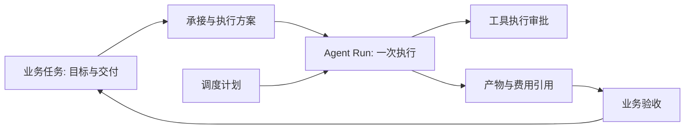

# 11 AI 能力调度平台：导航、首页与业务大厅设计

版本：1.3；日期：2026-11-09；配套主计划：v1.21。状态：P12前端已实现并补齐独立产品首页、视觉延续与导航交互约束，灰度待执行；P13业务大厅操作、P14数据集资产待实施。

本文中的代码路径相对于 `new-api/`。第3节是P12开发前基线；P12已交付的页面与本地验收见主计划第14章，后续业务路由和接口仍为设计。包分层见 [10 模块分层与渐进迁移设计](10-模块分层与渐进迁移设计.md)。

## 1. 产品定位与本轮决策

站点统一定位为 **AIVale · AI 能力调度平台**。AIToken 是平台内的模型接入产品；智能体工作台负责构建与维护；Agent 智能调度负责执行能力；业务大厅负责用户的任务、待办和交付。产品描述回答“能用什么”，业务大厅回答“正在做什么”，控制台回答“账户和服务如何管理”。

目标用户分为三类：开发者找模型/API 并构建 Agent；业务操作者发起、跟进和验收工作；团队管理员配置权限、费用及服务。首页以帮助新用户理解和选择入口为主；登录后的业务界面以完成任务为主。

设计决策：

1. 将五项核心能力统一收入“产品”：AIToken、Agent 智能调度、智能体工作台、数据集、模型库。
2. 顶部设“业务大厅”，内部按阶段开放任务中心、调度台、审批中心、揭榜大厅；“任务中学”按上下文暂按“任务中心”理解，不新增学习模块。
3. 保留独立工作台及原 URL、现有会话、Team、授权和计费，不因导航归组迁移运行协议。
4. 新增导航组和首页定位可以先交付；真实调度、数据资产和揭榜必须分别满足服务端门禁。
5. P12交付正式前端与既有入口的兼容接线；后端新增能力单独实施和验收。

## 2. 公开平台调研及适配结论

调研日期：2026-11-06。仅核对可公开访问的页面与官方说明，没有登录其他平台控制台，没有将页面菜单推断为其内部架构。

| 参考 | 观察到的组织方式 | AIVale 采用的原则 | 不直接迁入的内容 |
| --- | --- | --- | --- |
| [阿里云百炼产品页](https://www.aliyun.com/product/bailian) | 站点级“产品、解决方案、定价”等导航与右侧文档、控制台并存；具体产品有自己的介绍与控制台入口 | 全站导航收口，产品发现与操作空间分开 | 大量促销栏、完整云产品分类、地域与云资源管理 |
| [阿里云公共导航](https://help.aliyun.com/zh/management-console/public-navigation-overview) | 官方说明产品导航支持分类、搜索、最近访问和收藏；全局搜索覆盖多个内容类型 | 分类大面板与名称搜索先做，最近访问/收藏后做 | 首期不做跨所有私有资源的全局搜索，不复制云厂商所有控制台层级 |
| [百炼权限管理](https://help.aliyun.com/zh/model-studio/permission-management-overview) | 平台权限与业务空间权限分开，并以空间组织应用及资源 | 共享门户不等于共享数据，工作区与动作授权继续独立 | 不照搬 RAM、跨地域、多业务空间成员体系 |
| [火山引擎官网](https://www.volcengine.com/) | 顶部产品分类之下同时呈现模型服务、Agent 平台、工作站等不同能力 | 可将模型、Agent 构建与执行作为同平台的不同产品入口 | 不因为展示多个产品就拆成多个账号、站点或钱包 |

用户提供的带跟踪参数阿里云首页无法被检索工具读取，裸首页在工具环境跳转国际站。因此国内顶部依据来自可读取的百炼产品页与官方公共导航说明；这里没有声称逐像素复现用户当前浏览器中的首页。大面板尺寸、列数、悬停行为是下面的 AIVale 设计选择，不是对阿里云实时交互的测量结论。

### 2.1 OmniSched 的使用边界

`../OmniSched/assets.js`、`taskcenter.html`、`bounty.html`、`dispatch.html`、`approvals.html` 提供任务、承接、调度、待办聚合的概念参考。`_build_report.md` 和页面脚本表明其依赖 mock/localStorage，不具备真实登录、执行、审批或资金结算。

采用其“围绕工作组织入口”的思路，不复制页面全集、双轨资金、平台级跨租户监控或全自动状态流转。尤其不能将其本地存储状态迁成正式数据库事实，或把演示中的调度效果宣传为 AIVale 已上线能力。

## 3. 当前代码盘点与正确归位

| 能力 | 当前证据 | 当前边界 | 新导航归位 |
| --- | --- | --- | --- |
| 顶部导航 | `web/src/hooks/use-top-nav-links.ts`，公共/控制台导航组件 | 首页、控制台、模型广场、工作台、知识库、算力、数据集等平铺；概念中心无条件插入 | 单一目录驱动“产品 / 业务大厅 / 开发者 / 关于”，桌面顶栏不重复放置控制台按钮 |
| AIToken / 模型网关 | `router/relay-router.go`，Key、钱包、渠道、日志及订阅功能 | 既有模型业务基础；本轮不重新证明生产验收 | 产品 → 模型服务 → AIToken |
| 模型库 | `/pricing` 对应模型广场；`/models` 为受管理员权限约束的模型管理 | 公众目录与后台配置是两个界面 | “模型库（模型广场）”继续指向 `/pricing`，不向普通用户暴露 `/models` |
| 智能体工作台 | `features/agent-platform/`、`router/agent-router.go` | 已有团队/个人工作区、成员与 Key 授权等基础；工具页仍含开发中状态 | 产品 → Agent 平台 → 智能体工作台，保持 `/agent-platform/**` |
| Agent 智能调度 | `service/agentexecution/`，`service/agent/capabilities.go` | 单步骤内部适配；探测仍 `runtime_ready:false`；不是客户 Run 服务 | 产品介绍可展示“建设中”；无真实运行入口 |
| 数据集/知识库/算力 | `web/src/features/concept-centers/` 及 `/dataset-center`、`/knowledge-base`、`/compute-center` | 概念示例，不支持真实上传、训练、算力预订或调度 | 数据集保留为产品规划；知识库为数据能力扩展；算力进入探索区，不列首期核心产品 |
| Agent 演示 | `/agent-demo` | 独立访客演示 | 工作台产品说明中的“查看演示”，持续明确示例性质 |
| 业务大厅 | 未发现任务/揭榜/调度/审批的正式浏览器路由 | 计划已有 Run/审批/定时契约，但无大厅闭环 | 新增分阶段业务域，不将页面壳标记为完成 |
| 后台维护任务 | `controller/system_task*.go`、`service/system_task.go` | 平台维护和供应商相关任务 | 留在管理控制台，不混进客户业务任务中心 |

模型库首期指可调用模型目录，不承诺模型权重托管、训练、注册表或 GPU 部署。数据集管理也不等于知识检索：P10 的受控知识源绑定不能冒充完整数据资产生命周期。

## 4. 全站信息架构

```text
AIVale 标识（返回首页）
├─ 产品
│  ├─ 模型服务：AIToken、模型库（沿用模型广场）
│  ├─ Agent 平台：智能体工作台、Agent 智能调度
│  └─ 数据与知识：数据集、知识库〔后续〕
├─ 业务大厅
│  ├─ 任务中心：业务任务〔后续〕 / 运行记录〔P03 后〕
│  ├─ 调度台〔P07 后〕
│  ├─ 审批中心〔P06 后〕
│  └─ 揭榜大厅〔内部协作试点后〕
├─ 开发者：文档、API 接入指南、模型榜单
└─ 关于
右侧动作：搜索产品与文档入口 | 主题/语言 | 登录或账户。控制台保留首页次动作、移动导航及既有直达路径，桌面顶栏不再单独重复展示。
```

不再单列“首页”：品牌标识返回 `/`，移动端另提供明确的首页链接。“价格”首期在 AIToken 产品详情和模型库中呈现；已有订阅仍沿用真实套餐接口，不把所有产品合成一个尚未定义的价格表。“解决方案”先作为首页场景段落，待有真实案例与维护责任人再升为顶级栏目。

### 4.1 产品大面板

桌面顶栏高 64px，内容随视口全宽展开，两侧保留响应式 20–64px 页边；不以固定 1440px 容器收窄宽屏。展开面板在顶栏下方，采用宽幅分类与产品条目及底部“查看全部产品”；以名称、单行说明、状态和明确动作构成条目，不让五个产品各占一个顶栏位置。

固定或吸顶顶栏的桌面下拉面板使用与视口一致的固定定位，沿用 Base UI 的锚点跟踪和边缘避让；定位坐标不加缓动，滚动时保持贴合。展开、收起和分类切换可保留内容动效，不给滚动位置增加延迟。

### 4.1.1 视觉延续与填充约束

沿用现有品牌视觉：深色背景 `#05060e`、面板 `#0b0e1b`、紫色 `#7c5cff` 与青色 `#22d3ee`，保留 BrandOrb、星空与轨道场景、渐变标题及主动作。浅色主题采用同一紫青色系的较深文本与按钮色，满足可读性；不覆盖用户已有主题选择。

首页首屏至少铺满一个视口，内容、背景、产品入口和下方区块横向展开；手机允许内容自然增高，不裁切标题或操作。五个产品保持真实成熟度与权限，宽屏呈现完整能力面板，窄屏依次重排。产品目录、业务大厅与首页维持相同配色和页边节奏。文本仍保留合理行长，不能用拉长文案或虚构业务统计填充空间。

全站导航归组只调整信息架构，保留原配色、动效与视觉层次。后续布局优化同样以此为基线；装饰动画遵守减少动态效果设置，产品状态与实际操作权限始终独立。

五个核心产品的文案与动作：

| 产品 | 简短说明 | 首期动作与限制 |
| --- | --- | --- |
| AIToken | 统一接入模型 API，管理密钥、用量与费用 | 了解产品 → 拟新增 `/products/aitoken`；接入 API → 保留现有 Key/接入流程 |
| 模型库 | 比较可调用模型、能力与价格 | 查看模型 → `/pricing`，遵循原启用和登录要求 |
| 智能体工作台 | 在工作区内构建与管理智能体能力 | 了解产品 → `/products/workbench`；进入工作台仅在当前探测启用后指向 `/agent-platform` |
| Agent 智能调度 | 管理任务触发、运行过程与执行治理 | `/products/agent-scheduling` 展示建设进度；运行未就绪时无“立即调度” |
| 数据集 | 管理用于检索与评测的数据资产 | `/products/datasets` 说明规划；示例链接继续明确标注演示 |

大面板不是复杂的 ARIA 应用菜单：采用语义化导航、可展开按钮、分组标题和普通链接；优先检查项目已有 NavigationMenu/Popover/Sheet 能力。主导航按钮与“全部产品”链接分开，避免同一点击同时展开和跳转。

交互要求：

- 点击、Enter、Space 可展开；鼠标可增加短延迟悬停展开，但不作为唯一入口。Esc 关闭并返回触发按钮；点外部、路由变更关闭。
- 桌面非模态面板不锁住全页焦点；Tab 按自然顺序访问，焦点移到面板外后关闭。移动抽屉为模态，复用现有焦点圈定与归还行为。
- 只允许一个顶部面板打开；打开时避免遮盖账户菜单；悬停区连续，鼠标从按钮移向产品时不闪退。
- 产品名称和当前路由使用稳定 ID 匹配，不按翻译后的文字匹配；`/agent-platform/**` 在全站导航选中“产品”，工作台内部继续标记当前工作区页。
- 面板最大高度为可用视口高度，内容内部滚动；正常字号与 200% 缩放均能访问全部条目。

### 4.2 移动端与视觉方向

小于约 1024px 时改用现有抽屉，显示“产品/业务大厅/开发者”手风琴分组；实际断点由完整中文、英文及 200% 缩放结果验证。320/390/768/1024/1440 宽度均不得横向挤压导航。触控目标建议至少 44px；颜色对比、可见焦点、读屏名称、减少动画设置必须覆盖。

继承现有 AIVale 品牌、主题和组件 token，使用清晰分区、文字对齐、细边界与克制的强调色；不复制阿里云标识、品牌橙色或活动视觉。公开首页偏展示，工作台/大厅偏操作，二者共享导航规则、表单与状态组件。实施时复查真实明暗主题，不在本设计阶段虚构新的全站视觉 token。

### 4.3 四种界面外壳

| 外壳 | 顶部 | 次级导航与上下文 |
| --- | --- | --- |
| 公共门户 | 完整全站导航 | 产品说明、模型目录、首页内容；不预加载私有资源 |
| 智能体工作台 | 同一目录来源，可紧凑渲染 | 原工作区专属侧栏，URL 决定 Workspace；不挂载网关控制台侧栏 |
| 业务大厅 | 同一目录来源，可紧凑渲染 | 任务/调度/审批/揭榜导航，已授权工作区筛选；首期按一个明确工作区读写 |
| 管理控制台 | 共用产品切换和右侧账户动作 | 既有网关、账户、团队、费用、系统管理；不得再维护第二份产品列表 |

## 5. 能力目录与可用状态设计

建议新增 `web/src/features/platform-catalog/`，单一注册表给公共顶栏、控制台顶栏、移动导航、首页能力区和产品目录供数。它表达产品信息，不负责授权或执行。

拟定条目字段：`id`、`group`、`titleKey`、`descriptionKey`、`overviewHref`、可选 `operationHref`、`releaseStage`、`requiredCapability`、`legacyModuleKey`、`order`。前三类是静态元数据；有效状态由已有配置、实时探测及页面授权各自计算，禁止将某个 `available` 布尔同时当作实现状态、运行健康与权限。

| 状态维度 | 来源 | 界面行为 |
| --- | --- | --- |
| 产品成熟度 | 发布版本中的目录元数据 | 区分已交付功能、受控试用、演示、规划；不得自动提升成熟度 |
| 全局启用 | `HeaderNavModules` 及 Agent 独立探测 | 关闭的操作入口撤下；产品介绍是否可见独立配置 |
| 运行就绪 | 对应真实服务探测；当前 Agent 为 false | 只限制运行相关操作，不否定已开放的工作区元数据管理 |
| 登录与资源权限 | 原会话、服务端工作区/资源校验 | 导航可发现不等于可读写；无权不泄露名称、数量或待办 |
| 临时异常 | 请求错误、离线、维护 | 展示明确不可用与重试，不把失败转换成零任务或空列表 |

保留当前 Agent Query 的新挂载核验、30 秒前台复查、聚焦/网络恢复重查、失败和离线撤下操作入口策略；不改用持久化 `/api/status` 代替它。公开产品介绍可以保留“尚未开放”的事实说明，但不得请求私有资源。

迁移 `HeaderNavModules` 时采用兼容读取：原 `pricing.enabled/requireAuth` 继续控制模型库，原 `rankings` 控制榜单，`docs_link` 和原文档禁用配置保持有效。可新增 `products`、`business` 等可选配置；旧部署缺新字段时使用明示默认策略，而不是让隐藏的旧功能重新出现。首期注册表可为编译期配置，不为五个产品新建 CMS 或数据库表。

首期搜索仅匹配公开产品名、别名、说明以及已配置文档入口，不搜索团队资产正文。“最近访问/收藏”列为后续优化；若实现，只保存产品 ID 和非敏感页面标识，不在共享浏览器持久化私有名称或跨账号历史。

## 6. 首页：从 Token 服务转为能力平台

当前 `features/home/index.tsx` 围绕 Hero、卖点、架构、TokenFlowTheater、套餐、成果、工具和路线图组织。新版必须同步重写信息顺序和事实文案，不能只改 H1。

### 6.1 首屏文案与动作

主标题：**AI 能力调度平台**。

副标题：**从模型接入到智能体工作区，在 AIVale 统一发现、配置和使用 AI 能力。任务调度与数据服务按阶段开放。**

主动作：“探索产品” → `/products`；次动作：“进入控制台” → `/dashboard`（遵循原会话流程）。工作台实际启用时可增加轻量文字入口“进入智能体工作台”。业务大厅尚无可用后台时不显示“立即发布任务”按钮。

首屏右侧展示“模型接入 → 工作区构建 → 执行与治理”的能力关系图；已交付与规划阶段明显区分。该图是结构说明，不显示虚构实时任务数、成功率、客户数、时延、成本节省或正在运行的假任务。

### 6.2 页面顺序与复用

| 顺序 | 内容 | 处理现有组件 |
| --- | --- | --- |
| 1 | 平台定位、两项主动作、能力关系 | 改 `hero-heading`，收敛装饰性 Token 专属叙事 |
| 2 | 五个核心产品及各自成熟度 | 由统一目录供数，进入详情或真实功能 |
| 3 | 三条使用路径：接入模型 / 管理工作区 / 了解任务自动化 | 每条只有已实现动作可进入操作页，规划路线标记未来阶段 |
| 4 | 业务大厅说明：发起、执行、审批、交付 | 初期解释流程；待真实闭环验收后才显示经授权的操作入口 |
| 5 | 统一治理：身份、权限、用量和费用 | 对照已有代码与交付范围写文案，不声称未实现的全链路审计 |
| 6 | 接入指南、FAQ、真实开放进度 | 保留文档配置和路线图；按发布版本维护 |
| 产品页 | AIToken Token 流程及真实套餐 | `TokenFlowTheater`、公共套餐查询移入 AIToken 详情；原收费契约不改 |

现有成就数字、Logo 墙与功能卖点逐项校验来源；无可核验依据就删除或改成不含量化承诺的说明。移动首屏先展示标题、动作和核心产品入口，关系图降为下方简洁流程；减少动画时静态展示全部信息。

### 6.3 独立产品首页与旧内容迁移

`/` 展示整个平台，`/products/:productId` 是各产品的独立首页，不能退化成只有标题与两段说明的占位页。产品页延续紫青深空视觉、全宽响应式分区与既有公共导航；每项产品以自己的能力结构、适用场景和真实入口建立内容层次。

| 产品首页 | 展示与交互要求 | 事实与入口约束 |
| --- | --- | --- |
| `/products/aitoken` | 产品首屏、卖点切换、应用—网关—上游架构、Token 流程演示、原公共套餐、客户端接入、请求示例与 FAQ | 原 AIToken 首页相关内容归入本页；套餐继续读取真实公共接口，操作按钮遵守原目录开关；示例链路及其数值明确标注为演示 |
| `/products/model-library` | 模型发现首屏、能力与价格结构、选型至 API 调用路径 | 操作仍为原 `/pricing`，沿用启用与登录要求，不展示编造的可用模型清单 |
| `/products/workbench` | 工作区首屏、成员及授权关系、工作区访问路径 | 实时探测控制工作台入口，失败时保留产品说明和明确的演示入口，不把工作区管理描述为真实 Agent 执行 |
| `/products/agent-scheduling` | 调度首屏、触发—运行—审批—交付结构与阶段说明 | 保留规划标识，不增加尚未开放的调度或发布按钮 |
| `/products/datasets` | 数据资产首屏、文件与版本结构、检索评测路径 | 保留规划与概念预览标识，不增加真实上传、训练或处理入口 |

AIToken 迁移延续原内容主题与可复用组件，去除没有依据的 SLA、预算承诺、客户成果数字和固定“最新模型”清单。客户端展示解释配置兼容 API 地址与密钥的使用方式，具体可用协议和能力仍取决于客户端、账号与本站渠道配置。首屏不能固定塞入示例账单、运行统计或模型报价来填充空间。

产品页的介绍与操作权限继续分开：公共页面不预加载工作区成员、私有文件或运行历史。桌面保留完整结构，手机按内容顺序重排；文本、示例代码及能力图不能造成整页横向溢出。真实套餐的价格、额度、购买与余额逻辑保持原契约。

## 7. 业务大厅的领域边界



### 7.1 任务中心

目标页分“业务任务”和“运行记录”两个视图，但首个可交付版本只展示真实 Run 的运行记录，并明确来源为 Agent 运行。业务任务服务未完成时不渲染空壳标签或伪“发布任务”。

`BusinessTask` 表达目标、验收标准、负责人、截止时间与交付状态；`Run` 表达一次执行。一个业务任务可关联零到多个 Run；Run 成功只说明执行结束，不能自动将业务任务标为验收通过。原系统维护任务、视频供应商任务不直接拼入同一状态机。

业务任务建议状态：`draft → open → assigned → in_progress → submitted → accepted`；允许 `submitted → in_progress` 退回修订，未验收任务按权限取消。每次变更校验 revision、身份与合法前置状态。后续关联 Run 以显式引用及版本约束完成，取消业务任务不静默取消所有共享执行或承诺退还模型费用。

首期 Run 列表字段：名称/ID、来源、工作区、发起人、状态、时间、可见的费用状态；费用不明显示“待核对”。默认只查询一个已授权工作区，以既有 `UI-13/UI-14` 视图或共享组件呈现；大厅与工作台之间只传非敏感筛选和站内深链接。

跨工作区汇总后做：必须由服务端按授权范围先筛选、再统计和分页；禁止浏览器并发拉取所有工作区后拼页，或先返回全团队数量再隐藏无权行。

### 7.2 调度台

产品“Agent 智能调度”是能力说明；业务大厅“调度台”是操作页，共用一个执行系统。先覆盖手动发起、定时/Webhook 计划、触发历史、失败定位、重叠策略及取消；复用 P03/P07 的 Run、Schedule 和 Fire。

初期只实现显式选择已发布 Agent 版本和确定性路由策略；Workflow 作为执行目标须待 P09 对应出口验收后开放，不作为整个调度台的前置条件。自动选择 Agent、基于成本的策略、容量预测、跨资源优化需要可观察的策略契约和额外任务，不能由“智能”名称默认授权。Worker 健康及全局队列管理属于运营权限，不向普通租户显示全平台数据。

### 7.3 审批中心

先聚合 P06 已实现后的工具执行审批；显示实际动作、参数摘要、风险、到期时间、当前工作区及关联 Run，批准后按原检查点与队列恢复规则执行。已处理、已过期、状态冲突及权限撤销均必须重读服务端结果。

未来可增加数据授权和业务验收等待办类别，但统一列表只共享展示协议，各类型仍由其领域服务校验和执行。不能把“工具调用批准”变成给未来任意操作授权的通用 `approve(id)`，也不能从前端修改状态直接绕过执行屏障。

### 7.4 揭榜大厅

首期建议 **团队内协作揭榜**，保留 `Team + Workspace` 资源隔离：发布需求 → 有资格者应榜 → 发布方选定承接人 → 执行与交付 → 发布方验收。首期候选人与发布任务均限定在同一已授权工作区，团队成员但非该工作区成员仍不可查看或应榜。

揭榜是业务任务的一种承接方式，不是新的任务执行引擎。应榜截止、唯一有效承接、并发定榜、撤回、重交、验收争议记录和审计都属于必需闭环。P13 试点不涉及真实悬赏资金、托管、佣金或跨企业交易；预算提示与实际模型费用分开。公开市场后续单独设计可见范围、资质、争议与资金规则。

## 8. 新增数据与接口边界（候选，待任务冻结）

以下是开发切片的契约起点，不是已注册接口，不计入原 129 项接口/29 张表的完成统计。P13/P14 必须先补齐字段、索引、状态转移与迁移规格，才能写生产迁移。

| 领域 | 候选实体/表 | 不变量 |
| --- | --- | --- |
| 业务协作 | `biz_tasks`、`biz_task_run_links` | Task 含 Team/Workspace、creator、assignee、status、revision、验收标准；关联 Run 必须同作用域；一条 Run 可否关联多个 Task 在冻结前明确，默认只关联一个 |
| 揭榜 | `biz_task_applications`、`biz_task_deliveries` | 同任务同应榜人唯一有效申请；定榜与任务状态更新同事务；交付版本保留历史；不复制凭据或资金余额 |
| 业务审计 | 复用现有可满足事务要求的审计写入；否则独立业务事件表 | 状态变更与必要审计原子提交；不存秘密或未经授权的输入输出 |
| 数据集 | `ds_datasets`、`ds_dataset_versions`、`ds_dataset_files`、`ds_ingestion_jobs` | 元数据与对象内容分离；版本固定；处理任务独立状态；删除被引用版本受限；不复用 ag_runs 表充当上传任务 |

拟定浏览器接口：`/api/business/workspaces/:workspace_id/tasks`、任务的 `applications/assignments/deliveries/acceptance` 子资源；数据集使用 `/api/data/workspaces/:workspace_id/datasets` 及 `versions/files/ingestions`。最终命名、HTTP 方法、最小字段、权限动作、错误码和幂等范围在 P13-T04/P14-T01 冻结，避免先造大而全 API。

已注册的 `/api/agent-platform/**` 与原计划冻结的 `/v1/agents/**`、`/v1/agent-runs/**` 均保持命名，不因门户改名而重命名；后两类当前没有真实运行处理器。大厅一期通过对应阶段验收后的领域查询接口或工作区 API 读取 Run/审批/计划，不重复建设 `biz_runs`、`biz_approvals` 或另一套钱包。

新域继续使用 ID 字符串、UTC 毫秒、明确分页、revision、作用域内过滤、服务端授权与必要的幂等约定。数据集上传必须补齐大小/类型/配额、对象路径隔离、解析失败、版本引用、删除与保留策略；P10 知识检索可先接外部授权知识源，不依赖完整 P14。

## 9. 路由兼容与代码落点

| 当前路径/位置 | 目标 | 兼容要求 |
| --- | --- | --- |
| `/` | 平台首页 | 同地址更新，不改变登录默认行为 |
| `/pricing` | 模型库（模型广场） | 保留路径、查询参数、分享链接与原开关 |
| `/agent-platform/**` | 产品中的工作台 | 只移动入口；深链接、登录回跳、工作区缓存隔离不变 |
| `/dashboard` 及现有 Key/钱包/管理路径 | 首页控制台动作、移动导航及原路径 | 保留旧 URL、角色可见性与管理布局；桌面顶栏不重复设置按钮 |
| `/dataset-center`、`/knowledge-base`、`/compute-center`、`/agent-demo` | 带明确标识的概念说明/演示 | 首期不重定向成假真实资源页；退出全站核心平铺导航 |
| `/products`、`/products/:slug` | 拟新增公开产品目录/说明 | 先交付 overview，operation 链接只在真实功能可用时显示 |
| `/business` | 拟新增大厅入口 | 未有操作闭环时只作明确的介绍页；不能挂载不存在的 API |
| `/business/w/:workspace_id/tasks` | 拟新增任务中心 | 第一阶段只提供 Run 运行记录；后续接业务任务，URL 明确工作区 |
| `/business/w/:workspace_id/dispatch`、`approvals`、`bounties` | 拟新增操作页 | 各自功能开关、能力就绪、登录和资源授权，未交付默认不开放 |

前端落点建议：

```text
components/layout/                  通用外壳和无业务数据的导航呈现
features/platform-catalog/          产品注册表、公开状态解析、目录查询组合
features/home/                      平台首页，消费目录公开导出
features/products/                  产品说明与 AIToken 现有内容组合
features/business-hall/              大厅外壳与工作区上下文
features/business-tasks/             后续真实业务任务/揭榜页面
features/agent-platform/             原工作区与授权能力，按需拆分
features/agent-runs/                 Run 查询/详情和可复用业务视图
features/datasets/                  后续真实资产页面，不沿用 mock 数据层
```

有实际调用时才建立上述目录。每个 feature 按需要组织 `api.ts / queries.ts / types.ts / components / hooks / lib / index.ts`；薄路由只负责参数、guard 和页面装配。跨 feature 经公开接口，禁止跨 feature 深层导入页面内部组件。`components/ui` 继续承载通用控件，不加入 Run 或 Workspace API 请求。

## 10. 验收标准与开放次序

以下为分阶段验收标准；P12实际执行范围及发布边界见主计划14.6节。

| 范围 | 必须验证 |
| --- | --- |
| 顶部与兼容 | 公共/控制台/工作台/移动端同源；旧导航禁用与需登录配置保留；文档外链有效；原深链接、前进后退、刷新、登录回跳可用 |
| 状态真实性 | Agent 开关关/开但 runtime 未就绪/探测失败/离线/恢复；已交付工作区仍可管理，未实现运行无假按钮；概念数据明确标识 |
| 交互 | 点击、触控、Tab、Esc、焦点返回、滚动；明暗主题、中英文与长文本、200% 缩放、约定屏宽；不只验证 hover |
| 首页 | 标题与五项能力归属一致；套餐仍来自真实接口；无虚构指标；规划能力不出现成功运行暗示 |
| 大厅 | 空列表与请求失败不同；授权前不显示数量；不同 Team/Workspace 不混缓存；Run 成功不自动验收任务 |
| 协作/数据 | 并发应榜/定榜/审批、权限撤销、revision 冲突、重复提交、状态恢复及版本引用保护 |
| 工程 | 受影响类型/lint/构建、真实路由回归；若涉及数据/计费/运行则追加原门禁；模块迁移还须依赖方向检查 |

开发顺序：P12 完成信息架构与首页 → P02/P03 继续实际运行闭环 → P13 分别随 P03/P06/P07 接入运行、审批与调度 → 内部业务任务/揭榜试点 → P14 数据集资产。R 系列分层任务按具体领域穿插，不能等全仓重构后才交付导航，也不能用导航完成替代后端完成。

其中 P03 出口后的大厅运行界面仅供原 L0 内部验证；客户运行试用须满足 L1（P04–P06）和适用 P11 发布检查，后续能力继续遵守 L2/L3 门禁。P12公开说明可以先发布，不因此向客户提前开放未验收的Agent操作。

## 11. 后续冻结事项

以下均有默认方案，不阻塞本轮文档：产品名使用 AIToken；模型库保留“模型广场”别名；揭榜先团队内部且不处理真实赏金；调度先规则和显式配置；数据集先检索/评测资产，不承诺训练平台；算力继续探索区。若改变这些业务范围，应创建新的决策与任务，不静默扩展 P12 导航批次。
